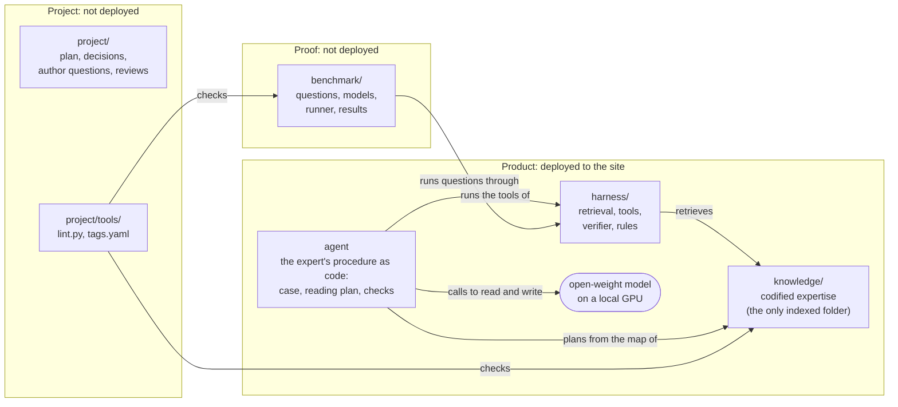

# Architecture

The whole system: how the repository is organized, and how the model, agent, harness and knowledge work together at run time. Not indexed.
The agent: [harness/AGENT.md](harness/AGENT.md). Harness parts: [harness/README.md](harness/README.md). Knowledge, folders and writing rules: [KNOWLEDGE-ENGINEERING.md](KNOWLEDGE-ENGINEERING.md). Benchmark: [benchmark/design.md](benchmark/design.md).

## Components
| Component | Design document |
|---|---|
| Model | [benchmark/models.md](benchmark/models.md): which frozen model to ship, size and hardware |
| Harness and agent | [harness/README.md](harness/README.md) (the software around the model) and [harness/AGENT.md](harness/AGENT.md) (the agent it hosts) |
| Knowledge | [KNOWLEDGE-ENGINEERING.md](KNOWLEDGE-ENGINEERING.md): what the knowledge is and how to write it |

- Why the system can win, and what it must do: [MISSION.md](MISSION.md).

## Repository

One repository, three groups. Only the product is deployed. Folder by folder: [REPOSITORY-MAP.md](REPOSITORY-MAP.md).

- Product: what runs at the customer site.
  - `knowledge/`: Level 400 mechanisms, metrics, misconceptions and flows (health checks, troubleshooting, decision trees), plus exact data in [`knowledge/catalog/`](knowledge/catalog). Up-front text and domain code in `harness/` act on it ([`KNOWLEDGE-ENGINEERING.md`](KNOWLEDGE-ENGINEERING.md), section 2). Version 1.0 covers vSphere 9.1 metrics, the VCF Operations metrics and models computed on vSphere objects, and the Guest OS layer, for performance and capacity; the end scope is the private cloud stack (vSAN, NSX, Kubernetes, and VCF Operations beyond its vSphere metrics).
  - `harness/`: the software around the model: hybrid retrieval, link expansion, exact tools (catalog lookup, calculator; the planning calculator and the flow executor are built but not yet called by the agent), answer verifier, web fetch and search, and the agent. Reads `knowledge/`; depends on no other folder.
  - Agent: the expert's procedure as code, a neuro-symbolic expert system (built 2026-11-14; [`harness/AGENT.md`](harness/AGENT.md)). It reads the question into a case, plans the reading set from the knowledge base's map ([`harness/planner.py`](harness/planner.py)), runs the exact tools, decides whether to ask, calls the model to read and write, and checks the answer.
  - Model: an open-weight vision model on local GPUs (one GPU is the stretch target; two to four are allowed), chosen by benchmark ([`benchmark/models.md`](benchmark/models.md)). Not stored here.
- Proof: shows that the product works: the release gate on the benchmark. A higher score than a frontier model is an outcome, not a goal.
  - `benchmark/`: questions with answer keys and their attachments, the candidate models ([`benchmark/models.md`](benchmark/models.md)), the runner, results. One final score, 0-100%, with sub-scores by answer type (deterministic, judged), input type (text, table, screenshot) and level (100-400). Luck removed: Unsure option, confident-wrong rate, each question scored on the mean of 5 runs, the worst run reported as consistency. Never indexed: it holds the answer keys.
- Project: how this repository is built and kept correct.
  - `project/`: plan (milestones, decisions, open work), author questions, reviews, archive.
  - [`project/tools/`](project/tools): `lint.py` (file, tag and folder checks, run before every merge) and `tags.yaml` (allowed tag values, avoided phrases).

- One repository, not two: the benchmark runs the harness and the knowledge base at the same commit, so a score always belongs to one exact version of the product. `lint.py` imports the parser from [`harness/kb.py`](harness/kb.py); the dependency points only from project to product.

## 1. Parts
| Part | What it is | Where | What it decides |
|---|---|---|---|
| Knowledge | Level 400 facts, mechanisms, misconceptions, flows (markdown) and exact data (YAML catalog); up-front misconceptions | `knowledge/` | Nothing. It is the first source; where it speaks, it wins. |
| Agent | The expert's procedure as code: six stages from question to checked answer ([`harness/AGENT.md`](harness/AGENT.md)) | [`harness/agent.py`](harness/agent.py), [`harness/planner.py`](harness/planner.py) | The case, the reading set, which exact tools run on which values, whether to ask, when the answer is accepted. |
| Harness | The execution environment and the guardrails: hybrid search engine (BM25 + vectors), SQLite catalog, calculator, planning calculator and flow executor (not yet called), web fetch and search, budgets, the answer verifier | `harness/` | Nothing on its own: it runs what the agent asks and enforces the limits. |
| Model | An open-weight vision LLM on local GPUs (one GPU is the stretch target; [`benchmark/models.md`](benchmark/models.md)) | served by vLLM, llama.cpp or Ollama | How to read the question and the images into the case, and how to read the reading set into an answer: which options are right, which mechanism applies. It does not choose what to read. |

- The agent leads, the model reads. The model does not know what the knowledge base holds, so it cannot plan the lookups; the knowledge base records its own map (file kinds, links, catalog, flows), so code can ([`harness/AGENT.md`](harness/AGENT.md), section 2).
- One pipeline for every question (author, 2026-11-14). Classic mode (one search, then one answer) and agentic mode (the model chooses its tools) are removed; their code is archived ([`harness/AGENT.md`](harness/AGENT.md), section 2). Baseline (the model alone) and web (the frontier reference) are benchmark references, not product modes.
- The model's own memory of vSphere metrics comes from public Internet text and repeats the misconceptions the knowledge base corrects.
- The model is told to use the knowledge base first; where the knowledge base speaks, it wins; where it is silent, the model may use its own knowledge and must say so.
- The knowledge base does not answer by itself. It must be found, read and applied to the question.
- The harness does not understand language. It searches, computes, enforces rules and checks answers.

## 2. Control
| Who | Decides | Model calls per question |
|---|---|---|
| Agent (code) | What to read (the reading plan), what to compute, whether to ask, whether the answer stands | - |
| Model | How the question reads (the case) and what the reading set means for it (the answer) | 2 in the common case; up to 4 with a gap follow-up and a repair; n answer samples with consensus |
| Harness | Nothing on its own: tools, budgets, verifier | - |

- The split, stage by stage, and the evidence for it: [`harness/AGENT.md`](harness/AGENT.md), sections 2 and 3.
- Level 400 questions need a chain across files (metric → same-name metric on another object → concept → flow). The tool-loop agent was built to follow that chain and did not: it searched in circles and did not open the files it found. The knowledge base already records the chain as links, so the agent follows it in code (`same_name`, `internal_derive`), and one search per claim finds the file each claim tests.
- Benchmark references: baseline (the model alone, no knowledge base) and web (the frontier reference with web search). They measure other systems, not modes of Agent E2.

## 3. The agent
- The six stages, the case, the reading plan, the rules and budgets, the knowledge the agent needs, the build order, and a walkthrough of one question: [`harness/AGENT.md`](harness/AGENT.md).
- The benchmark uses the deployment budgets (reading set, context window, model calls), so the score predicts the product: [`harness/AGENT.md`](harness/AGENT.md), section 5.

## 4. Level 400 on a local model
Each mechanism blocks one failure of a small model. None needs the Internet. Harness parts in detail: [`harness/README.md`](harness/README.md), section 1.

| Failure of a model alone | Mechanism | Part |
|---|---|---|
| Repeats a common misconception ("Ready above 5% is bad") | Misconception lines in every metric file, in the user's own words, so the misconception retrieves its correction | Knowledge |
| Mixes the VM and ESXi meaning of one label | One object per metric file; `same_name` links; a reminder before answering | Knowledge + harness |
| Calls a Guest OS metric a VM metric | Separate `guest-os/` layer; `layer` tag; lint rule | Knowledge |
| Gets a unit, rollup, statistics level or arithmetic wrong | Catalog lookup and calculator | Harness |
| Loses track in a multi-step capacity plan (six numbers, three classes, HA) | Planning calculator (`capacity.py`): code computes from the case's inputs, the model explains; built, to wire into stage 3 | Harness |
| Skips steps or jumps to a conclusion | The flow first in the reading set (tier 1), its numbered steps followed by the model; to build: the flow executor, where code compares the case's values with each step's test and takes the branch (Q166) | Knowledge + agent |
| Does not know which file it needs | Reading plan: named files, their mechanism links, one search per claim | Knowledge + agent |
| Invents a threshold | Rule: quote a threshold only with its source; thresholds catalog; verifier flags numbers not in the text | Knowledge + harness |
| Guesses when unsure | Unsure option; consensus of samples on one reading set; claims with no file marked not settled | Agent |
| Answers from memory where the knowledge base speaks | Prompt rule: knowledge base first, and it wins on conflict; override rate measured ([`benchmark/models.md`](benchmark/models.md)) | Agent (prompt) |
| Stale knowledge (older releases) | Knowledge written from the current release by rule (vSphere 9.1, VCF 9.1.1) | Knowledge |

## 5. Local deployment
| Component | Runs on | Notes |
|---|---|---|
| Chat model (one GPU as the stretch target; two to four allowed) | GPU, via vLLM, llama.cpp or Ollama | OpenAI-compatible API on the local network |
| Embedding model (qwen3-embedding-0.6b) | CPU | For hybrid search |
| Harness | CPU | Python: the agent, retrieval, catalog (SQLite in memory), calculator, verifier |
| Index | Disk | Chunks and vectors built from `knowledge/`, tied to one git commit (index version) |

- Updates arrive as a bundle: knowledge, catalog, index, and optionally new weights; downloaded, or imported offline. No customer data is sent out.
- Internet access: two harness tools, `fetch_url` (a link in the question) and `web_search` (only for current facts: bugs, builds, maximums, renamed features). Both go through the customer's proxy and send only public requests, never customer data. Fetched text is untrusted, trimmed to the relevant parts, placed after the knowledge-base files and checked against them. Rules: [`MISSION.md`](MISSION.md), section 5 (Ways to ask, Answer). Built in [`harness/web.py`](harness/web.py) (2026-11-09):
  - Every URL in the question (up to 3) is read before the model starts (`web.gather`, stage 5 of the agent). The model calls no tool; only the benchmark's frontier reference (mode `web`) gets `web_search` and `fetch_url` as tools.
  - Search runs only when the question asks for current facts (a pattern list: known bugs, builds, patches, release notes, maximums, defaults, renamed, end of support). The agent decides by that rule, not the model.
  - The search query keeps product words, versions and KB numbers and drops tokens that look like the customer's system names (letters mixed with digits, dots or underscores), so names of VMs, hosts and datastores do not leave the site.
  - Private, loopback and link-local addresses are refused; an optional allow list restricts hosts.
  - HTML is reduced to text without scripts, styles, menus and footers, then trimmed to about 2,000 tokens most relevant to the question (BM25 over 120-word chunks).
  - The page block is labelled untrusted, states the source rule by type of fact, and tells the model to ignore instructions in a page.
  - Search backend: SearXNG, run by the customer next to Agent E2, reached through `web.search_url`. Search returns only vendor documentation (`web.search_hosts`: techdocs.broadcom.com, knowledge.broadcom.com, docs.vmware.com, developer.broadcom.com); the query carries `site:` filters too. A page the user links can be any public host unless the customer sets `web.allow_hosts`.
  - Benchmark backend (2026-11-09): Vercel AI Gateway's Perplexity search (`web.search_backend: gateway`), with the same gateway key the runner uses and the same vendor-site filter; about USD 0.006 a search. A small model lists the result URLs; the harness fetches and trims the pages itself, so the benchmark tests the same page handling as a customer site. Customer sites use SearXNG (`search_backend: searxng`).
  - Enterprise approval, in order of what a security team accepts most easily:
    1. Fetch only, from vendor domains. Many VCF sites already allow outbound HTTPS to Broadcom for the online depot and patches, so allowing techdocs.broadcom.com and knowledge.broadcom.com through the same proxy is a small change. No search.
    2. SearXNG on site, vendor sites only. SearXNG queries public search engines from the server; some security teams reject it because it scrapes those engines, and server-side outbound access is usually stricter than users' browsing. The query scrubbing and the vendor-only filter are the controls to show them.
    3. No outbound access from the Agent E2 VM. Agent E2 says it cannot read the page and asks the user to paste the relevant text; answers come from the knowledge base.
  - Every option keeps the rule: no customer data leaves the site.
- The benchmark uses the Vercel AI Gateway to reach the same open-weight models; at a customer site, [`harness/llm.py`](harness/llm.py) points at the local server instead. The harness code is the same.
- One VM with a GPU (passthrough or vGPU) on the customer's own VCF. VMware Private AI Foundation with NVIDIA is the natural platform (to verify against current product documentation).
- The assistant's own GPU VM is monitored by the same rules: [`knowledge/vsphere/technology/gpu/gpu-monitoring.md`](knowledge/vsphere/technology/gpu/gpu-monitoring.md).

## 6. Harness checks
- The harness is checked on its own. In the final score, a retrieval miss and a reasoning error look the same.
- Three levels:

| Level | What it checks | Needs a model | Command |
|---|---|---|---|
| Tools | Catalog, calculator, flows, verifier give exact, expected results | No | `python3 -m unittest harness/test_tools.py` |
| Retrieval check | For every question, are the files it needs found and put in the context? | No | `python3 benchmark/runner/retrieval_eval.py` (add `--embeddings` for hybrid) |
| Whole system | Model + harness + knowledge on the question set; recall per answer shows whether the files were found or read | Yes | `python3 benchmark/runner/run.py` |

- Current retrieval result: [`project/plan.md`](project/plan.md), M3.
- Reading a wrong answer: needed file not in context → retrieval or knowledge problem; file in context but answer wrong → model or prompt problem; file missing from the knowledge base → knowledge gap.

## 7. Status
- Milestones and what is built: [`project/plan.md`](project/plan.md). Not built yet: the rest of the agent's build order ([`harness/AGENT.md`](harness/AGENT.md), section 7), query rewriting with glossary synonyms, the offline bundle. Screenshots are read in 1.0; the screen library is 1.1. Data files are 1.2; a live VCF Operations connection comes after 1.0.

## 8. Local LLM use
- Design target: a local LLM with a small context window and retrieval-augmented generation (RAG). The knowledge base is the retrieval corpus. No fine-tuning is assumed.
- `harness/` implements the steps below ([`harness/kb.py`](harness/kb.py), [`harness/retrieval.py`](harness/retrieval.py), [`harness/modes.py`](harness/modes.py), [`harness/agent.py`](harness/agent.py)). They are also the contract for any other RAG stack.

### Retrieval approach
- Retrieval, not fine-tuning, supplies the facts: the knowledge is not on the Internet; it changes often; answers must cite files; small models memorise facts poorly.
- Optional later: a light fine-tune (LoRA) for style and terminology only. Facts stay in retrieval.
- Not used: long-context stuffing (the whole knowledge base is about 315K tokens of indexed text, 2026-11-13: too much for a small model and too slow per question); a separate graph database (the metadata links already form the graph).

### No fast first-stage model
- Not used: a second, fast model in front of the reasoning model (a "System 1" classifier). Decided 2026-11-08.
- Manual use (an admin asks, with screenshots or CSV): requests are few and a person waits for each. Routing to the right file and flow is done by the reading plan (the flow tier, named files, links, search); CSV files are parsed by code.
- Automated use (a daily health check over VCF Operations): tens of millions of metrics cannot pass through any model. The fast stage is code: pull KPI and model results, score them against the threshold catalog, keep the objects in red or orange, and group them by what they share. The reasoning model then reads only those findings with their flows. Code is exact and repeatable, traceable to a threshold row, and uses no GPU memory.

### Ingest
1. Index `knowledge/**/*.md`. Do not index `benchmark/` (it holds answer keys; indexing it invalidates the evaluation), `project/`, `harness/`, or the root documents ([`README.md`](README.md), [`CLAUDE.md`](CLAUDE.md), [`MISSION.md`](MISSION.md), `ARCHITECTURE.md`, [`KNOWLEDGE-ENGINEERING.md`](KNOWLEDGE-ENGINEERING.md), [`CONTRIBUTING.md`](CONTRIBUTING.md), [`SECURITY.md`](SECURITY.md)).
2. Split each file at `## Metadata`. Parse the yaml block into filter fields. Do not embed it.
3. Chunk the body by `##` heading. Files are short, so one file is often one chunk. Mermaid charts are left out of the indexed and retrieved text: they repeat the numbered steps for GitHub, and the model follows the steps (retrieval check 2026-11-11: no change on the files as they were; with the flows rewritten to the template, search 59% → 60%, complete 60 → 61 of 95). File links [`id`](path.md) are reduced to `id`: the path is for reviewers on GitHub (retrieval check 2026-11-11: unchanged, 60%, 78%, 61/95).
4. Prefix each chunk with the file title and `id`, so a chunk is understood without its neighbours.
5. Keep image links in the chunk. The text next to each image states the same facts, so a text-only model loses nothing.
6. Index each `images` entry as its own record (path, alt text, tags), so an image can be retrieved by product, object, metric or type, and returned with what it shows.
7. Load `knowledge/catalog/*.yaml` into a database for exact lookups (unit, rollup, statistics level, thresholds, object relations). Do not chunk it as prose.
8. Up front as well as indexed: the misconception lines marked `up_front` in their files and the confusable pairs of [`knowledge/glossary.md`](knowledge/glossary.md) reach the model with every question as up-front blocks ([`harness/primer.py`](harness/primer.py)). All five paths by which knowledge reaches the model: [`KNOWLEDGE-ENGINEERING.md`](KNOWLEDGE-ENGINEERING.md), section 2.

### Query
0. Map the user's words ([`harness/terms.py`](harness/terms.py), [`knowledge/catalog/user-terms.yaml`](knowledge/catalog/user-terms.yaml)). Users write Level 300 terms ("CPU usage is high", "steal time", "the real-time chart"). Each matched row adds knowledge-base terms to the search query, pulls its files into the context, and adds one note on the misconception the words carry. Deterministic code, no model; part of the case (stage 1) and tier 2 of the reading plan.
1. Read the question into the case (stage 1 of [`harness/AGENT.md`](harness/AGENT.md)): its `retriever_guide` kind (how-it-works, metric-meaning, term-meaning, what-to-set, health-check, troubleshooting, decision-tree), objects, layer, metrics with values, claims, missing facts, what each image shows. Code also reads the question on its own: object words, metric titles and counter keys, values in ms, options and their parts ([`harness/planner.py`](harness/planner.py), [`harness/agent.py`](harness/agent.py)).
2. Filters: the objects the question names filter the metric files it names (tier 2); the case's kind picks the flow (tier 1). `product`, `technology` and `pillar` as search filters: not used.
3. Retrieve by similarity: hybrid search on the question, and one search per claim.
4. Expand: add files named in `same_name`, `internal_derive` and `related` (`same_meaning` is not followed by the reading plan).
   - Reading plan: `same_name` and `internal_derive` of the named files and the top 2 hits, one search per claim, 2 `related` of the top 2 hits; a troubleshooting question gets its flow first. Tiers and measurement: [`harness/AGENT.md`](harness/AGENT.md), section 4.2.
   - `same_name` is the main misconception guard: it brings in the other object's meaning of the same label.
5. Add the matching SP5 observability files (`sp5-framework/observability/`) and vSphere architecture files when the answer depends on units, sampling, thresholds or the provider/consumer view.
6. Fit to the context window. Priority: matching metric or flow file, then its concepts, then observability and architecture, then the rest of the links.
7. Take exact values (units, rollups, statistics levels, thresholds) from the catalog, and arithmetic from the calculator, not from the model. The agent runs them on the case's values before the model reads (stage 3, computed facts).

### Answer
- Answer from the retrieved text first. Where it is silent, the model may answer from its own knowledge and says so; where they differ, the knowledge base wins. Prefer mechanism and reason over a definition.
- Cite each file `id` used.
- Each file in the reading set shows its `status`; the answer prompt has no draft rule, and answers never mention review status (MISSION.md, D1). Release content is reviewed (284 of 285 knowledge files are draft on 2026-11-14; project/plan.md, M6).
- Use terms from [`knowledge/glossary.md`](knowledge/glossary.md): preferred names, other names, confusable terms.
- Quote a threshold only when a file states it with its source.
- One clarifying round ([`harness/clarify.py`](harness/clarify.py), `modes.converse`; rules in MISSION.md, section 5). Code decides whether the round is offered (stage 4: the case lists a missing fact or reads a premise, or a term-map row marked `premise` matches); otherwise the prompt has no clarifying rule. When offered, the conversation kind `chat` lets the model reply `CLARIFY:` with at most 3 questions, each with its reason, when the question is odd or illogical, the text and an attachment disagree, or one missing fact changes the answer. The second turn runs `chat_final`: the original question, the questions asked and the user's reply, with the rule to answer now; a second request to clarify gets one repair turn. Term-map rows marked `premise` flag their note as a possible wrong premise. The benchmark kinds (`choice`, `open`) never offer the round.

### Flow questions (`health-check`, `troubleshooting`, `decision-tree`)
- Retrieve the matching flow file first: the object's health check, the troubleshooting flow for the symptom, or the decision tree for the question. Retrieve its `internal_derive` metric files with it.
- Follow the numbered steps in `## Checks, in order`, from step 1. Do not skip to a later step.
- At each step: name the metric and object, compare with the stated threshold, then take the branch the step gives. To build: the comparison and the branch as code (executable steps, Q166); the model then explains the path.
- The Mermaid chart is not in the model's text (Ingest, step 3): the numbered steps are the flow. A reviewer checks that chart and steps agree.
- When the user has given a value, apply it to the step. When not, ask for that metric's value, or state both branches.
- Stop at the step that gives a conclusion. State the path taken: step numbers, values, thresholds and their sources.
- No flow matches: say so, then answer from metric and concept files. Do not invent a flow or a threshold.
- Troubleshooting: the check order of [`project/knowledge-rules/flows.md`](project/knowledge-rules/flows.md), unless the file states another order. (One place for the order; it was restated here without configuration.)

### Trace
Recorded for every answer (`traces.jsonl` in the benchmark; the answer log at the site).

| Field | Content |
|---|---|
| step, action | 1, 2, 3, ...; understand, plan (files by tier), compute, coverage, ask, web, answer, gap, verify, repair, consensus, context_over; the web reference: web_search, fetch_url, answer |
| input | tool arguments |
| output summary | ids returned, tokens returned |
| tokens, latency, provider | per model turn |
| index version | git SHA of `knowledge/` |

- The trace explains each failure: right file not in the reading set → plan or knowledge-link problem; file read but fact ignored → model problem; fact missing → knowledge gap. The trace names the tier that brought each file, so a miss points at the link or rule that should have brought it.

### Measurement
- A structure or retrieval change is kept only when the retrieval check improves, or holds while the content becomes more correct ([`benchmark/retrieval-check.md`](benchmark/retrieval-check.md); [`CLAUDE.md`](CLAUDE.md), Validation). The benchmark runs the same questions with and without the knowledge base (Base and Agent E2) and proves the release; it is not a tuning loop.
