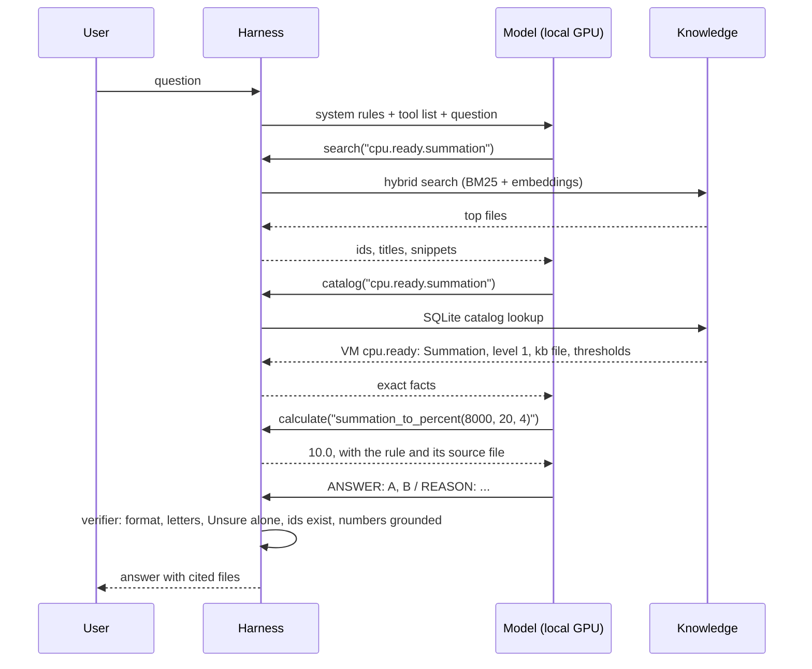

# Architecture: how the whole system answers at Level 400 without Internet

For readers who want to know how the parts work together at run time: model, harness, knowledge. Not indexed.
Why this design and why a 32B model: `project/solution-design.md`. Folder and writing rules: `README.md`. Test design: `benchmark/test-design.md`.

## 1. Three parts, one system
| Part | What it is | Where | What it decides |
|---|---|---|---|
| Knowledge | Level 400 facts, mechanisms, traps, flows (markdown) and exact data (YAML catalog) | `knowledge/` | Nothing. It is the only source of truth the answer may use. |
| Harness | The software around the model: retrieval, tools, rules, answer checks | `harness/` | What the model may see, which tools exist, which calls are allowed, whether the answer is accepted. |
| Model | A 27-32B open-weight LLM on a local GPU | served by vLLM, llama.cpp or Ollama | What to look up next (agentic mode), how to read the text, which options are right. |

- The model knows nothing about vSphere metrics that counts: its memory is the Internet's average, including the misconceptions the knowledge base corrects. It is told to answer only from what the harness returns.
- The knowledge base cannot answer by itself: it has to be found, read and applied to the question.
- The harness cannot answer either: it does not understand language. It finds, computes, enforces and checks.

## 2. Who drives: it depends on the mode
| Mode | Who decides what to read | Model calls per question | Role of the model | Role of the harness |
|---|---|---|---|---|
| Baseline | Nobody: no knowledge base | 1 | Answers from memory | Formats the question. Reference point for the test only. |
| Classic | The harness | 1 (+1 repair if needed) | Reads what it is given and answers | Driver: one search, link expansion, catalog facts, context budget, verifier. |
| Agentic | The model, within the harness's rules | up to 9 (+1 repair) | Driver of the lookups: chooses tools, queries, files, steps | Referee and toolbox: runs the tools, enforces the rules, checks the answer, falls back to classic. |

- Agentic mode is a two-way collaboration:
  - the model decides what it needs next ("search Ready", "read this file", "convert 8,000 ms");
  - the harness decides what is allowed and how it is done (search must come first, no repeated calls, 8 calls and 12K tokens of tool output at most, a reminder to check same-name metrics, exact tools for numbers, a verifier on the final answer).
- Classic mode is harness-led: the model is a reader. It cannot ask for a missing file, so retrieval sets the ceiling (section 6).
- Agentic mode is the target design: Level 400 questions often need a chain across files (metric → same-name metric on another object → concept → flow) that one search cannot predict.

## 3. One question, step by step (agentic mode)
Real trace (2026-11-04, alibaba/qwen-3-32b): "A 4-vCPU VM shows cpu.ready.summation = 8,000 ms in one real-time sample. Which statements are correct?" Options include the rollup and statistics level, 10% Ready and 40% Ready.

1. The harness sends the question with the rules: answer only from tool output; search or catalog first; check same-name metrics; use the catalog for units and levels, the calculator for arithmetic, the flow tool for troubleshooting.
2. The model searches. The harness runs hybrid search (keyword BM25 plus a local embedding model, fused by rank) and returns ids and snippets, not answers.
3. The model asks the catalog for the counter. The harness answers from SQLite built from `knowledge/catalog/`: rollup Summation, statistics level 1, the knowledge file, and the thresholds with their source.
4. The model asks for the conversion. The calculator returns 10% (8,000 ms ÷ (20 s × 1,000 ms × 4 vCPUs)) and names the rule's source file. The model never does the arithmetic itself.
5. The model answers. The verifier checks the reply; a hard issue (no ANSWER line, a letter that is not an option, Unsure mixed with other letters) gets one repair turn.
6. The answer goes out with the files it used.

## 4. How Level 400 is delivered without Internet
Each mechanism blocks one way a small model fails. None of them needs the Internet.

| Failure of a model alone | Mechanism | Part |
|---|---|---|
| Repeats a common misconception ("Ready above 5% is bad") | Trap lines in every metric file, in the user's own words, so the misconception retrieves its correction | Knowledge |
| Mixes the VM and ESXi meaning of one label | One object per metric file; `same_name` links; a reminder before answering | Knowledge + harness |
| Calls a Guest OS metric a VM metric | Separate `guest-os/` layer; `layer` tag; lint rule | Knowledge |
| Gets a unit, rollup or statistics level wrong | Catalog lookup returns the exact value from the vSphere 9.1 tables | Harness |
| Slips on arithmetic (ms to %, KB vs kb) | Calculator with source notes | Harness |
| Skips troubleshooting steps or jumps to a conclusion | Flow tool serves the diagnosis steps in order | Knowledge + harness |
| Invents a threshold | Rule: quote a threshold only with its source; thresholds catalog; verifier flags numbers not in the text | Knowledge + harness |
| Guesses when unsure | Unsure option and the rule that a wrong answer is worse than Unsure | Harness (prompt) |
| Answers outside the knowledge base from memory | "Answer only from tool output"; Not covered option | Harness (prompt) |
| Stale knowledge (older releases) | Knowledge written from the current release by rule (vSphere 9.1, VCF 9.1.1) | Knowledge |

## 5. What runs on the box (dark site)
| Component | Runs on | Notes |
|---|---|---|
| Chat model (27-32B) | GPU, via vLLM, llama.cpp or Ollama | OpenAI-compatible API on the local network |
| Embedding model (qwen3-embedding-0.6b) | CPU | For hybrid search |
| Harness | CPU | Python: retrieval, catalog (SQLite in memory), calculator, flow executor, verifier |
| Index | Disk | Chunks and vectors built from `knowledge/`, tied to one git commit (index version) |

- Updates arrive as an offline bundle: knowledge, catalog, index, and optionally new weights. Nothing calls out.
- The test site uses the Vercel AI Gateway to reach the same open-weight models; at a customer site, `harness/llm.py` points at the local server instead. The harness code is the same.

## 6. Testing the harness, not only the model
- Yes: the harness is tested on its own, because a retrieval miss and a reasoning error look the same in the final score.
- Three levels:

| Level | Test | Needs a model | Command |
|---|---|---|---|
| Tools | Catalog, calculator, flows, verifier give exact, expected results | No | `python3 -m unittest harness/test_tools.py` |
| Retrieval | For every golden case, are the files it needs found and put in the context? | No | `python3 benchmark/runner/retrieval_eval.py` (add `--embeddings` for hybrid) |
| Whole system | Model + harness + knowledge on the golden set; recall per answer shows whether the files were found or read | Yes | `python3 benchmark/runner/run.py` |

- Retrieval result, 28 golden cases (2026-11-04, hybrid): 67% of needed files reach the classic context; every needed file in only 12 of 28 cases. In classic mode the model cannot answer better than its context, so this is the ceiling to raise first.
- Reading a wrong answer: needed file not in context → retrieval or knowledge problem; file in context but answer wrong → model or prompt problem; file missing from the knowledge base → knowledge gap.

## 7. Built and not built (2026-11-04)
| Piece | Status |
|---|---|
| Hybrid search, link expansion, classic and agentic modes | Built |
| Catalog, calculator, flow executor, verifier | Built 2026-11-04 |
| Retrieval test without a model | Built 2026-11-04 |
| Question understanding before search (question type, object, layer as filters) | Not built: filters are used only when the model passes them in agentic mode |
| Query rewriting with glossary synonyms ("steal time" → Ready) | Not built |
| Screenshot reading | Release 1.1 |
| Data file parsing | Release 1.2 |
| Live VCF Operations connection | After 1.0 |
