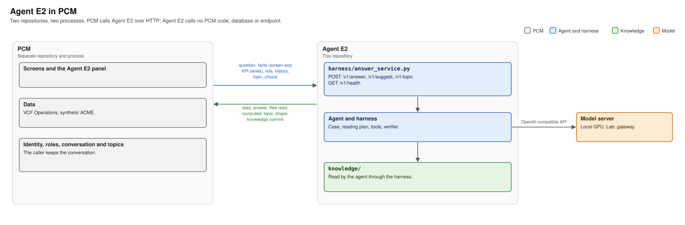
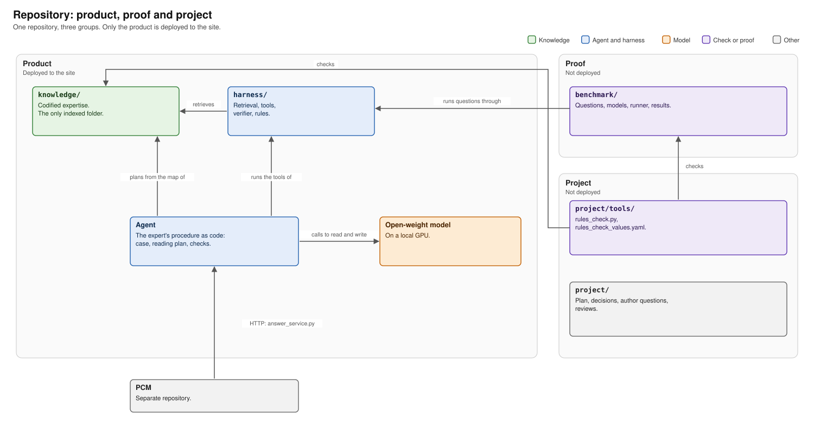
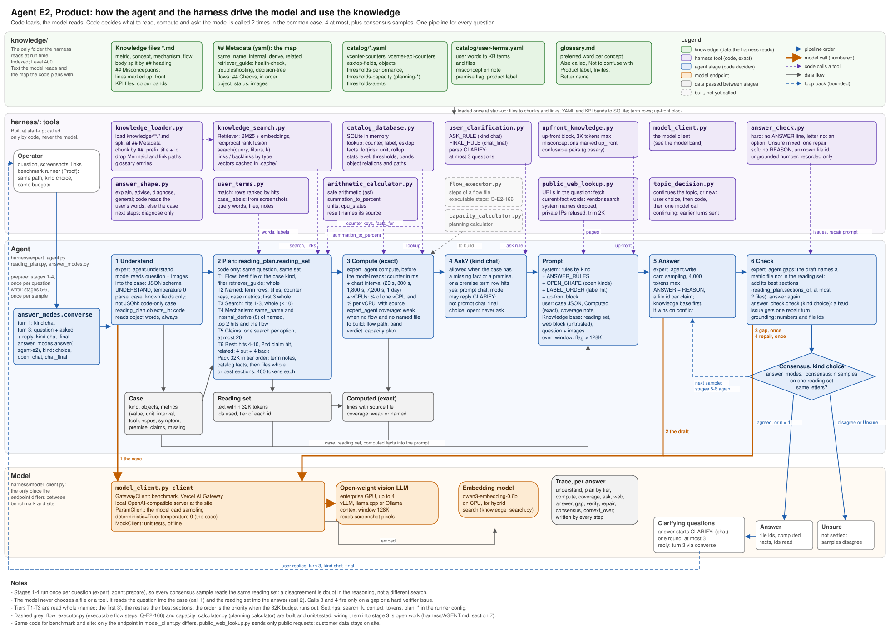

# Architecture

## Components
| Component | Design document |
|---|---|
| Model | [benchmark/models.md](benchmark/models.md): which frozen model to ship, size and hardware |
| Harness and agent | [harness/README.md](harness/README.md) (the software around the model) and [harness/AGENT.md](harness/AGENT.md) (the agent it hosts) |
| Knowledge | [KNOWLEDGE-ENGINEERING.md](KNOWLEDGE-ENGINEERING.md): what the knowledge is and how to write it |

- Why the system can win, and what it must do, is in [MISSION.md](MISSION.md).

## Agent E2 in PCM
Agent E2 is the knowledge service of [PCM](https://github.com/e1-rahabok/private-cloud-manager) (Private Cloud Manager). It stays a logically independent application: its own repository, tests, benchmark and process. Its releases are the workspace's ([ROADMAP.md](https://github.com/e1-rahabok/private-cloud-workspace/blob/main/ROADMAP.md)). PCM is its main caller and holds none of its logic ([PCM D-078](https://github.com/e1-rahabok/private-cloud-manager/blob/main/decisions.md)).

Text of the diagram, for readers that cannot see it

**Agent E2 in PCM.** Two repositories, two processes. PCM calls Agent E2 over HTTP; Agent E2 calls no PCM code, database or endpoint.
Colour key: grey = PCM; blue = Agent and harness; green = Knowledge; orange = Model.

Boxes, nested as drawn:
- n1 **PCM**: Separate repository and process
  - n2 **Screens and the Agent E2 panel** (PCM)
  - n3 **Data** (PCM): VCF Operations, synthetic ACME.
  - n4 **Identity, roles, conversation and topics** (PCM): The caller keeps the conversation.
- n5 **Agent E2**: This repository
  - n6 **harness/answer_service.py** (Agent and harness): POST /v1/answer, /v1/suggest, /v1/topic GET /v1/health
  - n7 **Agent and harness** (Agent and harness): Case, reading plan, tools, verifier.
  - n8 **knowledge/** (Knowledge): Read by the agent through the harness.
- n9 **Model server** (Model): Local GPU. Lab: gateway.

Arrows (from, to, label):
- n6 harness/answer_service.py --> n7 Agent and harness
- n7 Agent and harness --> n8 knowledge/
- n7 Agent and harness --> n9 Model server: OpenAI-compatible API
- n1 PCM --> n5 Agent E2: question, facts (screen and KPI series), role, history, topic_choice
- n5 Agent E2 --> n1 PCM: lead, answer, files read, computed, topic, shape, knowledge commit

Arrows: `-->` solid, `..>` dashed.

| Owner | Owns |
|---|---|
| PCM | Every screen, the data and its connectors (VCF Operations), actions, the user's identity and role, the conversation (topics and turns, kept per context), what the panel shows |
| Agent E2 | Domain knowledge and every domain decision: the knowledge base, catalog bands and KPI change levels, the reading plan, the flows, the calculator, the opening (`lead`, written by code), the suggested questions by situation, whether a question continues the topic, the answer shape, the model call |

- One way only. PCM calls Agent E2; Agent E2 imports no PCM code, reads no PCM database and calls no PCM endpoint. It knows PCM only as JSON on its endpoint. `harness/` depends on no folder outside the product (section Repository).
- One owner per domain rule. PCM computes no verdict, band or drop (PCM D-103, D-124): a domain rule in PCM would be a second copy that drifts from the knowledge base.
- Stateless. The service stores nothing. The caller keeps the conversation and sends the current topic's earlier turns (`history`); Agent E2 decides whether the new question continues it ([`harness/topic_decision.py`](harness/topic_decision.py)) and reports the decision, so the caller can show it and undo it (PCM D-128, D-129).
- Facts are data. The caller's live facts go below the question under a fixed heading, never as instructions. Web lookup is off in the service, so live facts never reach a search.
- The contract is the endpoint, not PCM. Any caller that sends a question, with or without facts, gets the same pipeline. What is written for a screen (the screen rules, the opening, the rewrites that remove data words and repeated figures) applies only when facts are sent. Fields that describe a PCM screen (`screen`, `drill_down`, `parts_at_worst`, `parts_hourly`) are optional inputs, documented in [`harness/answer_service.py`](harness/answer_service.py) and PCM `pcm/l2/spec/pages/frame.md`.
- Runs without PCM. The benchmark, the retrieval check and the unit tests use no PCM. The service runs alone (`python3 harness/answer_service.py`) and answers `curl`.
- Same pipeline as the proof. The service wraps `answer_modes.converse('agent-e2', ...)`, the pipeline the benchmark scores. The service-only layers (opening, screen rules, rewrites, topic decision, suggestions) are checked by unit tests and [`benchmark/runner/topic_check.py`](benchmark/runner/topic_check.py), not by the benchmark score.
- Versioned answers. Every answer names the model and the `knowledge_commit`, so a PCM screen ties an answer to one exact knowledge base.
- Deployment: a second service next to PCM (lab: the same VM, systemd unit `agent-e2`, its own checkout in `/opt/agent-e2`, loopback `127.0.0.1:8090`; PCM `deploy/install-agent-e2.sh`). When it is down, PCM works and its panel says Agent E2 is not available.
- One repository later (PCM D-078, open). If this repository moves into PCM, the boundary stays the folder and the endpoint, not the repository; the knowledge base stays authored, not generated from a specification.

## Repository

One repository holds three groups, and only the product is deployed. The folder-by-folder map is [REPOSITORY-MAP.md](REPOSITORY-MAP.md).

Text of the diagram, for readers that cannot see it

**Repository: product, proof and project.** One repository, three groups. Only the product is deployed to the site.
Colour key: green = Knowledge; blue = Agent and harness; orange = Model; purple = Check or proof; grey = Other.

Boxes, nested as drawn:
- n1 **Product**: checks | Deployed to the site | runs questions through | retrieves | plans from the map of | runs the tools of | calls to read and write | HTTP: answer_service.py
  - n2 **knowledge/** (Knowledge): Codified expertise. The only indexed folder.
  - n3 **harness/** (Agent and harness): Retrieval, tools, verifier, rules.
  - n4 **Agent** (Agent and harness): The expert's procedure as code: case, reading plan, checks.
  - n5 **Open-weight model** (Model): On a local GPU.
- n6 **Proof**: Not deployed
  - n7 **benchmark/** (Check or proof): Questions, models, runner, results.
- n8 **Project**: Not deployed
  - n9 **project/tools/** (Check or proof): rules_check.py, rules_check_values.yaml.
  - n10 **project/** (Other): Plan, decisions, author questions, reviews.
- n11 **PCM** (Other): Separate repository.

Arrows (from, to, label):
- n3 harness/ --> n2 knowledge/
- n4 Agent --> n2 knowledge/
- n4 Agent --> n3 harness/
- n4 Agent --> n5 Open-weight model
- n7 benchmark/ --> n3 harness/
- n9 project/tools/ --> n7 benchmark/: checks
- n9 project/tools/ --> n2 knowledge/
- n11 PCM --> n4 Agent

Arrows: `-->` solid, `..>` dashed.

- Product: what runs at the customer site.
  - `knowledge/`: Level 400 mechanisms, metrics, misconceptions and flows (health checks, troubleshooting, decision trees), plus exact data in [`knowledge/catalog/`](knowledge/catalog). Up-front text and domain code in `harness/` act on it ([`KNOWLEDGE-ENGINEERING.md`](KNOWLEDGE-ENGINEERING.md), section 2). Version 1.0 covers vSphere 9.1 metrics, the VCF Operations metrics and models computed on vSphere objects, and the Guest OS layer, for performance and capacity. The end scope is the private cloud stack (vSAN, NSX, Kubernetes, and VCF Operations beyond its vSphere metrics).
  - `harness/`: the software around the model. It holds hybrid retrieval, link expansion, the exact tools (catalog lookup and calculator; the planning calculator and the flow executor are built but not yet called by the agent), the answer verifier, web fetch and search, and the agent itself. It also holds the service for callers ([`harness/answer_service.py`](harness/answer_service.py), section Agent E2 in PCM) and its parts: the topic decision, the answer shape and the suggested questions. It reads `knowledge/` and depends on no other folder.
  - Agent: the expert's procedure as code, a neuro-symbolic expert system ([`harness/AGENT.md`](harness/AGENT.md)). It reads the question into a case, plans the reading set from the knowledge base's map ([`harness/reading_plan.py`](harness/reading_plan.py)), runs the exact tools, decides whether to ask, calls the model to read and write, and checks the answer.
  - Model: an open-weight vision model on local GPUs, chosen by the benchmark ([`benchmark/models.md`](benchmark/models.md)). It is not stored here.
- Proof: shows that the product works by passing the benchmark. A higher score than a frontier model is an outcome, not a goal.
  - `benchmark/`: questions with answer keys and their attachments, the candidate models ([`benchmark/models.md`](benchmark/models.md)), the runner, and the results. It produces one final score, 0-100%, with sub-scores by answer type (deterministic, judged), input type (text, table, screenshot) and level (100-400). Luck is taken out with an Unsure option, the confident-wrong rate, each question scored on the mean of 5 runs, and the worst run reported as consistency. It is never indexed, because it holds the answer keys.
- Project: how this repository is built and kept correct.
  - `project/`: the plan (milestones, decisions, open work), author questions, reviews, and the archive.
  - [`project/tools/`](project/tools): `rules_check.py` (file, tag and folder checks, run before every merge) and `rules_check_values.yaml` (allowed tag values, avoided phrases).

- It is one repository, not two, because the benchmark runs the harness and the knowledge base at the same commit; a score therefore always belongs to one exact version of the product. `rules_check.py` imports the parser from [`harness/knowledge_loader.py`](harness/knowledge_loader.py), so the dependency points only from project to product.

## Product
This is one level down from the Product group: how the agent and the harness drive the model and use the knowledge, module by module, for one question. There are four layers: `knowledge/` (what is read), the `harness/` tools (built at start-up and called only by agent code), the agent's six stages (where the decisions are made, in code), and the model endpoint (`model_client.py`).

Text of the diagram, for readers that cannot see it

**Agent E2, Product: how the agent and the harness drive the model and use the knowledge.** Code leads, the model reads. Code decides what to read, compute and ask; the model is called 2 times in the common case, 4 at most, plus consensus samples. One pipeline for every question.

Boxes, nested as drawn:
- n1 **knowledge/**: Legend | The only folder the harness | pipeline order | knowledge (data the harness reads) | reads at run time. | harness tool (code, exact) | model call (numbered) | Indexed; Level 400. | agent stage (code decides) | code calls a tool | Text the model reads and | the map the code plans with. | data flow | model endpoint | data passed between stages | loop back (bounded) | built, not yet called
  - n2 **Knowledge files *.md**: metric, concept, mechanism, flow body split by ## heading ## Misconceptions: lines marked up_front KPI files: colour bands
  - n3 **## Metadata (yaml): the map**: same_name, internal_derive, related retriever_guide: health-check, troubleshooting, decision-tree flows: ## Checks, in order object, status, images
  - n4 **catalog/*.yaml**: vcenter-counters, vcenter-api-counters esxtop-fields, objects thresholds-performance, thresholds-capacity (planning-*), thresholds-alerts
  - n5 **catalog/user-terms.yaml**: user words to KB terms and files misconception note premise flag, product label
  - n6 **glossary.md**: preferred word per concept Also called, Not to confuse with Product label, Invites, Better name
- n13 **harness/: tools**: Built at start-up; called | only by code, never the model. | counter keys, facts_for | words, labels | pages | issues, repair prompt
  - n14 **knowledge_loader.py**: load knowledge/**/*.md split at ## Metadata chunk by ##, prefix title + id drop Mermaid and link paths glossary entries
  - n15 **knowledge_search.py**: Retriever: BM25 + embeddings, reciprocal rank fusion search(query, filters, k) links / backlinks by type vectors cached in .cache/
  - n16 **catalog_database.py**: SQLite in memory lookup: counter, label, esxtop facts_for(ids): unit, rollup, stats level, thresholds, bands object relations and paths
  - n17 **user_clarification.py**: ASK_RULE (kind chat) FINAL_RULE (chat_final) parse CLARIFY: at most 3 questions
  - n18 **upfront_knowledge.py**: up-front block, 3K tokens max misconceptions marked up_front confusable pairs (glossary)
  - n19 **model_client.py**: the model client (see the model band)
  - n20 **answer_check.py**: hard: no ANSWER line, letter not an option, Unsure mixed: one repair soft: no REASON, unknown file id, ungrounded number: recorded only
  - n21 **Operator**: question, screenshots, links benchmark runner (Proof): same path, kind choice, same budgets
  - n22 **answer_shape.py**: explain, advise, diagnose, general; code reads the user's words, else the case next steps: diagnose only
  - n23 **user_terms.py**: match: rows ranked by hits case_labels: from screenshots query words, files, notes
  - n24 **arithmetic_calculator.py**: safe arithmetic (ast) summation_to_percent, units, cpu_states result names its source
  - n25 **flow_executor.py**: steps of a flow file executable steps: Q-E2-166
  - n26 **public_web_lookup.py**: URLs in the question: fetch current-fact words: vendor search system names dropped, private IPs refused, trim 2K
  - n27 **topic_decision.py**: continues the topic, or new: user choice, then code, then one model call continuing: earlier turns sent
  - n28 **capacity_calculator.py**: planning calculator
- n29 **Agent**: search, links | lookup | to build | ask rule | up-front | harness/expert_agent.py, | reading_plan.py, answer_modes.py | prepare: stages 1-4, | once per question | write: stages 5-6, | once per sample | 3 gap, once | 4 repair, once | Consensus, kind choice | answer_modes._consensus: n samples | on one reading set | next sample: | same letters? | stages 5-6 again | agreed, or n = 1 | disagree or Unsure | 2 the draft | case, reading set, computed facts into the prompt
  - n30 **1 Understand**: expert_agent.understand model reads question + images into the case: JSON schema UNDERSTAND, temperature 0 parse_case: known fields only; not JSON: code-only case reading_plan.objects_in: code reads object words, always
  - n31 **2 Plan: reading_plan.reading_set**: code only; same question, same set T1 Flow: best file of the case kind, filter retriever_guide; whole T2 Named: term rows, titles, counter keys, case metrics; first 3 whole T3 Search: hits 1-3, whole (k 10) T4 Mechanism: same_name and internal_derive (8) of named, top 2 hits and the flow T5 Claims: one search per option, at most 20 T6 Rest: hits 4-10, 2nd claim hit, related: 4 out + 4 back Pack 32K in tier order: term notes, catalog facts, then files whole or best sections, 400 tokens each
  - n32 **3 Compute (exact)**: expert_agent.compute, before the model reads: counter in ms + chart interval (20 s, 300 s, 1,800 s, 7,200 s, 1 day) + vCPUs: % of one vCPU and % per vCPU, with source expert_agent.coverage: weak when no flow and no named file to build: flow path, band verdict, capacity plan
  - n33 **4 Ask? (kind chat)**: allowed when the case has a missing fact or a premise, or a premise term row hits yes: prompt chat, model may reply CLARIFY: no: prompt chat_final choice, open: never ask
  - n34 **Prompt**: system: rules by kind + ANSWER_RULES + OPEN_SHAPE (open kinds) + LABEL_ORDER (label hit) + up-front block user: case JSON, Computed (exact), coverage note, Knowledge base: reading set, web block (untrusted), question + images over_window: flag > 128K
  - n35 **5 Answer**: expert_agent.write card sampling, 4,000 tokens max ANSWER + REASON, a file id per claim; knowledge base first, it wins on conflict
  - n36 **6 Check**: expert_agent.gaps: the draft names a metric file not in the reading set: add its best sections (reading_plan.sections_of, at most 2 files), answer again answer_check.check (kind choice): a hard issue gets one repair turn grounding: numbers and file ids
  - n37 **answer_modes.converse**: turn 1: kind chat turn 3: question + asked + reply, kind chat_final answer_modes.answer( agent-e2), kind: choice, open, chat, chat_final
  - n38 **Case**: kind, objects, metrics (value, unit, interval, tool), vcpus, symptom, premise, claims, missing
  - n39 **Reading set**: text within 32K tokens ids used, tier of each id
  - n40 **Computed (exact)**: lines with source file coverage: weak or named
- n41 **Model**: harness/model_client.py: | the only place the | endpoint differs between | benchmark and site | embed
  - n42 **Trace, per answer**: understand, plan by tier, compute, coverage, ask, web, answer, gap, verify, repair, consensus, context_over; written by every step
  - n43 **model_client.py client**: GatewayClient: benchmark, Vercel AI Gateway local OpenAI-compatible server at the site ParamClient: the model card sampling deterministic=True: temperature 0 (the case) MockClient: unit tests, offline
  - n44 **Open-weight vision LLM**: enterprise GPU, up to 4 vLLM, llama.cpp or Ollama context window 128K reads screenshot pixels
  - n45 **Embedding model**: qwen3-embedding-0.6b on CPU, for hybrid search (knowledge_search.py)
  - n46 **Clarifying questions**: answer starts CLARIFY: (chat) one round, at most 3 reply: turn 3 via converse
  - n47 **Answer**: file ids, computed facts, ids read
  - n48 **Unsure**: not settled: samples disagree

Arrows (from, to, label):
- n1 knowledge/ --> n13 harness/: tools
- n21 Operator --> n37 answer_modes.converse
- n37 answer_modes.converse --> n30 1 Understand
- n30 1 Understand --> n31 2 Plan: reading_plan.reading_set
- n31 2 Plan: reading_plan.reading_set --> n32 3 Compute (exact)
- n32 3 Compute (exact) --> n33 4 Ask? (kind chat)
- n33 4 Ask? (kind chat) --> n34 Prompt
- n34 Prompt --> n35 5 Answer
- n35 5 Answer --> n36 6 Check
- n36 6 Check --> n29 Agent
- n29 Agent ..> n35 5 Answer
- n29 Agent --> n47 Answer
- n29 Agent --> n48 Unsure
- n47 Answer --> n46 Clarifying questions
- n46 Clarifying questions ..> n21 Operator: user replies: turn 3, kind chat_final
- n30 1 Understand --> n38 Case
- n38 Case --> n31 2 Plan: reading_plan.reading_set
- n31 2 Plan: reading_plan.reading_set --> n39 Reading set
- n39 Reading set --> n40 Computed (exact)
- n29 Agent --> n34 Prompt
- n32 3 Compute (exact) --> n40 Computed (exact)
- n14 knowledge_loader.py ..> n15 knowledge_search.py
- n15 knowledge_search.py ..> n31 2 Plan: reading_plan.reading_set
- n23 user_terms.py ..> n31 2 Plan: reading_plan.reading_set
- n16 catalog_database.py ..> n31 2 Plan: reading_plan.reading_set: summation_to_percent
- n13 harness/: tools ..> n32 3 Compute (exact)
- n24 arithmetic_calculator.py ..> n32 3 Compute (exact)
- n28 capacity_calculator.py ..> n32 3 Compute (exact)
- n17 user_clarification.py ..> n33 4 Ask? (kind chat)
- n18 upfront_knowledge.py ..> n34 Prompt
- n26 public_web_lookup.py ..> n34 Prompt
- n20 answer_check.py ..> n36 6 Check
- n30 1 Understand --> n43 model_client.py client: 1 the case
- n35 5 Answer --> n43 model_client.py client
- n43 model_client.py client --> n44 Open-weight vision LLM
- n43 model_client.py client --> n41 Model

Notes on the diagram:
- loaded once at start-up: files to chunks and links; YAML and KPI bands to SQLite; term rows; up-front block
- Notes
- Stages 1-4 run once per question (expert_agent.prepare), so every consensus sample reads the same reading set: a disagreement is doubt in the reasoning, not a different search.
- The model never chooses a file or a tool. It reads the question into the case (call 1) and the reading set into the answer (call 2). Calls 3 and 4 fire only on a gap or a hard verifier issue.
- Tiers T1-T3 are read whole (named: the first 3), the rest as their best sections; the order is the priority when the 32K budget runs out. Settings: search_k, context_tokens, plan_* in the runner config.
- Dashed grey: flow_executor.py (executable flow steps, Q-E2-166) and capacity_calculator.py (planning calculator) are built and unit-tested; wiring them into stage 3 is open work (harness/AGENT.md, section 7).
- Same code for benchmark and site: only the endpoint in model_client.py differs. public_web_lookup.py sends only public requests; customer data stays on site.

Arrows: `-->` solid, `..>` dashed.

- Read it left to right through the agent band: 1 Understand, 2 Plan, 3 Compute, 4 Ask, Prompt, 5 Answer, 6 Check, Consensus. The stage view, with its evidence, is in [`harness/AGENT.md`](harness/AGENT.md), section 3.
- Orange lines are the model calls: 1 is the case (temperature 0) and 2 the draft. Calls 3 (the gap follow-up) and 4 (the repair) fire only when the agent finds a gap or a hard verifier issue. Consensus repeats 5 and 6 on the same reading set.
- Purple dashed lines show agent code calling a tool. The model calls no tool and never chooses a file.
- Grey dashed lines are built but not yet called: the `flow_executor.py` executable steps (Q-E2-166) and the `capacity_calculator.py` planning calculator.
- Source: [`project/tools/product_diagram.py`](project/tools/product_diagram.py) draws the SVG. Change it along with any change to `harness/` that the diagram shows, and run it from the repository root. The diagram is laid out by hand, not with Mermaid, because Mermaid's automatic layout pulled the stages out of order at this size. The Agent E2 in PCM and Repository diagrams are drawn by [`project/tools/document_diagrams.py`](project/tools/document_diagrams.py) in the same way.

## 1. Parts
| Part | What it is | Where | What it decides |
|---|---|---|---|
| Knowledge | Level 400 facts, mechanisms, misconceptions, flows (markdown) and exact data (YAML catalog); up-front misconceptions | `knowledge/` | Nothing. It is the first source, and where it speaks, it wins. |
| Agent | The expert's procedure as code: six stages from question to checked answer ([`harness/AGENT.md`](harness/AGENT.md)) | [`harness/expert_agent.py`](harness/expert_agent.py), [`harness/reading_plan.py`](harness/reading_plan.py) | The case, the reading set, which exact tools run on which values, whether to ask, and when the answer is accepted. |
| Harness | The execution environment and the guardrails: hybrid search engine (BM25 + vectors), SQLite catalog, calculator, planning calculator and flow executor (not yet called), web fetch and search, budgets, and the answer verifier | `harness/` | Nothing on its own. It runs what the agent asks for and enforces the limits. |
| Service | The boundary to callers (PCM): three endpoints, no state ([`harness/answer_service.py`](harness/answer_service.py)) | [`harness/answer_service.py`](harness/answer_service.py), `topic_decision.py`, `answer_shape.py`, `user_suggestions.py` | Whether a question continues the topic, the answer shape, the opening (code, from the calculator), the suggested questions by situation; the wording a screen needs. Never what is read. |
| Model | An open-weight vision LLM on local GPUs ([`benchmark/models.md`](benchmark/models.md)). Vision is a hard requirement: the model reads the pixels of every uploaded screenshot ([MISSION.md](MISSION.md), Non-functional) | served by vLLM, llama.cpp or Ollama | How to read the question and the images into the case, and how to turn the reading set into an answer: which options are right, which mechanism applies. It does not choose what to read. |

- The agent leads and the model reads. The model does not know what the knowledge base holds, so it cannot plan the lookups. The knowledge base records its own map (file kinds, links, catalog, flows), so the agent can ([`harness/AGENT.md`](harness/AGENT.md), section 2).
- Every question goes through one pipeline. Baseline (the model alone) and web (the frontier reference) are benchmark references, not product modes.
- The model's own memory of vSphere metrics comes from public Internet text, and it repeats the misconceptions the knowledge base corrects.
- The model is told to use the knowledge base first. Where the knowledge base speaks, it wins; where it is silent, the model may use its own knowledge and must say so.
- The knowledge base does not answer by itself. It has to be found, read and applied to the question.
- The harness does not understand language. It searches, computes, enforces rules and checks answers.

## 2. Control
| Who | Decides | Model calls per question |
|---|---|---|
| Agent (code) | What to read (the reading plan), what to compute, whether to ask, whether the answer stands | - |
| Model | How the question reads (the case) and what the reading set means for it (the answer) | 2 in the common case; up to 4 with a gap follow-up and a repair; n answer samples with consensus |
| Service (code) | Topic, answer shape, opening, suggested questions | 1 for what the question asks (answer shape, page values); 1 more for the topic when code cannot decide; up to 2 rewrites of a screen answer (data words, repeated figures) |
| Harness | Nothing on its own: tools, budgets, verifier | - |

- The split stage by stage, and the evidence for it, are in [`harness/AGENT.md`](harness/AGENT.md), sections 2 and 3.
- Level 400 questions need a chain across files (metric → same-name metric on another object → concept → flow). The tool-loop agent was built to follow that chain and did not: it searched in circles and did not open the files it found. The knowledge base already records the chain as links, so the agent follows it in code (`same_name`, `internal_derive`), and one search per claim finds the file that each claim tests.
- Benchmark references: baseline (the model alone, no knowledge base) and web (the frontier reference with web search). They measure other systems; they are not modes of Agent E2.

## 3. The agent
- [`harness/AGENT.md`](harness/AGENT.md) covers the six stages, the case, the reading plan, the rules and budgets, the knowledge the agent needs, the build order, and a walkthrough of one question.
- The benchmark uses the deployment budgets (reading set, context window, model calls), so the score predicts the product: [`harness/AGENT.md`](harness/AGENT.md), section 5.

## 4. Level 400 on a local model
Each mechanism blocks one failure of a small model, and none of them needs the Internet. The harness parts are described in detail in [`harness/README.md`](harness/README.md), section 1.

| Failure of a model alone | Mechanism | Part |
|---|---|---|
| Repeats a common misconception ("Ready above 5% is bad") | Misconception lines in every metric file, in the user's own words, so the misconception retrieves its correction | Knowledge |
| Mixes the VM and ESXi meanings of one label | One object per metric file; `same_name` links; a reminder before answering | Knowledge + harness |
| Calls a Guest OS metric a VM metric | A separate `guest-os/` layer; the `layer` tag; a lint rule | Knowledge |
| Gets a unit, rollup, statistics level or arithmetic wrong | Catalog lookup and calculator | Harness |
| Loses track in a multi-step capacity plan (six numbers, three classes, HA) | Planning calculator (`capacity_calculator.py`): the agent computes from the case's inputs and the model explains. Built; still to wire into stage 3 | Harness |
| Skips steps or jumps to a conclusion | The flow comes first in the reading set (tier 1) and the model follows its numbered steps. Still to build: the flow executor, where the agent compares the case's values with each step's test and takes the branch (Q-E2-166) | Knowledge + agent |
| Does not know which file it needs | Reading plan: named files, their mechanism links, one search per claim | Knowledge + agent |
| Invents a threshold | Rule: quote a threshold only with its source; the thresholds catalog; the verifier flags numbers not in the text | Knowledge + harness |
| Guesses when unsure | Unsure option; consensus of samples on one reading set; claims with no file marked as not settled | Agent |
| Answers from memory where the knowledge base speaks | Prompt rule: knowledge base first, and it wins on conflict; override rate measured ([`benchmark/models.md`](benchmark/models.md)) | Agent (prompt) |
| Stale knowledge (older releases) | Knowledge written from the current release by rule (vSphere 9.1, VCF 9.1.1) | Knowledge |

## 5. Local deployment
| Component | Runs on | Notes |
|---|---|---|
| Chat model (enterprise GPU; one GPU is an ideal, not a constraint; up to four large GPUs) | GPU, via vLLM, llama.cpp or Ollama | OpenAI-compatible API on the local network |
| Embedding model (qwen3-embedding-0.6b) | CPU | For hybrid search |
| Harness and service | CPU | Python: the agent, retrieval, catalog (SQLite in memory), calculator, verifier; `answer_service.py` on the loopback for PCM |
| Index | Disk | Chunks and vectors built from `knowledge/`, tied to one git commit (the index version) |

- Updates arrive as a bundle (knowledge, catalog, index, and optionally new weights), either downloaded or imported offline. No customer data is sent out. Lab exception: the author's lab VCF may send its live data to the gateway model; customer sites keep this rule and the local model.
- Internet access comes through two harness tools: `fetch_url` for a link in the question, and `web_search` only for current facts (bugs, builds, maximums, renamed features). Both go through the customer's proxy and send only public requests, never customer data. Fetched text is untrusted: it is trimmed to the relevant parts, placed after the knowledge-base files, and checked against them. The rules are in [`MISSION.md`](MISSION.md), section 5 (Ways to ask, Answer). Built in [`harness/public_web_lookup.py`](harness/public_web_lookup.py):
  - Every URL in the question (up to 3) is read before the model starts (`public_web_lookup.gather`, stage 5 of the agent). The model calls no tool; only the benchmark's frontier reference (mode `web`) gets `web_search` and `fetch_url` as tools.
  - Search runs only when the question asks for current facts, matched against a pattern list: known bugs, builds, patches, release notes, maximums, defaults, renamed, end of support. The agent decides by that rule, not the model.
  - The search query keeps product words, versions and KB numbers, and drops tokens that look like the customer's system names (letters mixed with digits, dots or underscores), so the names of VMs, hosts and datastores do not leave the site.
  - Private, loopback and link-local addresses are refused, and an optional allow list restricts hosts.
  - HTML is reduced to text without scripts, styles, menus and footers, then trimmed to the roughly 2,000 tokens most relevant to the question (BM25 over 120-word chunks).
  - The page block is labelled untrusted, states the source rule by type of fact, and tells the model to ignore any instructions in a page.
  - Search backend: SearXNG, run by the customer next to Agent E2 and reached through `web.search_url`. Search returns only vendor documentation (`web.search_hosts`: techdocs.broadcom.com, knowledge.broadcom.com, docs.vmware.com, developer.broadcom.com), and the query carries `site:` filters as well. A page the user links can be on any public host unless the customer sets `web.allow_hosts`.
  - Benchmark backend: Vercel AI Gateway's Perplexity search (`web.search_backend: gateway`), with the same gateway key the runner uses and the same vendor-site filter, at about USD 0.006 a search. A small model lists the result URLs, and the harness fetches and trims the pages itself, so the benchmark tests the same page handling as a customer site. Customer sites use SearXNG (`search_backend: searxng`).
  - Enterprise approval, in order of what a security team accepts most easily:
    1. Fetch only, from vendor domains. Many VCF sites already allow outbound HTTPS to Broadcom for the online depot and patches, so allowing techdocs.broadcom.com and knowledge.broadcom.com through the same proxy is a small change. No search.
    2. SearXNG on site, vendor sites only. SearXNG queries public search engines from the server. Some security teams reject it because it scrapes those engines, and server-side outbound access is usually stricter than users' browsing. The query scrubbing and the vendor-only filter are the controls to show them.
    3. No outbound access from the Agent E2 VM. Agent E2 says it cannot read the page and asks the user to paste the relevant text; answers come from the knowledge base.
  - Every option keeps the rule that no customer data leaves the site.
- The benchmark reaches the same open-weight models through the Vercel AI Gateway; at a customer site, [`harness/model_client.py`](harness/model_client.py) points at the local server instead. The harness code is the same.
- The deployment is the Agent E2 service next to PCM (section Agent E2 in PCM) and the model server on a GPU VM (passthrough or vGPU) on the customer's own VCF; both can share one VM. VMware Private AI Foundation with NVIDIA is the natural platform (to verify against current product documentation).
- The assistant's own GPU VM is monitored by the same rules: [`knowledge/vsphere/technology/gpu/gpu-monitoring.md`](knowledge/vsphere/technology/gpu/gpu-monitoring.md).

## 6. Harness checks
- The harness is checked on its own, because in the final score a retrieval miss and a reasoning error look the same.
- There are three levels:

| Level | What it checks | Needs a model | Command |
|---|---|---|---|
| Tools | Catalog, calculator, flows, verifier give exact, expected results | No | `python3 -m unittest harness/test_harness.py` |
| Retrieval check | For every question, are the files it needs found and put in the context? | No | `python3 benchmark/runner/retrieval_check.py` (add `--embeddings` for hybrid) |
| Whole system | Model + harness + knowledge on the question set; recall per answer shows whether the files were found or read | Yes | `python3 benchmark/runner/run_executor.py` |

- The current retrieval result is in [`project/plan.md`](project/plan.md), section Retrieval.
- Reading a wrong answer: if the needed file is not in context, it is a retrieval or knowledge problem; if the file is in context but the answer is wrong, it is a model or prompt problem; if the file is missing from the knowledge base, it is a knowledge gap.

## 7. Status
- Milestones and what is built are in [`project/plan.md`](project/plan.md). Not built yet: the rest of the agent's build order ([`harness/AGENT.md`](harness/AGENT.md), section 7), query rewriting with glossary synonyms, and the offline bundle. Screenshots are read in 1.0, and the screen library comes in 1.1. Data files come in 1.2. Live VCF Operations data reaches Agent E2 only through its caller: PCM owns the connector, and Agent E2 has none of its own (section Agent E2 in PCM). Release 1.0 needs PCM to call Agent E2 through the service ([`project/plan.md`](project/plan.md), section On-premises deployment).

## 8. Local LLM use
- The design target is a local LLM with a small context window and retrieval-augmented generation (RAG). The knowledge base is the retrieval corpus. No fine-tuning is assumed.
- `harness/` implements the steps below ([`harness/knowledge_loader.py`](harness/knowledge_loader.py), [`harness/knowledge_search.py`](harness/knowledge_search.py), [`harness/answer_modes.py`](harness/answer_modes.py), [`harness/expert_agent.py`](harness/expert_agent.py)). They are also the contract for any other RAG stack.

### Retrieval approach
- Retrieval, not fine-tuning, supplies the facts, for four reasons: the knowledge is not on the Internet, it changes often, answers must cite files, and small models memorise facts poorly.
- Optional later: a light fine-tune (LoRA) for style and terminology only. Facts stay in retrieval.
- Not used: long-context stuffing (the whole knowledge base is about 315K tokens of indexed text, too much for a small model and too slow per question), and a separate graph database (the metadata links already form the graph).

### No fast first-stage model
- Not used: a second, fast model in front of the reasoning model (a "System 1" classifier). Decided.
- Manual use (an admin asks, with screenshots or CSV): requests are few, and a person waits for each one. The reading plan routes the question to the right file and flow (the flow tier, named files, links, search), and CSV files are parsed by code.
- Automated use (a daily health check over VCF Operations): tens of millions of metrics cannot pass through any model, so the fast stage is code. PCM pulls KPI and model results; Agent E2's code scores them against the threshold catalog, keeps the objects in red or orange, and groups them by what they share. The reasoning model then reads only those findings, with their flows. Code is exact and repeatable, traceable to a threshold row, and uses no GPU memory.

### Ingest
1. Index `knowledge/**/*.md`. Do not index `benchmark/` (it holds answer keys, and indexing it invalidates the evaluation), `project/`, `harness/`, or the root documents ([`README.md`](README.md), [`CLAUDE.md`](CLAUDE.md), [`MISSION.md`](MISSION.md), `ARCHITECTURE.md`, [`KNOWLEDGE-ENGINEERING.md`](KNOWLEDGE-ENGINEERING.md), [`CONTRIBUTING.md`](CONTRIBUTING.md), [`SECURITY.md`](SECURITY.md)).
2. Split each file at `## Metadata`. Parse the yaml block into filter fields; do not embed it.
3. Chunk the body by `##` heading. Files are short, so one file is often one chunk. Mermaid charts are left out of the indexed and retrieved text: they repeat the numbered steps for GitHub, and the model follows the steps (retrieval check: no change on the files as they were; with the flows rewritten to the template, search 59% → 60%, complete 60 → 61 of 95). File links ``[`id`](path.md)`` are reduced to `id`, because the path is for reviewers on GitHub (retrieval check: unchanged, 60%, 78%, 61/95).
4. Prefix each chunk with the file title and `id`, so that a chunk can be understood without its neighbours.
5. Keep image links in the chunk. The text next to each image states the same facts, so Agent E2 can understand it.
6. Index each `images` entry as its own record (path, alt text, tags), so an image can be retrieved by product, object, metric or type, and returned with what it shows.
7. Load `knowledge/catalog/*.yaml` into a database for exact lookups (unit, rollup, statistics level, thresholds, object relations). Do not chunk it as prose.
8. Up front as well as indexed: the misconception lines marked `up_front` in their files and the confusable pairs of [`knowledge/glossary.md`](knowledge/glossary.md) reach the model with every question as up-front blocks ([`harness/upfront_knowledge.py`](harness/upfront_knowledge.py)). All five paths by which knowledge reaches the model are in [`KNOWLEDGE-ENGINEERING.md`](KNOWLEDGE-ENGINEERING.md), section 2.

### Query
0. Map the user's words ([`harness/user_terms.py`](harness/user_terms.py), [`knowledge/catalog/user-terms.yaml`](knowledge/catalog/user-terms.yaml)). Users write Level 300 terms ("CPU usage is high", "steal time", "the real-time chart"). Each matched row adds knowledge-base terms to the search query, pulls its files into the context, and adds one note on the misconception the words carry. This is deterministic code with no model; it is part of the case (stage 1) and tier 2 of the reading plan.
1. Read the question into the case (stage 1 of [`harness/AGENT.md`](harness/AGENT.md)): its `retriever_guide` kind (how-it-works, metric-meaning, term-meaning, what-to-set, health-check, troubleshooting, decision-tree), objects, layer, metrics with values, claims, missing facts, and what each image shows. The agent also reads the question on its own: object words, metric titles and counter keys, values in ms, options and their parts ([`harness/reading_plan.py`](harness/reading_plan.py), [`harness/expert_agent.py`](harness/expert_agent.py)).
2. Filters: the objects the question names filter the metric files it names (tier 2), and the case's kind picks the flow (tier 1). `product`, `technology` and `pillar` are not used as search filters.
3. Retrieve by similarity: hybrid search on the question, and one search per claim.
4. Expand: add the files named in `same_name`, `internal_derive` and `related` (the reading plan does not follow `same_meaning`).
   - Reading plan: `same_name` and `internal_derive` of the named files and the top 2 hits, one search per claim, and 2 `related` of the top 2 hits; a troubleshooting question gets its flow first. Tiers and measurement: [`harness/AGENT.md`](harness/AGENT.md), section 4.2.
   - `same_name` is the main misconception guard: it brings in the other object's meaning of the same label.
5. Add the matching SP5 observability files (`sp5-framework/observability/`) and vSphere architecture files when the answer depends on units, sampling, thresholds or the provider/consumer view.
6. Fit to the context window, in this priority: the matching metric or flow file, then its concepts, then observability and architecture, then the rest of the links.
7. Take exact values (units, rollups, statistics levels, thresholds) from the catalog, and arithmetic from the calculator, not from the model. The agent runs them on the case's values before the model reads (stage 3, computed facts).

### Answer
- Answer from the retrieved text first. Where it is silent, the model may answer from its own knowledge and says so; where the two differ, the knowledge base wins. Prefer mechanism and reason over a definition.
- Cite each file `id` used; the benchmark checks the cited ids. The service turns a citation into the file's title, or removes it, before a person reads the answer (`answer_service.no_file_refs`).
- The shape follows the question ([`harness/answer_shape.py`](harness/answer_shape.py)): explain (the mechanism, no page figures, no next steps), advise (the value, then the reason and the trade-off), diagnose (conclusion, evidence, mechanism, then what to check next), or general. The model reads the user's bare question in one call at temperature 0 and also decides whether it needs the page's values (page_values) or is about how a score works in general (no opening, no figures); keyword patterns did this before and missed new wordings. Unreadable reply: the page is kept and the case's kind decides the shape. Measured on [`benchmark/runner/screen_answer_check.py`](benchmark/runner/screen_answer_check.py).
- On a screen, code writes the opening (`lead`) in plain words from the calculator's numbers, and the model continues from it without repeating its figures: one voice, exact numbers (PCM D-119).
- Each file in the reading set shows its `status`. The answer prompt has no draft rule, and answers never mention review status (MISSION.md, D1). Content shipped in the on-premises deployment is reviewed (`knowledge_stats.py` prints the review status; project/plan.md, section On-premises deployment).
- Use the terms of [`knowledge/glossary.md`](knowledge/glossary.md): preferred names, other names, confusable terms.
- Quote a threshold only when a file states it with its source.
- Topics ([`harness/topic_decision.py`](harness/topic_decision.py)): a conversation holds topics, a topic holds turns. The agent decides whether a question continues the current topic (the user's choice, then code, then one model call); a continuing question gets every earlier turn of the topic as chat messages and is searched with the earlier questions; a new topic is read alone. The caller (PCM) keeps the conversation and shows the decision with a one-click undo (PCM D-129).
- One clarifying round ([`harness/user_clarification.py`](harness/user_clarification.py), `answer_modes.converse`; rules in MISSION.md, section 5). The agent decides whether the round is offered (stage 4): it is offered when the case lists a missing fact or reads a premise, or when a term-map row marked `premise` matches; otherwise the prompt has no clarifying rule. When the round is offered, the conversation kind `chat` lets the model reply `CLARIFY:` with at most 3 questions, each with its reason, when the question is odd or illogical, the text and an attachment disagree, or one missing fact changes the answer. The second turn runs `chat_final`: the original question, the questions asked and the user's reply, with the rule to answer now; a second request to clarify gets one repair turn. Term-map rows marked `premise` flag their note as a possible wrong premise. The benchmark kinds (`choice`, `open`) never offer the round.

### Flow questions (`health-check`, `troubleshooting`, `decision-tree`)
- Retrieve the matching flow file first: the object's health check, the troubleshooting flow for the symptom, or the decision tree for the question. Retrieve its `internal_derive` metric files with it.
- Follow the numbered steps in `## Checks, in order`, starting at step 1. Do not skip to a later step.
- At each step, name the metric and object, compare the value with the stated threshold, and take the branch the step gives. Still to build: the comparison and the branch as code (executable steps, Q-E2-166), with the model then explaining the path.
- The Mermaid chart is not in the model's text (Ingest, step 3); the numbered steps are the flow. A reviewer checks that the chart and the steps agree.
- When the user has given a value, apply it to the step. When not, ask for that metric's value, or state both branches.
- Stop at the step that gives a conclusion, and state the path taken: step numbers, values, thresholds and their sources.
- When no flow matches, say so, then answer from the metric and concept files. Do not invent a flow or a threshold.
- Troubleshooting follows the check order of [`project/knowledge-rules/flows.md`](project/knowledge-rules/flows.md), unless the file states another order. (The order has one place; it was restated here without configuration.)

### Trace
Recorded for every answer in the benchmark (`traces.jsonl`). The service stores nothing: it returns the files read, the computed lines, the topic decision, the shape, the model and the knowledge commit, and an answer log at a site is the caller's to keep.

| Field | Content |
|---|---|
| step, action | 1, 2, 3, ...; understand, plan (files by tier), compute, coverage, ask, web, answer, gap, verify, repair, consensus, context_over; the web reference: web_search, fetch_url, answer |
| input | tool arguments |
| output summary | ids returned, tokens returned |
| tokens, latency, provider | per model turn |
| index version | git SHA of `knowledge/` |

- The trace explains each failure. If the right file is not in the reading set, it is a plan or knowledge-link problem; if the file was read but the fact ignored, a model problem; if the fact is missing, a knowledge gap. The trace names the tier that brought each file, so a miss points at the link or rule that should have brought it.

### Measurement
- A structure or retrieval change is kept only when the retrieval check improves, or holds while the content becomes more correct ([`benchmark/retrieval-check.md`](benchmark/retrieval-check.md); [`CLAUDE.md`](CLAUDE.md), Validation). The benchmark runs the same questions with and without the knowledge base (Base and Agent E2) and proves the release; it is not a tuning loop.
