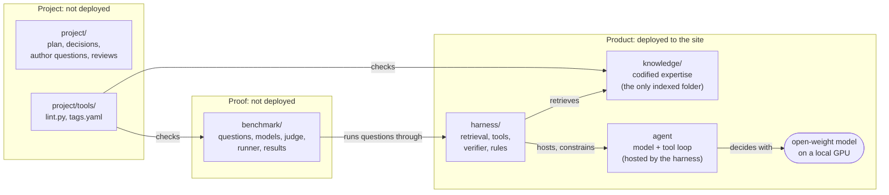

# Architecture

The whole system: how the repository is organized, and how the model, agent, harness and knowledge work together at run time. Not indexed.
Why it can work: [MISSION.md](MISSION.md). The agent: [harness/AGENT.md](harness/AGENT.md). Harness parts: [harness/README.md](harness/README.md). Knowledge, folders and writing rules: [KNOWLEDGE-ENGINEERING.md](KNOWLEDGE-ENGINEERING.md). Benchmark: [benchmark/design.md](benchmark/design.md).

## Components
| Component | Design document |
|---|---|
| Model | [benchmark/models.md](benchmark/models.md): which frozen model to ship, size and hardware |
| Harness and agent | [harness/README.md](harness/README.md) (the software around the model) and [harness/AGENT.md](harness/AGENT.md) (the agent it hosts) |
| Knowledge | [KNOWLEDGE-ENGINEERING.md](KNOWLEDGE-ENGINEERING.md): what the knowledge is and how to write it |

- Why the system can win, and what it must do: [MISSION.md](MISSION.md).

## Repository

One repository, three groups. Only the product is deployed. Folder by folder: [REPOSITORY-MAP.md](REPOSITORY-MAP.md).

- Product: what runs at the customer site.
  - `knowledge/`: Level 400 mechanisms, metrics, traps and troubleshooting flows, plus exact data in `knowledge/catalog/`. Version 1.0 covers vSphere 9.1 metrics and the Guest OS layer; the end scope is the private cloud stack (vSAN, NSX, VCF Operations, Kubernetes, Linux).
  - `harness/`: the software around the model: hybrid retrieval, link expansion, exact tools (catalog lookup, calculator, flow executor), answer verifier. Reads `knowledge/`; depends on no other folder.
  - Agent: the model plus the tool loop, in agentic mode. Its loop is harness code (`harness/agent.py`, up-front blocks in `harness/primer.py`); what it is told and how it decides: `harness/AGENT.md`.
  - Model: an open-weight vision model that fits one GPU (at most 96 GB), chosen by benchmark (`benchmark/models.md`). Not stored here.
- Proof: shows that the product beats a frontier model.
  - `benchmark/`: questions with answer keys and their attachments, the candidate models and judge (`benchmark/models.md`), the runner, results. One final score, 0-100%, with sub-scores by answer type (deterministic, judged), input type (text, table, screenshot) and level (100-400). Luck removed: Unsure option, confident-wrong rate, each question scored on its worst of 5 runs. Never indexed: it holds the answer keys.
- Project: how this repository is built and kept correct.
  - `project/`: plan (milestones, decisions, open work), author questions, reviews, archive.
  - `project/tools/`: `lint.py` (file, tag and folder checks, run before every merge) and `tags.yaml` (allowed tag values, avoided phrases).

- One repository, not two: the benchmark runs the harness and the knowledge base at the same commit, so a score always belongs to one exact version of the product. `lint.py` imports the parser from `harness/kb.py`; the dependency points only from project to product.

## 1. Parts
| Part | What it is | Where | What it decides |
|---|---|---|---|
| Knowledge | Level 400 facts, mechanisms, traps, flows (markdown) and exact data (YAML catalog) | `knowledge/` | Nothing. It is the first source; where it speaks, it wins. |
| Agent | The model plus the tool loop: iterative reasoning, decisions and multi-step planning. Exists in agentic mode only (`harness/AGENT.md`) | the loop in `harness/agent.py` (`agentic`), up-front blocks in `harness/primer.py`, the decisions in the model | Which tool to call next (search, read, catalog, calculate, flow), with which query, and when to stop and answer. |
| Harness | The execution environment and the guardrails: hybrid search engine (BM25 + vectors), SQLite catalog, calculator, flow executor, the loop's rules, the answer verifier | `harness/` | What the model may see, which tools exist, which calls are allowed, whether the answer is accepted. |
| Model | An open-weight vision LLM on one local GPU (at most 96 GB; `benchmark/models.md`) | served by vLLM, llama.cpp or Ollama | How to read the text and the images, which options are right. In agentic mode it is the decision-maker inside the agent. |

- Agent and harness split the agentic loop: the agent chooses, the harness executes and constrains. The harness hosts the agent; the agent is not a separate program.
- Classic mode has no agent: the harness runs a fixed pipeline (one search, then one answer). Baseline mode is the model alone.
- The model's own memory of vSphere metrics comes from public Internet text and repeats the misconceptions the knowledge base corrects.
- The model is told to use the knowledge base first; where the knowledge base speaks, it wins; where it is silent, the model may use its own knowledge and must say so (author, Q038, 2026-11-05).
- The knowledge base does not answer by itself. It must be found, read and applied to the question.
- The harness does not understand language. It searches, computes, enforces rules and checks answers.

## 2. Control by mode
| Mode | Who decides what to read | Model calls per question | Role of the model | Role of the harness |
|---|---|---|---|---|
| Baseline | Nobody: no knowledge base | 1 | Answers from memory | Formats the question. Reference point for the benchmark only. |
| Classic | The harness | 1 (+1 repair if needed) | Reads what it is given and answers | Driver: one search, link expansion, catalog facts, context budget, verifier. |
| Agentic | The agent (the model, within the harness's rules) | up to 9 (+1 repair) | Driver of the lookups: chooses tools, queries, files, steps | Referee and toolbox: runs the tools, enforces the rules, checks the answer, falls back to classic. |

- Agentic mode splits the work:
  - the model decides what it needs next ("search Ready", "read this file", "convert 8,000 ms");
  - the harness decides what is allowed and how it is done (search must come first, no repeated calls, 8 calls and 12K tokens of tool output at most, a reminder to check same-name metrics, exact tools for numbers, a verifier on the final answer).
- In classic mode the harness leads and the model only reads. The model cannot ask for a missing file, so retrieval caps the score (section 8).
- Agentic mode is the target design. Level 400 questions often need a chain across files (metric → same-name metric on another object → concept → flow). One search cannot predict that chain.

## 3. The agent
- The agent's rules, budgets, the tool-call limit, why classic mode stays, and a traced walkthrough of one question: `harness/AGENT.md`.
- The benchmark uses the deployment budgets (context window, tool-output tokens, no-progress stops), so the score predicts the product: `harness/AGENT.md`, section Budgets.

## 4. Level 400 on a local model
Each mechanism blocks one failure of a small model. None needs the Internet. Harness parts in detail: `harness/README.md`, section 1.

| Failure of a model alone | Mechanism | Part |
|---|---|---|
| Repeats a common misconception ("Ready above 5% is bad") | Trap lines in every metric file, in the user's own words, so the misconception retrieves its correction | Knowledge |
| Mixes the VM and ESXi meaning of one label | One object per metric file; `same_name` links; a reminder before answering | Knowledge + harness |
| Calls a Guest OS metric a VM metric | Separate `guest-os/` layer; `layer` tag; lint rule | Knowledge |
| Gets a unit, rollup, statistics level or arithmetic wrong | Catalog lookup and calculator | Harness |
| Skips troubleshooting steps or jumps to a conclusion | Flow tool serves the troubleshooting steps in order | Knowledge + harness |
| Invents a threshold | Rule: quote a threshold only with its source; thresholds catalog; verifier flags numbers not in the text | Knowledge + harness |
| Guesses when unsure | Unsure option and the rule that a wrong answer is worse than Unsure | Agent (prompt) |
| Answers from memory where the knowledge base speaks | Prompt rule: knowledge base first, and it wins on conflict; override rate measured (`benchmark/models.md`) | Agent (prompt) |
| Stale knowledge (older releases) | Knowledge written from the current release by rule (vSphere 9.1, VCF 9.1.1) | Knowledge |

## 5. Local deployment
| Component | Runs on | Notes |
|---|---|---|
| Chat model (one GPU, at most 96 GB) | GPU, via vLLM, llama.cpp or Ollama | OpenAI-compatible API on the local network |
| Embedding model (qwen3-embedding-0.6b) | CPU | For hybrid search |
| Harness | CPU | Python: retrieval, catalog (SQLite in memory), calculator, flow executor, verifier |
| Index | Disk | Chunks and vectors built from `knowledge/`, tied to one git commit (index version) |

- Updates arrive as a bundle: knowledge, catalog, index, and optionally new weights; downloaded, or imported offline. No customer data is sent out.
- Internet access (author, 2026-11-09): users browse the Internet, so a question can include a URL. Whether Agent E2 fetches it is an open design item (`project/plan.md`).
- The benchmark uses the Vercel AI Gateway to reach the same open-weight models; at a customer site, `harness/llm.py` points at the local server instead. The harness code is the same.
- One VM with a GPU (passthrough or vGPU) on the customer's own VCF. VMware Private AI Foundation with NVIDIA is the natural platform (to verify against current product documentation).
- The assistant's own GPU VM is monitored by the same rules: `knowledge/vsphere/technology/gpu/concepts/gpu-monitoring.md`.

## 6. Harness checks
- The harness is checked on its own. In the final score, a retrieval miss and a reasoning error look the same.
- Three levels:

| Level | What it checks | Needs a model | Command |
|---|---|---|---|
| Tools | Catalog, calculator, flows, verifier give exact, expected results | No | `python3 -m unittest harness/test_tools.py` |
| Retrieval check | For every question, are the files it needs found and put in the context? | No | `python3 benchmark/runner/retrieval_eval.py` (add `--embeddings` for hybrid) |
| Whole system | Model + harness + knowledge on the question set; recall per answer shows whether the files were found or read | Yes | `python3 benchmark/runner/run.py` |

- Current retrieval result: `benchmark/design.md`, section 9.
- Reading a wrong answer: needed file not in context → retrieval or knowledge problem; file in context but answer wrong → model or prompt problem; file missing from the knowledge base → knowledge gap.

## 7. Status
- Milestones and what is built: `project/plan.md`. Not built yet: question understanding before search (question type, object, layer as filters), query rewriting with glossary synonyms, the offline bundle. Screenshots are read in 1.0 (author, 2026-11-06); the screen library is 1.1. Data files are 1.2; a live VCF Operations connection comes after 1.0.

## 8. Local LLM use
- Design target: a local LLM with a small context window and retrieval-augmented generation (RAG). The knowledge base is the retrieval corpus. No fine-tuning is assumed.
- `harness/` implements the steps below (`harness/kb.py`, `harness/retrieval.py`, `harness/modes.py`, `harness/agent.py`). They are also the contract for any other RAG stack.

### Retrieval approach
- Retrieval, not fine-tuning, supplies the facts: the knowledge is not on the Internet; it changes often (author answers); answers must cite files; small models memorise facts poorly.
- Optional later: a light fine-tune (LoRA) for style and terminology only. Facts stay in retrieval.
- Not used: long-context stuffing (the whole knowledge base is about 125K tokens: too much for a small model and too slow per question); a separate graph database (the metadata links already form the graph).

### No fast first-stage model
- Not used: a second, fast model in front of the reasoning model (a "System 1" classifier). Decided with the author, 2026-11-08.
- Manual use (an admin asks, with screenshots or CSV): requests are few and a person waits for each. Routing to the right file and flow is done by retrieval and the flow index; CSV files are parsed by code.
- Automated use (a daily health check over VCF Operations): tens of millions of metrics cannot pass through any model. The fast stage is code: pull KPI and model results, score them against the threshold catalog, keep the objects in red or orange, and group them by what they share. The reasoning model then reads only those findings with their flows. Code is exact and repeatable, traceable to a threshold row, and uses no GPU memory.

### Ingest
1. Index `knowledge/**/*.md`. Do not index `benchmark/` (it holds answer keys; indexing it invalidates the evaluation), `project/`, `harness/`, or the root documents (`README.md`, `CLAUDE.md`, `MISSION.md`, `ARCHITECTURE.md`, `KNOWLEDGE-ENGINEERING.md`, `CONTRIBUTING.md`, `SECURITY.md`).
2. Split each file at `## Metadata`. Parse the yaml block into filter fields. Do not embed it.
3. Chunk the body by `##` heading. Files are short, so one file is often one chunk.
4. Prefix each chunk with the file title and `id`, so a chunk is understood without its neighbours.
5. Keep image links in the chunk. The text next to each image states the same facts, so a text-only model loses nothing.
6. Index each `images` entry as its own record (path, alt text, tags), so an image can be retrieved by product, object, metric or type, and returned with what it shows.
7. Load `knowledge/catalog/*.yaml` into a database for exact lookups (unit, rollup, statistics level, thresholds, object relations). Do not chunk it as prose.

### Query
1. Classify the question into one `retriever_guide` value: how-it-works, metric-meaning, term-meaning, what-to-set, health-check, troubleshooting. (Planned: today the agent passes it as a search filter; classic mode does not classify.)
2. Extract filters from the question: `product`, `object`, `technology`, `pillar`. (Planned, as step 1.)
3. Retrieve by similarity within those filters.
4. Expand: add files named in `related`, `internal_derive`, `same_name`, `same_meaning`.
   - Classic mode today: `same_name` and two `related` of the top 2 hits; with `expand_derive`, up to 3 `internal_derive` files of each. With `route_troubleshooting`, a troubleshooting question puts its best diagnosis file first.
   - `same_name` is the main trap guard: it brings in the other object's meaning of the same label.
5. Add the matching observability and vSphere architecture files when the answer depends on units, sampling, thresholds or the provider/consumer view.
6. Fit to the context window. Priority: matching metric or flow file, then its concepts, then observability and architecture, then the rest of the links.
7. Take exact values (units, rollups, statistics levels, thresholds) from the catalog, and arithmetic from the calculator, not from the model.

### Answer
- Answer from the retrieved text first. Where it is silent, the model may answer from its own knowledge and says so; where they differ, the knowledge base wins (author, Q038, 2026-11-05). Prefer mechanism and reason over a definition.
- Cite each file `id` used.
- Treat `status: draft` content as unreviewed. Say so when the answer depends on it.
- Use terms from `knowledge/glossary.md`: preferred names, defined terms, confusable pairs.
- Quote a threshold only when a file states it with its source.

### Troubleshooting questions (`troubleshooting`)
- Retrieve the matching `troubleshooting/` file first. Retrieve its `internal_derive` metric files with it.
- Follow the numbered steps in `## Checks, in order`, from step 1. Do not skip to a later step.
- At each step: name the metric and object, compare with the stated threshold, then take the branch the step gives.
- Use the Mermaid flow only to confirm the branch. The numbered steps win if they differ.
- When the user has given a value, apply it to the step. When not, ask for that metric's value, or state both branches.
- Stop at the step that gives a conclusion. State the path taken: step numbers, values, thresholds and their sources.
- No troubleshooting file matches: say so, then answer from metric and concept files. Do not invent a flow or a threshold.
- Contention before consumption before context, unless the file states another order.

### Trace
Recorded for every answer (`traces.jsonl` in the benchmark; the answer log at the site).

| Field | Content |
|---|---|
| step, action | 1, 2, 3, ...; search, read_file, follow_links, get_images, catalog, calculate, flow, primer, reminder, refused, verify, repair, answer, fallback |
| input | tool arguments |
| output summary | ids returned, tokens returned |
| tokens, latency, provider | per model turn |
| index version | git SHA of `knowledge/` |

- The trace explains each failure: right file never searched → retrieval or filter problem; file read but fact ignored → model problem; fact missing → knowledge gap.

### Measurement
- `benchmark/` runs the same questions with and without the knowledge base. A structure change is kept only when scores improve.
