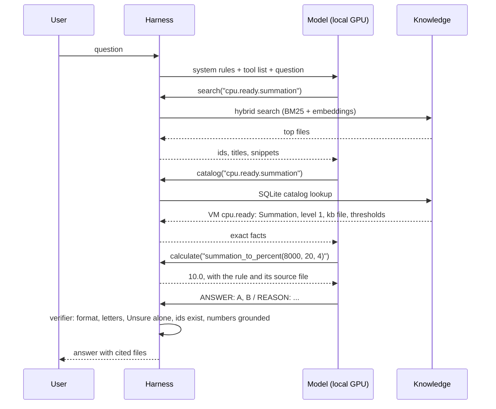

# Architecture

How the model, harness and knowledge work together at run time. Not indexed.
Design reasons and model size: `project/solution-design.md`. Knowledge capture: `KNOWLEDGE-ENGINEERING.md`. Folder and writing rules: `KNOWLEDGE-ENGINEERING.md`. Test design: `benchmark/test-design.md`.

## 1. Parts
| Part | What it is | Where | What it decides |
|---|---|---|---|
| Knowledge | Level 400 facts, mechanisms, traps, flows (markdown) and exact data (YAML catalog) | `knowledge/` | Nothing. The answer may use no other source. |
| Harness | The software around the model: retrieval, tools, rules, answer checks | `harness/` | What the model may see, which tools exist, which calls are allowed, whether the answer is accepted. |
| Model | An open-weight vision LLM on one local GPU (at most 96 GB; `benchmark/models.md`) | served by vLLM, llama.cpp or Ollama | What to look up next (agentic mode), how to read the text, which options are right. |

- The model's own memory of vSphere metrics comes from public Internet text and repeats the misconceptions the knowledge base corrects.
- The model is told to answer only from what the harness returns.
- The knowledge base does not answer by itself. It must be found, read and applied to the question.
- The harness does not understand language. It searches, computes, enforces rules and checks answers.

## 2. Control by mode
| Mode | Who decides what to read | Model calls per question | Role of the model | Role of the harness |
|---|---|---|---|---|
| Baseline | Nobody: no knowledge base | 1 | Answers from memory | Formats the question. Reference point for the test only. |
| Classic | The harness | 1 (+1 repair if needed) | Reads what it is given and answers | Driver: one search, link expansion, catalog facts, context budget, verifier. |
| Agentic | The model, within the harness's rules | up to 9 (+1 repair) | Driver of the lookups: chooses tools, queries, files, steps | Referee and toolbox: runs the tools, enforces the rules, checks the answer, falls back to classic. |

- Agentic mode splits the work:
  - the model decides what it needs next ("search Ready", "read this file", "convert 8,000 ms");
  - the harness decides what is allowed and how it is done (search must come first, no repeated calls, 8 calls and 12K tokens of tool output at most, a reminder to check same-name metrics, exact tools for numbers, a verifier on the final answer).
- In classic mode the harness leads and the model only reads. The model cannot ask for a missing file, so retrieval caps the score (section 8).
- Agentic mode is the target design. Level 400 questions often need a chain across files (metric → same-name metric on another object → concept → flow). One search cannot predict that chain.

## 3. Tool-call limit
- The test limit (8 tool calls, 12K tokens of tool output) caps the cost of 15,000 answers. It is not a design value. No knowledge-base need sets it at 8.
- Run results (2026-11-03, agentic mode, exact answers by number of calls):

| Model | 0-3 calls | 4-7 calls | Hit the limit (8) |
|---|---|---|---|
| frontier model | 31 of 33 | 27 of 42 | 6 of 20 |
| google/gemma-4-31b-it | 28 of 44 | 14 of 28 | 5 of 23 |
| mistral/mistral-small | 0 of 3 | 7 of 20 | 21 of 72 |
| alibaba/qwen-3-32b | 36 of 82 | 2 of 3 | never reached |

- Answers that hit the limit are mostly wrong. In most traces the model searches in circles; one more call would not have helped.
- Hard questions also take more calls, so the table does not prove that more calls are useless. Test: re-run the limit-hit answers with 16 calls.
- Some models make few tool calls (qwen-3-32b averages 1.8). The limit does not affect them.
- Deployment has no per-token fee. Its limits are:
  - the context window: every tool result stays in the conversation; with a 32K window, about 12-16K tokens of tool output leaves room for the prompt and the answer;
  - waiting time: each call is a model turn on the local GPU (seconds each).
- Deployment rule, replacing a fixed count:
  - stop on a token budget (tool output that still fits the context) or a time budget (set from user tests), whichever comes first;
  - stop early on no progress: repeated searches, re-reading the same file, two calls returning nothing new;
  - at the stop, answer with what was read and say what is missing, or answer Unsure;
  - show progress (what is being read) and let the user stop or ask to keep digging.
- The test uses the same budget as deployment, so the score predicts the product.

### Benchmark and deployment
- The release score is measured on the deployed configuration. A different test setting would grade a system that is not shipped.
- Same in both: prompt, tools, retrieval settings, verifier, context window, token budget for tool output, no-progress stops.
- Different:

- **Time**
  - Why: Test time depends on the gateway, network and provider rate limits, not on the customer GPU. A wall-clock limit in the test would grade the provider.
  - Handling: The test stops on hardware-independent limits only: tokens and no-progress. A maximum number of model turns is derived from the deployment time limit: turns = time limit ÷ seconds per turn measured on the target GPU (benchmark phase 5).
- **Context window**
  - Why: Gateway models often offer 128K or more; the deployed server may run 32K.
  - Handling: The test caps the context to the deployed window.
- **User in the loop**
  - Why: In deployment the user can stop, ask to keep digging, or answer a clarifying question. A test has no user.
  - Handling: The test answers at the end of the budget with no help: a worst case. Clarifying questions are scored as a separate set later.
- **Experiments**
  - Why: Some runs ask "what if" (16 calls, primed agentic, another embedding model).
  - Handling: Run as named experiment profiles. Only the deployment profile produces the release score.

- One harness, several profiles: the deployment profile (release score and product) and named experiment profiles (diagnosis only).

## 4. Classic mode
- Classic mode costs a third of the test runs. Reasons to keep it:
  1. It isolates tool skill. Classic = what the knowledge base adds with no tool skill from the model. Agentic minus classic = what the model's own tool use adds or loses. Without classic, a low agentic score cannot be pinned on the model or on the knowledge base.
  2. It is the better mode for some models today. Benchmark 20261103-081849: classic beat agentic for 7 of 8 small models (45% vs 33% exact on average); for the frontier model agentic was slightly ahead (67% vs 62%). The mode is chosen per model by the decision rule in `benchmark/test-design.md`.
  3. It is the fallback. When a model breaks the tool-call format twice, the harness answers in classic mode instead of failing.
  4. It is fast: one model call instead of up to nine.
- After the 100-question set picks the model and mode, routine runs use the chosen mode plus baseline only. Classic stays in the code as the fallback.
- To test: agentic mode that starts from the classic context (first search done, catalog facts included). This skips the first search, the weakest step for small models, and keeps further lookups.

## 5. Agentic mode walkthrough
Real trace (2026-11-04, alibaba/qwen-3-32b): "A 4-vCPU VM shows cpu.ready.summation = 8,000 ms in one real-time sample. Which statements are correct?" Options include the rollup and statistics level, 10% Ready and 40% Ready.

1. The harness sends the question with the rules: answer only from tool output; search or catalog first; check same-name metrics; use the catalog for units and levels, the calculator for arithmetic, the flow tool for troubleshooting.
2. The model searches. The harness runs hybrid search (keyword BM25 plus a local embedding model, fused by rank) and returns ids and snippets, not answers.
3. The model asks the catalog for the counter. The harness answers from SQLite built from `knowledge/catalog/`: rollup Summation, statistics level 1, the knowledge file, and the thresholds with their source.
4. The model asks for the conversion. The calculator returns 10% (8,000 ms ÷ (20 s × 1,000 ms × 4 vCPUs)) and names the rule's source file. The model never does the arithmetic itself.
5. The model answers. The verifier checks the reply; a hard issue (no ANSWER line, a letter that is not an option, Unsure mixed with other letters) gets one repair turn.
6. The answer goes out with the files it used.

## 6. Level 400 offline
Each mechanism blocks one failure of a small model. None needs the Internet.

| Failure of a model alone | Mechanism | Part |
|---|---|---|
| Repeats a common misconception ("Ready above 5% is bad") | Trap lines in every metric file, in the user's own words, so the misconception retrieves its correction | Knowledge |
| Mixes the VM and ESXi meaning of one label | One object per metric file; `same_name` links; a reminder before answering | Knowledge + harness |
| Calls a Guest OS metric a VM metric | Separate `guest-os/` layer; `layer` tag; lint rule | Knowledge |
| Gets a unit, rollup or statistics level wrong | Catalog lookup returns the exact value from the vSphere 9.1 tables | Harness |
| Slips on arithmetic (ms to %, KB vs kb) | Calculator with source notes | Harness |
| Skips troubleshooting steps or jumps to a conclusion | Flow tool serves the diagnosis steps in order | Knowledge + harness |
| Invents a threshold | Rule: quote a threshold only with its source; thresholds catalog; verifier flags numbers not in the text | Knowledge + harness |
| Guesses when unsure | Unsure option and the rule that a wrong answer is worse than Unsure | Harness (prompt) |
| Answers from memory where the knowledge base speaks | Prompt rule: knowledge base first, and it wins on conflict; own knowledge only where the knowledge base is silent, marked as such in the reason; override rate measured (`benchmark/models.md`) | Harness (prompt) |
| Stale knowledge (older releases) | Knowledge written from the current release by rule (vSphere 9.1, VCF 9.1.1) | Knowledge |

## 7. Dark-site deployment
| Component | Runs on | Notes |
|---|---|---|
| Chat model (one GPU, at most 96 GB) | GPU, via vLLM, llama.cpp or Ollama | OpenAI-compatible API on the local network |
| Embedding model (qwen3-embedding-0.6b) | CPU | For hybrid search |
| Harness | CPU | Python: retrieval, catalog (SQLite in memory), calculator, flow executor, verifier |
| Index | Disk | Chunks and vectors built from `knowledge/`, tied to one git commit (index version) |

- Updates arrive as an offline bundle: knowledge, catalog, index, and optionally new weights. Nothing calls out.
- The test site uses the Vercel AI Gateway to reach the same open-weight models; at a customer site, `harness/llm.py` points at the local server instead. The harness code is the same.

## 8. Harness testing
- The harness is tested on its own. In the final score, a retrieval miss and a reasoning error look the same.
- Three levels:

| Level | Test | Needs a model | Command |
|---|---|---|---|
| Tools | Catalog, calculator, flows, verifier give exact, expected results | No | `python3 -m unittest harness/test_tools.py` |
| Retrieval | For every question, are the files it needs found and put in the context? | No | `python3 benchmark/runner/retrieval_eval.py` (add `--embeddings` for hybrid) |
| Whole system | Model + harness + knowledge on the question set; recall per answer shows whether the files were found or read | Yes | `python3 benchmark/runner/run.py` |

- Retrieval result, 28 questions (2026-11-04, hybrid): 67% of needed files reach the classic context; every needed file in only 12 of 28 questions. Classic mode cannot answer better than its context, so retrieval is the first thing to improve.
- Reading a wrong answer: needed file not in context → retrieval or knowledge problem; file in context but answer wrong → model or prompt problem; file missing from the knowledge base → knowledge gap.

## 9. Status (2026-11-04)
| Piece | Status |
|---|---|
| Hybrid search, link expansion, classic and agentic modes | Built |
| Catalog, calculator, flow executor, verifier | Built 2026-11-04 |
| Retrieval test without a model | Built 2026-11-04 |
| Question understanding before search (question type, object, layer as filters) | Not built: filters are used only when the model passes them in agentic mode |
| Query rewriting with glossary synonyms ("steal time" → Ready) | Not built |
| Screenshot reading | Release 1.1 |
| Data file parsing | Release 1.2 |
| Live VCF Operations connection | After 1.0 |

## 10. Local LLM use
- Design target: a local LLM with a small context window and retrieval-augmented generation (RAG). The knowledge base is the retrieval corpus. No fine-tuning is assumed.
- `harness/` implements the steps below (`harness/kb.py`, `harness/retrieval.py`, `harness/modes.py`). They are also the contract for any other RAG stack.

### Ingest
1. Index `knowledge/**/*.md` except the folders listed in `KNOWLEDGE-ENGINEERING.md`, section Indexing rules.
2. Split each file at `## Metadata`. Parse the yaml block into filter fields. Do not embed it.
3. Chunk the body by `##` heading. Files are short, so one file is often one chunk.
4. Prefix each chunk with the file title and `id`, so a chunk is understood without its neighbours.
5. Keep image links in the chunk. The text next to each image states the same facts, so a text-only model loses nothing.
6. Index each `images` entry as its own record (path, alt text, tags), so an image can be retrieved by product, object, metric or type, and returned with what it shows.
7. Load `knowledge/catalog/*.yaml` into a database for exact lookups (unit, rollup, statistics level, thresholds, object relations). Do not chunk it as prose.

### Query
1. Classify the question into one `retriever_guide` value: how-it-works, metric-meaning, term-meaning, what-to-set, what-to-check.
2. Extract filters from the question: `product`, `object`, `technology`, `pillar`.
3. Retrieve by similarity within those filters.
4. Expand: add files named in `related`, `internal_derive`, `same_name`, `same_meaning`.
   - `same_name` is the main trap guard: it brings in the other object's meaning of the same label.
5. Add the matching foundations files when the answer depends on units, sampling, thresholds or the provider/consumer view.
6. Fit to the context window. Priority: matching metric or diagnosis file, then its concepts, then foundations, then the rest of the links.
7. Take exact values (units, rollups, statistics levels, thresholds) from the catalog, and arithmetic from the calculator, not from the model.

### Answer
- Answer from the retrieved text first. Where it is silent, the model may answer from its own knowledge and says so; where they differ, the knowledge base wins (author, Q038, 2026-11-05). Prefer mechanism and reason over a definition.
- Cite each file `id` used.
- Treat `status: draft` content as unreviewed. Say so when the answer depends on it.
- Use terms from `knowledge/glossary.md`. Avoid the words in its Words to avoid table.
- Quote a threshold only when a file states it with its source.

### Troubleshooting questions (`what-to-check`)
- Retrieve the matching `diagnosis/` file first. Retrieve its `internal_derive` metric files with it.
- Follow the numbered steps in `## Checks, in order`, from step 1. Do not skip to a later step.
- At each step: name the metric and object, compare with the stated threshold, then take the branch the step gives.
- Use the Mermaid flow only to confirm the branch. The numbered steps win if they differ.
- When the user has given a value, apply it to the step. When not, ask for that metric's value, or state both branches.
- Stop at the step that gives a conclusion. State the path taken: step numbers, values, thresholds and their sources.
- No diagnosis file matches: say so, then answer from metric and concept files. Do not invent a flow or a threshold.
- Contention before consumption before context, unless the file states another order.

### Measurement
- `benchmark/` runs the same questions with and without the knowledge base. A structure change is kept only when scores improve.
