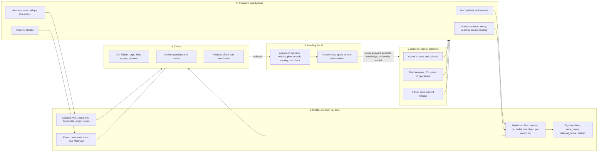

# Knowledge engineering

This document describes what Agent E2 knows, how each kind of knowledge reaches the model, and why it is shaped that way. It is the design overview for reviewers; the detailed rules for writers are modules in [project/knowledge-rules/](project/knowledge-rules/). Not indexed.
Related reading: why the system can win is in [MISSION.md](MISSION.md); how the parts run, including ingest and indexing, in [ARCHITECTURE.md](ARCHITECTURE.md); what the agent is told about the knowledge base, in [harness/AGENT.md](harness/AGENT.md); the plan and open gaps, in [project/plan.md](project/plan.md).

## From expertise to knowledge the model reads



- Experts hold judgment, not definitions. Each kind of judgment gets its own form: prose for reasons, misconception lines for wrong readings, YAML for exact numbers, and numbered steps for the order of checks.
- Tags and links carry the expert's mental map: which files must be read together.
- Nothing reaches the model unchecked: it passes lint, the author's review and the benchmark.
- The loop closes: every wrong answer is traced back to a missing fact, a retrieval miss or a model error.

| Read | For |
|---|---|
| This file | The design: the problem, where knowledge lives, forms, Level 400 and misconceptions, why the structure is so, workflow |
| [placement.md](project/knowledge-rules/placement.md) | Which folder a file goes in; the `knowledge/` tree |
| [flows.md](project/knowledge-rules/flows.md) | Health checks, troubleshooting flows, decision trees: vocabulary, order, step format |
| [metadata.md](project/knowledge-rules/metadata.md) | `retriever_guide` values, every metadata field, the dimensions not to mix |
| [thresholds.md](project/knowledge-rules/thresholds.md) | What a threshold is, the catalog files, one place per number |
| [writing.md](project/knowledge-rules/writing.md) | Writing rules, the author's editing checklist, format choices, images, versions |
| [vocabulary.md](project/knowledge-rules/vocabulary.md) | Words to avoid, each with its replacement and reason |
| [terminology.md](project/knowledge-rules/terminology.md) | Glossary entries, confusable pairs, up-front misconceptions, budget |

## 1. The problem
- Source: the author's books, quizzes and field answers, and 20+ years of operating vSphere.
- Most of this knowledge is tacit. It is judgment ("this reading is misleading when…"), not definitions.
- Three readers must use the same knowledge:
  - a small local model, which reads short retrieved passages and follows rules literally;
  - the harness, which needs exact, structured values it can look up and compute with;
  - a human expert, who must be able to review every fact and trace it to its source.
- No single format serves all three, so each kind of knowledge gets its own form. All the forms live in one git repository and are reviewed and versioned together.

### Principles
1. The AI is the reader; humans review. Content is facts, mechanisms, formulas and reasons, with no text aimed at human motivation and no narrative.
2. Mechanism before counter. A metric is a byproduct of the architecture, so a metric file points back to the concepts it follows from.
3. Technology before object. A technology (CPU, memory, storage, network) works across Guest OS, VM, ESXi and cluster. Master how it works first, then apply it to each object.
4. Nuance is explicit. The same name with a different meaning, and the reverse, is stored as links and misconception lines instead of being buried in prose.
5. Vantage points are never mixed: one object type and one layer per metric file. The Guest OS is its own layer and folder.
6. Traceable to source. Every file records its source document and heading path.
7. Depth before breadth. One complete mechanism beats twenty shallow counter definitions.
8. Measured, not assumed. A structure change is kept only when the retrieval check improves, or holds while the content becomes more correct; the benchmark proves the release ([`benchmark/retrieval-check.md`](benchmark/retrieval-check.md)).

### Limits
- Turning expert judgment into files is lossy, and some tacit knowledge resists codifying.
- The model retrieves and recombines text. Structure improves its answers; it does not create understanding.
- Quality drifts without review. Coverage is partial on purpose, because depth comes first.

## 2. Where the knowledge lives

- Agent E2 combines two bodies of knowledge in every answer, the same two the author carries as a consultant:
  - the method, the SP5 Framework: how to operate VCF, in VCF terms and examples (`sp5-framework/`);
  - the product, VCF 9.x: what each component is and does (`vsphere/`, `vcf-operations/`), and the Guest OS above the VM (`guest-os/`).
- Sources are stated once, here (since 2026-11-14). The knowledge is written from [`project/sources/`](project/sources) and from https://isvara.io, which holds the latest copy of the author's books, spreadsheets and other material. The knowledge base is a superset of them: it adds vendor documents, mechanisms and corrections. A knowledge file therefore never names the author's material. Its `source.document` is `Knowledge base`, plus any vendor document with its version, which can go stale. `corrections` record differences from vendor documents only.
- Scope is VCF only, with nothing about competitor products. Folder rules: [`project/knowledge-rules/placement.md`](project/knowledge-rules/placement.md).
- Agent E2 is purpose-built, so its domain knowledge is not only in what search returns. Up-front text, code and the agent's instructions carry VMware knowledge too. All of it is deployed to the site, and the author reviews all of it.
- The home of a fact is decided by how it must reach the model, not by its subject. There are five paths, each for a failure the others cannot prevent:

| Path | Holds | Home | Why this path |
|---|---|---|---|
| Retrieved when a question needs it | Mechanisms, metrics, misconceptions, flows | `knowledge/**/*.md` (indexed) | About 315K tokens (2026-11-13), too large to send with every question |
| Looked up exactly | Units, rollups, statistics levels, thresholds, user terms | `knowledge/catalog/*.yaml` (loaded into SQLite) | An exact value must not depend on ranking or on the model's memory |
| Given up front, every question | Misconceptions with the widest reach, confusable pairs | Built by [`harness/primer.py`](harness/primer.py) from the `## Misconceptions` lines marked `up_front` in their files and from [`knowledge/glossary.md`](knowledge/glossary.md) | A confident wrong belief is never looked up, so the correction must be in place before the model reasons |
| Executed as code | Arithmetic identities, answer checks, user-word mapping; capacity plans and flow branches (built, not yet called by the agent: [`harness/AGENT.md`](harness/AGENT.md), section 4.3) | [`harness/calc.py`](harness/calc.py), `verify.py`, `terms.py`; `capacity.py`, `flows.py` | Small models slip on arithmetic and skip steps; code does not |
| Agent instructions | Knowledge base first, same-name check, a file for each claim, threshold only with its source, Unsure | [`harness/modes.py`](harness/modes.py) (system prompts), [`harness/agent.py`](harness/agent.py) (answer rules) | Conduct for every answer, not a fact about one metric |

- One home per fact. The mechanism lives in `knowledge/`; code and up-front text hold only what they need to act, and point to the file. For example, `calc.py` converts a summation counter from ms to %, but why Ready is a summation counter is explained in the Ready file. Each up-front misconception ends with `See <id>`.
- Up-front text reaches every answer, while a retrieved file reaches only the answers that find it. A wrong up-front line or prompt rule therefore costs more than a wrong metric file, and it is reviewed first.
- All the domain knowledge the author reviews lives in `knowledge/`, whatever its path to the model. Every knowledge file is indexed, and the up-front block is built from marked lines of those files, so no fact has a second, unindexed copy (Q211, 2026-11-14). `knowledge/` is not the same as chunked prose: the catalog is loaded, not chunked.
- Not deployed: `project/` (lint, allowed tags, moved ids) and `benchmark/`. They check the knowledge and hold nothing the agent reads.

## 3. Knowledge forms
| Form | Holds | Home | Why this form |
|---|---|---|---|
| Structured prose | Mechanisms, reasons, edge cases | `knowledge/**/*.md` | Reasons need prose, and one fact per bullet keeps a mistake to one line |
| Misconceptions | Wrong readings and their correction | `## Misconceptions` in each file | The wrong conclusion, in the user's words, retrieves its correction |
| Metadata tags | Technology, pillar, product, object, layer, instance, metric class | `## Metadata` yaml | One file is found from several perspectives; tags filter retrieval |
| Links | Same name, same meaning, derived from, related | `same_name`, `same_meaning`, `internal_derive`, `related` | The expert's mental map: which facts are read together |
| Folder hierarchy | The method (SP5 Framework) and the product (VCF 9.x) kept apart; inside the product, metrics by technology and KPIs by object | `knowledge/` | One tree, in the order the author reviews; links and tags give the other views |
| Catalog | Units, rollups, statistics levels, esxtop fields, thresholds, object model | `knowledge/catalog/*.yaml` → SQLite | Exact values must not depend on retrieval luck |
| Flows | Order of checks: health check, troubleshooting, decision tree | Files with `retriever_guide` health-check, troubleshooting or decision-tree | Small models skip steps; the reading plan puts the flow first, and the flow executor takes the branches in code (to build, Q166) |
| Formulas and calculator | Conversions and identities (summation ms ↔ %, KB vs kb) | [`harness/calc.py`](harness/calc.py), formulas in files | Arithmetic is where models slip |
| Images with text twins | The author's diagrams and charts | `images/` folders | Search reads words, not pixels: the text twin lets the image be found, and it costs fewer tokens than the image |
| Terminology | Vocabulary, confusable pairs | [`knowledge/glossary.md`](knowledge/glossary.md) | Wrong words produce wrong reasoning (Usage vs Utilization, KPI vs SLA) |
| Provenance | Source and version, what is still to check, status | metadata | Every fact can be traced and challenged |
| Rules as code | Architecture and writing rules (project, not deployed) | [`project/tools/lint.py`](project/tools/lint.py), `tags.yaml` | A rule that a script checks cannot drift |
| Executable expectations | Expert answers and the misconception a non-expert holds | [`benchmark/questions/`](benchmark/questions) | Shows that the knowledge changes answers |

## 4. Misconceptions and Level 400

### Levels
This is the one definition of the levels, and the benchmark uses it ([`benchmark/design.md`](benchmark/design.md), section 3.2).

| Level | Can do | Example (VM CPU Ready) |
|---|---|---|
| 100 | Name the metric. | "Ready is a CPU metric." |
| 200 | Define it. | "Ready is time a vCPU waited for a physical thread." |
| 300 | Use it: read the value, apply a common threshold, follow a runbook. | "Ready above 5% is bad; add capacity." |
| 400 | Explain the mechanism, predict where the reading misleads, and say what to check instead. | "2% Ready on 10% Run delayed 20% of the work; 2% on 98% Run is fine. Ready includes limit time and the summation counter grows with vCPU count, so check Run, Max Limited and the per-vCPU %." |

- The knowledge base is written at Level 400. Levels 100-200 are assumed, and generic models already reach Level 300 from public text.
- What separates 400 from 300 is knowing where a correct number is read wrongly. A Level 300 reader acts on the reading at face value. A Level 400 reader knows the mechanism, and so knows when the reading misleads.

### What a misconception is
- A misconception is a wrong conclusion drawn from a true observation or from a public rule of thumb. The number is right; the reading is wrong.
- It is held with confidence at Level 300: an experienced administrator, a frontier model trained on public text, or the vendor documentation states it.
- It has a mechanism: the knowledge base says why the conclusion fails and what to check instead. A misconception without a mechanism is an opinion, and it does not go in.
- Agent E2 does not set misconceptions for other models to fall into. It beats them by knowing the mechanism behind the number. A misconception is only where that depth becomes visible, because a model that has only Level 300 text repeats it.
- The word is misconception, as in the author's books, and not "trap". In IT infrastructure a trap is an event notification (SNMP trap, a log message an alert traps), and in CPU virtualization it is a hand-over to the hypervisor (trap-and-emulate). The knowledge base uses both meanings, so a third would collide in search.
- Format: one per line, in the `## Misconceptions` section at the end of the file body:

```text
- "<the wrong conclusion, in the words someone would use>" → <the correct reading, the reason, and what to check instead>.
```

- Example: "Swap Consumed = Swap Out - Swap In" → no. Swap Out and Swap In are cumulative totals; Swap Consumed is what sits in swap now, like VM Swapped.

### One home, two paths to the model
- Home: `## Misconceptions` in the file, in the user's own words, next to the mechanism. A question that carries the belief brings in its correction through the reading set.
- Up front: the dozen with the widest reach are marked in their file (metadata `up_front`: the wrong belief, as quoted in the line). [`harness/primer.py`](harness/primer.py) collects the marked lines into the up-front block, so the correction is in place before the model reasons, even when the question does not name the file. There is one copy: the author edits the line in its file (Q211, 2026-11-14).
- Not a confusable pair: two real terms swapped (Core vs Thread Utilization) is a vocabulary error, and it is kept in the glossary. A misconception is a wrong belief about how something works.

### Misconception types
| Type | The reading goes wrong because | Example |
|---|---|---|
| Same name, other object | One label has different meanings on VM, ESXi, cluster | VM CPU Usage vs ESXi CPU Usage |
| Layer confusion | A Guest OS reading is taken as a VM reading, or the reverse | Guest OS run queue called a VM metric |
| Consumption read as contention | Utilization is taken as a performance signal | "Host CPU 90%, so VMs are slow" |
| Average hides the worst | A host or cluster average hides the VM that suffers | "Host Ready is low, so every VM is fine" |
| Rollup and interval | Averaging over 5 minutes or a day removes 20-second peaks | "The 1-week chart shows the peak" |
| Unit and normalization | Summation, per-vCPU vs per-VM, KB vs kb, ms vs % | "Ready of 2,000 ms is high" |
| Frequency and Hyper-Threading | Turbo, power management and HT bend percentages | "Usage above 100% is a data error" |
| Provider vs consumer | A consumer concept is applied to the provider, or the reverse | "Ready applies to ESXi" |
| Cumulative vs current | A running total is read as a current amount | "Swap Consumed = Swap Out - Swap In" |
| Threshold transplanted | A threshold from one layer, product or hardware era is applied elsewhere | "DAVG 10 ms is fine; the docs allow 15 ms" |
| Reclamation read as contention | Balloon, swapped or compressed memory is read as current waiting | "Balloon above 0, so the VM is slow" |
| Tool confusion | vCenter and VCF Operations, or esxtop and vCenter, are treated as the same reading | "Same counter name, so the values match" |
| Label read as model | The label names a different model than the one the product computes | "Total Capacity (GHz) is the host's CPU capacity" |

### Product label and better model (Q208)
- The product shows a label and computes it with a simple model. The label is reality: the operator reads it on the screen, types it into a question, and acts on what it seems to say. But reality is not always the best model.
- The product is not wrong; it is simpler. Its designer had to fit one number on a summary screen, with no one there to explain it. Agent E2 is the one who explains.
- So Agent E2 holds both, and never trades one for the other:

| Layer | Example: Total Capacity (CPU) | Example: CPU Usage (MHz) |
|---|---|---|
| Product label, as the UI shows it | Total Capacity, GHz (vSphere host and cluster, VCF Operations) | Usage (MHz) |
| What the product computes | cores × base frequency | productive cycles, scaled by frequency |
| The decision the label invites (the Level 300 reading) | "this is how much the host can hold" | "this is how busy the CPU is" |
| The better model | GHz at base clock, no Turbo or Hyper-Threading; space for vCPUs is counted in physical threads | completed work, not busy time |
| The better name | Total Base Capacity (GHz) | CPU Throughput |
| Why the product is simpler | one number that adds up across hosts and VMs | one counter for charts and billing |

- The test for a label: the label invites a decision that its computed model does not support, and the knowledge base holds the better model. A label that names what it computes stays a plain metric, whatever else is misread about it.
- Rules:
  - Never reword a label. Quote it as the product shows it, then correct the model behind it. Wrong: "vSphere's GHz total". Right: "Total Capacity (GHz) is the capacity at base clock; space for vCPUs is threads" ([`project/knowledge-rules/vocabulary.md`](project/knowledge-rules/vocabulary.md), Words to avoid).
  - Tone: "the product uses a simpler model", never "the product is wrong".
  - The better name belongs to Agent E2's vocabulary ([`knowledge/glossary.md`](knowledge/glossary.md)). A benchmark prompt uses only the label (fairness F1). A key point grades the model, never the better name, which a frontier model cannot know.
  - A better name reuses Agent E2's existing words where one fits (CPU Throughput, Active, Guest OS Needed Memory), so the names form one family: Usage (MHz) is CPU Throughput, and Total Capacity (GHz) is Total Base Capacity (GHz). A label that already names its model well stays as the better name (Q236): VM CPU Latency, ESXi Memory Usage (%), VM Memory Consumed. Throughput is activity, not capability, so no capacity figure is named a throughput.
- Teaching order, the order the author uses in consulting: (1) name the label as the operator sees it; (2) say what it computes; (3) name the decision it invites and why that decision fails; (4) give the better model and its name; (5) say what to read instead.
  - It is applied only when the question or the case names a listed label (a term-map row with `label` matches), and it fits inside the answer's length and shape; it is never added on top of them. An operator reads a short answer, and 250 words with the conclusion first leave no room for five extra steps.
  - The conclusion carries steps 1, 3 and 4; the mechanism carries step 2; what to check next carries step 5. The text is `LABEL_ORDER` in [`harness/terms.py`](harness/terms.py), added to the rules of an open answer ([`harness/AGENT.md`](harness/AGENT.md), section 4.5). A multiple-choice answer gets the note, not the order.
- Where it lives (one home each):
  - The glossary entry, named by the label as the question names it, with its object (ESXi CPU Usage (%)). The meaning line says what the product computes; `Product label:` gives the label verbatim, with where it shows; `Invites:` the decision the label invites; `Better name:` the name, a colon, and the better model; `File:` the file that owns the metric ([`project/knowledge-rules/terminology.md`](project/knowledge-rules/terminology.md)).
  - The file that owns the metric keeps the mechanism and a misconception line in the operator's words.
  - The term-map row ([`knowledge/catalog/user-terms.yaml`](knowledge/catalog/user-terms.yaml)) names the entry (`label:`) and holds only the match patterns, the search words and extra files. It has no note: [`harness/terms.py`](harness/terms.py) builds the note from the glossary entry at start and puts the entry's File first. Lint checks one row per label entry, a pattern that matches the term, and no note.
  - There is no generator. The match patterns are the user's words, which the term map already owns, and the note is read from the glossary at start. A generated copy and its sync check would add machinery and remove no second home.
  - A new label row goes at the end of the term map, so it adds its note without taking the two term-map file slots from older rows. Its search words name only what the question's words lack. Retrieval check 2026-11-15, BM25, 275 questions, the change alone on one snapshot: 171 to 172 complete, main file missing 18 to 18; stem only: 126 to 126, main file missing 38 to 37.
  - Misconception type `label-read-as-model` ([`project/tools/tags.yaml`](project/tools/tags.yaml)).
- The first list (2026-11-15), each entry in the glossary:

| Product label (entry) | Invites | Better name |
|---|---|---|
| CPU Usage (MHz) | how busy the CPU is | CPU Throughput |
| ESXi CPU Usage (%) | the host is full at 100% | CPU Throughput (% of nominal) |
| Total Capacity (GHz) | the host's CPU capacity | Total Base Capacity (GHz) |
| VM CPU Latency | the VM waits for CPU | VM CPU Latency (kept) |
| ESXi Memory Usage (%) | the host is short of memory | ESXi Memory Usage (%) (kept) |
| VM Memory Consumed | what the Guest OS uses now | VM Memory Consumed (kept) |
| VM Memory Usage (%) | the VM needs more memory | Active (%) or Guest OS Needed Memory (%), by tool |
| Capacity Remaining (%) | the capacity free now | 3-Day Forecast Capacity Remaining (%) |

- Left out of the list: Contention (VCF Operations). Since Aria Operations 8.18 it is Overlap + Co-stop + Ready + Other Wait (below 1%): time the vCPU did not get, which is what the label says ([`vsphere/technology/cpu/metrics/virtual-motherboard/contention`](knowledge/vsphere/technology/cpu/metrics/virtual-motherboard/contention.md)). Its wrong reading, that the cluster is overloaded when a limit causes it, is about cause, so it stays a misconception of its file. Its mapping to CPU Latency before 8.18 is outside the releases covered.

### Use
- Retrieval: a misconception line holds the wrong conclusion in the user's own words, so a question that carries it retrieves the file that corrects it.
- `same_name` links bring in the other object's meaning of the same label. They are the main guard against the first type.
- Benchmark: every multiple-choice question names its misconception option in metadata `misconception`, and its wording in `## Explanation`. The misconception rate, the share of answers that pick it, shows whether a model holds the Level 300 belief.
- A misconception needs a mechanism and a source, like any other fact.

## 5. Structure rationale
- A generic AI fails on vSphere metrics in a known way: it knows the general meaning of a label and applies it where vSphere differs.
- Each structural choice blocks one failure:

| Choice | Failure it blocks |
|---|---|
| Concepts separate from metrics | Answering from a definition without the mechanism behind the value. |
| One object type per metric file | Mixing the VM, ESXi and cluster meanings of the same label. |
| `same_name` / `same_meaning` links | Treating two metrics as equal because the labels match, or as different because the labels differ. |
| Book-order folders plus tags | One hierarchy for review in the book's order, with tags for the other perspectives (technology, pillar, product, object). |
| Derived metrics beside their source metrics | Taking a derived VCF Operations metric for a vCenter counter (Contention vs Latency): both sit in the same folder, linked by `same_name` or `internal_derive`. |
| Tool references in `tools/` | Reading esxtop, vCenter and VCF Operations values as the same thing. |
| `retriever_guide` | Retrieving a definition when the question asks what to check or what to set. |
| Small files, one fact per line | A retrieved chunk carrying unrelated facts; an error spreading beyond one line. |
| Metadata at the end, parsed separately | Audit text (status, corrections) polluting the embedded content. |
| Method apart from product (SP5 Framework vs vSphere and VCF Operations) | A design rule mistaken for product behaviour, or a product limit mistaken for a rule of the method. |
| A `## Misconceptions` section in every metric file | A true observation read to the wrong conclusion. See section 4. |

- A file that is not tagged, linked and placed in the right folder is found only by its words, which is why lint checks tags and links. How the agent plans with this structure: [`harness/AGENT.md`](harness/AGENT.md), sections 4.2 and 6.

## 6. Workflow: from source to reviewed file
1. Extract: the book one Heading 3 at a time, then the official documentation for the current release, checking the document revision each time. Files start as `status: draft`.
2. Structure: write each fact in the form that fits it (section 3), and add tags, links and misconceptions.
3. Ask: every conflict or gap becomes an author question in [`project/author-questions.md`](project/author-questions.md), with a verbatim search string. The answer is applied to the file and the review note is deleted. Extraction continues meanwhile; it does not wait for answers.
4. Check: `python3 project/tools/lint.py` must pass before merge (folders, tags, layers, links, images, quotes, tables, phrases). Unit tests check the tools.
5. Prove: the retrieval check confirms that the right files are found, the benchmark runs the questions against the whole system, and every wrong answer is traced to knowledge, retrieval or model.
6. Review: the author reviews each file, answers `review_notes`, fixes errors and sets `status: reviewed`. Release content is final and curated: every file is reviewed.
7. Update: when the source document is updated, move `corrections` into the normal text and clear them.
