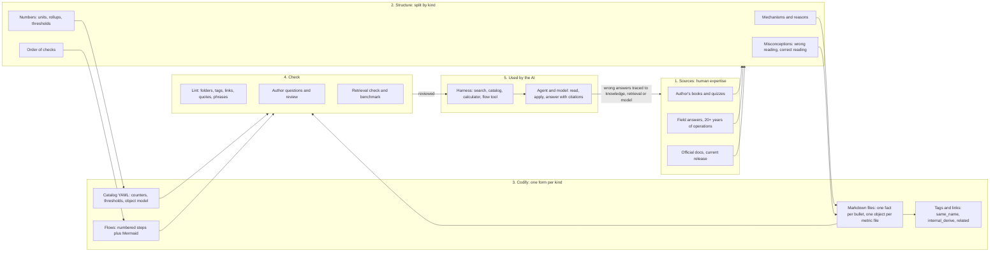

# Knowledge engineering

What Agent E2 knows, how each kind of knowledge reaches the model, and why it is shaped that way. The design overview for reviewers; the detailed rules for writers are modules in [project/knowledge-rules/](project/knowledge-rules/). Not indexed.
Why the system can win: [MISSION.md](MISSION.md). How the parts run, including ingest and indexing: [ARCHITECTURE.md](ARCHITECTURE.md). What the agent is told about the knowledge base: [harness/AGENT.md](harness/AGENT.md). Plan and open gaps: [project/plan.md](project/plan.md).

## From expertise to knowledge the model reads



- Experts hold judgment, not definitions. Each kind of judgment gets its own form: prose for reasons, misconception lines for wrong readings, YAML for exact numbers, numbered steps for the order of checks.
- Tags and links carry the expert's mental map: which files must be read together.
- Nothing reaches the model unchecked: lint, the author's review, and the benchmark.
- The loop closes: every wrong answer is traced back to a missing fact, a retrieval miss or a model error.

| Read | For |
|---|---|
| This file | The design: problem, where knowledge lives, forms, Level 400 and misconceptions, why the structure is so, workflow |
| [placement.md](project/knowledge-rules/placement.md) | Which folder a file goes in; the `knowledge/` tree |
| [flows.md](project/knowledge-rules/flows.md) | Health checks, troubleshooting flows, decision trees: vocabulary, order, step format |
| [metadata.md](project/knowledge-rules/metadata.md) | `retriever_guide` values and every metadata field |
| [thresholds.md](project/knowledge-rules/thresholds.md) | What a threshold is, the catalog files, one place per number |
| [writing.md](project/knowledge-rules/writing.md) | Writing rules, the author's editing checklist, format choices, images, versions |
| [terminology.md](project/knowledge-rules/terminology.md) | Glossary entries, confusable pairs, up-front misconceptions, budget |

## 1. The problem
- Source: the author's books, quizzes, field answers and 20+ years of operating vSphere.
- Most of this knowledge is tacit. It is judgment ("this reading is misleading when…"), not definitions.
- Three readers must use the same knowledge:
  - a small local model, which reads short retrieved passages and follows rules literally;
  - the harness, which needs exact, structured values it can look up and compute with;
  - a human expert, who must be able to review every fact and trace it to its source.
- No single format serves all three. Each kind of knowledge gets its own form. All forms live in one git repository, reviewed and versioned together.

### Principles
1. The AI is the reader; humans review. Content is facts, mechanisms, formulas and reasons; no text aimed at human motivation or narrative.
2. Mechanism before counter. A metric is a byproduct of the architecture; a metric file points back to the concepts it follows from.
3. Technology before object. A technology (CPU, memory, storage, network) works across Guest OS, VM, ESXi and cluster: master how it works, then apply it to each object.
4. Nuance is explicit. Same name with a different meaning, and the reverse, is stored as links and misconception lines, not buried in prose.
5. Vantage points are never mixed. One object type and one layer per metric file; Guest OS is its own layer and folder.
6. Traceable to source. Every file records its source document and heading path.
7. Depth before breadth. One complete mechanism beats twenty shallow counter definitions.
8. Measured, not assumed. A structure change is kept only when the benchmark or the retrieval check improves.

### Limits
- Turning expert judgment into files is lossy; some tacit knowledge resists codifying.
- The model retrieves and recombines text. Structure improves its answers; it does not create understanding.
- Quality drifts without review. Coverage is partial on purpose: depth first.

## 2. Where the knowledge lives

- Two bodies of knowledge, as the author carries them as a consultant, and Agent E2 combines them in every answer:
  - the method, the SP5 Framework: how to operate VCF, in VCF terms and examples (`sp5-framework/`). Source: Private Cloud Management by Iwan Rahabok.
  - the product, VCF 9.x: what each component is and does (`vsphere/`, `vcf-operations/`), and the Guest OS above the VM (`guest-os/`).
- Scope is VCF only: nothing about competitor products. Folder rules: `project/knowledge-rules/placement.md`.
- Agent E2 is purpose-built: its domain knowledge is not only in what search returns. Up-front text, code and the agent's instructions carry VMware knowledge too. All of it is deployed to the site, and all of it is reviewed by the author.
- The home of a fact is decided by how it must reach the model, not by its subject. Five paths, each for a failure the others cannot prevent:

| Path | Holds | Home | Why this path |
|---|---|---|---|
| Retrieved when a question needs it | Mechanisms, metrics, misconceptions, flows | `knowledge/**/*.md` (indexed) | About 125K tokens: too large to send with every question |
| Looked up exactly | Units, rollups, statistics levels, thresholds, user terms | `knowledge/catalog/*.yaml` (loaded into SQLite) | An exact value must not depend on ranking or model memory |
| Given up front, every question | Misconceptions with the widest reach, confusable pairs, flow index, map | `knowledge/misconceptions.md`; built from `knowledge/glossary.md` and file ids by `harness/primer.py` | A confident wrong belief is never looked up: the correction must be in place before the model reasons |
| Executed as code | Arithmetic identities, flow step order, answer checks, user-word mapping | `harness/calc.py`, `capacity.py`, `flows.py`, `verify.py`, `terms.py` | Small models slip on arithmetic and skip steps; code does not |
| Agent instructions | Knowledge base first, same-name check, threshold only with its source, Unsure | `harness/modes.py` (system prompts), `harness/primer.py` (procedure) | Conduct for every answer, not a fact about one metric |

- One home per fact. The mechanism lives in `knowledge/`; code and up-front text hold only what they need to act and point to the file. `calc.py` converts a summation counter from ms to %; why Ready is a summation counter is in the Ready file. Each up-front misconception ends with `See <id>`.
- Up-front text reaches every answer, a retrieved file only the answers that find it. A wrong up-front line or prompt rule therefore costs more than a wrong metric file, and its review comes first.
- All domain knowledge the author reviews lives in `knowledge/`, whatever its path to the model. `knowledge/misconceptions.md` is given up front and kept out of the index (`harness/kb.py`, `NOT_INDEXED`): search must return the file with the mechanism, not the one-line summary. `knowledge/` is not the same as indexed: the catalog is not chunked as prose either.
- Not deployed: `project/` (lint, allowed tags, moved ids) and `benchmark/` check the knowledge and hold nothing the agent reads.

## 3. Knowledge forms
| Form | Holds | Home | Why this form |
|---|---|---|---|
| Structured prose | Mechanisms, reasons, edge cases | `knowledge/**/*.md` | Reasons need prose; one fact per bullet keeps a mistake to one line |
| Misconceptions | Wrong readings and their correction | `## Misconceptions` in each file | The wrong conclusion, in the user's words, retrieves its correction |
| Metadata tags | Technology, pillar, product, object, layer, instance, metric class | `## Metadata` yaml | One file found from several perspectives; filters retrieval |
| Links | Same name, same meaning, derived from, related | `same_name`, `same_meaning`, `internal_derive`, `related` | The expert's mental map: which facts are read together |
| Folder hierarchy | The method (SP5 Framework) and the product (VCF 9.x) apart; inside the product, metrics by technology and KPIs by object | `knowledge/` | One tree in the order the author reviews; links and tags give the other views |
| Catalog | Units, rollups, statistics levels, esxtop fields, thresholds, object model | `knowledge/catalog/*.yaml` → SQLite | Exact values must not depend on retrieval luck |
| Flows | Order of checks: health check, troubleshooting, decision tree | Files with `retriever_guide` health-check, troubleshooting or decision-tree | Small models skip steps; the flow tool keeps them on the path |
| Formulas and calculator | Conversions and identities (summation ms ↔ %, KB vs kb) | `harness/calc.py`, formulas in files | Arithmetic is where models slip |
| Images with text twins | The author's diagrams and charts | `images/` folders | The text twin makes a diagram usable by a text-only model |
| Terminology | Vocabulary, confusable pairs | `knowledge/glossary.md` | Wrong words produce wrong reasoning (Usage vs Utilization, KPI vs SLA) |
| Provenance | Source and version, what is still to check, status | metadata | Every fact traceable and challengeable |
| Rules as code | Architecture and writing rules (project, not deployed) | `project/tools/lint.py`, `tags.yaml` | A rule a script checks cannot drift |
| Executable expectations | Expert answers and the misconception a non-expert holds | `benchmark/questions/` | Shows that the knowledge changes answers |

## 4. Misconceptions and Level 400

### Levels
This is the one definition of the levels; the benchmark uses it (`benchmark/design.md`, section 3.2).

| Level | Can do | Example (VM CPU Ready) |
|---|---|---|
| 100 | Name the metric. | "Ready is a CPU metric." |
| 200 | Define it. | "Ready is time a vCPU waited for a physical thread." |
| 300 | Use it: read the value, apply a common threshold, follow a runbook. | "Ready above 5% is bad; add capacity." |
| 400 | Explain the mechanism, predict where the reading misleads, and say what to check instead. | "2% Ready on 10% Run delayed 20% of the work; 2% on 98% Run is fine. Ready includes limit time and the summation counter grows with vCPU count, so check Run, Max Limited and the per-vCPU %." |

- The knowledge base is written at Level 400. Levels 100-200 are assumed; generic models already reach Level 300 from public text.
- Knowing where a correct number is read wrongly separates 400 from 300. A Level 300 reader acts on the reading at face value. A Level 400 reader knows the mechanism, so knows when the reading misleads.

### What a misconception is
- A wrong conclusion drawn from a true observation or a public rule of thumb. The number is right; the reading is wrong.
- Held with confidence at Level 300: an experienced administrator, a frontier model trained on public text, or the vendor documentation states it.
- It has a mechanism: the knowledge base says why the conclusion fails and what to check instead. A misconception without a mechanism is an opinion and does not go in.
- Agent E2 does not set misconceptions for other models to fall into. It beats them by knowing the mechanism behind the number; a misconception is only where that depth becomes visible, because a model that has only Level 300 text repeats it.
- Word: misconception, as in the author's books. Not "trap": in IT infrastructure a trap is an event notification (SNMP trap, a log message an alert traps), and in CPU virtualization a hand-over to the hypervisor (trap-and-emulate). The knowledge base uses both meanings, so a third would collide in search.
- Format, one per line, in the `## Misconceptions` section at the end of the file body:

```text
- "<the wrong conclusion, in the words someone would use>" → <the correct reading, the reason, and what to check instead>.
```

- Example: "Swap Consumed = Swap Out - Swap In" → no. Swap Out and Swap In are cumulative totals; Swap Consumed is what sits in swap now, like VM Swapped.

### One concept, two homes
- In the file: `## Misconceptions`, in the user's own words, next to the mechanism. A question that carries the belief retrieves its correction. It reaches only the answers that retrieve the file.
- Up front: `knowledge/misconceptions.md`, the dozen with the widest reach, each one also in the file it names. A model never looks up what it is sure of, so these corrections are in place before it reasons.
- Not a confusable pair: two real terms swapped (Core vs Thread Utilization) is a vocabulary error, kept in the glossary; a misconception is a wrong belief about how something works.

### Misconception types
| Type | The reading goes wrong because | Example |
|---|---|---|
| Same name, other object | One label has different meanings on VM, ESXi, cluster | VM CPU Usage vs ESXi CPU Usage |
| Layer confusion | A Guest OS reading is taken as a VM reading, or the reverse | Guest OS run queue called a VM metric |
| Consumption read as contention | Utilization is taken as a performance signal | "Host CPU 90%, so VMs are slow" |
| Average hides the worst | A host or cluster average hides the VM that suffers | "Host Ready is low, so every VM is fine" |
| Rollup and interval | Averaging over 5 minutes or a day removes 20-second peaks | "The 1-week chart shows the peak" |
| Unit and normalization | Summation, per-vCPU vs per-VM, KB vs kb, ms vs % | "Ready of 2,000 ms is high" |
| Frequency and Hyper-Threading | Turbo, power management and HT bend percentages | "Usage above 100% is a data error" |
| Provider vs consumer | A consumer concept is applied to the provider, or the reverse | "Ready applies to ESXi" |
| Cumulative vs current | A running total is read as a current amount | "Swap Consumed = Swap Out - Swap In" |
| Threshold transplanted | A threshold from one layer, product or hardware era is applied elsewhere | "DAVG 10 ms is fine; the docs allow 15 ms" |
| Reclamation read as contention | Balloon, swapped or compressed memory is read as current waiting | "Balloon above 0, so the VM is slow" |
| Tool confusion | vCenter and VCF Operations, or esxtop and vCenter, are treated as the same reading | "Same counter name, so the values match" |

### Use
- Retrieval: a misconception line holds the wrong conclusion in the user's own words, so a question that carries it retrieves the file that corrects it.
- `same_name` links bring in the other object's meaning of the same label. They are the main guard against the first type.
- Benchmark: every multiple-choice question names its misconception option in `## Likely wrong answer` (metadata `misconception`). The misconception rate, the share of answers that pick it, shows whether a model holds the Level 300 belief.
- A misconception needs a mechanism and a source, like any other fact.

## 5. Structure rationale
- A generic AI fails on vSphere metrics in a known way: it knows the general meaning of a label and applies it where vSphere differs.
- Each structural choice blocks one failure:

| Choice | Failure it blocks |
|---|---|
| Concepts separate from metrics | Answering from a definition without the mechanism behind the value. |
| One object type per metric file | Mixing the VM, ESXi and cluster meanings of the same label. |
| `same_name` / `same_meaning` links | Treating two metrics as equal because the labels match, or as different because the labels differ. |
| Book-order folders plus tags | One hierarchy for review in the book's order; tags give the other perspectives (technology, pillar, product, object). |
| Derived metrics beside their source metrics | Taking a derived VCF Operations metric for a vCenter counter (Contention vs Latency): both sit in the same folder, linked by `same_name` or `internal_derive`. |
| Tool references in `tools/` | Reading esxtop, vCenter and VCF Operations values as the same thing. |
| `retriever_guide` | Retrieving a definition when the question asks what to check or what to set. |
| Small files, one fact per line | A retrieved chunk carrying unrelated facts; an error spreading beyond one line. |
| Metadata at the end, parsed separately | Audit text (status, corrections) polluting the embedded content. |
| Method apart from product (SP5 Framework vs vSphere and VCF Operations) | A design rule mistaken for product behaviour, or a product limit mistaken for a rule of the method. |
| A `## Misconceptions` section in every metric file | A true observation read to the wrong conclusion. See section 4. |

- A file that is not tagged, linked and placed in the right folder is found only by its words. Lint checks tags and links for that reason. How the agent uses this structure: `harness/AGENT.md`, section 3.

## 6. Workflow: from source to reviewed file
1. Extract: the book one Heading 3 at a time, then official documentation for the current release, checking the document revision each time. Files start as `status: draft`.
2. Structure: write each fact in the form that fits it (section 3); add tags, links and misconceptions.
3. Ask: every conflict or gap becomes an author question in `project/author-questions.md`, with a verbatim search string. The answer is applied to the file; the review note is deleted. Extraction continues; it does not wait for answers.
4. Check: `python3 project/tools/lint.py` must pass before merge (folders, tags, layers, links, images, quotes, tables, phrases). Unit tests check the tools.
5. Prove: the retrieval check confirms that the right files are found; the benchmark runs the questions against the whole system; every wrong answer is traced to knowledge, retrieval or model.
6. Review: the author reviews each file, answers `review_notes`, fixes errors and sets `status: reviewed`. Release content is final and curated: every file reviewed.
7. Update: when the source document is updated, move `corrections` into the normal text and clear them.
