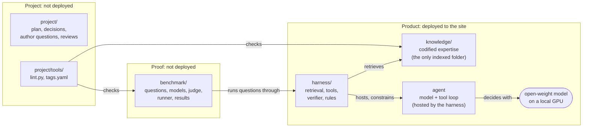

<p align="center">
  
</p>
<p align="center">
  
  
  
  
  
  
  
</p>
<p align="center">
  
  
  
  
  
</p>

# Agent E2: private cloud operations management expertise

- What it is: an LLM-based expert system, built as agentic RAG on a local LLM.
- Name: the author is E1; Agent E2 is the second version of that expertise, available all day. It will replace AskIO on isvara.io.

**💡 [Mission](MISSION.md) · 🏛️ [Architecture](ARCHITECTURE.md) · 🧠 [Knowledge engineering](KNOWLEDGE-ENGINEERING.md) · 🤖 [Agent](harness/AGENT.md) · ⚙️ [Harness](harness/README.md) · 🧪 [Benchmark](benchmark/design.md)**

**Business problem:**
- Many private cloud customers cannot send operational data to a cloud AI service: regulated industries, government and defence, and dark sites with no Internet at all.
- Others can use cloud AI but must contain its cost: per-token fees grow with every question, user and automated check.
- Frontier AI models answer vSphere performance questions from public Internet text, which repeats common misconceptions. Their answers $\color{red}{\text{sound expert}}$ and are often wrong at Level 400. 

**Mission:**
- An open-weight model, running offline on one GPU (dark site, no Internet), answering Level 400 private cloud management questions better than frontier models.

## Why it is possible
- A frontier model wins on memorised breadth. In one *narrow* domain, retrieval supplies the knowledge, and what remains is reading a few files and applying their rules. Current 27-32B open models are close to frontier models at that.
- The frontier model memorised the Internet's misconceptions ("Ready above 5% is bad", "the VM is the Guest OS"). The knowledge base holds the author's corrections. Measured: the frontier model without it gave the trap answer on 16% of answers. 
- The knowledge base is current (vSphere 9.1, VCF 9.1.1); training data lags.
- Exact work moves out of the model: a catalog returns units, rollups and thresholds; a calculator does the arithmetic; a flow executor keeps the order of checks.
- The knowledge is written for VMware Administrators and Architects: one fact per bullet, one object per file, traps linked to the metric they belong to.
- Argument, risks and what would prove it wrong: [MISSION.md](MISSION.md).

## The system
The model is frozen; we do not train it. We improve the three parts around it, and choose which frozen model to ship.

| Part | Job | Where |
|---|---|---|
| Knowledge base | Level 400 facts, mechanisms, traps, flows and exact data | `knowledge/` |
| Harness | Retrieval, exact tools, rules, budgets, answer verifier | `harness/` |
| Agent | The model plus the tool loop: what it is told up front, how it chooses tools | `harness/AGENT.md` |
| Model | An open-weight vision model on one GPU, chosen by the benchmark | `benchmark/models.md` |

- The benchmark tests the whole system, not the model: it picks the model, scores each change to the other three parts, and compares the system with the frontier model.

## Repository map

Three groups. Only the product is deployed.



- Product: what runs at the customer site.
  - `knowledge/`: Level 400 mechanisms, metrics, traps and troubleshooting flows, plus exact data in `knowledge/catalog/`. Version 1.0 covers vSphere 9.1 metrics and the Guest OS layer; the end scope is the private cloud stack (vSAN, NSX, VCF Operations, Kubernetes, Linux).
  - `harness/`: the software around the model: hybrid retrieval, link expansion, exact tools (catalog lookup, calculator, flow executor), answer verifier. Reads `knowledge/`; depends on no other folder.
  - Agent: the model plus the tool loop, in agentic mode. Its loop is harness code (`harness/agent.py`, up-front blocks in `harness/primer.py`); what it is told and how it decides: `harness/AGENT.md`.
  - Model: an open-weight vision model that fits one GPU (at most 96 GB), chosen by benchmark (`benchmark/models.md`). Not stored here.
- Proof: shows that the product beats a frontier model.
  - `benchmark/`: questions with answer keys and their attachments, the candidate models and judge (`benchmark/models.md`), the runner, results. One final score, 0-100%, with sub-scores by answer type (deterministic, judged), input type (text, table, screenshot) and level (100-400). Luck removed: Unsure option, confident-wrong rate, each question scored on its worst of 5 runs. Never indexed: it holds the answer keys.
- Project: how this repository is built and kept correct.
  - `project/`: plan (milestones, decisions, open work), author questions, reviews, archive.
  - `project/tools/`: `lint.py` (file, tag and folder checks, run before every merge) and `tags.yaml` (allowed tag values, avoided phrases).

## Documents

| Read | For |
|---|---|
| [MISSION.md](MISSION.md) | The mission; why it is possible; what we can change; risks; what the product must do; design considerations |
| [ARCHITECTURE.md](ARCHITECTURE.md) | The whole system: parts, modes, dark site, checks, query flow; links the component designs |
| [KNOWLEDGE-ENGINEERING.md](KNOWLEDGE-ENGINEERING.md) | How expertise is codified and found; folder, metadata, trap, flow, image and writing rules |
| [harness/AGENT.md](harness/AGENT.md) | What the agent knows up front, what it decides, its rules, how it is improved |
| [harness/README.md](harness/README.md) | What each harness part does for an expert answer; modules |
| [benchmark/design.md](benchmark/design.md) | How the benchmark proves the claim; final score |
| [benchmark/models.md](benchmark/models.md) | Model design: which frozen model to ship, size and hardware; frontier reference; judge |
| [benchmark/live-test.md](benchmark/live-test.md) | The system deployed on an offline model: setup, steps, pass criteria |
| [project/plan.md](project/plan.md) | Milestones, decisions, open work |
| [CONTRIBUTING.md](CONTRIBUTING.md) | How to add or change a file |

## Status
- Goal not achieved yet: best small model 58% vs frontier 75% on the first 17 questions.
- Plan, milestones and decisions: `project/plan.md`. Latest review: `project/review-2026-11-06.md`.

## Checks

```bash
python3 project/tools/lint.py
```

```bash
python3 -m unittest harness/test_tools.py
```
