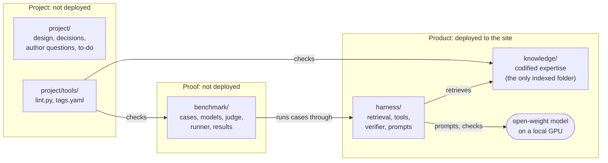

<p align="center">
  
</p>
<p align="center">
  
  
  
  
  
  
  
</p>
<p align="center">
  
  
  
  
  
</p>

# Isvara: private cloud operations management expertise

**🏛️ [Architecture](ARCHITECTURE.md) · 🧠 [Knowledge engineering](KNOWLEDGE-ENGINEERING.md) · 🧪 [Test design](benchmark/test-design.md) · ⚙️ [Harness](harness/README.md)**

**Business problem:**
- Many private cloud customers cannot send operational data to a cloud AI service: regulated industries, government and defence, and dark sites with no Internet at all.
- Others can use cloud AI but must contain its cost: per-token fees grow with every question, user and automated check.
- Frontier AI models answer vSphere performance questions from public Internet text, which repeats common misconceptions. Their answers sound expert and are often wrong at Level 400.

**Goal:** an open-weight model, running offline on one GPU (dark site, no Internet, no per-token cost), answers Level 400 private cloud operations questions better than frontier models.

## Repository map

Three groups. Only the product is deployed.



- Product: what runs at the customer site.
  - `knowledge/`: Level 400 mechanisms, metrics, traps and troubleshooting flows, plus exact data in `knowledge/catalog/`. Version 1.0 covers vSphere 9.1 metrics and the Guest OS layer; the end scope is the private cloud stack (vSAN, NSX, VCF Operations, Kubernetes, Linux).
  - `harness/`: the software around the model: hybrid retrieval, link expansion, exact tools (catalog lookup, calculator, flow executor), answer verifier. Reads `knowledge/`; depends on no other folder.
  - Model: an open-weight vision model that fits one GPU (at most 96 GB), chosen by benchmark (`benchmark/models.md`). Not stored here.
- Proof: shows that the product beats a frontier model.
  - `benchmark/`: exam cases with answer keys and their attachments, the candidate models and judge (`benchmark/models.md`), the runner, results. One final score, 0-100%, with sub-scores for multiple choice, screenshot and conversation. Luck removed: Unsure option, confident-wrong rate, each case scored on its worst of 5 runs. Never indexed: it holds the answer keys.
- Project: how this repository is built and kept correct.
  - `project/`: design, decisions, reviews, author questions, to-do, archive.
  - `project/tools/`: `lint.py` (file, tag and folder checks, run before every merge) and `tags.yaml` (allowed tag values, avoided phrases).

## Documents

| Read | For |
|---|---|
| [ARCHITECTURE.md](ARCHITECTURE.md) | How model, harness and knowledge run together; ingest, query and answer steps |
| [KNOWLEDGE-ENGINEERING.md](KNOWLEDGE-ENGINEERING.md) | Forms of codified knowledge; folder, metadata, trap, flow, image and writing rules |
| [benchmark/test-design.md](benchmark/test-design.md) | How the benchmark proves the gain; final score |
| [benchmark/models.md](benchmark/models.md) | Candidate models, frontier reference, judge |
| [harness/README.md](harness/README.md) | Harness modules and commands |
| [project/solution-design.md](project/solution-design.md) | Why it can work, why 32B |
| [CONTRIBUTING.md](CONTRIBUTING.md) | How to add or change a file |

## Status
- Goal not achieved yet: best small model 58% vs frontier 75% on the first 17 questions.
- Findings and decisions: `project/review-2026-11-04.md`.

## Checks

```bash
python3 project/tools/lint.py
```

```bash
python3 -m unittest harness/test_tools.py
```
