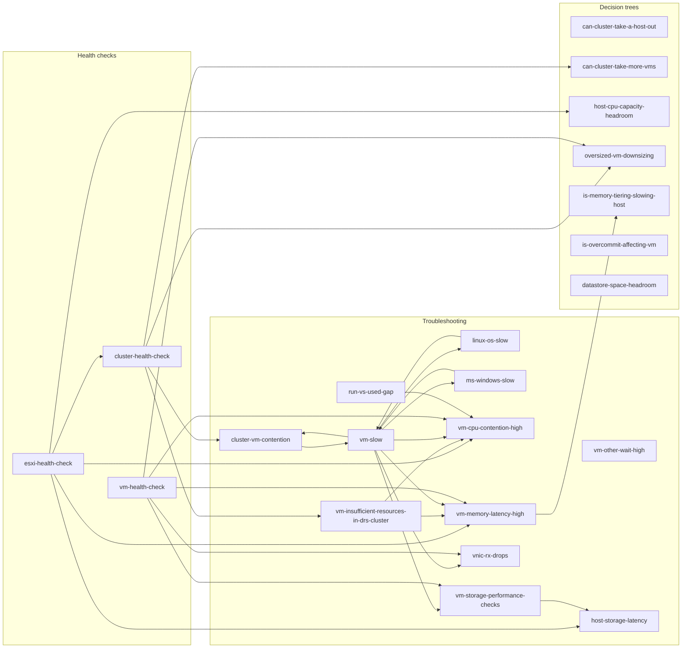

# Repository map

Where each thing lives. For people; not indexed. How the parts work together: [ARCHITECTURE.md](ARCHITECTURE.md), section Repository.

## Root
| File | For |
|---|---|
| [README.md](README.md) | What Agent E2 is, in one page |
| [MISSION.md](MISSION.md) | Why a small local model can win; requirements; risks |
| [ARCHITECTURE.md](ARCHITECTURE.md) | The whole system: repository, parts, modes, query flow |
| [`images/`](images) | Diagrams of the root documents: `product-architecture.svg` (ARCHITECTURE.md, section Product), drawn by [`project/tools/product_diagram.py`](project/tools/product_diagram.py); `knowledge-structure.svg` (KNOWLEDGE-ENGINEERING.md, section 2), drawn by [`project/tools/knowledge_diagram.py`](project/tools/knowledge_diagram.py). Six more, drawn by [`project/tools/document_diagrams.py`](project/tools/document_diagrams.py): `knowledge-workflow`, `knowledge-paths`, `file-as-model-sees`, `source-to-reviewed` (KNOWLEDGE-ENGINEERING.md), `agent-e2-in-pcm`, `repository-groups` (ARCHITECTURE.md). Not indexed |
| [KNOWLEDGE-ENGINEERING.md](KNOWLEDGE-ENGINEERING.md) | The knowledge design: where knowledge lives, forms, Level 400 and misconceptions. Rules: [`project/knowledge-rules/`](project/knowledge-rules) |
| [CONTRIBUTING.md](CONTRIBUTING.md) | How to add or change a file |
| [CLAUDE.md](CLAUDE.md) | How Claude works in this repository |
| [SECURITY.md](SECURITY.md) | Security policy |

## Product: deployed to the site
| Folder | Holds |
|---|---|
| `knowledge/` | What Agent E2 reads. The only indexed folder. Placement rules: [project/knowledge-rules/placement.md](project/knowledge-rules/placement.md) |
| [`knowledge/catalog/`](knowledge/catalog) | Exact data in YAML, read by code: vCenter counters, esxtop fields, object model, thresholds (performance KPI, capacity models and decisions, alerts), user terms |
| [`knowledge/sp5-framework/`](knowledge/sp5-framework) | The method: how to operate VCF, the SP5 Framework (source: Private Cloud Management by Iwan Rahabok). `concepts/`: across pillars (overview, health check, health-risk-efficiency, class of service, modelling). `observability/`: how to read telemetry. `outputs/`: alerts, dashboards, reports, NOC live screen. `performance/`, `capacity/`: one pillar each |
| [`knowledge/vsphere/architecture/`](knowledge/vsphere/architecture) | vSphere design every metric follows from: provider and consumer, VM vs Guest OS realms, overhead, resource controls |
| [`knowledge/vsphere/technology/`](knowledge/vsphere/technology) | One technology at a time (`cpu`, `memory`, `storage`, `network`, `gpu`): how it works, metrics per object, what to set, troubleshooting and decision trees within that technology |
| [`knowledge/vsphere/object-types/`](knowledge/vsphere/object-types) | One folder per object type (`vm`, `esxi`, `cluster`, `resource-pool`, `datastore`, `datastore-cluster`, `distributed-switch`, `distributed-port-group`): what combines technologies, KPIs, models, the object's alerts (`<object>-alerts`), its health check (`<object>-health-check`), troubleshooting and decision trees on that object |
| [`knowledge/vsphere/tools/`](knowledge/vsphere/tools) | How esxtop and the vSphere Client show the counters |
| [`knowledge/vcf-operations/`](knowledge/vcf-operations) | The product VCF Operations: its role, `features/`, `dashboards/` and the report suite as built in it, and how an alert definition works (`alert-definitions`). How to design them is method (`sp5-framework/outputs/`); metrics it computes about vSphere objects live with those objects |
| [`knowledge/guest-os/`](knowledge/guest-os) | Windows and Linux: a separate realm from the VM; the hypervisor neither sees nor controls it. The Guest OS alerts: `guest-os-alerts` |
| [`knowledge/glossary.md`](knowledge/glossary.md) | The agent's vocabulary |
| `harness/` | The agent (six stages: case, reading plan, compute, ask, answer, check) and its tools: retrieval, catalog, calculator, verifier, web; the planning calculator and the flow executor are built but not yet called by the agent. [README](harness/README.md), [AGENT.md](harness/AGENT.md) |

## Flows
A flow is an expert's order of checks. Three kinds, named by `retriever_guide` (health-check, troubleshooting, decision-tree); the agent finds them by that metadata, wherever the file sits: the reading plan puts the best flow of the question's kind first (tier 1, [harness/AGENT.md](harness/AGENT.md), section 4.2), and the model follows its numbered steps. Code taking the branches is to build (Q166). What each kind is: [Health check](knowledge/sp5-framework/concepts/health-check.md); the word: [glossary](knowledge/glossary.md), entry Flow. Placement: a flow sits at its entry point, the object and layer where the symptom or question is stated, and hands off to another flow at an object or realm boundary ([placement.md](project/knowledge-rules/placement.md), Flows). Lint checks that these tables list every flow and that the map of hand-offs below is current.

### Health checks: is this object healthy?
Started by a schedule or a request, never by a problem. Always on one object type, never on a technology or a pillar; every pillar in order: availability, performance, security, capacity. The parent includes its children, except across a realm (the Guest OS is not part of the VM or host check). A failed step opens a troubleshooting flow.

| Object | File |
|---|---|
| VM | [`vsphere/object-types/vm/vm-health-check`](knowledge/vsphere/object-types/vm/vm-health-check.md) |
| ESXi host | [`vsphere/object-types/esxi/esxi-health-check`](knowledge/vsphere/object-types/esxi/esxi-health-check.md) |
| vSphere cluster | [`vsphere/object-types/cluster/cluster-health-check`](knowledge/vsphere/object-types/cluster/cluster-health-check.md) |

### Troubleshooting: why is it down or slow?
Started by a known problem: a complaint, an alert, or a failed health check step. Start a performance complaint at the VM slow flow.

| Symptom | File |
|---|---|
| Users say the VM is slow | [`vsphere/object-types/vm/troubleshooting/vm-slow`](knowledge/vsphere/object-types/vm/troubleshooting/vm-slow.md) |
| Windows is slow (step 1 of VM slow) | [`guest-os/system/troubleshooting/ms-windows-slow`](knowledge/guest-os/system/troubleshooting/ms-windows-slow.md) |
| Linux is slow (step 1 of VM slow) | [`guest-os/system/troubleshooting/linux-os-slow`](knowledge/guest-os/system/troubleshooting/linux-os-slow.md) |
| VM CPU Contention or Latency is high | [`vsphere/technology/cpu/troubleshooting/vm-cpu-contention-high`](knowledge/vsphere/technology/cpu/troubleshooting/vm-cpu-contention-high.md) |
| VM CPU Other Wait is high | [`vsphere/technology/cpu/troubleshooting/vm-other-wait-high`](knowledge/vsphere/technology/cpu/troubleshooting/vm-other-wait-high.md) |
| VM CPU Run and Used differ | [`vsphere/technology/cpu/troubleshooting/run-vs-used-gap`](knowledge/vsphere/technology/cpu/troubleshooting/run-vs-used-gap.md) |
| VM memory latency (contention) is high | [`vsphere/technology/memory/vm-memory-latency-high`](knowledge/vsphere/technology/memory/vm-memory-latency-high.md) |
| VM storage performance: what to check | [`vsphere/technology/storage/troubleshooting/vm-storage-performance-checks`](knowledge/vsphere/technology/storage/troubleshooting/vm-storage-performance-checks.md) |
| ESXi storage latency is high | [`vsphere/technology/storage/troubleshooting/host-storage-latency`](knowledge/vsphere/technology/storage/troubleshooting/host-storage-latency.md) |
| vNIC receive drops | [`vsphere/technology/network/vnic-rx-drops`](knowledge/vsphere/technology/network/vnic-rx-drops.md) |
| VMs in a cluster face contention | [`vsphere/object-types/cluster/cluster-vm-contention`](knowledge/vsphere/object-types/cluster/cluster-vm-contention.md) |
| VM starved of resources in a DRS cluster | [`vsphere/object-types/vm/troubleshooting/vm-insufficient-resources-in-drs-cluster`](knowledge/vsphere/object-types/vm/troubleshooting/vm-insufficient-resources-in-drs-cluster.md) |

### Decision trees: can it, should it, how much?
Started by one operational question; ends in a choice to act, with its reason. Not a health check, even when a health check step reads its result.

| Question | File |
|---|---|
| Can this cluster take more VMs? | [`vsphere/object-types/cluster/decision-tree/can-cluster-take-more-vms`](knowledge/vsphere/object-types/cluster/decision-tree/can-cluster-take-more-vms.md) |
| Does this ESXi host have CPU headroom? | [`vsphere/technology/cpu/decision-tree/host-cpu-capacity-headroom`](knowledge/vsphere/technology/cpu/decision-tree/host-cpu-capacity-headroom.md) |
| Should this large, idle VM be downsized? | [`vsphere/technology/cpu/decision-tree/oversized-vm-downsizing`](knowledge/vsphere/technology/cpu/decision-tree/oversized-vm-downsizing.md) |
| Is memory overcommit affecting this VM? | [`vsphere/technology/memory/decision-tree/is-overcommit-affecting-vm`](knowledge/vsphere/technology/memory/decision-tree/is-overcommit-affecting-vm.md) |
| Can this cluster take a host out? | [`vsphere/object-types/cluster/decision-tree/can-cluster-take-a-host-out`](knowledge/vsphere/object-types/cluster/decision-tree/can-cluster-take-a-host-out.md) |
| Is memory tiering slowing this host? | [`vsphere/technology/memory/decision-tree/is-memory-tiering-slowing-host`](knowledge/vsphere/technology/memory/decision-tree/is-memory-tiering-slowing-host.md) |
| Will this datastore run out of space? | [`vsphere/technology/storage/datastore-space-headroom`](knowledge/vsphere/technology/storage/datastore-space-headroom.md) |

### Map of hand-offs
Generated by [`project/tools/flow_map_diagram.py`](project/tools/flow_map_diagram.py) from the steps of each flow; do not edit by hand. A box is a flow file; click it to open the file. An arrow is a step that opens or hands off to another flow ([placement.md](project/knowledge-rules/placement.md), Flows).

## Proof: not deployed
| Folder | Holds |
|---|---|
| [`benchmark/questions/`](benchmark/questions) | Questions with answer keys. Never indexed. Template: [`benchmark/_templates/question.md`](benchmark/_templates/question.md) |
| [`benchmark/runner/`](benchmark/runner) | Runner (one file per job, named by it: `run_executor.py`, `round_executor.py`, `round_alive_check.py`), retrieval check (`retrieval_check.py`), topic check (`topic_check.py`, `topic_check_pairs.yaml`), screen answer check (`screen_answer_check.py`, `screen_answer_check.yaml`, `screen_answer_check_pages.json`), config |
| [`benchmark/results/`](benchmark/results) | One folder per run (`<date>-<model>`), [`README.md`](benchmark/results/README.md) (the analysis of all runs) and the retrieval check outputs (`retrieval-<date>/`) |
| [`benchmark/RUN.md`](benchmark/RUN.md) | How to run a benchmark round: prompt, approvals, time, cost |
| `benchmark/*.md` | [design](benchmark/design.md), [models](benchmark/models.md), [live test](benchmark/live-test.md), [retrieval check](benchmark/retrieval-check.md) |

## Project: not deployed
| Folder | Holds |
|---|---|
| [`project/README.md`](project/README.md) | What the project folder holds |
| [`project/plan.md`](project/plan.md) | Milestones, decisions, open work. Read first |
| [`project/consultations.md`](project/consultations.md) | The consultations Agent E2 leads: capacity planning (1.0) and 14 after 1.0, one entry each, for the author to edit |
| [`project/author-questions.md`](project/author-questions.md), [`project/author-questions-resolved.md`](project/author-questions-resolved.md) | Open questions for the author (Release 1.0, Future release); answered ones, kept as history |
| [`project/design-thresholds.md`](project/design-thresholds.md) | Threshold catalog design: use cases, files, fields. Proposal |
| [`project/archive/`](project/archive) | Records no longer maintained: reviews, the plan's decision logs, results of earlier benchmark generations, legacy code and designs |
| [`project/terms.md`](project/terms.md) | Repository terms (words to avoid when writing knowledge: [`project/knowledge-rules/vocabulary.md`](project/knowledge-rules/vocabulary.md)) |
| [`project/sources/`](project/sources) | Source documents: book chapters, vendor PDFs, technical notes. The author adds them; Claude may edit them |
| [`project/knowledge-rules/`](project/knowledge-rules) | Rules for knowledge files, one module each: placement, flows, metadata, thresholds, writing, terminology, vocabulary (words to avoid) |
| [`project/templates/`](project/templates) | Templates for knowledge files: concept, metric, configuration, alerts (one object type), screen, and the three flow kinds (health check, troubleshooting, decision tree) |
| [`project/tools/`](project/tools) | `rules_check.py` and `rules_check_values.yaml` (checks and allowed values), `link_rewriter.py` and `moved_ids.yaml` (old file ids → current ids), `markdown_tidy.py`, `kpi_csv_sync.py`, `author_replies.py`, `question_renumber.py`, `question_coverage.py` (what the question set covers: counts per tag value), `product_diagram.py` (the Product diagram of ARCHITECTURE.md), `knowledge_diagram.py` (the knowledge diagram of KNOWLEDGE-ENGINEERING.md), `document_diagrams.py` and `diagram_kit.py` (the other diagrams of the root documents and their shared helpers), `diagram_text.py` (the text of each SVG diagram, generated under its image; lint checks it), `model_view.py` (what the model gets from a knowledge file, for review), `flow_map_diagram.py` (the map of hand-offs between flows, section Flows) |
