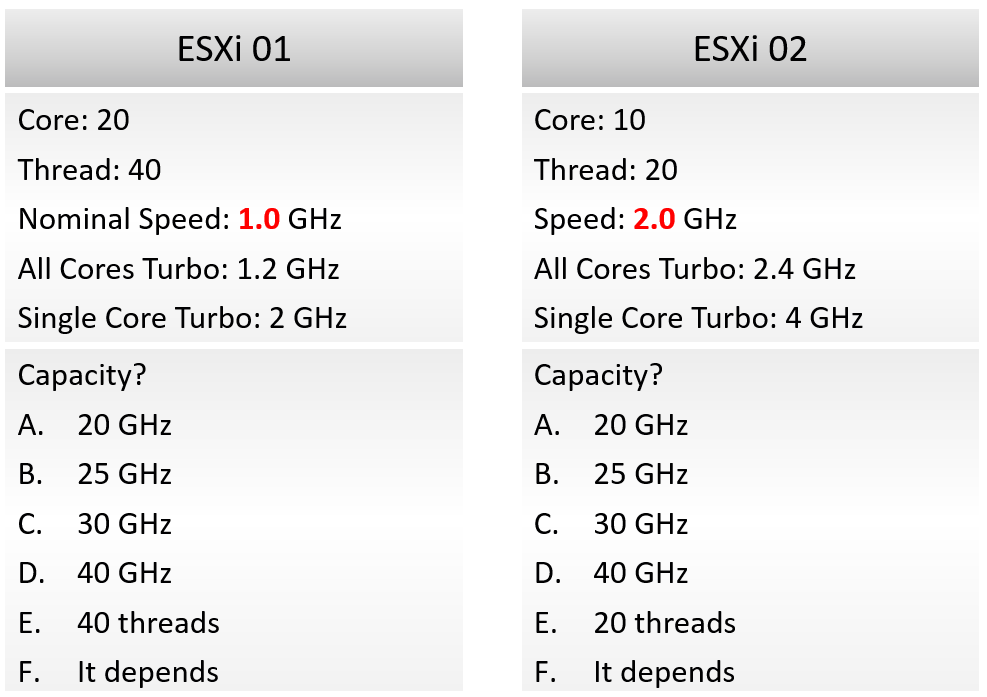

# ESXi CPU capacity: threads, not hertz

## Prompt
Review the two ESXi hosts in the attachment.

ESXi 01: 20 cores, 40 threads, nominal speed 1.0 GHz, All Cores Turbo 1.2 GHz, Single Core Turbo 2 GHz.
ESXi 02: 10 cores, 20 threads, speed 2.0 GHz, All Cores Turbo 2.4 GHz, Single Core Turbo 4 GHz.

What is the capacity of each host? Choose one answer per host.

ESXi 01: A. 20 GHz  B. 25 GHz  C. 30 GHz  D. 40 GHz  E. 40 threads  F. It depends
ESXi 02: A. 20 GHz  B. 25 GHz  C. 30 GHz  D. 40 GHz  E. 20 threads  F. It depends

Hints:
- The two hosts have different specifications, so the two answers must be different.
- ESXi capacity can also be expressed in CPU compute cycles: the amount of processing it can do per second. That is not the same as the count of cores.

## Attachments


## Likely wrong answer
A for both (20 GHz = cores x nominal GHz), or a GHz figure that includes Turbo or Hyper-Threading.

## Expected key points
- Answer: E for ESXi 01 (40 threads) and E for ESXi 02 (20 threads).
- Capacity measures space, not speed. Hertz measures throughput.
- A to D are performance figures: they fluctuate with frequency and Hyper-Threading, while total capacity does not.
- F is wrong: hardware capacity is fixed.

## Notes
- The second hint pushes toward GHz on purpose. It is a distractor.

## Metadata
```yaml
id: vsphere-cpu-006
title: "ESXi CPU capacity: threads, not hertz"
scope: vsphere
product: [vsphere]
technology: [cpu]
area: cpu
input: mixed
tests: concept
knowledge:
  - vsphere/technology/cpu/concepts/cpu-measurement-levels
  - operations-management/capacity/capacity-model
  - vsphere/technology/cpu/concepts/cpu-frequency
attachments: 
  - vsphere-cpu-006/two-esxi-hosts-specification-and-capacity-options.png
origin: quiz
source_path: "vSphere Metric Quiz.docx (author upload 2026-11-03) > CPU > Q3 ESXi Total Capacity"
format: compound            # two answers (one per host); scored by the judge
level: l400
status: draft
```
