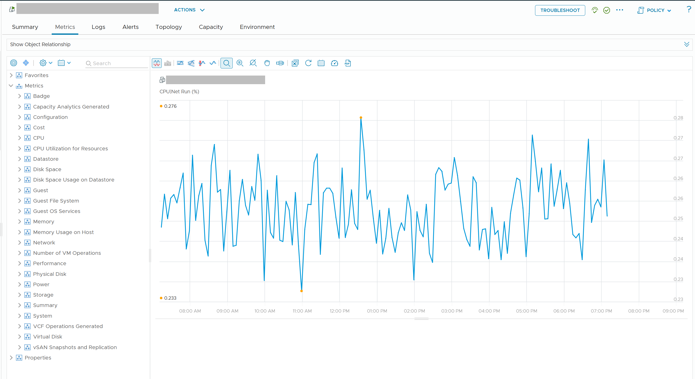

# Recognise the tool and the object

## Prompt
Look at [the attached screenshot](0037/vcf-operations-vm-metrics-tab.png).

Which statements about the screen are correct?

- A. It is VCF Operations.
- B. It is the vSphere Client.
- C. The object is a VM.
- D. The object is an ESXi host.

## Screenshot


## Likely wrong answer
B: taking the VCF Operations metric tree for the vCenter performance chart.

## Expected key points
- Answer: A, C.
- A true: the metric tree with groups such as CPU, Memory, Guest and Virtual Disk is the VCF Operations Metrics tab.
- B false: the vSphere Client shows Chart Options and Advanced Performance, not a metric tree; vCenter is the administrative tool, VCF Operations the operations tool.
- C true: the tree has groups only a VM has, such as Guest, Guest File System and Virtual Disk.
- D false: an ESXi host has no Guest group; its tree differs.

## Notes
- Review 2026-11-15: plural stem; one fact per option (tool, object). Key changed from A to A, C. The blank row left by the removed vCommunity group is closed in the screenshot.
- 2026-11-14 (project/question-pairing-2026-11-14.md, section 3.B): in the screenshot, the VM name masked in the title and the chart heading; the vCommunity group removed from the metric tree (author: every VM name is masked); the stale `## Input to supply` removed.
- Drafted by Claude 2026-11-05 from the knowledge files listed in `knowledge` (origin: synthetic). Counts only after author approval.
## Metadata
```yaml
id: "0037"
title: "Recognise the tool and the object"
product: [vcf-operations, vsphere]
technology: [system]
task: read-metric
level: 100
answer_type: deterministic
input: [screenshot]
knowledge:
  - vsphere/architecture/metric-sources
  - vsphere/architecture/vm-vs-guest-os
attachments:
  - 0037/vcf-operations-vm-metrics-tab.png
origin: synthetic
source_path: "Drafted by Claude 2026-11-05"
answer: [A, C]
misconception: [B]
object: [vm]
tool: [vcf-operations]
knowledge_main: vsphere/architecture/metric-sources
misconception_type: []
status: reviewed
```
