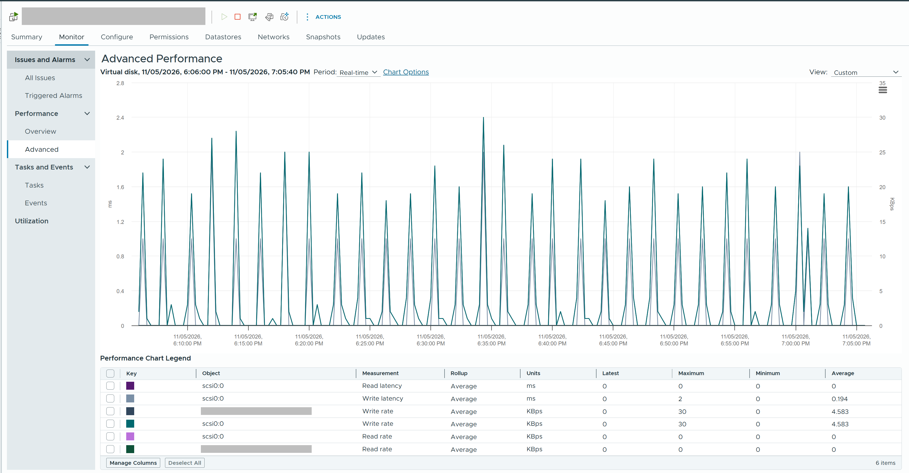

# Latency counters in a vCenter virtual disk chart

## Prompt
[The attached screenshot](0034/vcenter-vm-virtual-disk-chart.png) is a vCenter performance chart of one VM, metric group Virtual disk.

Which of the counters in the chart measure latency? Choose all that apply.

- A. Read latency
- B. Write latency
- C. Read rate
- D. Write rate


## Screenshot


## Likely wrong answer
C or D: taking the rate (KBps) for latency.

## Expected key points
- Answer: A, B.
- Read latency and Write latency are in milliseconds: the time per IO.
- Read rate and Write rate are in kilobytes per second: throughput, not latency.

## Notes
- 2026-11-14 (project/question-pairing-2026-11-14.md, section 3.B): in the screenshot, the VM name masked in the title and the legend (author: every VM name is masked); the stale `## Input to supply` removed.
- Drafted by Claude 2026-11-05 from the knowledge files listed in `knowledge` (origin: synthetic). 

## Metadata
```yaml
id: "0034"
title: "Latency counters in a vCenter virtual disk chart"
product: [vsphere]
technology: [storage]
task: read-metric
level: 100
answer_type: deterministic
input: [screenshot]
knowledge:
  - vsphere/technology/storage/metrics/virtual-motherboard/disk-latency
  - vsphere/technology/storage/concepts/storage-layers
attachments:
  - 0034/vcenter-vm-virtual-disk-chart.png
origin: synthetic
source_path: "Drafted by Claude 2026-11-05"
answer: [A, B]
misconception: [C]
object: [vm]
tool: [vcenter]
knowledge_main: vsphere/technology/storage/metrics/virtual-motherboard/disk-latency
misconception_type: []
status: reviewed
```
