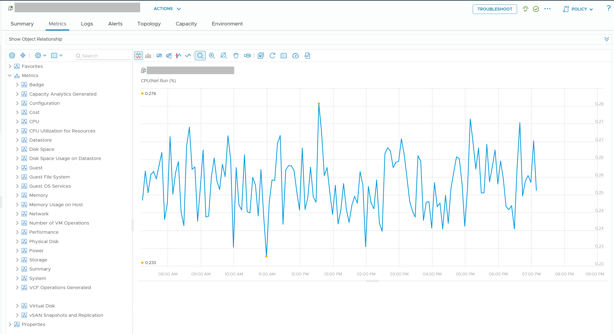

# Recognise the tool and the object

## Prompt
Look at [the attached screenshot](0037/vcf-operations-vm-metrics-tab.png).

Which tool shows it, and for which object type?

- A. VCF Operations, a virtual machine
- B. vCenter, a virtual machine
- C. esxtop, an ESXi host
- D. VCF Operations, an ESXi host


## Screenshot


## Input to supply
- Tool: VCF Operations 9.1.
- Where: one VM > Metrics tab, metric tree expanded at the top level.
- Must show: the object type icon and name in the header, and the top-level metric groups (CPU, Memory, Guest, Virtual Disk, Network).
- Mask the VM name.
- Save as `benchmark/questions/37/vcf-operations-vm-metrics-tab.png`.

## Likely wrong answer
B: taking the VCF Operations metric tree for the vCenter performance chart.

## Expected key points
- Answer: A.
- The metric tree with groups such as CPU, Memory, Guest and Virtual Disk is the VCF Operations Metrics tab of a VM.
- vCenter is the administrative tool and shows Chart Options; VCF Operations is the operations tool.

## Notes
- Drafted by Claude 2026-11-05 from the knowledge files listed in `knowledge` (origin: synthetic). Counts only after author approval.
## Metadata
```yaml
id: "0037"
title: "Recognise the tool and the object"
product: [vcf-operations, vsphere]
technology: [system]
task: read-metric
level: 100
answer_type: deterministic
input: [screenshot]
knowledge:
  - vsphere/architecture/metric-sources
  - vsphere/architecture/vm-vs-guest-os
attachments:
  - 0037/vcf-operations-vm-metrics-tab.png
origin: synthetic
source_path: "Drafted by Claude 2026-11-05"
answer: [A]
misconception: [B]
object: [vm]
tool: [vcf-operations]
knowledge_main: vsphere/architecture/metric-sources
misconception_type: []
status: reviewed
```
