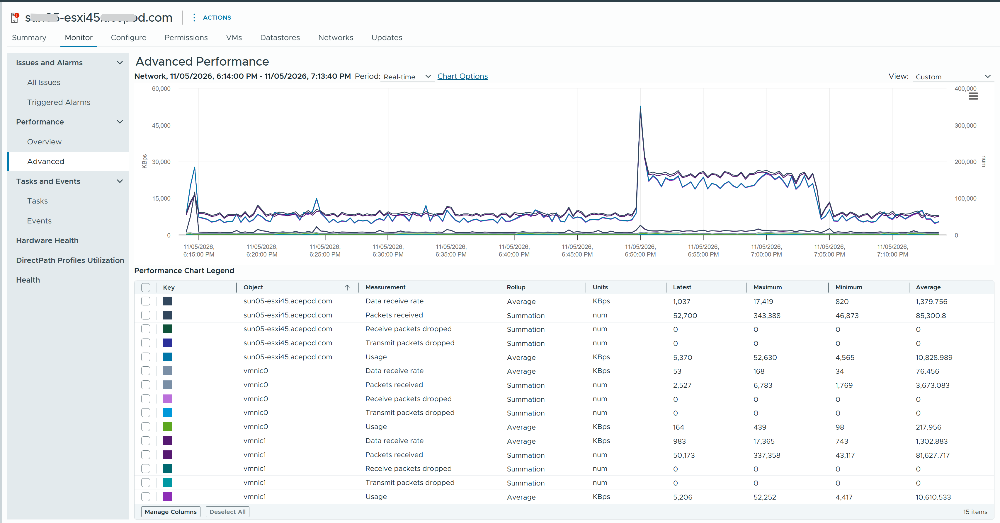

# Contention counters in a vCenter host network chart

## Prompt
Review [the attached screenshot](0042/vcenter-esxi-network-chart.png).

Which counters in the chart show contention, and what value do you expect from them on a healthy host? Which statements are correct?

- A. Receive packets dropped: a contention counter, expected to stay at 0 on a healthy host.
- B. Transmit packets dropped: a contention counter, expected to stay at 0 on a healthy host.
- C. Data receive rate: a contention counter that stays well below the link speed on a healthy host.
- D. Packets received: a contention counter, where a sudden rise shows the vmnic is short of capacity.

## Attachments


## Answers
A, B

## Explanation
- A is correct: dropped (and error) packets are the host network contention counters; a data center network should be free of drops, so the expected value is 0 at all times.
- B is correct: transmit drops on a vmnic are contention too, expected at 0; on a healthy host they are rare.
- C is wrong: Data receive rate is consumption, the work done; a busy host can be healthy, and a network has no clear 100% to read contention from.
- D is wrong: Packets received is consumption too; a rise means more work, not a shortage of capacity.
- Misconception: C or D: "The data rate and the packet count show how busy the network is, so they show contention."

## Notes
- 2026-11-14 (project/question-pairing-2026-11-14.md, section 3.B): in the screenshot, the host name masked in the title and the legend (host, VM, datastore and cluster names are masked: benchmark/design.md, section 13); the stale `## Input to supply` removed.
- Changed in the 2026-11-15 audit: C (Usage expected near 0) and D (Packets received expected 0) were throwaways and were replaced with consumption counters read as contention (host/throughput, network-characteristics); "Choose all that apply" removed; "## Screenshot" renamed "## Attachments"; key points one per option; needs the author's review.
## Metadata
```yaml
id: "0042"
title: "Contention counters in a vCenter host network chart"
product: [vsphere]
technology: [network]
task: read-metric
level: 200
answer_type: deterministic
input: [screenshot]
knowledge:
  - vsphere/technology/network/metrics/host/packets-dropped
  - vsphere/technology/network/metrics/host/errors
  - vsphere/technology/network/metrics/host/throughput
  - vsphere/technology/network/concepts/network-characteristics
attachments:
  - 0042/vcenter-esxi-network-chart.png
origin: synthetic
source_path: "Synthetic, 2026-11-05"
misconception: [C, D]
object: [esxi]
tool: [vcenter]
knowledge_main: vsphere/technology/network/metrics/host/packets-dropped
misconception_type: [consumption-as-contention]
status: draft
```
