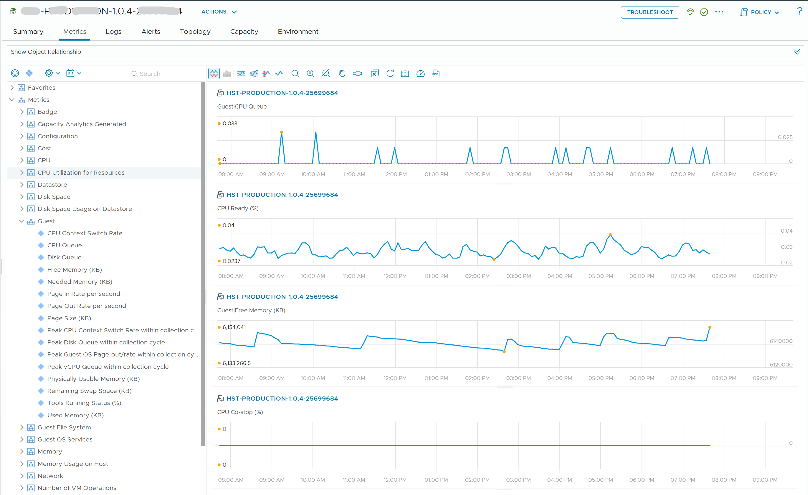

# Guest OS metrics in the VM metric tree

## Prompt
Review [the attached screenshot](0051/vcf-operations-vm-guest-and-cpu-metrics.png).

Which of these metrics are Microsoft Windows or Linux metrics, not VMware VM metrics? Choose all that apply.

- A. Guest | CPU Queue
- B. CPU | Ready
- C. Guest | Free Memory
- D. CPU | Co-stop


## Screenshot


## Likely wrong answer
Taking every metric on the VM object as a VM metric.

## Expected key points
- Answer: A, C.
- A is correct: CPU Queue is the Guest OS run queue, read inside Windows through VMware Tools. It is stored on the VM object, but the Guest OS layer produces it: decide by the producing layer, not by the storing object.
- B is wrong: Ready is time the VMkernel held a ready vCPU off a physical CPU; the VMkernel measures it, and the Guest OS cannot see it.
- C is correct: Free Memory is the Guest OS memory counter in the Guest group, read inside Windows through VMware Tools.
- D is wrong: Co-stop is time the VMkernel stopped a vCPU to keep the VM's vCPUs in step; a VM metric the Guest OS cannot see.

## Notes
- 2026-11-14 (project/question-pairing-2026-11-14.md, section 3.B): in the screenshot, the VM name masked in the title and the four chart headings (author: every VM name is masked); the stale `## Input to supply` removed.
- 2026-11-16 re-review: key points rewritten to one reason per option.
- Drafted by Claude 2026-11-05 from the knowledge files listed in `knowledge` (origin: synthetic). Counts only after author approval.
## Metadata
```yaml
id: "0051"
title: "Guest OS metrics in the VM metric tree"
product: [vcf-operations, vsphere, windows]
technology: [system]
task: read-metric
level: 200
answer_type: deterministic
input: [screenshot]
knowledge:
  - vsphere/architecture/vm-vs-guest-os
  - vsphere/architecture/metric-sources
attachments:
  - 0051/vcf-operations-vm-guest-and-cpu-metrics.png
origin: synthetic
source_path: "Drafted by Claude 2026-11-05"
answer: [A, C]
misconception: [B]
object: [vm, guest-os]
tool: [vcf-operations]
knowledge_main: vsphere/architecture/vm-vs-guest-os
misconception_type: []
status: reviewed
```
