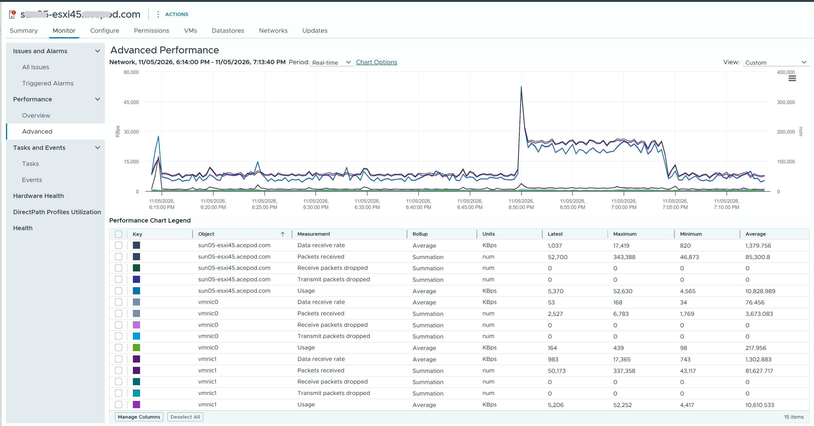

# Contention counters in a vCenter host network chart

## Prompt
The attached screenshot is a vCenter performance chart of one ESXi host, metric group Network.

Which counters in the chart show contention, and what value do you expect from them on a healthy host? Choose all that apply.

- A. Receive packets dropped: expected 0.
- B. Transmit packets dropped: expected 0.
- C. Usage: expected near 0.
- D. Packets received: expected 0.


## Screenshot


## Input to supply
- Tool: vCenter (vSphere Client 9.1).
- Where: one ESXi host > Monitor > Performance > Advanced > Chart Options > Network, object: the host (all vmnics).
- Counters to tick: Receive packets dropped, Transmit packets dropped, Usage, Packets received. Real-time or Last day.
- Mask the host name.
- Save as `benchmark/questions/42/vcenter-esxi-network-chart.png`.

## Likely wrong answer
C: reading host network Usage as a sign of trouble.

## Expected key points
- Answer: A, B.
- Dropped (and error) packets are the network contention counters. On a data center network they should be 0 at all times.
- Usage and packets received measure work done; a busy host can be healthy.
- Receive drops are far more common than transmit drops; a pattern goes to the network team.

## Notes
- Previous id: question-0042 (renamed 2026-11-05).
- Drafted by Claude 2026-11-05 from the knowledge files listed in `knowledge` (origin: synthetic). Counts only after author approval.
## Metadata
```yaml
id: "0042"
title: "Contention counters in a vCenter host network chart"
product: [vsphere]
technology: [network]
task: read-metric
level: 200
answer_type: deterministic
input: [screenshot]
knowledge:
  - vsphere/technology/network/metrics/host/packets-dropped
  - vsphere/technology/network/metrics/host/errors
attachments:
  - 0042/vcenter-esxi-network-chart.png
origin: synthetic
source_path: "Drafted by Claude 2026-11-05 for the Level 100-200 allocation (benchmark/design.md, section 3.6)"
answer: [A, B]
misconception: [C]
status: draft
```
