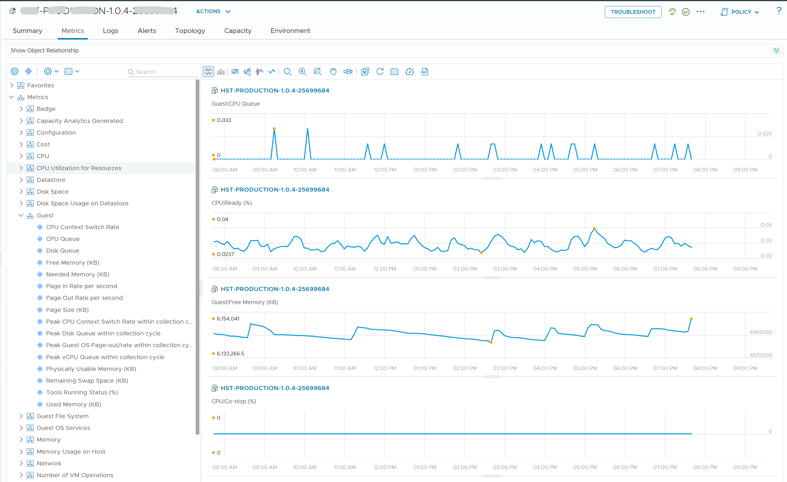

# Guest OS metrics in the VM metric tree

## Prompt
The attached screenshot is the VCF Operations Metrics tab of a Windows VM, with the Guest and CPU groups expanded.

Which of these metrics are Guest OS metrics, not VM metrics? Choose all that apply.

- A. Guest | CPU Queue
- B. CPU | Ready
- C. Guest | Free Memory
- D. CPU | Co-stop


## Screenshot


## Input to supply
- Tool: VCF Operations 9.1.
- Where: one Windows VM with VMware Tools running > Metrics tab; expand the Guest group and the CPU group.
- Must show: Guest | CPU Queue, Guest | Free Memory, CPU | Ready, CPU | Co-stop (names as VCF Operations 9.1 shows them; tell Claude if a name differs).
- Mask the VM name.
- Save as `benchmark/questions/51/vcf-operations-vm-guest-and-cpu-metrics.png`.

## Likely wrong answer
Taking every metric on the VM object as a VM metric.

## Expected key points
- Answer: A, C.
- The Guest group comes from inside Windows through VMware Tools. It is stored on the VM object, but the Guest OS layer produces it.
- Ready and Co-stop are measured by the VMkernel: VM metrics the Guest OS cannot see.
- Decide by the layer that produces a metric, not by the object that stores it.

## Notes
- Previous id: question-0051 (renamed 2026-11-05).
- Drafted by Claude 2026-11-05 from the knowledge files listed in `knowledge` (origin: synthetic). Counts only after author approval.
## Metadata
```yaml
id: "0051"
title: "Guest OS metrics in the VM metric tree"
product: [vcf-operations, vsphere, windows]
technology: [system]
task: read-metric
level: 200
answer_type: deterministic
input: [screenshot]
knowledge:
  - vsphere/foundations/vm-vs-guest-os
  - vsphere/foundations/metric-sources
attachments:
  - 0051/vcf-operations-vm-guest-and-cpu-metrics.png
origin: synthetic
source_path: "Drafted by Claude 2026-11-05 for the Level 100-200 allocation (benchmark/design.md, section 3.6)"
answer: [A, C]
trap: [B]
status: draft
```
