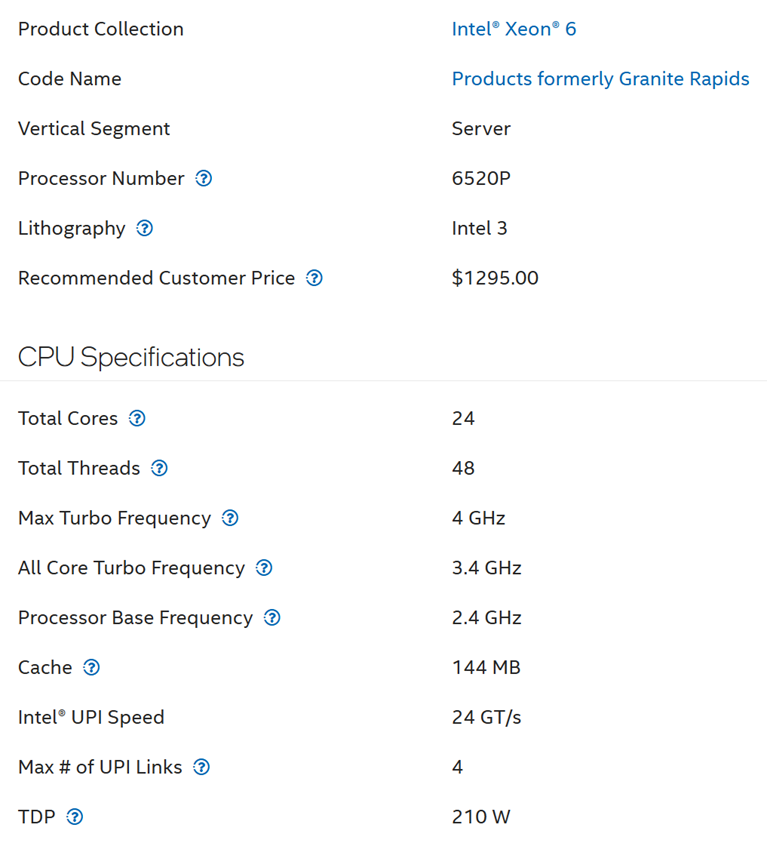

# Reading an Intel Xeon specification: base, all-core Turbo, TDP

## Prompt
- CPU specification, taken unchanged from the Intel website: Intel Xeon 6 6530P (Granite Rapids).
- 32 cores, 64 threads, Max Turbo Frequency 4.1 GHz, All Core Turbo Frequency 3.7 GHz, Processor Base Frequency 2.3 GHz, cache 144 MB, TDP 225 W.

Choose all the correct statements about the Xeon 6530P:

- A. All 32 cores can run at the 3.7 GHz All Core Turbo at the same time.
- B. The 225 W TDP is the most power the processor can draw.
- C. vSphere counts 2.3 GHz per core when it reports the host's Total Capacity (GHz).
- D. Under load on every core, the cores spend most of their time near 2.3 GHz.
- E. At its 4.1 GHz Max Turbo the processor draws more than its 225 W TDP.
- F. The 4.1 GHz Max Turbo is the single-core figure that single-thread benchmarks quote.
- G. With Hyper-Threading, the 64 threads deliver twice the work of the 32 cores.
- H. Under load on every core, the cores run near the 4.1 GHz Max Turbo most of the time.
- I. Turn Turbo Boost off in the BIOS to keep the processor within its 225 W.

## Answers
A, C, F

## Explanation
- A is true: All-Core Turbo is the frequency every core can hold at the same time; 3.7 GHz is 61% above base.
- B is false: TDP is Thermal Design Power: the average power the processor dissipates at Base Frequency with all cores active under an Intel-defined high-complexity workload. It is not the maximum draw.
- C is true: Total Capacity (GHz) counts every core at the base (nominal) frequency: the capacity at base clock, with no Turbo or Hyper-Threading in it. Intel does not expose All-Core Turbo through an API, so vSphere could not count it anyway.
- D is false: a loaded CPU rarely runs at base clock; it spends most of its time near All-Core Turbo, so base understates throughput.
- E is false: power and frequency are not linear. At Single-Core Turbo the other cores are idle, so total power can stay below TDP.
- F is true: Max Turbo is the Single-Core Turbo figure, a marketing figure that single-thread benchmarks use.
- G is false: Hyper-Threading delivers about 1.25 times the work of one thread per core, not 2 times.
- H is false: the over-correction of D. Single-Core Turbo is reached only when few cores are active and the rest are idle; with every core loaded the ceiling is All-Core Turbo, 3.7 GHz.
- I is false: Turbo works within the socket's power envelope; under heavy instructions the processor lowers its frequency to stay under the limit, so turning Turbo off only gives up throughput.
- Misconception: B (TDP read as maximum power draw), D (base frequency read as the speed a loaded CPU runs at), or E (power read as rising with the highest clock).

## Notes
- The Intel web page image holds the specification of the Xeon 6 6520P, the product of the original quiz. It is not sent to the candidate: it is not a product screenshot (author, 2026-11-05).
- Product changed 2026-11-16 (re-review): cpu-frequency carries the 6520P as its Turbo example (base 2.4 GHz, 3.4 GHz, 42% above base), so the stem now gives the Xeon 6 6530P, from the Intel specification page read 2026-11-16 (https://www.intel.com/content/www/us/en/products/sku/242636/intel-xeon-6530p-processor-144m-cache-2-30-ghz/specifications.html). Every option recomputed; truth values unchanged.



- Fact source for the TDP definition: Intel's published definition (cpu-frequency, section TDP).
- Hint moved out of the prompt (author, 2026-11-14: a hint helps the frontier model, not the local model), for reviewers: "Be aware of the architectural difference between AMD EPYC and Intel Xeon."
- Options rewritten 2026-11-14 to the theory option rules (design.md 3.9; project/question-pairing-2026-11-14.md): one fact per option. Old C (only High Performance reaches Max Turbo) and D (Balanced costs performance for every workload) removed: the same facts are options E and G of 0111. C, D, F, G, H (the over-correction of D) and I (the wrong action) are new. Key changed from A to A, C, F (author approved, 2026-11-14).

## Metadata
```yaml
id: "0007"
title: "Reading an Intel Xeon specification: base, all-core Turbo, TDP"
product: [vsphere]
technology: [cpu]
input: [text]
task: explain-mechanism
object: [esxi]
tool: [none]
knowledge:
  - vsphere/technology/cpu/concepts/cpu-frequency
  - vsphere/technology/cpu/concepts/hyper-threading
knowledge_main: vsphere/technology/cpu/concepts/cpu-frequency
attachments: []
origin: quiz
source_path: "vSphere Metric Quiz.docx (author upload 2026-11-03) > CPU > Q4 ESXi CPU Frequency"
answer_type: deterministic
level: 300                      # author 2026-11-05
misconception: [B, D, E]
misconception_type: [frequency-and-hyper-threading]
status: draft
```
