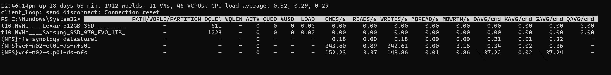

# Where the storage latency sits in esxtop

## Prompt
Review [the attached screenshot](0050/esxtop-disk-device-panel.png).

Look at the device with the highest GAVG. Which statements about its latency are correct?

- A. Nearly all of it is spent on the storage network or in the NAS, past the host's storage stack.
- B. A large part of it is time the commands spend queued in the VMkernel of this host (KAVG).
- C. It does not matter: at about 150 commands per second, 37 ms is noise.
- D. Its source cannot be read in esxtop: an NFS datastore has no device latency in esxtop.
- E. Part of it is hidden: the - in QUED stands for commands waiting for a free device queue slot.

## Screenshot


## Answers
A

## Explanation
- A is correct: the device with the highest GAVG is {NFS}vcf-m02-sup01-ds-nfs: GAVG 37.24 ms = KAVG 0.02 ms + DAVG 37.22 ms. For an NFS row, DAVG is the time beyond the host NFS client: network latency plus NAS processing time. KAVG near 0 shows no wait in the host's storage stack. Next: check the NFS server latency and the storage network (drops, MTU) to that server.
- B is wrong: KAVG is 0.02 ms on that row; the commands do not wait in the VMkernel.
- C is wrong: queues add latency at any load; 152 commands per second at 37 ms each is a slow datastore, not noise.
- D is wrong: esxtop shows an NFS datastore as an {NFS} pseudo-device at the File System Switch layer, with DAVG, KAVG and GAVG. It is not a physical device, and the vSphere Client lists no device for it, because NFS bypasses the Pluggable Storage Architecture.
- E is wrong: NFS has no SCSI device queue in the host (no DQLEN, no QAVG); the queue columns show - for that reason, and KAVG is 0.02 ms.
- Misconception: D: assuming an NFS datastore does not show in the device panel and has no DAVG.

## Notes
- Changed in the 2026-11-15 audit: throwaway C (the Guest OS) replaced by the low-IOPS over-correction; E added (a device queue NFS does not have); A reworded away from "outside the host" (the host's network stack sits beyond the NFS client); B made a full sentence; key points per option. Key unchanged: A. Needs the author's review.
- Re-review 2026-11-16: stem no longer asks where "most of the latency" comes from (it read as one answer); options reworded as separate statements about the row. Key unchanged.
- Review 2026-11-15: A reworded so it does not restate option A of the paired theory question 0186. Key unchanged.
- 2026-11-14 (project/question-pairing-2026-11-14.md, A15): the hand-drawn marks beside DAVG and GAVG on the answer row masked; the stale `## Input to supply` removed (screenshot supplied by the author 2026-11-05, esxtop on one ESXi 9.1 host); closing line made plural (Q199).
- Author 2026-11-05: Level 300; the misconception is thinking an NFS datastore is not in the device panel and has no DAVG.
- Synthetic, 2026-11-05, from the knowledge files listed in `knowledge`. Counts only after author approval.
## Metadata
```yaml
id: "0050"
title: "Where the storage latency sits in esxtop"
product: [vsphere]
technology: [storage]
task: troubleshoot
level: 300   # author 2026-11-05
answer_type: deterministic
input: [screenshot]
knowledge:
  - vsphere/technology/storage/concepts/esxi-storage-latency-stack
  - vsphere/tools/esxtop/storage
  - vsphere/tools/esxtop/overview
  - vsphere/technology/storage/troubleshooting/vm-storage-performance-checks
attachments:
  - 0050/esxtop-disk-device-panel.png
origin: synthetic
source_path: "Synthetic, 2026-11-05"
misconception: [D]
object: [esxi, datastore]
tool: [esxtop]
knowledge_main: vsphere/technology/storage/concepts/esxi-storage-latency-stack
misconception_type: [tool-confusion]
pair: "0186"
status: draft
```
