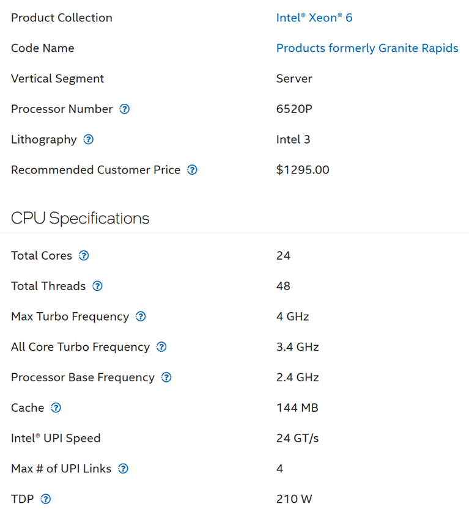

# Reading an Intel Xeon specification: base, all-core Turbo, TDP

## Prompt
- CPU specification, taken unchanged from the Intel website: Intel Xeon 6 6520P (Granite Rapids).
- 24 cores, 48 threads, Max Turbo Frequency 4 GHz, All Core Turbo Frequency 3.4 GHz, Processor Base Frequency 2.4 GHz, cache 144 MB, TDP 210 W.

Choose all the correct statements about the Xeon 6520P:

- A. All 24 cores can run at 3.4 GHz at the same time.
- B. The 210 W TDP is the most power the processor can draw.
- C. vSphere counts 2.4 GHz per core when it reports the host's Total Capacity (GHz).
- D. Under load on every core, the cores spend most of their time near 2.4 GHz.
- E. At 4 GHz the processor draws more than 210 W.
- F. The 4 GHz Max Turbo is reached only while few cores are active and the rest are idle.
- G. With Hyper-Threading, the 48 threads deliver twice the work of the 24 cores.

## Likely wrong answer
B (TDP read as maximum power draw), D (base frequency read as the speed a loaded CPU runs at), or E (power read as rising with the highest clock).

## Expected key points
- Answer: A, C, F.
- A is true: All-Core Turbo is the frequency every core can hold at the same time; 3.4 GHz is 42% above base.
- B is false: TDP is Thermal Design Power: the average power the processor dissipates at Base Frequency with all cores active under an Intel-defined high-complexity workload. It is not the maximum draw.
- C is true: vSphere uses the base (nominal) frequency for Total Capacity, because Intel does not expose All-Core Turbo through an API.
- D is false: a loaded CPU rarely runs at base clock; it spends most of its time near All-Core Turbo, so base understates throughput.
- E is false: power and frequency are not linear. At Single-Core Turbo the other cores are idle, so total power can stay below TDP.
- F is true: Max Turbo (Single-Core Turbo) is reached only when few cores are active and the rest are idle.
- G is false: Hyper-Threading delivers about 1.25 times the work of one thread per core, not 2 times.

## Notes
- The Intel web page image holds the same specification as the prompt. It is not sent to the candidate: it is not a product screenshot (author, 2026-11-05).



- Fact source for the TDP definition: Intel's published definition, as quoted in the author's key.
- Hint moved out of the prompt (author, 2026-11-14: a hint helps the frontier model, not the local model), for reviewers: "Be aware of the architectural difference between AMD EPYC and Intel Xeon."
- Options rewritten 2026-11-14 to the theory option rules (design.md 3.9; project/question-pairing-2026-11-14.md): one fact per option. Old C (only High Performance reaches Max Turbo) and D (Balanced costs performance for every workload) removed: the same facts are options E and G of 0111. C, D, F and G are new. Key changed from A to A, C, F (author approved, 2026-11-14).

## Metadata
```yaml
id: "0007"
title: "Reading an Intel Xeon specification: base, all-core Turbo, TDP"
product: [vsphere]
technology: [cpu]
input: [text]
task: explain-mechanism
object: [esxi]
tool: [none]
knowledge:
  - vsphere/technology/cpu/concepts/cpu-frequency
  - vsphere/technology/cpu/concepts/hyper-threading
knowledge_main: vsphere/technology/cpu/concepts/cpu-frequency
attachments: []
origin: quiz
source_path: "vSphere Metric Quiz.docx (author upload 2026-11-03) > CPU > Q4 ESXi CPU Frequency"
answer_type: deterministic
level: 300                      # author 2026-11-05
answer: [A, C, F]
misconception: [B, D, E]
misconception_type: [frequency-and-hyper-threading]
status: draft
```
