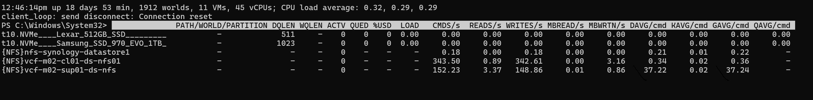

# Where the storage latency sits in esxtop

## Prompt
Review [the attached screenshot](0050/esxtop-disk-device-panel.png).

For the device with the highest GAVG, where does most of the latency come from?

- A. Beyond the host: the network and the NFS server (DAVG).
- B. The VMkernel queue (KAVG).
- C. The Guest OS.
- D. It cannot be told from esxtop: an NFS datastore has no device latency in esxtop.

## Screenshot


## Input to supply
- Tool: esxtop on one ESXi 9.1 host, disk device panel (press u).
- Must show the columns DEVICE, DAVG/cmd, KAVG/cmd, GAVG/cmd, QAVG/cmd, and at least 3 devices.
- Condition for the key: the device with the highest GAVG has KAVG under 0.5 ms and DAVG at least 2 ms.
- Supplied by the author 2026-11-05: highest GAVG is {NFS}vcf-m02-sup01-ds-nfs, DAVG 37.22, KAVG 0.02, GAVG 37.24 ms.
- Mask device names if they reveal the customer.
- Save as `benchmark/questions/50/esxtop-disk-device-panel.png`.

## Likely wrong answer
D: assuming an NFS datastore does not show in the device panel and has no DAVG.

## Expected key points
- Answer: A.
- The device with the highest GAVG is the NFS datastore {NFS}vcf-m02-sup01-ds-nfs: GAVG 37.24 ms = KAVG 0.02 ms + DAVG 37.22 ms.
- esxtop shows an NFS datastore as an {NFS} pseudo-device at the File System Switch layer, with DAVG, KAVG and GAVG. It is not a physical device; the vSphere Client lists no device for it, because NFS bypasses the Pluggable Storage Architecture.
- KAVG is near 0: the latency is beyond the host NFS client, in the network or the NFS server. For NFS, DAVG = network latency + remote NAS processing time.
- Queue columns and QAVG show - for NFS: there is no SCSI device queue.
- Next: check the NFS server latency and the storage network (drops, MTU) to that server.
- C is wrong: esxtop has no Guest OS metrics.

## Notes
- Author 2026-11-05: Level 300; the misconception is thinking an NFS datastore is not in the device panel and has no DAVG.
- Drafted by Claude 2026-11-05 from the knowledge files listed in `knowledge` (origin: synthetic). Counts only after author approval.
## Metadata
```yaml
id: "0050"
title: "Where the storage latency sits in esxtop"
product: [vsphere]
technology: [storage]
task: troubleshoot
level: 300   # author 2026-11-05
answer_type: deterministic
input: [screenshot]
knowledge:
  - vsphere/technology/storage/concepts/esxi-storage-latency-stack
  - vsphere/tools/esxtop/storage
  - vsphere/tools/esxtop/overview
attachments:
  - 0050/esxtop-disk-device-panel.png
origin: synthetic
source_path: "Drafted by Claude 2026-11-05 for the Level 100-200 allocation (benchmark/design.md, section 3.6)"
answer: [A]
misconception: [D]
status: reviewed
```
