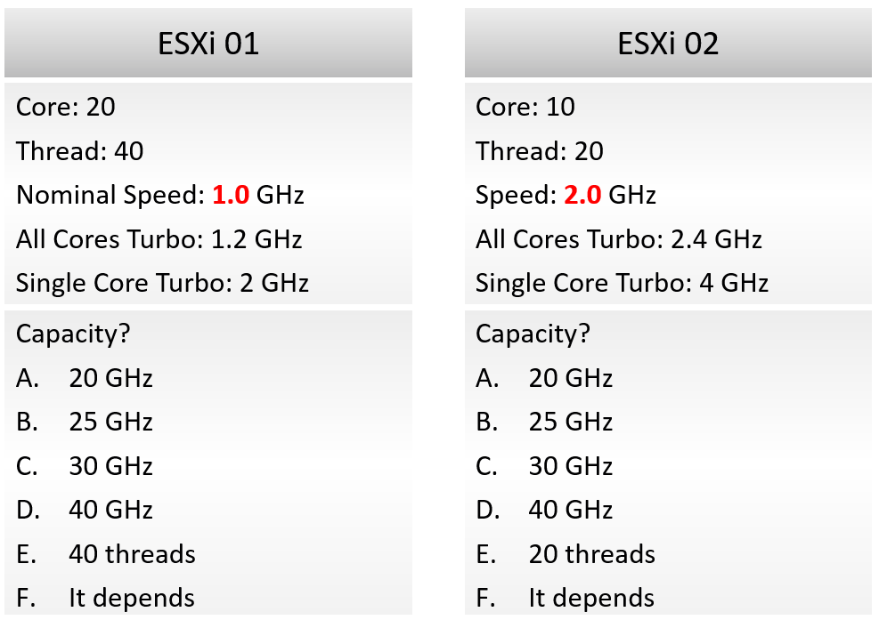

# ESXi CPU capacity: threads, not hertz

## Prompt
Two VMware ESXi 9.1 hosts, Hyper-Threading on:
- ESXi 01: 24 cores, 48 threads, nominal speed 1.5 GHz, All Cores Turbo 1.8 GHz, Single Core Turbo 3 GHz.
- ESXi 02: 12 cores, 24 threads, speed 3.0 GHz, All Cores Turbo 3.6 GHz, Single Core Turbo 4.2 GHz.
- The vSphere Client shows Total Capacity 36 GHz for each host.

Which statements give the CPU capacity of the two hosts correctly?

- A. ESXi 01: 36 GHz; ESXi 02: 36 GHz (cores x nominal speed).
- B. ESXi 01: 48 threads; ESXi 02: 24 threads (physical threads).
- C. ESXi 01: 45 GHz; ESXi 02: 45 GHz (cores x nominal speed x 1.25 for Hyper-Threading).
- D. ESXi 01: 43.2 GHz; ESXi 02: 43.2 GHz (cores x All Cores Turbo).
- E. ESXi 01: 24 cores; ESXi 02: 12 cores (physical cores).
- F. ESXi 01: 54 GHz; ESXi 02: 54 GHz (cores x All Cores Turbo x 1.25 for Hyper-Threading).
- G. ESXi 01: 72 GHz; ESXi 02: 72 GHz (threads x nominal speed).
- H. No fixed figure for either host: the capacity changes with Turbo and the power policy.

## Answers
B

## Explanation
- A is false: 36 GHz is the Total Capacity (GHz) label that vCenter and VCF Operations show: cores × base clock, the capability at base clock only. The host's capacity is counted in physical threads, 48 and 24, so the two hosts hold different numbers of vCPUs.
- B is true: capacity measures space, not speed. It is counted in physical threads, where a vCPU can run: 48 on ESXi 01, 24 on ESXi 02. Performance and capacity do not correlate: on ESXi 02 a vCPU runs about 2x faster, but only half as many fit.
- C is false: a GHz figure with a Hyper-Threading factor is still throughput; it changes with load, while the thread count does not.
- D is false: Turbo raises throughput, not capacity, and varies with load and power policy.
- E is false: with Hyper-Threading on, a core with one busy thread still has a free thread; capacity counts threads, not cores.
- F is false: Turbo and Hyper-Threading are performance factors; GHz mixes performance and capacity.
- G is false: threads × base clock is still a GHz figure, and two threads of one core do not each deliver the core's clock (each gets about 62.5% of the core while both run).
- H is false: hardware capacity is fixed by the hardware and the Hyper-Threading setting; Turbo and power policy change throughput only.
- Misconception: A: "36 GHz each: cores times the nominal GHz, the number vCenter shows." - C: "Add the Hyper-Threading gain to the GHz." - F: "Count the All Cores Turbo and the Hyper-Threading gain."

## Notes
- The second hint pushes toward GHz on purpose. It is a distractor.
- The quiz image holds the original quiz hosts (20 cores at 1.0 GHz and 10 cores at 2.0 GHz, 20 GHz each) and options. It is not sent to the LLM as it's just for human reviewer convenience. The prompt uses other numbers (2026-11-16 re-review): the quiz hosts are the knowledge-base example of cpu-measurement-levels (section CPU capacity: Example), so one retrieved line answered the question. Every option recomputed (A 24 x 1.5 and 12 x 3.0; C x 1.25; D 24 x 1.8 and 12 x 3.6; F D x 1.25; G 48 x 1.5 and 24 x 3.0); truth values unchanged.
- Hints:
  - The two hosts have different specifications, so the two answers must be different.
  - ESXi capacity can also be expressed in CPU compute cycles: the amount of processing it can do per second. That is not the same as the count of cores.
- Changed in the 2026-11-15 audit: the stem shows the Total Capacity label the operator reads; key points A and G no longer call a capacity figure throughput; misconception type label-read-as-model added.
- Converted from judged to multiple choice (Q-E2-199 F, 2026-11-14). The quiz's two lists of one answer per host became one list of pairs, each pair one way of counting capacity; exactly one pair is right.




## Metadata
```yaml
id: "0006"
title: "ESXi CPU capacity: threads, not hertz"
product: [vsphere]
technology: [cpu]
input: [text]
task: decide-capacity
object: [esxi]
tool: [none]
knowledge:
  - vsphere/technology/cpu/concepts/cpu-measurement-levels
  - sp5-framework/capacity/overcommit
  - vsphere/technology/cpu/concepts/cpu-frequency
knowledge_main: vsphere/technology/cpu/concepts/cpu-measurement-levels
attachments: []
origin: quiz
source_path: "vSphere Metric Quiz.docx (author upload 2026-11-03) > CPU > Q3 ESXi Total Capacity"
answer_type: deterministic
misconception: [A, C, F]
level: 400                      # author 2026-11-05
misconception_type: [frequency-and-hyper-threading, label-read-as-model]
status: draft                     # reviewed as a free-text question; converted to multiple choice 2026-11-14 (Q-E2-199): review again
```
