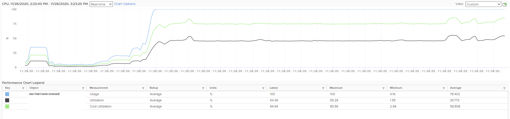
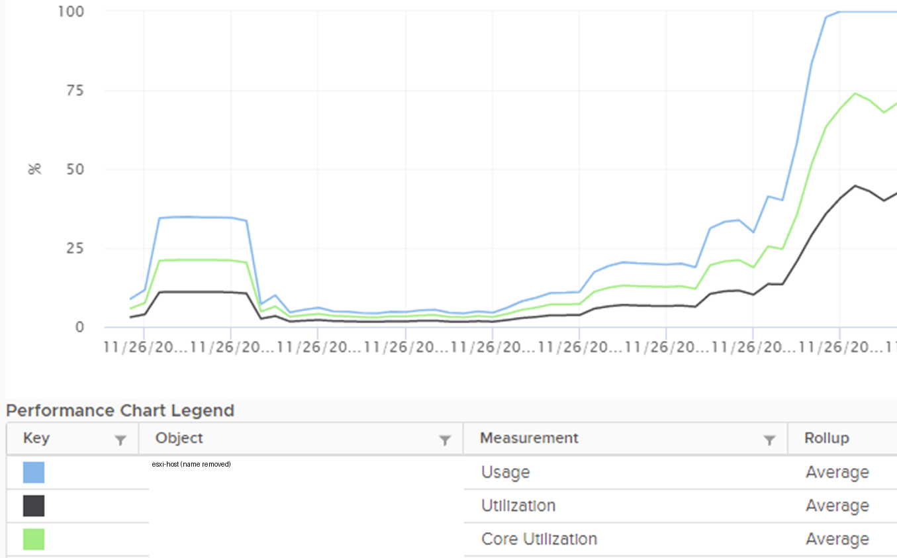

# ESXi utilization for capacity, from Usage, Core Utilization and Utilization

## Prompt
- Study [the attached vCenter chart](0004/esxi-cpu-usage-core-utilization-utilization-1-hour-vcenter-chart.png) (not VCF Operations) of a single ESXi host.
- Hyper-Threading is enabled: each core runs 2 hardware threads.
- [The second attachment](0004/esxi-cpu-usage-core-utilization-utilization-zoom-on-ramp.png) zooms into the start of the chart.
- The host runs ESXi 7.

Three metrics show three values at the end of the chart, where the counters spike. Which options give the ESXi utilization at that point, from a capacity management perspective?

- A. About 100%, the blue Usage line: no physical cores or threads are left.
- B. About 85%, the green Core Utilization line: it balances cores and threads.
- C. About 54%, the black Utilization line: nearly half of the physical threads are idle.
- D. Not shown: about 70%, the average of the green and black lines, because Hyper-Threading is enabled.
- E. Not shown: add up the running VMs and the kernel to get the utilization.

## Attachments




## Likely wrong answer
A (100%): reading CPU Usage as utilization. Or B (85%): treating Core Utilization as the capacity measure.

## Expected key points
- Answer: C (about 54%).
- A is wrong: CPU Usage (%) includes frequency (Turbo Boost), which is speed, and on ESXi 7 it is capped at 100%.
- B is wrong: Core Utilization counts a core as busy when one thread runs. Each thread can run a vCPU or a kernel world, so the thread is the unit of capacity.
- C is correct: the legend's Latest value is 54.38%, so about 46% of the physical threads are idle and can still run work. Capacity counts space (threads available), not speed.
- D is wrong: averaging thread and core utilization has no meaning.
- E is wrong: it mixes the consumer (VM) and provider (ESXi) perspectives.

## Notes
- Attachments: host names masked in the legend before commit.
- Hint moved out of the prompt (author, 2026-11-14: a hint helps the frontier model, not the local model), for reviewers: "(From vSphere 8.0 Update 3 this counter is no longer capped and would exceed 100%: Broadcom KB 417702.)"
- Stem made plural (2026-11-14): the singular form told the candidate that one option is correct (Q199: the count is never disclosed). Was: "What is the ESXi utilization, from capacity management perspective?"
- Hint moved out of the prompt (author, 2026-11-14: a hint helps the frontier model, not the local model), for reviewers: "Hint: capacity is about space, while performance is about speed. Capacity is about quantity, performance is about quality."
- Stem and options changed 2026-11-14 (author agreed; project/question-pairing-2026-11-14.md, A1 and section 5): the stem typed Core Utilization about 70% and Utilization about 40%, which disagreed with the chart (plateau about 75% and 46%, Latest 84.94% and 54.38%) and equalled the example in the ESXi CPU Utilization knowledge file. The bullets are deleted; the options carry the chart's values at the end (the legend's Latest). The version line stays: a case fact (Usage capped at 100% on ESXi 7). Key unchanged, C.
- Paired with 0012 (theory and practical, design.md 3.9).

## Metadata
```yaml
id: "0004"
title: "ESXi true utilization from Usage, Core Utilization and Utilization"
product: [vsphere]
technology: [cpu]
input: [screenshot]
task: read-metric
object: [esxi]
tool: [vcenter]
knowledge:
  - vsphere/technology/cpu/metrics/host/usage
  - vsphere/technology/cpu/metrics/host/core-utilization
  - vsphere/technology/cpu/metrics/host/utilization
  - vsphere/technology/cpu/concepts/hyper-threading
  - vsphere/technology/cpu/concepts/cpu-measurement-levels
knowledge_main: vsphere/technology/cpu/metrics/host/utilization
attachments: 
  - 0004/esxi-cpu-usage-core-utilization-utilization-1-hour-vcenter-chart.png
  - 0004/esxi-cpu-usage-core-utilization-utilization-zoom-on-ramp.png
origin: quiz
source_path: "vSphere Metric Quiz.docx (author upload 2026-11-03) > CPU > Q1 ESXi CPU Utilisation"
answer_type: deterministic
level: 400                      # author 2026-11-05
answer: [C]
misconception: [A,B]
misconception_type: [same-name-other-object, frequency-and-hyper-threading]
pair: "0012"
status: draft
```
