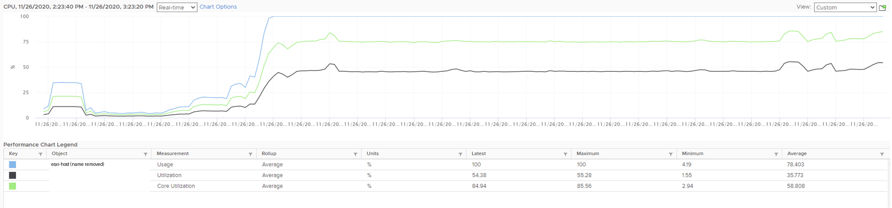
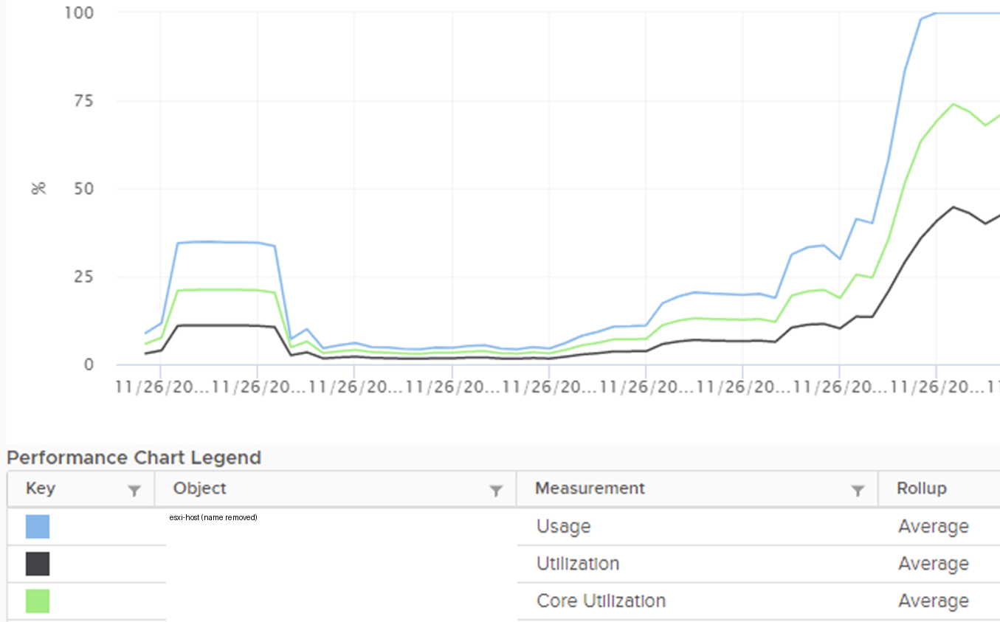

# ESXi utilization for capacity, from Usage, Core Utilization and Utilization

## Prompt
- Study the attached vCenter chart (not VCF Operations) of a single ESXi host.
- Hyper-Threading is enabled: each core runs 2 hardware threads.
- The second attachment zooms into the start of the chart.

At the end, where the counters spike:
- ESXi CPU Usage is flat at 100%. (The host was ESXi 7. In ESXi 9 this counter is no longer capped and would exceed 100%.)
- ESXi CPU Core Utilization is about 70%.
- ESXi CPU Utilization is about 40%.

Three metrics show three values. What is the ESXi utilization, from capacity management perspective?

- A. 100%. The blue line. No more physical cores or threads are available.
- B. 70%. The green line. It is a balanced reporting.
- C. 40%. The black line. Plenty of physical threads are idle.
- D. Not shown. It is the average of the green line and the black line, as Hyper-Threading is enabled.
- E. Not shown. To get the utilization, sum the running VMs and the kernel.

Hint: capacity is about space, while performance is about speed. Capacity is about quantity, performance is about quality.

## Attachments




## Likely wrong answer
A (100%): reading CPU Usage as utilization. Or B (70%): treating Core Utilization as the capacity measure.

## Expected key points
- Answer: C (40%).
- A is wrong: CPU Usage (%) is inflated by Turbo Boost.
- B is wrong: Core Utilization counts a core as busy when one thread runs. Each thread can run a vCPU or a kernel world, so the thread is the unit of capacity.
- C is correct: about 60% of the physical threads are idle and can still run work. Capacity counts space (threads available), not speed.
- D is wrong: averaging thread and core utilization has no meaning.
- E is wrong: it mixes the consumer (VM) and provider (ESXi) perspectives.

## Notes
- Previous id: vsphere-cpu-004 (renamed 2026-11-05).
- Attachments: host names masked in the legend before commit.

## Metadata
```yaml
id: "04"
title: "ESXi true utilization from Usage, Core Utilization and Utilization"
product: [vsphere]
technology: [cpu]
input: [screenshot]
task: read-metric
knowledge:
  - vsphere/technology/cpu/metrics/host/usage
  - vsphere/technology/cpu/metrics/host/core-utilization
  - vsphere/technology/cpu/metrics/host/utilization
  - vsphere/technology/cpu/concepts/hyper-threading
  - vsphere/technology/cpu/concepts/cpu-measurement-levels
attachments: 
  - 04/esxi-cpu-usage-core-utilization-utilization-1-hour-vcenter-chart.png
  - 04/esxi-cpu-usage-core-utilization-utilization-zoom-on-ramp.png
origin: quiz
source_path: "vSphere Metric Quiz.docx (author upload 2026-11-03) > CPU > Q1 ESXi CPU Utilisation"
answer_type: deterministic
level: 400                      # author 2026-11-05
answer: [C]
trap: [A,B]
status: draft
```
