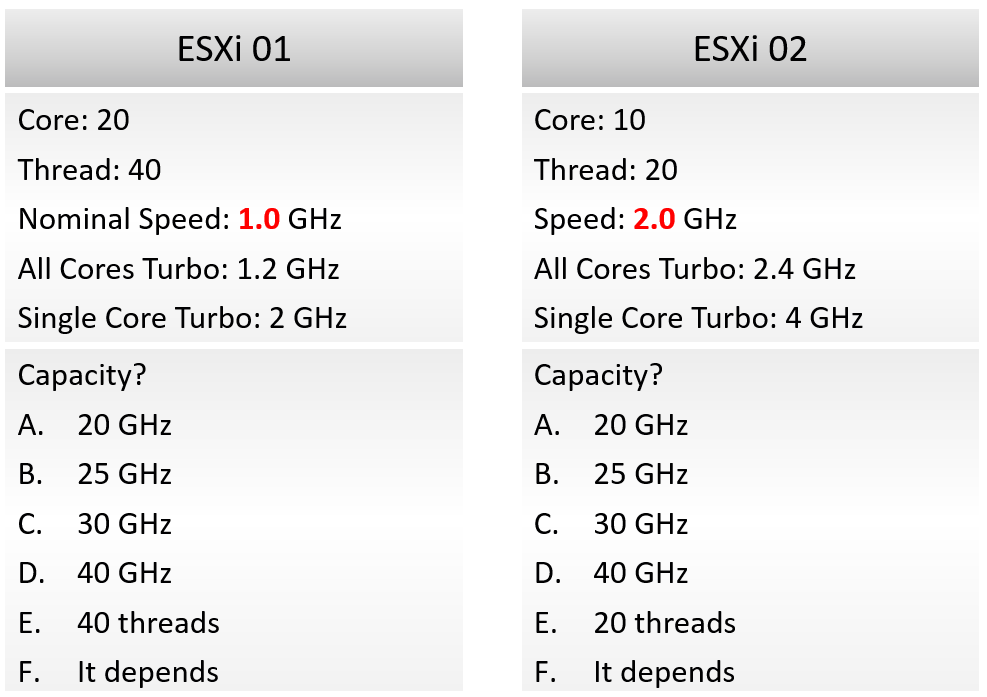

# ESXi CPU capacity: threads, not hertz

## Prompt
Two VMware ESXi 9.1 hosts, Hyper-Threading on:
- ESXi 01: 20 cores, 40 threads, nominal speed 1.0 GHz, All Cores Turbo 1.2 GHz, Single Core Turbo 2 GHz.
- ESXi 02: 10 cores, 20 threads, speed 2.0 GHz, All Cores Turbo 2.4 GHz, Single Core Turbo 4 GHz.

Which statements give the CPU capacity of the two hosts correctly?

- A. ESXi 01: 20 GHz; ESXi 02: 20 GHz (cores x nominal speed).
- B. ESXi 01: 40 threads; ESXi 02: 20 threads (physical threads).
- C. ESXi 01: 25 GHz; ESXi 02: 25 GHz (cores x nominal speed x 1.25 for Hyper-Threading).
- D. ESXi 01: 24 GHz; ESXi 02: 24 GHz (cores x All Cores Turbo).
- E. ESXi 01: 20 cores; ESXi 02: 10 cores (physical cores).
- F. ESXi 01: 30 GHz; ESXi 02: 30 GHz (cores x All Cores Turbo x 1.25 for Hyper-Threading).
- G. ESXi 01: 40 GHz; ESXi 02: 40 GHz (threads x nominal speed).
- H. No fixed figure for either host: the capacity changes with Turbo and the power policy.

## Likely wrong answer
- A: "20 GHz each: cores times the nominal GHz, the number vCenter shows."
- C: "Add the Hyper-Threading gain to the GHz."
- F: "Count the All Cores Turbo and the Hyper-Threading gain."

## Expected key points
- Answer: B.
- A is false: cores x base frequency is the Total Capacity (GHz) label vCenter and VCF Operations show (20 GHz for both hosts). It is throughput at base clock, not capacity: the two hosts hold different numbers of vCPUs.
- B is true: capacity measures space, not speed. It is counted in physical threads, where a vCPU can run: 40 on ESXi 01, 20 on ESXi 02. Performance and capacity do not correlate: on ESXi 02 a vCPU runs about 2x faster, but only half as many fit.
- C is false: a GHz figure with a Hyper-Threading factor is still throughput; it changes with load, while the thread count does not.
- D is false: Turbo raises throughput, not capacity, and varies with load and power policy.
- E is false: with Hyper-Threading on, a core with one busy thread still has a free thread; capacity counts threads, not cores.
- F is false: Turbo and Hyper-Threading are performance factors; GHz mixes performance and capacity.
- G is false: still a GHz (throughput) figure; it also ignores that two threads on one core do not each run at full speed.
- H is false: hardware capacity is fixed by the hardware and the Hyper-Threading setting; Turbo and power policy change throughput only.

## Notes
- The second hint pushes toward GHz on purpose. It is a distractor.
- The quiz image holds the same two hosts and options as the prompt. It is not sent to the LLM as it's just for human reviewer convenience.
- Hints:
  - The two hosts have different specifications, so the two answers must be different.
  - ESXi capacity can also be expressed in CPU compute cycles: the amount of processing it can do per second. That is not the same as the count of cores.
- Converted from judged to multiple choice (Q199 F, 2026-11-14). The quiz's two lists of one answer per host became one list of pairs, each pair one way of counting capacity; exactly one pair is right.




## Metadata
```yaml
id: "0006"
title: "ESXi CPU capacity: threads, not hertz"
product: [vsphere]
technology: [cpu]
input: [text]
task: decide-capacity
object: [esxi]
tool: [none]
knowledge:
  - vsphere/technology/cpu/concepts/cpu-measurement-levels
  - sp5-framework/capacity/overcommit
  - vsphere/technology/cpu/concepts/cpu-frequency
knowledge_main: vsphere/technology/cpu/concepts/cpu-measurement-levels
attachments: []
origin: quiz
source_path: "vSphere Metric Quiz.docx (author upload 2026-11-03) > CPU > Q3 ESXi Total Capacity"
answer_type: deterministic
answer: [B]
misconception: [A, C, F]
level: 400                      # author 2026-11-05
misconception_type: [frequency-and-hyper-threading]
status: reviewed
```
