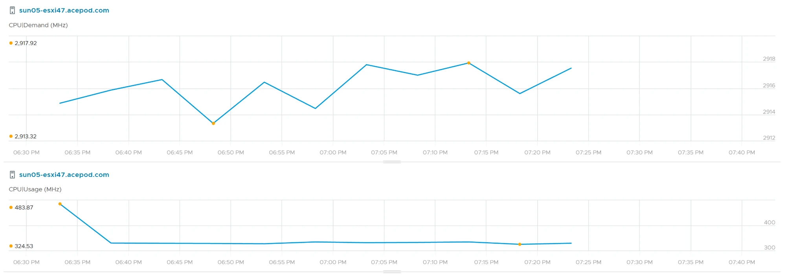
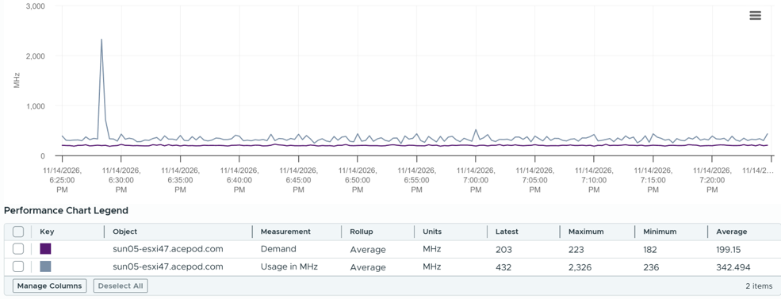
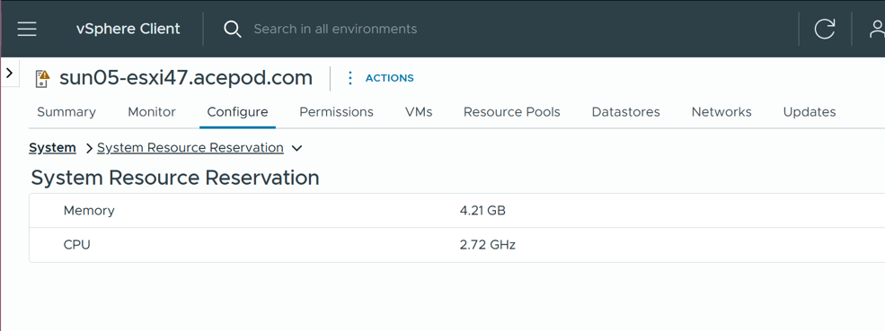

# ESXi CPU Demand differs between VCF Operations and vCenter

## Prompt
See [the VCF Operations chart](0363/vcf-operations-esxi-cpu-demand-usage.webp), [the vCenter performance chart](0363/vcenter-esxi-cpu-demand-usage.png) and [the vCenter host configuration page](0363/vcenter-system-resource-reservation.png).

Which statements about what these screens show are correct?

- A. A known bug: ESXi CPU Demand in VCF Operations has an issue in rollup and aggregation.
- B. VCF Operations Demand is about vCenter Demand plus the CPU System Resource Reservation: about 199 + 2,720 MHz.
- C. The 2,720 MHz reservation is CPU the kernel uses all the time, so host Usage must stay above it.
- D. In vCenter, this host's Demand sits below its Usage over the hour, as kernel work is in Usage only.
- E. The host is CPU-constrained: its VMs ask for about 2.9 GHz and get only about 0.33 GHz.
- F. Usage differs between the tools because VCF Operations Usage leaves out the kernel's work.
- G. There is no problem: the counters are the same, and rollup, collection cycle and aggregation explain the difference.
- H. VCF Operations Demand counts reserved capacity; vCenter Demand counts only what the VMs ask for.

## Attachments




## Answers
B, D, H

## Explanation
- A false: no bug; the formulas differ by design, since vRealize Operations.
- B true: 2,915 − 2,720 = 195 MHz, against a vCenter Demand average of 199 MHz (182-223). The third screenshot holds the 2,720.
- C false: a reservation is capacity set aside, not CPU in use. Usage is about 330 MHz in both tools, far below the 2,720 MHz.
- D true: vCenter Demand sums what the VMs ask for, while Usage also holds the kernel's own work, so on this quiet host Demand (average 199 MHz) sits below Usage (average 342 MHz).
- E false: Demand in VCF Operations includes reserved capacity. The gap to Usage is the reservation, not unmet demand; contention is Ready and Co-stop.
- F false: Usage is about 330 MHz in both tools; it is one counter, with kernel work.
- G false: Usage is the same counter; Demand is not. A 5-minute average cannot exceed the largest 20-second sample: vCenter Demand never passes 223 MHz, while VCF Operations shows about 2,915 MHz.
- H true: vCenter takes the administration view (what the scheduler wants now); VCF Operations the operations view (what the host must be able to deliver).
- Misconception: G: the counters are the same, and rollup and the collection cycle explain the gap. Or A: a rollup bug in VCF Operations. Or C: the kernel reservation read as CPU in use.

## Reasoning path
1. Compare Usage: about equal in both tools (one 20-second spike of 2,326 MHz averages to about 484 MHz over 15 samples).
2. Compare Demand: 14x apart, beyond what any average can do; in vCenter Demand sits below Usage.
3. Subtract the CPU System Resource Reservation from VCF Operations Demand: the rest matches vCenter.

## Notes
- Paired with 0362 (theory and practical; author, 2026-11-14).
- Author's hint, kept out of the prompt: the prompt intentionally adds no information that would make a frontier model investigate. Gemini Hydrogen (high effort) took the author's own prompt as a premise that the counters must differ and misread both counters.
- Screenshots supplied by the author 2026-11-14, vSphere and VCF Operations 9.1, one host. Exception to design.md section 3.4 (no new screenshots in 1.0), author's request: the third image is a configuration page, not a chart, and has no CSV export. The host name is the author's lab; masking is the author's call.
- Changed in the 2026-11-15 audit: stem made plural; C and D (the 5-minute average of Usage, a fact tested in many questions) replaced by the reservation-as-use misconception and the vCenter Demand-below-Usage reading; H reworded. No situation line added to the stem: the author keeps the prompt free of a premise that the counters differ.
- Synthetic, 2026-11-14, from the author's sample. Counts only after author approval.

## Metadata
```yaml
id: "0363"
title: "ESXi CPU Demand differs between VCF Operations and vCenter"
product: [vsphere, vcf-operations]
technology: [cpu]
task: read-metric
level: 400   # needs arithmetic across three screenshots (design.md, section 3.2)
answer_type: deterministic
input: [screenshot]
object: [esxi]
tool: [vcenter, vcf-operations]
knowledge:
  - vsphere/technology/cpu/metrics/host/demand
  - vsphere/technology/cpu/metrics/host/usage
knowledge_main: vsphere/technology/cpu/metrics/host/demand
attachments:
  - 0363/vcf-operations-esxi-cpu-demand-usage.webp
  - 0363/vcenter-esxi-cpu-demand-usage.png
  - 0363/vcenter-system-resource-reservation.png
origin: synthetic
source_path: "Author's sample, 2026-11-14 (Q218)"
misconception: [C, G]
misconception_type: [tool-confusion, rollup-and-interval, consumption-as-contention]
pair: "0362"
status: draft
```
