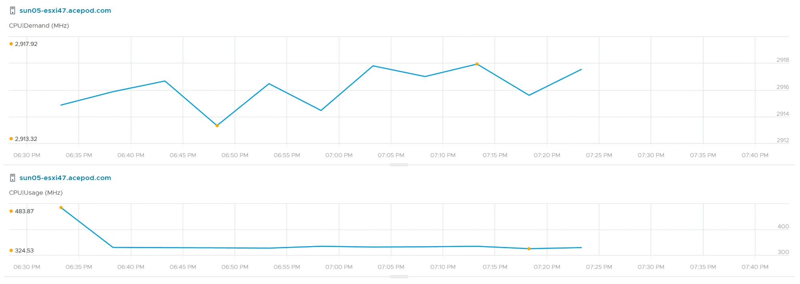
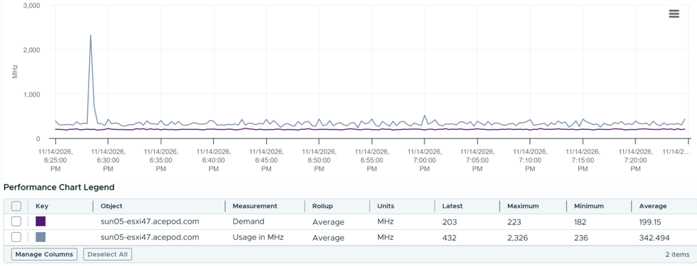
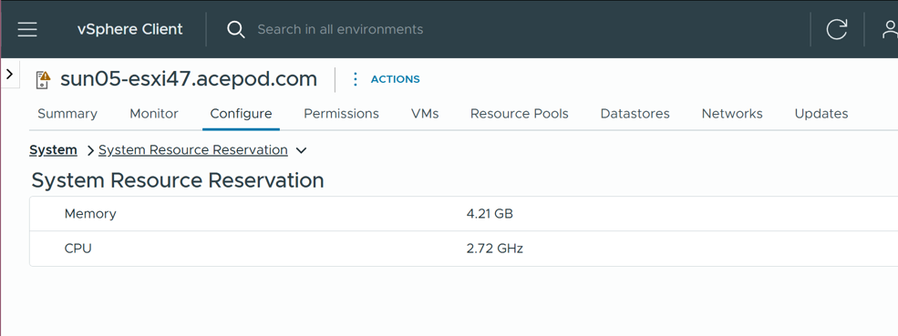

# ESXi CPU Demand differs between VCF Operations and vCenter

## Prompt
See [the VCF Operations chart](0363/vcf-operations-esxi-cpu-demand-usage.webp), [the vCenter performance chart](0363/vcenter-esxi-cpu-demand-usage.png) and [the vCenter host configuration page](0363/vcenter-system-resource-reservation.png).

What is the problem here? Why are their values different?

- A. A known bug: ESXi CPU Demand in VCF Operations has an issue in rollup and aggregation.
- B. VCF Operations Demand is about vCenter Demand plus the CPU System Resource Reservation: about 199 + 2,720 MHz.
- C. The gap is the 5-minute rollup: VCF Operations averages the 20-second peaks, which lifts its Demand.
- D. Usage peaks at 2,326 MHz in vCenter and at 483.87 MHz in VCF Operations because VCF Operations stores the 5-minute average of the 20-second samples.
- E. The host is CPU-constrained: VMs ask for about 2.9 GHz and get about 0.33 GHz.
- F. Usage differs between the tools because VCF Operations Usage leaves out the kernel's work.
- G. There is no problem: the counters are the same, and rollup, collection cycle and aggregation explain the difference.
- H. The name is the same but the purpose differs: ESXi CPU Demand in VCF Operations includes reserved capacity; in vCenter it does not.

## Attachments




## Likely wrong answer
G: the counters are the same, and rollup and the collection cycle explain the gap. Or A: a rollup bug in VCF Operations.

## Expected key points
- Answer: B, D, H.
- A false: no bug; the formulas differ by design, since vRealize Operations.
- B true: 2,915 − 2,720 = 195 MHz, against a vCenter Demand average of 199 MHz (182-223). The third screenshot holds the 2,720.
- C false: a 5-minute average cannot exceed the largest 20-second sample. vCenter Demand never passes 223 MHz; VCF Operations shows about 2,915 MHz.
- D true: the one 20-second spike of 2,326 MHz averages to about 484 MHz over 15 samples. Usage agrees between the tools.
- E false: Demand in VCF Operations includes reserved capacity. The gap to Usage is the reservation, not unmet demand; contention is Ready and Co-stop.
- F false: Usage is about 330 MHz in both tools; it is one counter, with kernel work.
- G false: Usage is the same counter; Demand is not.
- H true: vCenter takes the administration view (what the scheduler wants now); VCF Operations the operations view (what the host must be able to deliver).

## Reasoning path
1. Compare Usage: about equal; the peak difference is the 5-minute average.
2. Compare Demand: 14x apart, beyond what any average can do.
3. Subtract the CPU System Resource Reservation from VCF Operations Demand: the rest matches vCenter.

## Notes
- Paired with 0362 (Type 1 know, Type 2 explain; author, 2026-11-14).
- Author's hint, kept out of the prompt: the prompt intentionally adds no information that would make a frontier model investigate. Gemini Hydrogen (high effort) took the author's own prompt as a premise that the counters must differ and misread both counters.
- Screenshots supplied by the author 2026-11-14, vSphere and VCF Operations 9.1, one host. Exception to design.md section 3.4 (no new screenshots in 1.0), author's request: the third image is a configuration page, not a chart, and has no CSV export. The host name is the author's lab; masking is the author's call.
- Drafted by Claude 2026-11-14 from the author's sample (origin: synthetic). Counts only after author approval.

## Metadata
```yaml
id: "0363"
title: "ESXi CPU Demand differs between VCF Operations and vCenter"
product: [vsphere, vcf-operations]
technology: [cpu]
task: read-metric
level: 400   # needs arithmetic across three screenshots (design.md, section 3.2)
answer_type: deterministic
input: [screenshot]
object: [esxi]
tool: [vcenter, vcf-operations]
knowledge:
  - vsphere/technology/cpu/metrics/host/demand
  - vsphere/technology/cpu/metrics/host/usage
knowledge_main: vsphere/technology/cpu/metrics/host/demand
attachments:
  - 0363/vcf-operations-esxi-cpu-demand-usage.webp
  - 0363/vcenter-esxi-cpu-demand-usage.png
  - 0363/vcenter-system-resource-reservation.png
origin: synthetic
source_path: "Author's sample, 2026-11-14 (Q218)"
answer: [B, D, H]
misconception: [C, G]
misconception_type: [tool-confusion, rollup-and-interval, consumption-as-contention]
pair: "0362"
status: draft
```
