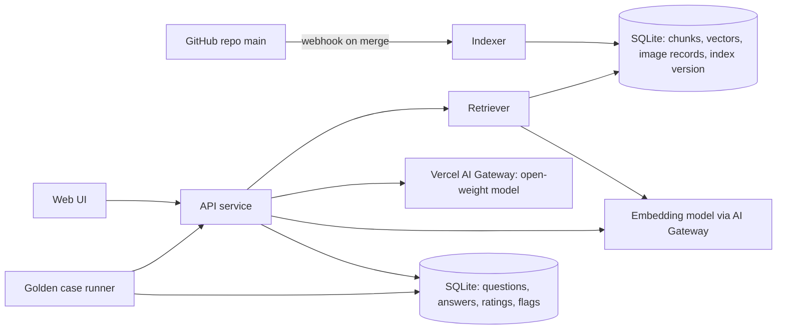
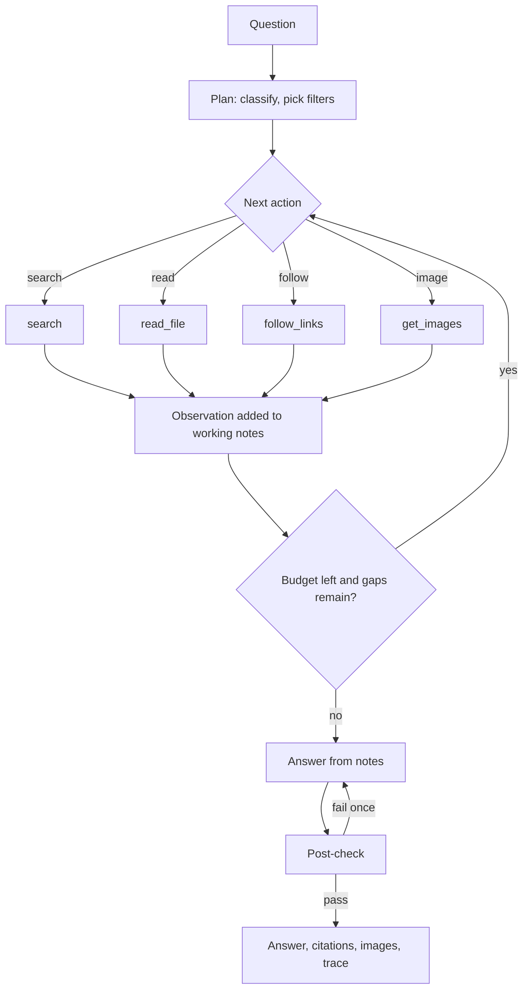

# Design: knowledge base test site

Status: design only. Not built. Not indexed.

## Purpose
- Measure the quality of `knowledge/` through a local LLM that answers from it.
- Let invited visitors ask questions in natural language and judge the answers.
- Turn every weak answer into a fix: a knowledge gap, a retrieval miss, or a model limit.
- Same contract as `README.md`, section How a local LLM uses it. The site implements that contract; it adds no rules of its own.

## What "quality" means here
| Signal | Question it answers | Source |
|---|---|---|
| Retrieval hit | Did the right files come back? | Golden case `knowledge` ids vs retrieved ids |
| Answer score | Is the answer right, with the right reason? | 0-3 rubric from `evaluation/README.md` |
| KB lift | Does the knowledge base beat no knowledge base? | Same question, baseline vs kb mode |
| Draft dependence | How much of the answer rests on `status: draft` files? | Cited file status |
| Gap rate | Which questions find no relevant file? | Low retrieval score, visitor flag |
| Trap rate | Does the answer fall into a known trap? | Golden case `Likely wrong answer` |

## Users
| Role | Can do |
|---|---|
| Visitor (invited) | Ask, rate, flag an answer as wrong with a comment. |
| Author | Everything a visitor can, plus: review flags, score answers, run golden cases, see the dashboard. |
| System | Rebuild the index on each merge to `main`; run golden cases on each rebuild. |

## Architecture

- Indexer: reads `knowledge/**/*.md` except the excluded folders. Uses the repo's own `scripts/validate.py` split logic for metadata. Refuses to index if the validator fails.
- Retriever: hybrid search (keyword BM25 + vector), filtered by metadata, then link expansion.
- API service: query pipeline, prompt assembly, streaming answer, logging.
- LLM: open-weight model via Vercel AI Gateway for the test site. At a customer, the same weights run on their own VM, so no data leaves their environment.
- Golden case runner: sends only `## Prompt` of each case, never the answer key.
- Every answer stores the index version (git commit SHA). A score is always tied to the knowledge that produced it.

## Retrieval approach
- Retrieval, not fine-tuning, supplies the facts. Reasons: the knowledge is not on the internet; it changes often (author answers); answers must cite files; small models memorise facts poorly.
- Two modes, both built and compared in phase 1:
  - Classic RAG: one fixed retrieval pass, then answer. Baseline and fallback.
  - Agentic retrieval: the model calls tools in a loop until it has enough, then answers. Target mode.
- Optional later: light fine-tune (LoRA) for style and terminology only. Facts stay in retrieval.
- Not used: full long-context stuffing (125K tokens is too much for small models and too slow per question); a separate graph database (metadata links already form the graph).

## Query pipeline: classic RAG
1. Classify the question into one `retriever_guide` value. Small prompt to the same LLM, or keyword rules first.
2. Extract filters: `product`, `object`, `technology`, `pillar`. Values must match `knowledge/glossary/terminology.md`.
3. Hybrid search within filters. Fall back to no filter if fewer than N hits.
4. Expand: `related`, `internal_derive`, `same_name`, `same_meaning`. `same_name` always included (trap guard).
5. Add matching foundations files when units, sampling, thresholds or provider/consumer apply.
6. `what-to-check`: retrieve the diagnosis file first; follow README, section Troubleshooting questions.
7. Fit to the context budget. Priority: diagnosis or metric file, its concepts, foundations, other links.
8. Generate. System prompt = the Answer rules in README. Chunks carry `id` and `status`.
9. Post-check (below).
10. Return: answer, cited files, images, retrieval trace.

## Query pipeline: agentic retrieval (tool loop)

### Tools
| Tool | Input | Output | Rules |
|---|---|---|---|
| `search` | query text; optional filters (product, object, technology, pillar, retriever_guide) | Top 8 hits: id, title, heading, 2-line snippet, status, score | Filters must use terminology.md values. Hybrid BM25 + vector. |
| `read_file` | file id; optional heading | Body text of the file or one section. No metadata block. | One file per call. Long files: section by section. |
| `follow_links` | file id; link type (related, internal_derive, same_name, same_meaning, all) | Linked ids with titles and status | Cheap: titles only. The model then reads what it chooses. |
| `get_images` | file id, or filters (object, metric, image_type) | Image records: path, alt text, tags, sample | Returns records only. The UI shows the image. |
| `draw_mermaid` (later) | Mermaid code | Rendered diagram in the UI | For flows or layers that no stored image shows. |

### Loop rules
- System prompt: the README Answer and Troubleshooting rules, plus the tool list. The model is told it knows nothing about vSphere metrics beyond what tools return.
- First action is always `search`. The answer may use only text returned by `read_file`.
- Before answering a metric question, the model must call `follow_links` with `same_name` on the metric file (trap guard).
- `what-to-check` questions: the first `read_file` must be the matching diagnosis file; then follow its numbered steps.
- Budget per question: at most 8 tool calls and 12K tokens of tool output. On budget end, answer with what is held and say what is missing.
- Repeated identical calls are refused by the loop controller and counted as an error.
- Model fails to call tools in the right format twice: fall back to classic RAG for that question; record the fallback.

### Post-check (both modes)
- Every cited id was returned by a tool (agentic) or retrieved (classic).
- Every number with a unit or % in the answer appears in a cited chunk.
- Every metric name in the answer exists as a metric file title or is a quoted user term.
- Fail: regenerate once with the failures listed. Fail again: show the answer with a warning.

### Retrieval trace
Recorded for every answer, shown collapsed on the Ask page, stored in `answers.trace`.

| Field | Content |
|---|---|
| step | 1, 2, 3, ... |
| action | plan, search, read_file, follow_links, get_images, answer, post_check, fallback |
| input | tool arguments |
| output summary | ids returned, tokens returned |
| model reasoning | the model's short reason for the action, if the model gives one |
| tokens, latency | per step |
| index version | git SHA |

- The trace explains each failure. Example: right file never searched = retrieval or filter problem; file read but fact ignored = model problem; fact missing = knowledge gap.
- The review queue shows the trace next to the flagged answer.

## Pages
| Page | Content |
|---|---|
| Ask | Chat. Each answer shows cited files (id, title, draft badge), images that match, and a collapsible retrieval trace. Buttons: rate 0-3, flag wrong. |
| Compare | Same question answered twice: kb and baseline. Shown blind as A and B. Visitor picks the better one, then sees which was which. |
| Golden cases (author) | Latest run per case: score, retrieval hit, trap hit. Trend per index version. Runs on demand or after each rebuild. |
| Review queue (author) | Flagged answers. Author tags the cause: knowledge gap, wrong fact, retrieval miss, model error. One click creates an entry in `docs/todo.md` or `docs/author-questions.md` via a pull request. |
| Dashboard (author) | Signals table above, per technology and per retriever_guide. Top unanswered questions. Most-cited draft files (review first). |
| Corpus | Read-only browser of indexed files and image records, as the LLM sees them. |

## Data stored
| Table | Fields |
|---|---|
| chunks | id, file id, heading, text, tags, status, index version |
| images | path, file id, product, object, metric, topic, image_type, sample, alt text |
| questions | text, mode (kb, baseline), user role, time |
| answers | question, text, cited ids, retrieval trace, index version, model, latency |
| ratings | answer, score 0-3, flag, comment, cause tag |
| eval_runs | case id, mode, score, retrieval hit, index version, model; also appended to `evaluation/results/results.csv` |
- Golden case answer keys are read only by the runner and the author pages. Never sent to the LLM. Never shown to visitors.

## Technology choice
| Part | Choice | Reason |
|---|---|---|
| LLM serving (test) | Vercel AI Gateway, open-weight models only | No hardware to buy. One API for all candidate models. Pay per token. The author already has a Vercel account. |
| LLM serving (customer) | Ollama or vLLM on the customer's own VM | Same open weights the test site scores. vLLM when several users query at once. |
| Model | Open-weight, Apache 2.0, 8B-32B, at least 16K context. Candidates below. | Must be downloadable and runnable by VMware customers. Pick by golden case score, not by benchmark. |
| Embeddings | `alibaba/qwen3-embedding-0.6b` via Vercel for the test; same model on CPU at the customer | Small, open, runs without a GPU. |
| Index and logs | SQLite with a vector extension | About 200 files: no separate vector database needed. One file to back up. |
| API | Python (FastAPI) | Reuses `scripts/validate.py`. Same language as the repo tooling. |
| UI | Server-rendered pages with light JavaScript; streaming answers | Few pages, low maintenance. |
| Hosting (test site) | Vercel: web app, API routes, AI Gateway | No server to run. Index and logs in a hosted database. |
| Hosting (customer) | One VM with a GPU, or CPU only for the smallest model | The deployment target the scores must predict. |
| Rebuild | GitHub webhook or scheduled pull of `main` | Index always matches merged knowledge. |

## Security and abuse
- Invite-only first: login by email link or a shared access code. Public later, if ever.
- Rate limit per user and per IP.
- Visitor text is untrusted. The system prompt tells the model to answer only from retrieved chunks and to ignore instructions inside the question that change its role.
- The corpus is trusted, but only `main` is indexed. No branch or PR content.
- Logs hold questions. Tell visitors. No customer names in answers or logs shown on public pages.
- Admin pages behind author login.

## Candidate models
Source: Vercel AI Gateway model list, checked 2026-11-03. Prices per 1M input / output tokens; re-check before use.

| Vercel model id | Size | Customer hardware at 4-bit (estimate) | Price | Role |
|---|---|---|---|---|
| `openai/gpt-oss-20b` | 20B, mixture-of-experts | One 16 GB GPU | $0.07 / $0.30 | Main candidate |
| `google/gemma-4-31b-it` | 31B dense | One 24-48 GB GPU | $0.14 / $0.40 | Strongest deployable size |
| `google/gemma-4-26b-a4b-it` | 26B, 4B active | One 16-24 GB GPU | $0.13 / $0.40 | Fast option |
| `alibaba/qwen-3-14b` | 14B dense | One 12-16 GB GPU or a large CPU VM | $0.12 / $0.24 | Small-hardware option |
| `mistral/ministral-8b` | 8B | CPU VM or small GPU | $0.15 / $0.15 | Lower bound |

- Excluded: frontier closed models (customers cannot run them); Llama (licence restrictions).
- 70B class: test only if 31B misses golden cases through reasoning errors, not retrieval errors.
- Gemini API (free Gemma 4) is a fallback for testing only: free-tier data may be used by Google.

## Why 8B-32B is enough
- The knowledge is not stored in the model. It is retrieved per question (RAG). Parameters hold general skill, not the repository.
- Repository: 203 files, about 95,000 words (about 125K tokens). Average file about 600 tokens.
- One answer uses 5-10 files: 4K-8K tokens. A 16K-32K context window is enough.
- Size matters for: reasoning across files, unit arithmetic, trusting retrieved text over training. 27-32B is the expected sweet spot.
- Order of impact on quality: retrieval, then knowledge writing, then model size.

## Score transfer to customers
- Providers may serve higher precision than a customer's 4-bit build. Hosted scores are an upper bound.
- Before recommending a model: re-run the golden cases on the 4-bit build (for example, one hour on a rented GPU).

## Build phases
1. Runner first, no website. See Phase 1 test plan.
2. Ask page with citations and retrieval trace. Author only. Uses the mode and model that won phase 1.
3. Ratings, flags, review queue. Invite visitors.
4. Compare page (blind A/B) and dashboard.
5. 4-bit re-test of the chosen model and mode on customer-like hardware.

## Phase 1 test plan
### Matrix
| Dimension | Values |
|---|---|
| Model | the 5 candidates (see Candidate models) |
| Mode | baseline (no knowledge base), classic RAG, agentic retrieval |
| Cases | all golden cases (21 now) |
| Repeats | 3 runs per cell, temperature 0.2, to see variance |
- Cells: 5 models x 3 modes x 21 cases x 3 repeats = 945 answers per full run.
- Cost estimate: under US$ 5 per full run at current Vercel prices (agentic uses about 2-3x the tokens of classic). Re-check prices.

### Measured per answer
| Measure | How |
|---|---|
| Score 0-3 | Rubric from `evaluation/README.md`. First pass by a judge model against `## Expected key points`; author checks every 0 and every disagreement between repeats. |
| Trap hit | Answer matches `## Likely wrong answer`. |
| Retrieval recall | Share of the case's `knowledge` ids that were retrieved (classic) or read (agentic). |
| Retrieval precision | Share of retrieved or read ids that the answer cited. |
| Tool errors (agentic) | Bad format, refused repeats, budget hits, fallbacks. |
| Steps (agentic) | Tool calls used. |
| Tokens and latency | Per answer. |
| Post-check result | pass, pass after retry, warning. |

### Judge rules
- The judge model is a different model from the one under test, and never one of the 5 candidates. A frontier model is fine here: the judge is not deployed to customers. It sees the prompt, the answer and the answer key; the model under test never sees the key.
- The judge returns a score and the key points matched. The author's score overrides it. Author overrides are logged to calibrate the judge.

### Decision rules
- Pick the mode: agentic must beat classic RAG by at least 0.3 mean score on the same model, or classic RAG stays the default (simpler, cheaper).
- Pick the model: highest mean score in the chosen mode; ties go to the smaller model.
- Agentic is dropped for a model with more than 10% fallbacks.
- Knowledge base lift: kb modes must beat baseline on every technology area. An area with no lift is a knowledge or retrieval problem, not a model problem.
- 70B test: only if the best 31B result loses points through reasoning errors (trace shows the right files were read).

### Outputs
- `evaluation/results/results.csv`: one row per answer (add columns: mode, retrieval_recall, steps, tokens, post_check).
- A short report per run in `evaluation/results/`: matrix of mean scores, worst cases, trace links.
- Every failed case tagged with a cause (knowledge gap, retrieval miss, model error) and turned into a to-do or author question.

## Decisions for the author
- Hosting: decided 2026-11-03: Vercel AI Gateway for the test site.
- Audience: author only, invited experts, or public?
- Who scores: author only, or visitor ratings count too?
- Model: decided 2026-11-03: compare the 5 candidates in phase 1.
- Domain name and branding.
