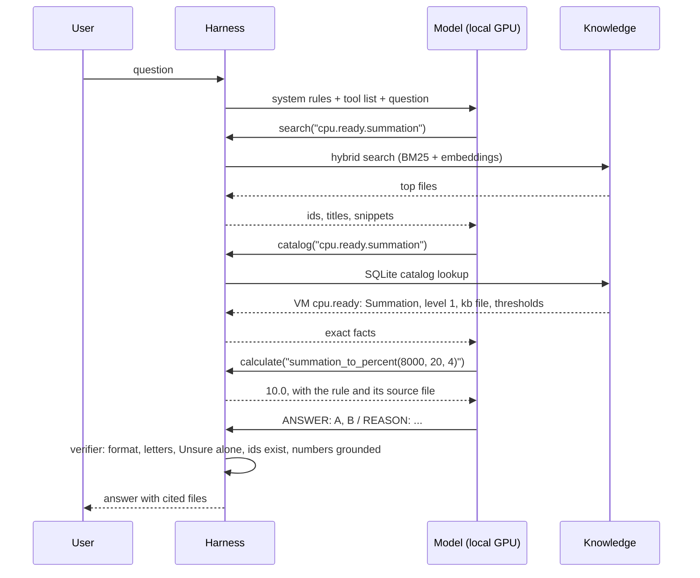

# Agent

What the agent is, what it knows when a question arrives, what it decides, and how it is improved. Not indexed.
Why the system can win: [MISSION.md](../MISSION.md). Run-time flow and modes: [ARCHITECTURE.md](../ARCHITECTURE.md). Harness parts: [README.md](README.md). How the knowledge is shaped: [KNOWLEDGE-ENGINEERING.md](../KNOWLEDGE-ENGINEERING.md), Part B.

## 1. What it is
- The agent is the model plus the tool loop, in agentic mode only. It is not a separate program.
- The model makes the decisions: which tool next, with which query, which file to read, when to stop and answer.
- The harness hosts the loop and constrains it: it runs the tools, enforces the rules and the budgets, and checks the answer.
- Code: `harness/agent.py` (the loop, the tools, the rules), `harness/primer.py` (the up-front blocks), prompts `SYSTEM_AGENT` and `PROMPTS` in `harness/modes.py`. The tools are in `harness/` (`retrieval.py`, `catalog.py`, `calc.py`, `flows.py`); the verifier in `verify.py`.
- The model is frozen. What we change is what the agent is told, which tools it has, and the rules around them.

## 2. Why an agent
- A Level 400 question often needs a chain across files: metric → the same-named metric on another object → the concept behind it → the troubleshooting flow → a calculation.
- One search cannot predict that chain. Classic mode (one lookup, then answer) is capped by what that lookup finds: 67% of needed files reach its context (2026-11-04).
- The agent can go back for more: read a file, follow its links, look up a value, compute, then answer.
- Classic mode stays as the reference point and the fallback (section 9).

## 3. What it knows when a question arrives
### Today
- The system prompt: knowledge base first, and it wins on conflict; own knowledge only where the knowledge base is silent, said so in the reason; mechanism before definition; same-name metrics; thresholds only when the knowledge base states them; Unsure over a guess.
- The tool rules (section 5) and the tool descriptions.
- The question and its images.
- Nothing about the knowledge base itself. The agent discovers what exists only by searching.

### The gap
- Searching helps only when the model knows it does not know. Its worst errors are Internet rules of thumb it believes, so it never searches for them.
- Without a map, the agent searches blind: it does not know that a diagnosis file answers "what do I check" or that a comparison file sets two tools side by side.

### How the agent finds knowledge
A model that knows nothing about the knowledge base can still reach the right file, through these paths:

| Path to a file | Built from | Used by |
|---|---|---|
| Words in the question | Body text, trap lines in the user's words, glossary synonyms | Search (BM25 and embeddings) |
| Kind of question | `retriever_guide` and the folder (`concepts/`, `metrics/`, `kpis/`, `configuration/`, `diagnosis/`) | Search filters; the map (block 1) |
| Object, layer, product | Metadata tags | Search filters |
| From one file to the next | `same_name`, `same_meaning`, `internal_derive`, `related` | Link expansion; `follow_links` |
| Exact values | `knowledge/catalog/*.yaml`, KPI colour-band tables | `catalog` tool |
| Order of checks | Numbered steps in `diagnosis/` files | `flow` tool |

### Five up-front blocks (built 2026-11-06, off until measured)
Each is small (all five: about 1,800 tokens; budget 3,000, checked by lint), needed on most questions, and changes behaviour. Each is generated from the knowledge base at start by `harness/primer.py`, so it cannot drift, and each has its own switch in `benchmark/runner/config.yaml`, key `agent_primer`. All are off by default until the benchmark shows a gain (section 7). When one is on, the trace records a `primer` step.

| # | Block | Content | Built from |
|---|---|---|---|
| 1 | Map of the knowledge base | Each area with its files by kind; what each kind answers and which tool serves it | File ids (folders) |
| 2 | Core rules | 12 short rules, each with its reason and file, that undo Internet priors: VM is not Guest OS; utilization is not contention; provider and consumer views differ; a counter means what its layer measures | `knowledge/vsphere/foundations/core-rules.md`, section Rules |
| 3 | Confusable terms | Only the pairs public text mixes up: Usage, Utilization and Demand; Ready and Latency; Run and Used; Consumed and Active; Ballooned and Swapped | `knowledge/glossary.md`, section Confusable pairs |
| 4 | Symptom → flow index | One line per diagnosis file: its name and when to use it | `diagnosis/` files |
| 5 | Procedure rules | Troubleshooting starts with the flow; a number comes from the catalog, never from memory; cite the files read | Fixed text in `primer.py` (procedure, not facts) |

### Kept behind tools
| Content | Why not up front |
|---|---|
| Full glossary | Long; most entries never matter for one question. Looked up when met. |
| Metrics and thresholds | Hundreds of rows. Up front, the model recalls a value instead of looking it up, and a recalled number cannot be checked or cited. |
| Full flowcharts | Long; one applies per question. The index points to it; the `flow` tool serves it step by step. |

- Reason for the size limit: a small model's attention thins as the prompt grows; rules buried in 20K tokens of reference are ignored. Every token is also sent on every question and run.

## 4. What it decides
| Decision | Example |
|---|---|
| What to look up first | `search("cpu.ready.summation")` or `catalog("cpu.ready")` |
| Which file to read | `read_file` on the metric file, not the snippet |
| Which links to follow | `follow_links(same_name)` before answering about a metric |
| Which exact tool | `catalog` for unit and rollup, `calculate` for the conversion, `flow` for a troubleshooting question |
| When to stop | Answer once the files settle the question, or Unsure |

## 5. Rules the harness enforces
| Rule | How | Why |
|---|---|---|
| Look up before answering | The first call must be `search` or `catalog`; any other tool is refused | Answers from memory are the main failure |
| No repeats | An identical call is refused | Small models search in circles |
| Same-name check | Before the answer, a reminder to call `follow_links(same_name)` on each metric file read | Same label, different object, is the commonest trap |
| Budget | At most `agent_max_calls` (8) tool calls and `agent_tool_tokens` (12K) of tool output; then "answer now" | Context window and time; benchmark cost |
| Context window | Before each model turn, the prompt estimate plus the answer budget must fit `context_window` (32K); otherwise no more tools, answer now (trace step `context_full`) | The deployed model's window, not the gateway's |
| Format | Two malformed tool calls: fall back to classic mode | A broken loop must still answer |
| Verify | The final answer goes through `verify.py`; a hard issue gets one repair turn | A wrong format scores as wrong |

- The limits are budgets, not design values. Deployment rule (stop on token budget, time budget or no progress): section 8.

## 6. Observed behaviour (2026-11-03, 17 questions)
- Agentic scored below classic for 7 of 8 small models (33% vs 45% exact on average). The frontier model was slightly ahead in agentic (67% vs 62%).
- Causes seen in traces: few or no tool calls (qwen-3-32b averaged 1.8); searching in circles until the limit (answers that hit the limit were mostly wrong); one model broke the answer format.
- So today the weakest step is the agent's first lookups, not the knowledge base. The up-front blocks (section 3) and a primed start (agentic mode that starts from the classic context) target that step.

## 7. How it is improved
- One change at a time, scored on the benchmark against the same model and questions: a score delta per change.
- Levers, in expected order of effect:
  1. up-front blocks 1-5 (section 3), each switched on alone and then together;
  2. a primed start from the classic context;
  3. tool descriptions and tool rules;
  4. the budgets, re-run on the answers that hit the limit with 16 calls.
- Kept: a change that raises the final score or lowers the confident-wrong or override rate by more than the margin. Otherwise dropped.
- Code split done 2026-11-06: the loop moved from `modes.py` to `agent.py`.

## 8. Budgets and the tool-call limit
- The benchmark limit (8 tool calls, 12K tokens of tool output) caps the cost of 15,000 answers. It is not a design value. No knowledge-base need sets it at 8.
- Run results (2026-11-03, agentic mode, exact answers by number of calls):

| Model | 0-3 calls | 4-7 calls | Hit the limit (8) |
|---|---|---|---|
| frontier model | 31 of 33 | 27 of 42 | 6 of 20 |
| google/gemma-4-31b-it | 28 of 44 | 14 of 28 | 5 of 23 |
| mistral/mistral-small | 0 of 3 | 7 of 20 | 21 of 72 |
| alibaba/qwen-3-32b | 36 of 82 | 2 of 3 | never reached |

- Answers that hit the limit are mostly wrong. In most traces the model searches in circles; one more call would not have helped.
- Hard questions also take more calls, so the table does not prove that more calls are useless. Next check: re-run the limit-hit answers with 16 calls.
- Some models make few tool calls (qwen-3-32b averages 1.8). The limit does not affect them.
- Deployment has no per-token fee. Its limits are:
  - the context window: every tool result stays in the conversation; with a 32K window, about 12-16K tokens of tool output leaves room for the prompt and the answer;
  - waiting time: each call is a model turn on the local GPU (seconds each).
- Deployment rule, replacing a fixed count:
  - stop on a token budget (tool output that still fits the context) or a time budget (set from trials with users), whichever comes first;
  - stop early on no progress: repeated searches, re-reading the same file, two calls returning nothing new;
  - at the stop, answer with what was read and say what is missing, or answer Unsure;
  - show progress (what is being read) and let the user stop or ask to keep digging.
- The benchmark uses the same budget as deployment, so the score predicts the product.

### Benchmark and deployment
- The release score is measured on the deployed configuration. A different benchmark setting would grade a system that is not shipped.
- Same in both: prompt, tools, retrieval settings, verifier, context window, token budget for tool output, no-progress stops.
- Different:

- **Time**
  - Why: Benchmark time depends on the gateway, network and provider rate limits, not on the customer GPU. A wall-clock limit in the benchmark would grade the provider.
  - Handling: The benchmark stops on hardware-independent limits only: tokens and no-progress. A maximum number of model turns is derived from the deployment time limit: turns = time limit ÷ seconds per turn measured on the target GPU (benchmark phase 5).
- **Context window**
  - Why: Gateway models often offer 128K or more; the deployed server may run 32K.
  - Handling: The benchmark caps the context to the deployed window.
- **User in the loop**
  - Why: In deployment the user can stop, ask to keep digging, or answer a clarifying question. A benchmark has no user.
  - Handling: The benchmark answers at the end of the budget with no help: a worst case. Clarifying questions are scored as a separate set later.
- **Experiments**
  - Why: Some runs ask "what if" (16 calls, primed agentic, another embedding model).
  - Handling: Run as named experiment profiles. Only the deployment profile produces the release score.

- One harness, several profiles: the deployment profile (release score and product) and named experiment profiles (diagnosis only).

## 9. Why classic mode stays
- Classic mode costs a third of the benchmark. Reasons to keep it:
  1. It isolates tool skill. Classic = what the knowledge base adds with no tool skill from the model. Agentic minus classic = what the model's own tool use adds or loses. Without classic, a low agentic score cannot be pinned on the model or on the knowledge base.
  2. It is the better mode for some models today. Benchmark 20261103-081849: classic beat agentic for 7 of 8 small models (45% vs 33% exact on average); for the frontier model agentic was slightly ahead (67% vs 62%). The mode is chosen per model by the decision rule in `benchmark/design.md`.
  3. It is the fallback. When a model breaks the tool-call format twice, the harness answers in classic mode instead of failing.
  4. It is fast: one model call instead of up to nine.
- After the 100-question set picks the model and mode, routine runs use the chosen mode plus baseline only. Classic stays in the code as the fallback.
- To try: agentic mode that starts from the classic context (first search done, catalog facts included). This skips the first search, the weakest step for small models, and keeps further lookups.

## 10. Walkthrough of one question
Real trace (2026-11-04, alibaba/qwen-3-32b): "A 4-vCPU VM shows cpu.ready.summation = 8,000 ms in one real-time sample. Which statements are correct?" Options include the rollup and statistics level, 10% Ready and 40% Ready.

1. The harness sends the question with the rules: knowledge base first, and it wins on conflict; search or catalog first; check same-name metrics; use the catalog for units and levels, the calculator for arithmetic, the flow tool for troubleshooting.
2. The model searches. The harness runs hybrid search (keyword BM25 plus a local embedding model, fused by rank) and returns ids and snippets, not answers.
3. The model asks the catalog for the counter. The harness answers from SQLite built from `knowledge/catalog/`: rollup Summation, statistics level 1, the knowledge file, and the thresholds with their source.
4. The model asks for the conversion. The calculator returns 10% (8,000 ms ÷ (20 s × 1,000 ms × 4 vCPUs)) and names the rule's source file. The model never does the arithmetic itself.
5. The model answers. The verifier checks the reply; a hard issue (no ANSWER line, a letter that is not an option, Unsure mixed with other letters) gets one repair turn.
6. The answer goes out with the files it used.
