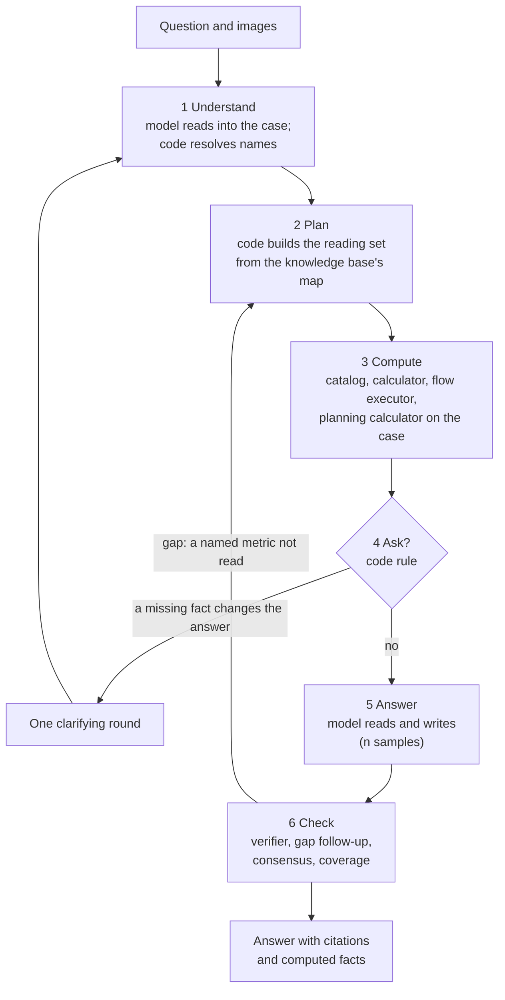

# Agent

Agent E2's agent: a neuro-symbolic expert system. Code holds the expert's procedure and the knowledge base's map and decides; the model reads and writes. The agent reads the question into a case, plans what to read from the knowledge base's own map, runs the exact tools, decides whether to ask, calls the model, and checks the answer. One pipeline for every question (author, 2026-11-14). Not indexed.
Why Agent E2 can win: [MISSION.md](../MISSION.md). The whole system: [ARCHITECTURE.md](../ARCHITECTURE.md). Harness parts: [README.md](README.md). How the knowledge is shaped: [KNOWLEDGE-ENGINEERING.md](../KNOWLEDGE-ENGINEERING.md). The tool-loop agent it replaces, with its measurements: [project/archive/agent-tool-loop-2026-11-14.md](../project/archive/agent-tool-loop-2026-11-14.md).

- Status (2026-11-14): built and the only mode of Agent E2: [`harness/agent.py`](agent.py) (stages 1 and 3-6), [`harness/planner.py`](planner.py) (stage 2), entered through [`harness/modes.py`](modes.py) as mode `agent-e2`. Classic and agentic mode are removed; their code is archived in [project/archive/legacy/harness-tool-loop-2026-11-14/](../project/archive/legacy/harness-tool-loop-2026-11-14). Still to build: section 7.
- Name: a neuro-symbolic expert system, of the kind where symbolic control calls a neural model as a subroutine (Kautz: Symbolic[Neural]). The symbolic part is the knowledge base's map (links, file kinds, catalog, flows), the rules and the exact tools; the neural part reads language and images. The fixed order of the stages, with two bounded loops back (one clarifying round, one gap follow-up), is a small state machine; the flow executor with executable steps (Q166) will be the larger one. Agreed by the author (Q210, 2026-11-14).

## 1. Who decides what
| Part | Does | Never does |
|---|---|---|
| Agent (code) | Builds the case; plans the reading set; runs the catalog and the calculator on the case's values (the flow executor and the planning calculator: to build, section 4.3); reads the pages the question links; decides whether to ask the user; calls the model; checks the answer; follows up once on a gap | Writes prose; guesses a value |
| Harness | The tools (hybrid search, catalog, calculator, web; the planning calculator and the flow executor, built but not yet called), budgets, the verifier, the model client | Decides |
| Model | Reads the question and its images into the case (fixed schema); reads the reading set and writes the answer, with a file for each claim | Chooses files or tools; does arithmetic; compares a value with a threshold |
| Knowledge | The map the agent plans with (file kinds, links, catalog, flows, term map) and the text the model reads | |

- The model is called; it does not drive. Every decision about what to read, compute or ask is code that reads the knowledge base, so the author can review it, and the same question always takes the same path.
- The word agent changes meaning: it was the model plus the tool loop ([project/terms.md](../project/terms.md), Q210).

## 2. Evidence for the split
- Planning a lookup needs a map of what the knowledge base holds. That map is the author's proprietary knowledge; the Internet text the model learned from does not have it. A model cannot plan a search through ground it has never seen, and its worst errors are beliefs it never looks up.
- The code can plan: the knowledge base records its own map (file kinds, `same_name` and `internal_derive` links, the catalog, flows, the term map).

| Finding (the previous generation: benchmark 2026-11-12 and 2026-11-13, retrieval check 2026-11-13; [archived](../project/archive/benchmark-results-before-2026-11-14/analysis-2026-11-13.md)) | Reading |
|---|---|
| Agentic and classic within the margin for every model (-6, -3, +1 points); agentic at 2-3.5 times the tokens and twice the latency | The model's own tool use adds nothing yet |
| 4.8-7.4 tool calls per multiple-choice answer; Muse at the 8-call limit on 359 of 595 | The model searches in circles |
| A needed file in the agent's search results, never opened (20-question sample, 2026-11-13): Gemma read 49%, saw 64%; Muse read 62%, saw 80% | The model cannot tell which hit matters |
| Qwen agentic: the same letters in all 5 runs on 35% of the questions | Lookups chosen by the model change from run to run |
| Primed start (same sample): given the classic context, no tool call on 32 of 40 (Gemma) and 38 of 40 (Muse) answers | The model does not ask for what is missing; a gap must be found by code |
| Every needed file read: Muse agentic loses 1.7 of its 22 lost points | The model reads and reasons well |
| Classic: every needed file in context for 96% of questions with 1 needed file, 5% with 5 or more; the most-missed files are mechanism files the question's words do not name (VM CPU Ready 9 times, resource-controls 7, Co-stop 5) | One search on the question's words does not reach the mechanism |

- So the model keeps the jobs it does well (reading, reasoning over given text, writing) and loses the job it does badly (deciding what to read). Code takes that job, from the knowledge base's map.

### Classic and agentic (removed): what the agent keeps
- Classic was the first harness (2026-11-04). It stayed for three reasons: the control that isolates the model's tool skill (agentic minus classic), the fallback when a model breaks the tool-call format twice, and speed (one model call).
- For Agent E2 the product, only the fallback and the speed counted. The control is a benchmark diagnostic, and the benchmark is a proof, not a goal ([CLAUDE.md](../CLAUDE.md), Evaluation).
- The agent needs no fallback: the model makes no tool calls, so no tool-call format can break. It keeps the speed: 2 model calls in the common case.
- Kept from classic: the harness leads; a deterministic lookup; catalog facts in the context; the term map; the troubleshooting route.
- Kept from agentic: reading beyond one search (link closure, one search per claim, a follow-up on a gap); the exact tools; the verifier.
- Dropped: the model choosing tools; the tool-call budget; the same-name and read reminders (code reads the files and their same-name links itself); the primed start; up-front blocks 1 (map) and 4 (flow index), which existed so the model could plan.

## 3. One question, six stages

| Stage | Who | Model calls | Output |
|---|---|---|---|
| 1 Understand | Model, then code | 1 | The case |
| 2 Plan | Code | 0 | The reading set |
| 3 Compute | Code | 0 | Computed facts; the flow path |
| 4 Ask | Code | 0 | Clarifying questions, or none |
| 5 Answer | Model | 1 (n with consensus) | The draft answer |
| 6 Check | Code | 0-1 gap follow-up, 0-1 repair | The checked answer |

- Common case: 2 model calls (agentic averaged 5-8, classic 1). The understand call reads about 1-2K tokens and writes a few hundred; the answer call reads about 16K.
- Consensus samples share one prompt, so on a local vLLM server they run as one batch on a cached prefix.

## 4. The stages
### 4.1 Understand: the case
- The model reads the question and its images into a fixed schema; it does not answer yet. Extraction is reading, which a 30B model does well. It is also the only way to read a screenshot (MISSION.md, section 5: values shown back before reasoning).
- Case fields:
  - `kind`: a `retriever_guide` value (how-it-works, metric-meaning, term-meaning, what-to-set, health-check, troubleshooting, decision-tree);
  - `objects` and `layer`: VM, ESXi, cluster, datastore, resource pool; virtual motherboard or Guest OS;
  - `metrics`: each as written, with object, value, unit, interval or chart, and tool (vCenter, esxtop, VCF Operations, Windows, Linux);
  - `symptom`;
  - `premise`: the belief the question carries ("add vCPUs because Ready is high");
  - `claims`: the options of a multiple-choice question, or the parts of an open one;
  - `missing`: facts the question does not give (interval, vCPU count, object);
  - `images`: per screenshot, tool, object, metrics, values, interval and time range.
- Code checks the case (`agent.parse_case`): only the known fields stay; each metric name resolves through the catalog and the metric file titles (`planner.case_files`). A name that does not resolve stays text and plans nothing; it is never guessed into a file.
- Code also reads the question on its own (term map, object words, counter keys, metric titles, values given in ms, the vCPU count, options and their parts: `planner.anchors`, `planner.claims`, `planner.objects_in`, `agent.COUNTER_MS`) and both readings plan. A reply that is not JSON leaves the code-only case, so no fallback mode is needed.
- Asked at temperature 0 (`deterministic`), whatever the model card's sampling: the same question is read the same way every time. The answer call keeps the card's sampling.
- Output is JSON; on vLLM and llama.cpp, grammar-guided decoding can enforce the schema (plan, M5). Validity sample of 2026-11-14 (Gemma, 9 questions, screenshots included): every case was valid JSON.
- Not built: `layer` as a field; the case shown back to the user before the answer (a product screen, M6).

### 4.2 Plan: the reading set
Code, from what the knowledge base records about itself ([`harness/planner.py`](planner.py)). Tiers, packed in this order into the context budget (`context_tokens`, 16K):

| Tier | Files | Form |
|---|---|---|
| 1 Flow | A troubleshooting, health-check or decision-tree question (the case's kind; without a case, the troubleshooting words): its best flow file of that kind | Whole |
| 2 Named | Files the question names exactly: term-map rows; metric titles and counter keys resolved through the catalog, kept for the objects the question names; the metrics of the case | Whole |
| 3 Search | Top 3 hits of hybrid search on the question | Whole |
| 4 Mechanism | `same_name` and `internal_derive` (up to 8 each) of the named files and the top 2 hits | Best sections, 400 tokens each |
| 5 Claims | The top hit of one search per claim: each option (prefixed by its part, such as "ESXi 01:", when a question has several option lists), or each part the case reads in an open question; at most 10 | Best sections |
| 6 Rest | Search hits 4-6; the second hit per claim; 2 `related` of the top 2 hits | Best sections |

- Tiers 4 and 5: the claims of a Level 400 question test different mechanisms, and the mechanism file seldom shares the question's words. The links record which file a metric derives from; one search per claim finds the file for each claim.
- Sections: the candidate list averages 21 files against room for about 14 whole files. With whole files, 10 points of needed-file recall were planned and then cut by the budget (plan 78%, context 68%, BM25). A secondary file gives its best sections (BM25 on the question). The retrieval check counts a file as read when its sections are.
- Deterministic: the same question gets the same reading set. Consensus samples then differ only in reasoning, so a disagreement marks doubt in the reasoning, not a different search.
- Measured, retrieval check on the 196 questions (2026-11-14, the code-only case; `python3 benchmark/runner/retrieval_eval.py`, `--embeddings` for hybrid):

| Search | Recall | Every needed file | Main file missing | 3 needed files | 4 | 5 or more |
|---|---|---|---|---|---|---|
| BM25 | 76% (77% after Q211) | 109 of 196 (56%; 110 after Q211) | 25 | 52% | 33% (36% after Q211) | 21% |
| Hybrid | 80% | 117 of 196 (60%) | 19 | 57% | 40% | 26% |

- Outputs: [benchmark/results/retrieval-2026-11-14/](../benchmark/results/retrieval-2026-11-14/hybrid.md). The design was measured against classic mode before it was built: hybrid recall 69% to 80%, complete 46% to 59% ([archived](../project/archive/benchmark-results-before-2026-11-14/retrieval-2026-11-14/plan-hybrid.md)); generations are not compared further.
- Not tuned to the questions: one design, the tiers as the knowledge base defines its links; two settings tried (section size 250 or 400 tokens, derive cap 3 or 8), within 2 questions of each other.
- Still short of the release level of the retrieval check (main file 100%, recall 95%, complete 90%). Next levers, in order: the model's case measured on the retrieval check; the knowledge changes of section 6.

### 4.3 Compute
- The agent runs the exact tools on what the case holds, before the model reads. The model gets `Computed (exact)` lines and computes nothing.
  - Built: catalog facts of every file in the reading set (unit, rollup, statistics level, thresholds by use, KPI levels, with source: `catalog.facts_for`).
  - Built: each summation counter given in ms (by the case, or written as `cpu.ready.summation = 8,000 ms`): % of one vCPU and % per vCPU when the vCPU count is known, for the chart interval the question names (Real-time 20 s, 1 Day 300 s, 1 Week 1,800 s, 1 Month 7,200 s, 1 Year 1 day: [vsphere/tools/vsphere-client/vcenter-statistics](../knowledge/vsphere/tools/vsphere-client/vcenter-statistics.md)), by `calc.py` with its rule's source.
  - To build: the band of a value against its threshold row for that interval and use, with the source ([project/design-thresholds.md](../project/design-thresholds.md), target: the verdict per use from the catalog).
  - To build: a troubleshooting or health-check question through the flow executor with executable steps (Q166, approved for 1.0). Each step names its metric, object and test as data; code compares the case's values, takes the branch, and stops at the first step whose value the case lacks. Today the flow file is read whole (tier 1) and the model follows its steps.
  - To build: a capacity question with its inputs through the planning calculator ([`harness/capacity.py`](capacity.py)).
- Before the model, not on request: a small model does not call a tool it does not know it needs, as it does not search for a belief it holds. Code calls it every time.

### 4.4 Ask
- Code decides whether the model may ask, by the rule of MISSION.md, section 5. Built: the round is offered only when the case lists a missing fact, the case reads a premise, or a term-map row marked `premise` matches; otherwise the answer prompt has no clarifying rule at all (`chat_final`).
- To build: the flow's next step needs a value the case does not hold (with Q166); a term-map row marks words with several meanings; the text and an image disagree.
- At most one round. The model words the questions. The benchmark kinds (`choice`, `open`) never ask.

### 4.5 Answer
- One model call (n with consensus) with: the rules (knowledge base first and it wins; a file for each claim; a threshold only with its source; Unsure over a guess); the up-front misconceptions and confusable pairs ([`harness/primer.py`](primer.py), config `primer`); the case as read; the computed facts; the coverage note when it applies; the reading set; any web page the question links; the question.
- Answer shape: conclusion first, then the mechanism and the reason, then what to check next. Each claim names the file it rests on. Open answers: a claim with no file goes under a last line "Not settled by the knowledge base:" (`agent.OPEN_SHAPE`; a product feature: the benchmark is multiple choice since 2026-11-14, Q199, so the line is measured in the live test, judged by the author). Proposed, not built: a product label follows the teaching order of [KNOWLEDGE-ENGINEERING.md](../KNOWLEDGE-ENGINEERING.md), section Product label and better model (Q208).
- Not built: a `MISSING:` line for the model to name what it lacks. The gap follow-up (4.6) finds the same need from the draft, and models given a context seldom ask (primed start).

### 4.6 Check
- Verifier ([`harness/verify.py`](verify.py)): format, letters, Unsure alone; one repair turn.
- Gap follow-up, once (`gap_followup`): every metric the draft names, for the case's objects, must resolve to a file in the reading set. A name outside it (the draft reasons about Co-stop; the reading set has no Co-stop file) makes the agent add that file's best sections (at most 2 files) and ask for the answer again. Only names of two or more words or a hyphenated name count (`strict`): in the first validity sample, single words such as Throughput or Performance fired it on 6 of 9 answers with unrelated files; strict, on 0 of 9. This is the gain the tool loop was built for, a chain across files, run by code on evidence in the draft instead of on the model's choice.
- Grounding (multiple choice; open answers are not verified): a number in neither the question, the reading set nor the computed facts is flagged; a cited id must exist.
- Consensus (multiple choice): n samples of stage 5 on one reading set; unanimous letters stand, otherwise Unsure ([README.md](README.md), section 6a). Each sample runs its own gap follow-up, so two samples can read different extra sections after their drafts; the shared reading set is stages 1-4.
- Coverage boundary: when nothing in the reading set came from tier 1 or 2 (no flow, no file the question names: only search hits), the answer prompt says the question may be outside the knowledge base, and to say so if the text does not settle it. Trace step `coverage` (`weak` or `named`). A search-score limit is set later on the field set (Q207), not on the benchmark.

## 5. Rules and budgets
| Rule | How | Replaces (tool loop) |
|---|---|---|
| Knowledge before the answer | The model answers only with the reading set in front of it | First call must be search or catalog |
| The other object's meaning of a label | `same_name` files of every named file are tier 4 | Same-name reminder |
| The mechanism behind a metric | `internal_derive` closure | The model's `follow_links` |
| Exact values | Computed facts from the catalog and the calculator | `catalog` and `calculate` calls |
| Order of checks | The flow file read whole (tier 1); to build: the flow executor takes the branch (Q166) | `flow` tool; the model took the branch |
| One question, one path | Deterministic plan | Lookups chosen per run |
| Budget | Reading set 16K; context window 32K (`context_window`; a prompt above it is flagged, `context_over`); at most 4 model calls (case, answer, gap, repair) plus consensus samples | 8 tool calls, 12K tokens of tool output |

- The benchmark uses the deployment budgets, so the score predicts the product. Time per question on the target GPU: 2 model turns in the common case; measured in the live test (M5). Validity sample of 2026-11-14 (Gemma on the gateway, 9 questions): 2 model calls per answer, 11-23K prompt tokens per answer (both calls), 19-59 seconds.

## 6. What the knowledge must give the agent
The plan is as good as the map. Changes to the knowledge, in order; each becomes a rule in [project/knowledge-rules/](../project/knowledge-rules) and a lint check when built:
1. `internal_derive` is the mechanism closure: a metric file lists every mechanism file it follows from. The most-missed files are reached only through these links: 12 files derive from resource-controls and 8 from vm-vs-guest-os, yet a question that names none of those 20 files does not reach them.
2. Names resolve: metric file titles keep the form object, technology, label (VM CPU Ready); esxtop field rows in the catalog get the `kb` of their metric file (today only vCenter counters carry it).
3. Sections stand alone: the plan reads sections of secondary files, so each `##` section names its object and metric in its first line and does not lean on the section before it.
4. Flow steps as data (Q166): metric, object, interval, the catalog test, the branch targets, in the flow file (one home). Format designed on the VM slow flow.
5. Term-map rows mark words with several meanings (stage 4).
6. Coverage by mechanism ([analysis-2026-11-13](../project/archive/benchmark-results-before-2026-11-14/analysis-2026-11-13.md), section 12): the field set shows which mechanisms are missing.

## 7. Build order
Each step is proved by its own check.
1. Done 2026-11-14: the reading plan on the code-only case; the retrieval check (section 4.2).
2. Done 2026-11-14: the case by the model, the summation conversions, the ask rule, the answer prompt and shape, the gap follow-up, the coverage note, consensus on one reading set; unit tests with the mock client; a live validity sample on one model (every answer readable, 2 model calls each).
3. Next: the round that proves it, Agent E2 and Base on the candidates and the frontier reference ([project/plan.md](../project/plan.md), M4), after the author's go.
4. To build, each with unit tests on worked examples and the retrieval check where it changes the reading set: the model's case in the retrieval check (`--case-model`); executable flow steps, starting with the VM slow flow (Q166); threshold bands in stage 3; the planning calculator in stage 3; the knowledge changes of section 6.

## 8. Walkthrough of one question
Question: "A 4-vCPU VM shows cpu.ready.summation = 8,000 ms in one real-time sample. Which statements are correct?" Options include the rollup and statistics level, 10% Ready and 40% Ready.

1. Understand (model call 1): kind metric-meaning; object VM; metric `cpu.ready.summation` = 8,000 ms, real-time chart (20-second sample), 4 vCPUs, vCenter; the claims are the options.
2. Plan (traced): tier 2 VM CPU Ready (the counter key resolves through the catalog); tier 3 adds vCenter statistics and aggregation; tier 4 the mechanism files (provider and consumer, resource controls, vCPU states, metric sources); tier 5 one hit per option (vCenter statistics for the statistics-level option, vCPU states for the limit option; one hit, the cluster health check, is noise). 16 files in the 16K budget, the secondary ones as sections.
3. Compute (traced): catalog facts of the Ready file (Summation, statistics level 1); `cpu.ready.summation = 8000 ms in a 20-second sample: 40% of one vCPU; 10% per vCPU of 4 vCPUs`, with the rule's source.
4. Ask: no; "real-time" gives the interval.
5. Answer (model call 2): the model reads and writes the letters, each reason citing its file.
6. Check: the verifier; every metric the draft names is in the reading set; consensus.

- Two model calls. The tool-loop agent took four model turns for the same question (trace of 2026-11-04, archived design, section 10), and chose each lookup itself.
