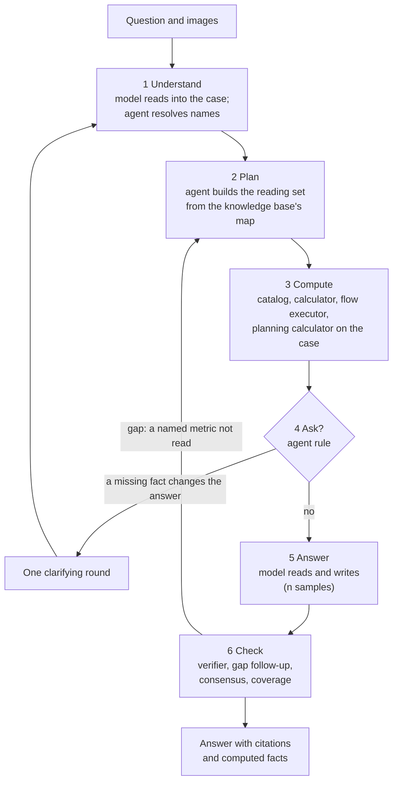

# Agent

Agent E2's agent is a neuro-symbolic expert system. Its code holds the expert's procedure and the knowledge base's map, and it makes the decisions; the model reads and writes. The agent reads the question into a case, plans what to read from the knowledge base's own map, runs the exact tools, decides whether to ask, calls the model, and checks the answer. Every question goes through this one pipeline. Not indexed.
Related reading: why Agent E2 can win is in [MISSION.md](../MISSION.md); the whole system in [ARCHITECTURE.md](../ARCHITECTURE.md); the harness parts in [README.md](README.md); how the knowledge is shaped in [KNOWLEDGE-ENGINEERING.md](../KNOWLEDGE-ENGINEERING.md). The tool-loop agent this design replaces, with its measurements, is archived in [project/archive/agent-tool-loop-2026-11-14.md](../project/archive/agent-tool-loop-2026-11-14.md).

- Status: built, and the only mode of Agent E2. [`harness/expert_agent.py`](expert_agent.py) runs stages 1 and 3-6 and [`harness/reading_plan.py`](reading_plan.py) runs stage 2; both are entered through [`harness/answer_modes.py`](answer_modes.py) as mode `agent-e2`. Classic and agentic mode are removed, and their code is archived in [project/archive/legacy/harness-tool-loop-2026-11-14/](../project/archive/legacy/harness-tool-loop-2026-11-14). Still to build: section 7.
- Name: a neuro-symbolic expert system, of the kind where symbolic control calls a neural model as a subroutine (Kautz: Symbolic[Neural]). The symbolic part is the knowledge base's map (links, file kinds, catalog, flows), the rules and the exact tools; the neural part reads language and images. The fixed order of the stages, with two bounded loops back (one clarifying round, one gap follow-up), is a small state machine. The flow executor with executable steps (Q166) will be the larger one. The name was settled in Q210.

## 1. Who decides what
| Part | Does | Never does |
|---|---|---|
| Agent (code) | Builds the case; plans the reading set; runs the catalog and the calculator on the case's values (the flow executor and the planning calculator are still to build, section 4.3); reads the pages the question links; decides whether to ask the user; calls the model; checks the answer; follows up once on a gap | Writes prose; guesses a value |
| Harness | The tools (hybrid search, catalog, calculator, web; the planning calculator and the flow executor, built but not yet called), budgets, the verifier, the model client | Decides |
| Model | Reads the question and its images into the case (fixed schema); reads the reading set and writes the answer, with a file for each claim | Chooses files or tools; does arithmetic; compares a value with a threshold |
| Knowledge | The map the agent plans with (file kinds, links, catalog, flows, term map) and the text the model reads | |

- The model is called; it does not drive. Every decision about what to read, compute or ask is made by agent code that reads the knowledge base. The author can review that code, and the same question always takes the same path.
- The word agent has changed meaning: it used to mean the model plus the tool loop ([project/terms.md](../project/terms.md), Q210).

## 2. Evidence for the split
- Planning a lookup needs a map of what the knowledge base holds. That map is the author's proprietary knowledge, and the Internet text the model learned from does not contain it. A model cannot plan a search through ground it has never seen, and its worst errors are beliefs it never looks up.
- The agent can plan, because the knowledge base records its own map (file kinds, `same_name` and `internal_derive` links, the catalog, flows, the term map).

| Finding (the previous generation: benchmark 2026-11-12 and 2026-11-13, retrieval check 2026-11-13; [archived](../project/archive/benchmark-results-before-2026-11-14/analysis-2026-11-13.md)) | Reading |
|---|---|
| Agentic and classic within the margin for every model (-6, -3, +1 points); agentic at 2-3.5 times the tokens and twice the latency | The model's own tool use adds nothing yet |
| 4.8-7.4 tool calls per multiple-choice answer; Muse at the 8-call limit on 359 of 595 | The model searches in circles |
| A needed file in the agent's search results but never opened (20-question sample, 2026-11-13): Gemma read 49% and saw 64%; Muse read 62% and saw 80% | The model cannot tell which hit matters |
| Qwen agentic: the same letters in all 5 runs on 35% of the questions | Lookups chosen by the model change from run to run |
| Primed start (same sample): given the classic context, no tool call on 32 of 40 (Gemma) and 38 of 40 (Muse) answers | The model does not ask for what is missing, so a gap must be found by code |
| Every needed file read: Muse agentic loses 1.7 of its 22 lost points | The model reads and reasons well |
| Classic: every needed file in context for 96% of questions with 1 needed file, and 5% with 5 or more; the most-missed files are mechanism files the question's words do not name (VM CPU Ready 9 times, resource-controls 7, Co-stop 5) | One search on the question's words does not reach the mechanism |

- So the model keeps the jobs it does well (reading, reasoning over given text, writing) and gives up the job it does badly (deciding what to read). The agent takes that job, working from the knowledge base's map.

### Classic and agentic (removed): what the agent keeps
- Classic was the first harness. It stayed for three reasons: it was the control that isolates the model's tool skill (agentic minus classic), the fallback when a model breaks the tool-call format twice, and the fast option (one model call).
- For Agent E2 as a product, only the fallback and the speed counted. The control is a benchmark diagnostic, and the benchmark is a proof, not a goal ([CLAUDE.md](../CLAUDE.md), Evaluation).
- The agent needs no fallback: the model makes no tool calls, so no tool-call format can break. It keeps the speed, with 2 model calls in the common case.
- Kept from classic: the harness leads; a deterministic lookup; catalog facts in the context; the term map; the troubleshooting route.
- Kept from agentic: reading beyond one search (link closure, one search per claim, a follow-up on a gap); the exact tools; the verifier.
- Dropped: the model choosing tools; the tool-call budget; the same-name and read reminders (the agent reads the files and their same-name links itself); the primed start; up-front blocks 1 (map) and 4 (flow index), which existed so the model could plan.

## 3. One question, six stages

| Stage | Who | Model calls | Output |
|---|---|---|---|
| 1 Understand | Model, then agent | 1 | The case |
| 2 Plan | Agent | 0 | The reading set |
| 3 Compute | Agent | 0 | Computed facts; the flow path |
| 4 Ask | Agent | 0 | Clarifying questions, or none |
| 5 Answer | Model | 1 (n with consensus) | The draft answer |
| 6 Check | Agent | 0-1 gap follow-up, 0-1 repair | The checked answer |

- The common case takes 2 model calls (agentic averaged 5-8, classic 1). The understand call reads about 1-2K tokens and writes a few hundred; the answer call reads about 32K.
- Consensus samples share one prompt, so on a local vLLM server they run as one batch on a cached prefix.

## 4. The stages
### 4.1 Understand: the case
- The model reads the question and its images into a fixed schema; it does not answer yet. Extraction is reading, which a 30B model does well, and it is also the only way to read a screenshot (MISSION.md, section 5: values shown back before reasoning).
- Case fields:
  - `kind`: a `retriever_guide` value (how-it-works, metric-meaning, term-meaning, what-to-set, health-check, troubleshooting, decision-tree);
  - `objects` and `layer`: VM, ESXi, cluster, datastore, resource pool; virtual motherboard or Guest OS;
  - `metrics`: each as written, with object, value, unit, interval or chart, and tool (vCenter, esxtop, VCF Operations, Windows, Linux);
  - `symptom`;
  - `premise`: the belief the question carries ("add vCPUs because Ready is high");
  - `claims`: the options of a multiple-choice question, or the parts of an open one;
  - `missing`: facts the question does not give (interval, vCPU count, object);
  - `images`: per screenshot, the tool, object, metrics, values, interval and time range.
- The agent checks the case (`expert_agent.parse_case`): only the known fields stay, and each metric name resolves through the catalog and the metric file titles (`reading_plan.case_files`). A name that does not resolve stays as text and plans nothing; it is never guessed into a file.
- The agent also reads the question on its own (term map, object words, counter keys, metric titles, values given in ms, the vCPU count, options and their parts: `reading_plan.anchors`, `reading_plan.claims`, `reading_plan.objects_in`, `expert_agent.COUNTER_MS`), and both readings feed the plan. A reply that is not JSON leaves the code-only case, so no fallback mode is needed.
- The case is asked for at temperature 0 (`deterministic`), whatever the model card's sampling, so the same question is read the same way every time. The answer call keeps the card's sampling.
- The output is JSON. On vLLM and llama.cpp, grammar-guided decoding can enforce the schema (plan, M5). Validity sample (Gemma, 9 questions, screenshots included): every case was valid JSON.
- Not built: `layer` as a field; showing the case back to the user before the answer (a product screen, M6).

### 4.2 Plan: the reading set
The agent plans in code, from what the knowledge base records about itself ([`harness/reading_plan.py`](reading_plan.py)). The tiers are packed into the context budget in this order (`context_tokens`, 32K since 2026-11-15):

| Tier | Files | Form |
|---|---|---|
| 1 Flow | A troubleshooting, health-check or decision-tree question (the case's kind; without a case, a named health check, else the troubleshooting words): its best flow file of that kind | Whole |
| 2 Named | Files the question names exactly, strongest name first: term-map rows; titles of two or more words, hyphenated names and counter keys resolved through the catalog; the metrics of the case; last, titles matched by one plain word (Latency, Wait, Disk). Kept for the objects the question names | The first 3 whole (`plan_named_whole`), the rest as best sections |
| 3 Search | Top 3 hits of hybrid search on the question | Whole |
| 4 Mechanism | `same_name` and `internal_derive` (up to 8 each) of the named files, the top 2 hits, then the flow (the files its steps read) | Best sections, 400 tokens each |
| 5 Claims | The top hit of one search per claim: each option (prefixed by its part, such as "ESXi 01:", when a question has several option lists), or each part the case reads in an open question; at most 10 | Best sections |
| 6 Rest | Search hits 4-10 (`search_k`); the second hit per claim; `related` files of the top 2 hits, of each named file and of each file the claims found: up to 4 the file declares (`plan_related_n`) and up to 4 that declare it (`plan_related_back`; a related link is symmetric in meaning) | Best sections |

- Search reads a table's header (the metric names) and not its data rows, whose times and numbers would outweigh the question's words. An ask that names no topic ("Which statements are correct?") is not searched as a claim (structure review 2026-11-14).
- Why tiers 4 and 5: the claims of a Level 400 question test different mechanisms, and the mechanism file seldom shares the question's words. The links record which file a metric derives from, and one search per claim finds the file for each claim.
- Budget 32K (since ; 16K before). Retrieval check, BM25, 275 questions, with the named tier capped. With options: 16K gave 171 complete and main file missing on 21; 24K 204 and 10; 32K 209 and 7; 48K 210 and 7. Stem only: 119 and 39; 133 and 35; 134 and 34; 134 and 34. The gain stops at 32K. The hardware allows it: enterprise GPU, up to four large GPUs (decision of 2026-11-15), and the context window is 128K. The budget stays at 32K for quality, not hardware: 48K added 1 complete question. The risk is distraction by files the question does not need. The benchmark round reads that risk from the traces, as wrong answers with every needed file present; if they rise, the budget goes to 24K.
- Named files are read whole only for the first 3. A question names many metric files through ordinary title words, and every named file used to be read whole, ahead of search. Across the 275 questions the tier pulled 1,611 files, of which 318 were needed (20%); one-word matches pulled 769, of which 70 were needed (9%). The tier took a median of 4,900 tokens of the 16K budget, and over 8,000 on 55 questions, so the last search hit, often the main file, fell out. Retrieval check, BM25, against all named files read whole: reading the first 3 whole, strongest names first, moved complete from 165 to 171 and main file missing from 26 to 21 (with options), and 117 to 119 and 39 to 39 (stem only). Tried and not taken: the first 4, 5 or 6 whole (169, 169, 168 with options); one-word matches moved behind search as sections (main file missing 21 with options, but 41 stem only).
- Sections: the candidate list averages 21 files, against room for about 14 whole files. With whole files, 10 points of needed-file recall were planned and then cut by the budget (plan 78%, context 68%, BM25). A secondary file therefore gives its best sections (BM25 on the question). The retrieval check counts a file as read when its sections are.
- Deterministic: the same question gets the same reading set. Consensus samples then differ only in reasoning, so a disagreement marks doubt in the reasoning, not a different search.
- Measured with the retrieval check on the 196 questions (2026-11-14, the code-only case; `python3 benchmark/runner/retrieval_check.py`, `--embeddings` for hybrid):

| Search | Recall | Every needed file | Main file missing | 3 needed files | 4 | 5 or more |
|---|---|---|---|---|---|---|
| BM25 | 76% (77% after Q211) | 109 of 196 (56%; 110 after Q211) | 25 | 52% | 33% (36% after Q211) | 21% |
| Hybrid | 80% | 117 of 196 (60%) | 19 | 57% | 40% | 26% |

- Outputs: [benchmark/results/retrieval-2026-11-14/](../benchmark/results/retrieval-2026-11-14/hybrid.md). The design was measured against classic mode before it was built: hybrid recall 69% to 80%, complete 46% to 59% ([archived](../project/archive/benchmark-results-before-2026-11-14/retrieval-2026-11-14/plan-hybrid.md)). Generations are not compared further.
- Not tuned to the questions: there is one design, with the tiers as the knowledge base defines its links. Two settings were tried (section size 250 or 400 tokens, derive cap 3 or 8), and they came within 2 questions of each other.
- Still short of the release level of the retrieval check (main file 100%, recall 95%, complete 90%). The next levers, in order: the model's case measured on the retrieval check, then the knowledge changes of section 6.

### 4.3 Compute
- The agent runs the exact tools on what the case holds, before the model reads. The model gets `Computed (exact)` lines and computes nothing.
  - Built: the catalog facts of every file in the reading set (unit, rollup, statistics level, thresholds by use, limits, with source: `catalog_database.facts_for`).
  - Built: NVMe wait of a VM (`nvme_wait`, `arithmetic_calculator.nvme_wait_pct`): from the case, the VM's NVMe read bandwidth, the host's NVMe read latency and the vCPU count, by the formula of cluster-performance, section NVMe wait formula. Memory Contention does not count this wait.
  - Built: each summation counter given in ms (by the case, or written as `cpu.ready.summation = 8,000 ms`) is converted by `arithmetic_calculator.py`, with its rule's source, to % of one vCPU, and to % per vCPU when the vCPU count is known, for the chart interval the question names (Real-time 20 s, 1 Day 300 s, 1 Week 1,800 s, 1 Month 7,200 s, 1 Year 1 day: [vsphere/tools/vsphere-client/vcenter-statistics](../knowledge/vsphere/tools/vsphere-client/vcenter-statistics.md)).
  - To build: the band of a value against its threshold row for that interval and use, with the source ([project/design-thresholds.md](../project/design-thresholds.md); target: the verdict per use from the catalog).
  - To build: a troubleshooting or health-check question goes through the flow executor with executable steps (Q166, approved for 1.0; format in [project/knowledge-rules/flows.md](../project/knowledge-rules/flows.md), Steps as data). Each step names its metric, object and test as data; the agent compares the case's values and takes the branch. The path reaches the model as computed facts: "Flow path (exact): step 1 VM CPU Ready 12% per vCPU at the 20-second peak, orange (row ...) → step 2". At the first step whose value the case lacks, the agent stops: it asks (4.4), or, in a single-turn answer, the model states both branches and what to read. First flow: VM CPU Contention or Latency is high; VM slow next, as the router. Today the flow file is read whole (tier 1) and the model follows its steps.
  - To build: a capacity question with its inputs goes through the planning calculator ([`harness/capacity_calculator.py`](capacity_calculator.py)).
- The tools run before the model, not on request. A small model does not call a tool it does not know it needs, just as it does not search for a belief it holds, so the agent calls them every time.

### 4.4 Ask
- The agent decides whether the model may ask, by the rule of MISSION.md, section 5. Built: the round is offered only when the case lists a missing fact, the case reads a premise, or a term-map row marked `premise` matches; otherwise the answer prompt has no clarifying rule at all (`chat_final`).
- To build: the round is also offered when the flow's next step needs a value the case does not hold (with Q166), when a term-map row marks words with several meanings, and when the text and an image disagree.
- At most one round, except in a consultation (4.7). The model words the questions. The benchmark kinds (`choice`, `open`) never ask.

### 4.5 Answer
- One model call (n with consensus) gets: the rules (knowledge base first, and it wins; a file for each claim; a threshold only with its source; Unsure over a guess); the up-front misconceptions and confusable pairs ([`harness/upfront_knowledge.py`](upfront_knowledge.py), config `primer`); the case as read; the computed facts; the coverage note when it applies; the reading set; any web page the question links; and the question.
- Answer shape ([`harness/answer_shape.py`](answer_shape.py)): it follows what the question asks. Explain (what it is, how it works): the mechanism, with what the metric leaves out; no page figures, no next steps. Advise (what to set): the value, then the reason and the trade-off. Diagnose (a verdict, a cause, a next step): conclusion, evidence and mechanism, then what to check next. General when unclear: only what is asked. In the service, the model reads the user's bare question once, at temperature 0, for the shape and for whether the answer needs the page's values (`answer_shape.decide`); elsewhere, or when its reply is unreadable, the case's kind decides. An explain answer to "which metrics" lists them first, one line each with its reason. Each claim names the file it rests on. In open answers, a claim with no file goes under a last line "Not settled by the knowledge base:" (`expert_agent.OPEN_SHAPE`). This is a product feature: the benchmark has been multiple choice (Q199), so the line is measured in the live test, judged by the author.
- Product label (Q208; [KNOWLEDGE-ENGINEERING.md](../KNOWLEDGE-ENGINEERING.md), section Product label and better model): this applies when a term-map row with `label` matches the question or the case's metrics (a label read from a screenshot: `user_terms.case_labels`). Its note in "Terms in this question" comes from the glossary entry: what the product computes, the decision the label invites, the better model and its name (`user_terms.label_note`). An open answer then gets one more rule, the teaching order inside the answer shape (`user_terms.LABEL_ORDER`): the conclusion names the label, the reading it invites, why that reading fails and the better model; the mechanism says what the product computes; what to check next says what to read instead. The rule is an instruction, so it sits with the answer rules and not in the reading-set budget. A multiple-choice answer gets the note only.
- Not built: a `MISSING:` line for the model to name what it lacks. The gap follow-up (4.6) finds the same need from the draft, and models given a context seldom ask (primed start).

### 4.6 Check
- Verifier ([`harness/answer_check.py`](answer_check.py)): format, letters, Unsure alone; one repair turn.
- Gap follow-up, once (`gap_followup`): every metric the draft names, for the case's objects, must resolve to a file in the reading set. A name outside it (the draft reasons about Co-stop, but the reading set has no Co-stop file) makes the agent add that file's best sections (at most 2 files) and ask for the answer again. Only names of two or more words, or hyphenated names, count (`strict`). In the first validity sample, single words such as Throughput or Performance fired it on 6 of 9 answers with unrelated files; with `strict`, on 0 of 9. This is the gain the tool loop was built for, a chain across files, but the agent runs it on evidence in the draft instead of on the model's choice.
- Grounding (multiple choice; open answers are not verified): a number that is in neither the question, the reading set nor the computed facts is flagged, and a cited id must exist.
- Consensus (multiple choice): n samples of stage 5 on one reading set. Unanimous letters stand; otherwise the answer is Unsure ([README.md](README.md), section 6a). Each sample runs its own gap follow-up, so two samples can read different extra sections after their drafts; the shared reading set comes from stages 1-4.
- Coverage boundary: when nothing in the reading set came from tier 1 or 2 (no flow and no file the question names, only search hits), the answer prompt says the question may be outside the knowledge base, and to say so if the text does not settle it. Trace step `coverage` (`weak` or `named`). There is no search-score limit in 1.0: it needs real operator questions, and 1.0 has none (Q207). It is never tuned on the benchmark.

### 4.7 Consultation (several turns; to build for 1.0)
- When the user asks to be guided ("You're my expert consultant: guide me through capacity planning"), the agent leads (MISSION.md, Ways to ask, 7). Release 1.0 covers capacity planning only; the other consultations and their checklists are in [project/consultations.md](../project/consultations.md).
- The procedure is code: the planning calculator's inputs are the checklist. Each turn, the agent compares what the conversation holds with that list and picks the next topic and the inputs it needs; the model explains why the topic matters and words the question.
- A missing input gets its default from the catalog (`planning-*` rows of thresholds-capacity.yaml), offered as a default and named as one ("Silver default: 2:1 per physical thread; give yours to recompute"). Defaults are the starting point of the advice, never a hidden assumption.
- When the inputs are complete, the calculator computes (stage 3), and the model explains the six numbers, the binding one, and what would change it.
- The one-round limit of 4.4 does not apply, because the user asked for the conversation.
- Not in the benchmark: a benchmark question states every input in its prompt (benchmark/design.md, section 6.1, F3), so it tests the method, not the conversation (question L4-43). The live test measures consultations (benchmark/live-test.md, step 9).

## 5. Rules and budgets
| Rule | How | Replaces (tool loop) |
|---|---|---|
| Knowledge before the answer | The model answers only with the reading set in front of it | First call must be search or catalog |
| The other object's meaning of a label | `same_name` files of every named file are tier 4 | Same-name reminder |
| The mechanism behind a metric | `internal_derive` closure | The model's `follow_links` |
| Exact values | Computed facts from the catalog and the calculator | `catalog` and `calculate` calls |
| Order of checks | The flow file read whole (tier 1); to build: the flow executor takes the branch (Q166) | `flow` tool; the model took the branch |
| One question, one path | Deterministic plan | Lookups chosen per run |
| Budget | Reading set 32K; context window 128K (`context_window`; a prompt above it is flagged, `context_over`); at most 4 model calls (case, answer, gap, repair) plus consensus samples | 8 tool calls, 12K tokens of tool output |

- The benchmark uses the deployment budgets, so the score predicts the product. Time per question on the target GPU is 2 model turns in the common case, to be measured in the live test (M5). Validity sample (Gemma on the gateway, 9 questions): 2 model calls per answer, 11-23K prompt tokens per answer (both calls), 19-59 seconds.

## 6. What the knowledge must give the agent
The plan is only as good as the map. These are the changes the knowledge needs, in order; each becomes a rule in [project/knowledge-rules/](../project/knowledge-rules) and a lint check once built:
1. `internal_derive` is the mechanism closure: a metric file lists every mechanism file it follows from. The most-missed files are reached only through these links. 12 files derive from resource-controls and 8 from vm-vs-guest-os, yet a question that names none of those 20 files does not reach them.
2. Names resolve: metric file titles keep the form object, technology, label (VM CPU Ready), and esxtop field rows in the catalog get the `kb` of their metric file (today only vCenter counters carry it).
3. Sections stand alone: the plan reads sections of secondary files, so each `##` section names its object and metric in its first line and does not lean on the section before it.
4. Flow steps as data (Q166): metric, object, interval, the catalog test and the branch targets, in the flow file (one home). Format: [project/knowledge-rules/flows.md](../project/knowledge-rules/flows.md), Steps as data. The first flow is VM CPU Contention or Latency is high.
5. Term-map rows mark words with several meanings (stage 4).
6. Coverage by mechanism ([analysis-2026-11-13](../project/archive/benchmark-results-before-2026-11-14/analysis-2026-11-13.md), section 12): the field set shows which mechanisms are missing.

## 7. Build order
Each step is proved by its own check.
1. Done : the reading plan on the code-only case; the retrieval check (section 4.2).
2. Done : the case by the model, the summation conversions, the ask rule, the answer prompt and shape, the gap follow-up, the coverage note, and consensus on one reading set; unit tests with the mock client; a live validity sample on one model (every answer readable, 2 model calls each).
3. Next: the round that proves it, with Agent E2 and Base on the candidates and the frontier reference ([project/plan.md](../project/plan.md), M4), after the author's go.
4. To build, each with unit tests on worked examples, and with the retrieval check where it changes the reading set: the model's case in the retrieval check (`--case-model`); executable flow steps, starting with the VM CPU Contention or Latency flow (Q166); threshold bands in stage 3; the planning calculator in stage 3; the knowledge changes of section 6.

## 8. Walkthrough of one question
Question: "A 4-vCPU VM shows cpu.ready.summation = 8,000 ms in one real-time sample. Which statements are correct?" The options include the rollup and statistics level, 10% Ready and 40% Ready.

1. Understand (model call 1): kind metric-meaning; object VM; metric `cpu.ready.summation` = 8,000 ms, real-time chart (20-second sample), 4 vCPUs, vCenter; the claims are the options.
2. Plan (traced): tier 2 brings VM CPU Ready (the counter key resolves through the catalog); tier 3 adds vCenter statistics and aggregation; tier 4 adds the mechanism files (provider and consumer, resource controls, vCPU states, metric sources); tier 5 adds one hit per option (vCenter statistics for the statistics-level option, vCPU states for the limit option; one hit, the cluster health check, is noise). That makes 16 files in the 16K budget, the secondary ones as sections.
3. Compute (traced): the catalog facts of the Ready file (Summation, statistics level 1); `cpu.ready.summation = 8000 ms in a 20-second sample: 40% of one vCPU; 10% per vCPU of 4 vCPUs`, with the rule's source.
4. Ask: no, because "real-time" gives the interval.
5. Answer (model call 2): the model reads and writes the letters, each reason citing its file.
6. Check: the verifier runs; every metric the draft names is in the reading set; consensus.

- Two model calls in all. The tool-loop agent took four model turns for the same question (trace, archived design, section 10), and chose each lookup itself.
