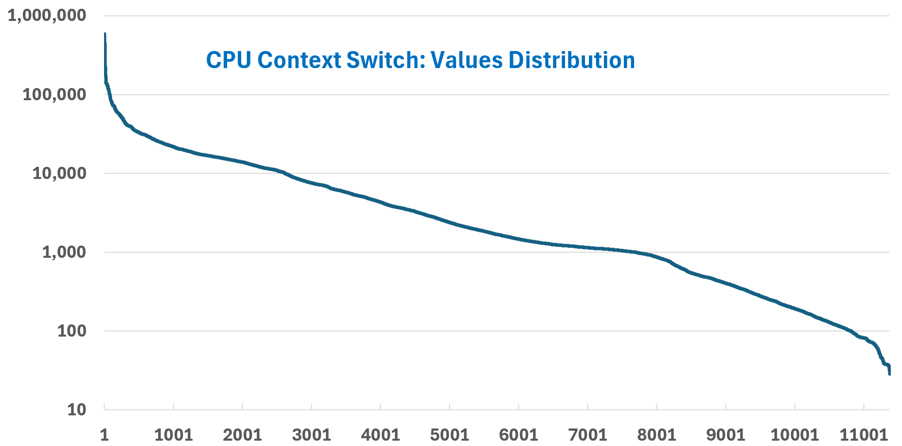

# Guest OS CPU Context Switch Rate

## Layer
- Guest OS layer: Windows or Linux, running on the VM. The VM is a virtual motherboard; it cannot see inside the Guest OS.
- VMware Tools collects this counter inside the Guest OS and vCenter and VCF Operations store it on the VirtualMachine object. That is a data path, not ownership: the counter belongs to the Guest OS.

## Meaning
- Combined rate at which all processors switch threads (within or across processes). More processors, more switches.
- Costly: scheduler work, TLB flushes, cache pollution (L1/L2 reloads).
- Causes: a thread asking another for data, or preemption by a higher-priority thread. IO tends to require switches.
- VCF Operations reports the total only (System and Thread objects exist in Windows).

## Thresholds (book)
| Range | Per processor |
|---|---|
| Yellow | 2K-4K |
| Orange | 4K-8K |
| Red | Above 8K |

## Values
- Wide range. Windows 10 desktop, 8 threads, 10% CPU: 10K-50K.
- 11,372 VMs: about 80% below 10,000; more than half below 1,000. Extreme cases sustain above 10 million.
- Example: CentOS VM with 4 vCPU near 1 million, tracking CPU usage. Do not add vCPUs if the queue stays manageable.
- Example: Horizon Connection Server, 10 vCPU, about 120 processes and over 2,000 threads: steady 34K-37K (about 3.5K per CPU) while idle.
- Use a value between the 95th and 99th percentile: momentary peaks rarely matter.
- Profile per application: healthy for one VM may not be for another.


## Correlation
- Weak with CPU utilization across 3,328 VMs: not all instructions switch. Strong in some VMs.
- Can rise with vCPU usage disparity even for a single-threaded agent (example: 78% disparity on a 4-vCPU VDI VM running a security agent).
- Thread ping-pong: an idle 10-vCPU VM whose vCPUs take turns being busy.

## Traps
- "High context switch means CPU shortage" → check the run queue.

## Metadata
```yaml
id: guest-os/cpu/metrics/context-switch
retriever_guide: metric-meaning
scope: guest-os
technology:
- cpu
pillar:
- performance
product:
- windows
- vcf-operations
layer:
- guest-os
metric_class: context
internal_derive: []
same_name: []
same_meaning: []
related:
- guest-os/cpu/concepts/windows-cpu-scheduling
- guest-os/cpu/metrics/run-queue
- vsphere/cpu/metrics/virtual-motherboard/usage-disparity
images:
  - path: ../images/guest-os-context-switch-rate-distribution-across-vms.png
    product: [windows]
    object: [VirtualMachine]
    metric: ['Guest OS CPU Context Switch Rate']
    image_type: distribution
    sample: '11,372 VMs'
source:
  document: PART 3 - Counters.docx
  path: MS Windows > CPU > Context Switch
corrections: []
review_notes:
- 'Section ''Thresholds'': colour labels inferred as for the run queue table.'
status: draft
```
