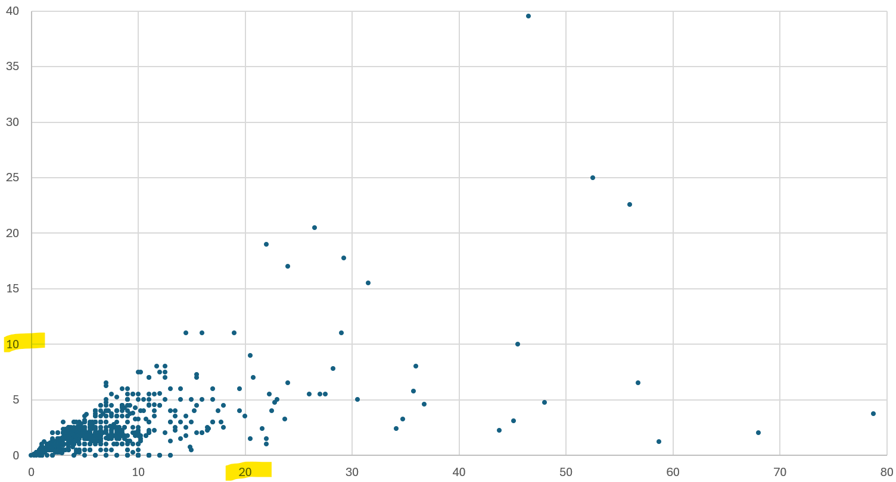
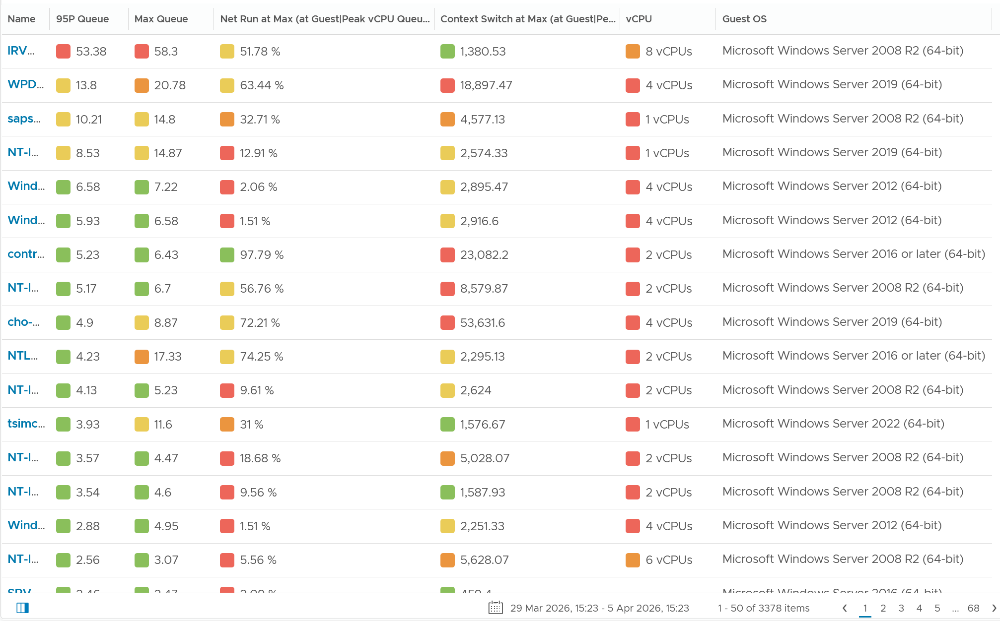
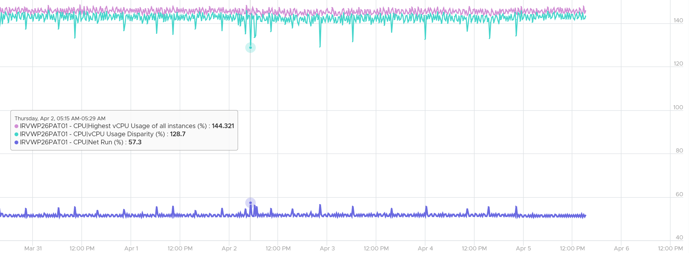

# Guest OS CPU Run Queue (Windows Processor Queue Length)

## Layer
- Guest OS layer: Windows or Linux, running on the VM. The VM is a virtual motherboard; it cannot see inside the Guest OS.
- VMware Tools collects this counter inside the Guest OS and vCenter and VCF Operations store it on the VirtualMachine object. That is a data path, not ownership: the counter belongs to the Guest OS.

## Meaning
- Threads in the processor queue. Windows excludes running threads; Linux includes them.
- The primary Guest OS CPU performance counter: whether the CPU keeps up with demand.
- An 8-vCPU VM runs 8 threads in parallel; more demand queues. Include the queue in Guest OS sizing.
- VMware Tools counter: guest.processor.queue. Windows source: Win32_PerfFormattedData_PerfOS_System ProcessorQueueLength (WMI).
- The guest counter is the value at the moment of each 20-second sample, not an average. VCF Operations builds two metrics from those samples, in the next section.

## Scale in VCF Operations
- Two metrics on the VM object: Guest|CPU Queue (5-minute value, the mean of the 15 samples of 20 seconds) and Guest|Peak vCPU Queue within collection cycle (the highest of the same 15; key `guest|20_sec_peak_cpu_queue`). The names say CPU and vCPU; both mean the same unit, per vCPU. Say "vCPU" for the peak metric: on a large VM a count per CPU and a count per vCPU differ by the whole vCPU count.
- Both are the guest's total queue divided by the VM's vCPU count: the average queue per vCPU. The total on the VM is the value times the vCPU count. An 8-vCPU VM with 24 threads in the queue shows 3. Windows PerfMon (System \ Processor Queue Length) and Linux `vmstat` show the total.
- How to tell from an export, with no access to the guest: the guest reports a whole number of threads, so every peak value is a whole multiple of 1/vCPU count (8 vCPUs: steps of 0.125) and every 5-minute value a whole multiple of 1/(15 × vCPU count). A raw total would show whole numbers. A cycle that lost samples (a gap in the 20-second collection) shows a finer step for that cycle only.
- The peak is never below the 5-minute value and never above 15 times it. The ratio reaches 15 only when one sample holds all the queue and the other 14 are zero; the median is about 5.
- Checked on exports of a 6-vCPU and an 8-vCPU VM (1 day to 1 month). The counter is confirmed per vCPU for both metrics; the 20-second alert in the catalog reads the same per vCPU value (see Thresholds).

## Thresholds
- Colour levels per processor: the Guest OS KPI row "Peak vCPU run queue length (count)" in the threshold catalog (one place per number). The VCF Operations value is already per vCPU, so it compares directly with the KPI levels; a PerfMon or `vmstat` total is divided by the vCPU count first.
- The alert symptoms on these metrics (red above 20 for the 20-second peak, above 4 for the 5-minute value) are tested on the same per vCPU value, so one value works for a VM of any size. 20 per vCPU is high on purpose (a total of 160 threads on 8 vCPUs, 320 on 16): the alert fires only on an extreme queue, to avoid false positives. The KPI turns red at 16. When the alert fires, read the two checks in [`guest-os/guest-os-alerts`](../guest-os-alerts.md), section Guest OS CPU run queue.
- PerfMon UI text: divide by processors; below 10 per processor is normally acceptable. MSDN: above 2 sustained indicates congestion. SQL Server documentation: 3.
- Utilization can be 100% with a low queue: the workload runs as fast as it can. Adding vCPUs then slows it (more context switching).

## Observed values
- 3,385 Windows VMs, 1 week, 20-second peaks (30,240 points per VM): some VMs have high queues.
- 800 VMs, 1 month: the 99th percentile is under half of the peak; for peaks of 3 or more, the 99th percentile averaged 34% of the peak.

- Whether Hyper-Threading doubles the queue is undocumented.


## Cases
- 8-vCPU VM at 52% with queue 53 (a PerfMon total; VCF Operations would show 6.6 per vCPU): expected about 8. Queue cycled 14-59 (sharp rise in 5-10 minutes, slow fall over an hour) and trended up over 7 days (possible leak). Ready, Co-stop, Other Wait, memory contention and disk latency were low. vCPU Run was very imbalanced (gap above 140%). A thread blocked on a lock (mutex, semaphore, critical section) is in the Wait state and is not in the queue: the queue counts Ready threads only. A long queue while some vCPUs idle points at threads that cannot use those vCPUs (processor affinity, work bound to one vCPU). High Privileged Time with low User Time points at driver or kernel work (DPC, interrupts).
- High queue while idle: the application created many threads. 20-second spikes are much smaller in the 5-minute average.


## Misconceptions
- "The queue in VCF Operations is the Windows Processor Queue Length" → it is that value divided by the vCPU count. Multiply by the vCPU count to compare it with PerfMon or `vmstat`.
- "The 20-second peak is 15 times the 5-minute value" → the peak is the highest of 15 samples and the 5-minute value their mean: the ratio runs from 1 to 15.
- "Queue 53 on 8 vCPUs means add vCPUs" → check vCPU imbalance, processor affinity and kernel time first.
- "Threads waiting on a lock lengthen the processor queue" → a blocked thread is in Wait; it joins the queue only when the lock is released.

## Metadata
```yaml
id: guest-os/cpu/metrics/run-queue
retriever_guide: metric-meaning
scope: guest-os
technology:
- cpu
pillar:
- performance
product:
- windows
- vcf-operations
layer:
- guest-os
metric_class: contention
internal_derive:
- guest-os/cpu/windows-cpu-scheduling
- vsphere/technology/cpu/concepts/guest-os-vs-vm-cpu
- vsphere/architecture/vm-vs-guest-os
same_name: []
same_meaning: []
related:
- guest-os/cpu/windows-cpu-scheduling
- guest-os/system/concepts/guest-os-sizing
- guest-os/system/guest-os-performance
images:
  - path: ../images/windows-run-queue-peak-vs-99th-percentile-scatter.png
    product: [windows]
    object: [VirtualMachine]
    metric: ['Guest OS CPU Run Queue']
    image_type: scatter
    sample: '800 VMs, 1 month'
  - path: ../images/windows-run-queue-distribution-across-vms.png
    product: [windows]
    object: [VirtualMachine]
    metric: ['Guest OS CPU Run Queue']
    image_type: distribution
    sample: '3,385 VMs, 1 week'
  - path: ../images/windows-high-run-queue-with-imbalanced-vcpu-run.png
    product: [windows]
    object: [VirtualMachine]
    metric: ['Guest OS CPU Run Queue', 'VM CPU Run']
    image_type: timeline
source:
  document: Knowledge base
  path: MS Windows > CPU > Run Queue
corrections: []
review_notes:
- 'Section Scale in VCF Operations: derived from exports of two VMs (6 and 8 vCPUs). Check the wording of the metric definitions in the VCF Operations 9.1 documentation (techdocs.broadcom.com, Guest OS metrics) and keep the vCPU count test as the way to verify.'
- 'Section Observed values: the 3,385-VM and 800-VM charts do not say whether the queue is a total or per vCPU; check the scale.'
status: draft
```
