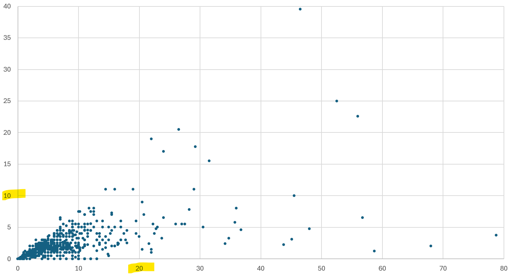
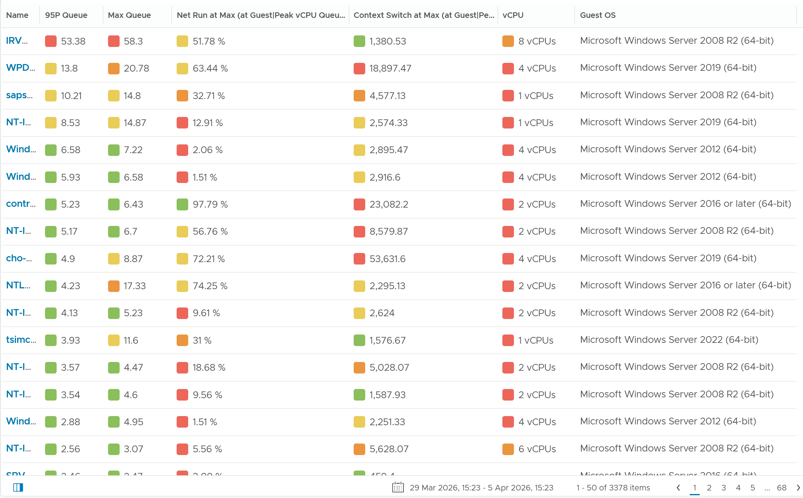
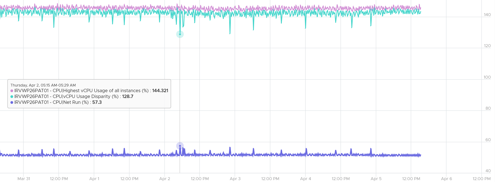

# Guest OS CPU Run Queue (Windows Processor Queue Length)

## Layer
- Guest OS layer: Windows or Linux, running on the VM. The VM is a virtual motherboard; it cannot see inside the Guest OS.
- VMware Tools collects this counter inside the Guest OS and vCenter and VCF Operations store it on the VirtualMachine object. That is a data path, not ownership: the counter belongs to the Guest OS.

## Meaning
- Threads in the processor queue. Windows excludes running threads; Linux includes them.
- The primary Guest OS CPU performance counter: whether the CPU keeps up with demand.
- An 8-vCPU VM runs 8 threads in parallel; more demand queues. Include the queue in Guest OS sizing.
- VMware Tools counter: guest.processor.queue. Windows source: Win32_PerfFormattedData_PerfOS_System ProcessorQueueLength (WMI).
- Reports the last observed value, not an average. No highest or lowest variants.

## Thresholds
| Range | Per processor (book) |
|---|---|
| Yellow | 2-4 |
| Orange | 4-8 |
| Red | Above 8 |
- PerfMon UI text: divide by processors; below 10 per processor is normally acceptable. MSDN: above 2 sustained indicates congestion. SQL Server documentation: 3.
- Utilization can be 100% with a low queue: the workload runs as fast as it can. Adding vCPUs then slows it (more context switching).

## Observed values
- 3,385 Windows VMs, 1 week, 20-second peaks (30,240 points per VM): some VMs have high queues.
- 800 VMs, 1 month: the 99th percentile is under half of the peak; for peaks of 3 or more, the 99th percentile averaged 34% of the peak.

- Whether Hyper-Threading doubles the queue is undocumented.


## Cases
- 8-vCPU VM at 52% with queue 53: expected about 8. Queue cycled 14-59 (sharp rise in 5-10 minutes, slow fall over an hour) and trended up over 7 days (possible leak). Ready, Co-stop, Other Wait, memory contention and disk latency were low. vCPU Run was very imbalanced (gap above 140%). Check software locks (mutex, semaphore) holding ready threads, and high Privileged Time with low User Time (driver or kernel locking).
- High queue while idle: the application created many threads. 20-second spikes are much smaller in the 5-minute average.


## Traps
- "Queue 53 on 8 vCPUs means add vCPUs" → check locks, imbalance and kernel time first.

## Metadata
```yaml
id: guest-os/cpu/metrics/run-queue
retriever_guide: metric-meaning
scope: guest-os
technology:
- cpu
pillar:
- performance
product:
- windows
- vcf-operations
layer:
- guest-os
metric_class: contention
internal_derive: []
same_name: []
same_meaning: []
related:
- guest-os/cpu/concepts/windows-cpu-scheduling
- vsphere/system/concepts/guest-os-sizing
- guest-os/system/metrics/guest-os-performance
images:
  - path: ../images/windows-run-queue-peak-vs-99th-percentile-scatter.png
    product: [windows]
    object: [VirtualMachine]
    metric: ['Guest OS CPU Run Queue']
    image_type: scatter
    sample: '800 VMs, 1 month'
  - path: ../images/windows-run-queue-distribution-across-vms.png
    product: [windows]
    object: [VirtualMachine]
    metric: ['Guest OS CPU Run Queue']
    image_type: distribution
    sample: '3,385 VMs, 1 week'
  - path: ../images/windows-high-run-queue-with-imbalanced-vcpu-run.png
    product: [windows]
    object: [VirtualMachine]
    metric: ['Guest OS CPU Run Queue', 'VM CPU Run']
    image_type: timeline
source:
  document: PART 3 - Counters.docx
  path: MS Windows > CPU > Run Queue
corrections: []
review_notes:
- 'Section ''Thresholds'': the book''s table lists the three ranges without colour labels in the extracted text. Mapped to yellow, orange, red, matching Guest OS Performance (%).'
status: draft
```
