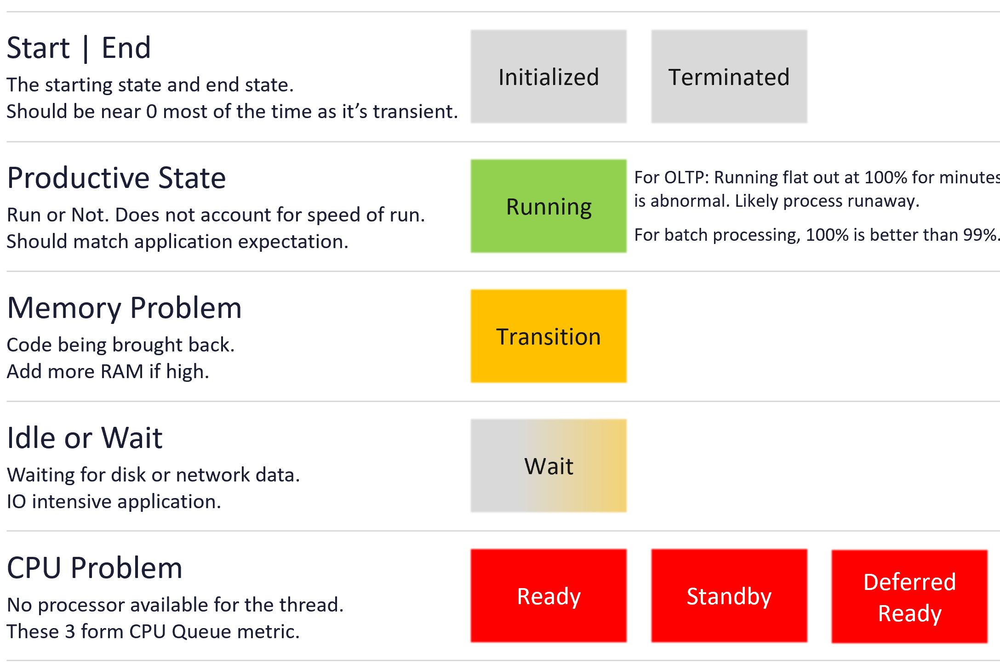
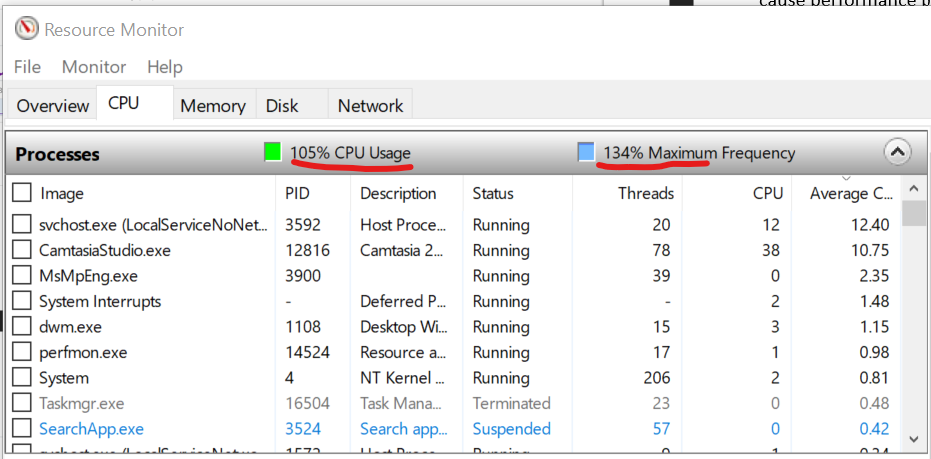
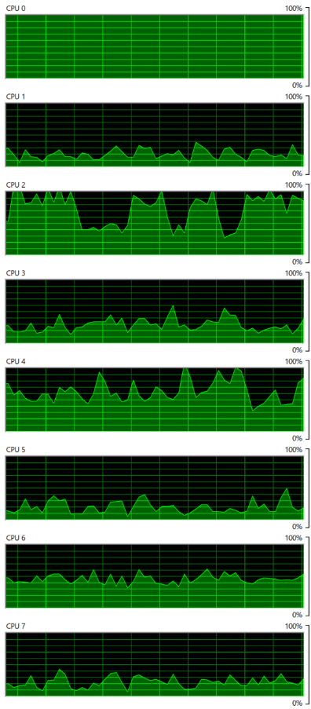

# Windows CPU scheduling

## Layer
- Guest OS layer: Windows or Linux, running on the VM. The VM is a virtual motherboard; it cannot see inside the Guest OS.
- Counters here come from inside the Guest OS (PerfMon, WMI, or VMware Tools). vCenter and VCF Operations store some of them on the VirtualMachine object. That is a data path, not ownership.

## Tools
- Performance Monitor (oldest), Task Manager, Resource Monitor. Names and possibly formulas differ.
- Guest OS observability per thread or process is minimal: no per-process CPU queue, page faults, dropped packets or disk latency.
- Sysinternals tools show utilization only, no contention.
- PerfMon puts Processor Queue Length and Context Switches under System (system-wide), not Processor.

## Objects
- An application has 1 or more processes; a process has 1 or more threads. Threads are scheduled on processors.

## Thread states (Windows Internals, 7th edition)


| State | Group | Meaning |
|---|---|---|
| Ready | CPU issue | Waiting for a processor; all are busy. Includes threads waiting to be in-swapped after a wait, and preempted threads (put at the front of the queue). Should be near 0. Many high-priority threads bumping low-priority ones keep it high. |
| Standby | CPU issue | Selected as next on a processor. At most one per processor. A higher-priority thread (often an IO interrupt) can still take the CPU. |
| Deferred Ready | CPU issue | Assigned to a processor but not started. Kept in a general list to minimize per-processor lock time. Shown as Unknown in PerfMon and WMI. |
| Waiting | Non-CPU | Natural for most threads (for example 2,950 of 3,000). Voluntary synchronization, OS waits (paging IO), or subsystem suspension. Points to disk or network. |
| Transition | Non-CPU | Waiting because its kernel stack was paged out. Page faults rise. A memory problem: add memory. |
| Initialized | Other | Being created. Near 0; high values: excessive thread spawning or slow creation. |
| Terminated | Other | Finished. Not a problem when planned. |
| Running | Other | Productive. Should approximate infrastructure sizing (OS, Tools, agents) plus application sizing. |

- Processor Queue Length includes threads in Ready, Standby and Deferred Ready (shown as Unknown). All 3 indicate a CPU problem.
- Tools count threads per state at one instant. Collecting thousands of threads takes about 100 ms, during which Standby slots change hundreds of times. Counts can exceed the number of processors.

## Priority
- Windows prioritizes foreground work: 6 priority classes over 32 priority levels (0-31); foreground boosts apply to levels 0-15. ESXi has no priority concept: it uses a fair-share scheduler with no foreground.
- A process often in the queue may have low relative priority. Give agents low priority and limited CPU.

## Usage, utilization, time
| Tool | Name |
|---|---|
| Performance Monitor | Processor Time |
| Task Manager | CPU Utilization |
| Resource Monitor | CPU Usage |

- They do not measure the same thing.
- Windows CPU Usage ignores hypervisor Hyper-Threading. Windows at 100% on a shared core: VM CPU Usage 62.5%, VM CPU Demand 100%.
- Windows 8 and later report CPU usage above 100% when frequency exceeds nominal. Maximum Frequency shows speed relative to nominal. Example: 134% speed; 69% speed at low load (8% usage means 8% productive cycles).
- How Windows fills frozen time (Ready, Co-stop, Overlap, Other Wait) is not documented.


| Metric | Frequency scaling | Hyper-Threading | VM contention |
|---|---|---|---|
| Guest CPU Usage | Yes | No | No |
| VM CPU Run | No | No | No |
| VM CPU Net Run | No | No | No |
| VM CPU Usage | Yes | Yes | No |
| VM CPU Demand | Yes | Yes | Yes |

- Slowness with low utilization: check whether the CPU runs in a lower power state. Matters for frequency-sensitive applications.
- C1 + C2 + C3 time below 100% is time in C0. The idle loop typically runs in C3: Idle Time and C3 Time track each other.

## OS vs process
- OS-level CPU can look healthy while one process hangs. Example: Word hung (100% on one CPU) while Windows showed 57% overall and Word 18.9%. Likely cause, not confirmed: OS-level counters include Turbo, process counters do not.
- Monitor process state for hangs, and the peak among vCPUs (VCF Operations provides it).
- Runaway process: one CPU flat at 100% (example: Diagnostic Policy Service in an infinite loop) while the OS stays responsive. Track the highest CPU, not only the total.


## Misconceptions
- "Task Manager, Resource Monitor and PerfMon agree" → different names and calculations.
- "Windows 100% means the VM is at 100%" → HT and frequency differ by layer.

## Metadata
```yaml
id: guest-os/cpu/windows-cpu-scheduling
retriever_guide: how-it-works
scope: guest-os
technology:
- cpu
pillar:
- performance
product:
- windows
layer:
- guest-os
internal_derive:
- vsphere/technology/cpu/concepts/guest-os-vs-vm-cpu
related:
- guest-os/cpu/metrics/run-queue
- guest-os/cpu/metrics/context-switch
- guest-os/cpu/metrics/processor-time
images:
  - path: images/windows-thread-states-diagram.png
    product: [windows]
    object: [VirtualMachine]
    topic: 'Windows thread states'
    image_type: diagram
  - path: images/windows-cpu-usage-above-100-percent-with-turbo.png
    product: [windows]
    object: [VirtualMachine]
    metric: ['Guest OS CPU Usage']
    image_type: timeline
  - path: images/windows-cpu0-flat-out-from-runaway-service.png
    product: [windows]
    object: [VirtualMachine]
    metric: ['Guest OS CPU Usage']
    image_type: timeline
source:
  document: Knowledge base
  path: MS Windows > Introduction; CPU > Thread State; CPU Priority; Usage | Utilization | Time; OS vs Process; Runaway Process
corrections: []
review_notes: []
status: draft
```
