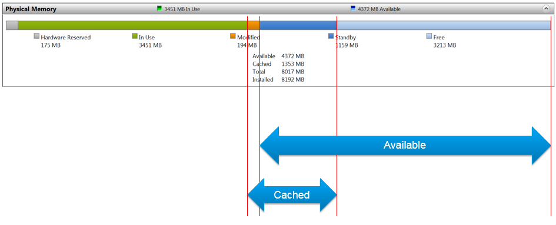
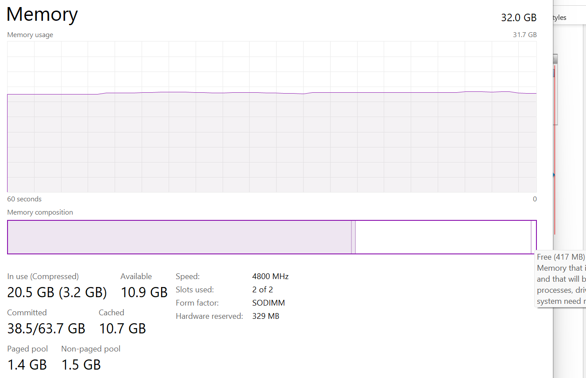
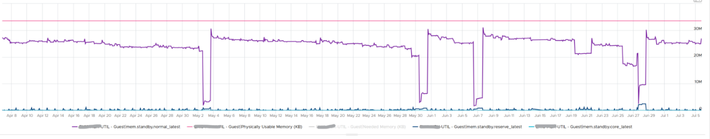
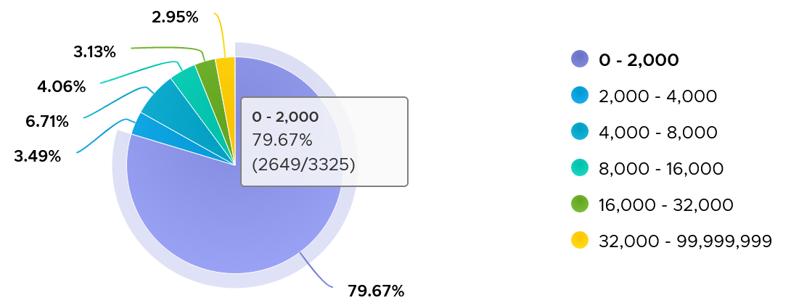
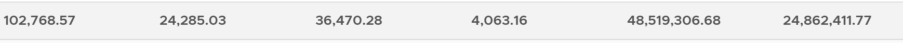

# Windows memory management

## Layer
- Guest OS layer: Windows or Linux, running on the VM. The VM is a virtual motherboard; it cannot see inside the Guest OS.
- Counters here come from inside the Guest OS (PerfMon, WMI, or VMware Tools). vCenter and VCF Operations store some of them on the VirtualMachine object. That is a data path, not ownership.

## Nature
- Poorly documented; even Microsoft sources conflict. Mark Russinovich's description of virtual memory is a reference.

## Categories
```text
Cached    = Standby + Modified
Available = Standby + Free
In Use    = Total - (Modified + Standby + Free)
```

- Available: usable immediately, without saving the page first.
- Sysinternals also shows Transition and Zeroed.

| Category | Facts |
|---|---|
| In Use | Main Task Manager counter. Not the minimum Windows requires: Windows compresses In Use pages even with plenty free (example: 457 MB of 6.8 GB compressed, 8.9 GB available). ESXi compresses only when low on free. VCF Operations (since 8.6): Used Memory. Memory leaks grow In Use until the OS runs out. |
| Modified | Changed pages no longer used. Must be written to disk before reuse. Part of Cache, not Available. Written in batches to reduce IO (and SSD wear). |
| Standby | Three levels in VMware Tools: Standby Core, Standby Normal, Standby Reserve. Behaviour differs by application: example Exchange 2013 with Standby Normal swinging up to 90%; example Tableau where Standby Reserve grew after memory doubled. Hard to size on. |
| Cache | More cache, fewer misses. Prefetch and SuperFetch show the complexity; the UI simplifies it. |
| Free | Immediately usable, excluding cache. Low Free is fine with high Standby; it can touch 0 MB momentarily. |



## Free memory guidance (book)
- Keep above 500 MB for server VMs, above 100 MB for VDI VMs (VDI adds up: 10K users × 100 MB = 1 TB).
- Near-zero free memory with healthy other metrics is ideal: no waste.
- Free, page-in rate and commit ratio are capacity (utilization) metrics, not contention. They cannot measure severity. Windows and Linux do not measure how long the CPU waits for memory.
- A freed guest page only updates the guest free list; the hypervisor keeps the page mapped. Hence high Consumed after Active has dropped.

## Page file
- Paging is integral: Windows uses the page file while physical memory is free. Microsoft advises not disabling it. Let Windows manage its size.
- Default size = physical memory (8 GB RAM, 8 GB page file). Larger than that: memory pressure.
- Processes see virtual memory backed by RAM and page file. Paging moves pages between page file and RAM.
- Page file size is a poor sizing input: SuperFetch prefetches pages that are never used. Paging rate (recent 300 s in VCF Operations) is more realistic.
- Page in: a potential performance indicator. Page out: a potential capacity indicator.
- Paging does not always mean memory shortage: application binary load, memory-mapped files (processes exchanging data, large files), proactive prefetch (page-in with no page-out), background trimming of idle processes to the page file.
- High page-in and page-out together with a high disk queue: likely a memory performance problem.
- Judge by change and by the application's history; no universal threshold. %pagefile 100% = page file full; no guidance.
- VMware Tools: Guest | Swap Space Remaining.

## Paging metrics
- Unit: pages, not MB. Windows mixes 4 KB and 2 MB (large) pages per process; no conversion possible.
- Page-in rate: reads through the paging and cache system, including cacheable reads (double-counted pages/s).
- Page-out: less important; usually idle pages. Large pages are never paged out.
- 3,325 VMs, 4 months, 99th percentile of 5-minute values: 97% below 32,000 pages; a few above 500,000.

- Example arithmetic: 10,000 pages/s × 8 KB × 300 s = 24 GB in 5 minutes.
- Across about 3K VMs: page-in max about 4x page-out; at the 99th percentile about 9x. Likely read-only pages (binaries) discarded instead of written.
- Both are momentary: the 99th percentile is usually far below the maximum (about 1,000 VMs checked).
- Example Oracle RAC VM: page-in and page-out correlated. 100,000 pages/s × 4 KB = 400 MB/s, 120 GB in 5 minutes.
- Profile view: highest and 99th percentile page-in and page-out, colour thresholds 1,000, 10,000, 100,000 (each 10x), plus sums. At least 1 week (2,016 points; the 99th percentile drops the top 20), preferably 3 months.


## Other counters
| Counter | Facts |
|---|---|
| Active File Cache Memory | Active subset of the system file cache (System Cache Resident Bytes, Memory \ Cache Bytes). Last observed value. |
| Committed Bytes | Committed virtual memory; not all written to the page file yet. Measures demand: can rise without In Use rising (example: committed 2x usage, Free and Cached unchanged). |
| Commit Limit | RAM + page file, typically 2x RAM. A growing limit is an early warning: Windows grows pagefile.sys under pressure. |
| % Committed | Keep below 80%. Performance drops at 90%. With the page file disabled, Windows slowed and applications crashed despite over 1 GB free. |
- Reserved memory (databases, JVM reserve a contiguous block) holds no data until committed. Committed memory is guaranteed in RAM or on disk (page file).

## Needed Memory (VMware Tools)
```text
Needed = physical - max(0, Unneeded - 5% of physical)
Unneeded = Free + Reserve Cache + Normal Priority Cache
```
- Derived by VMware Tools, not a Windows counter. Includes some cache; 5% buffer per general Microsoft guidance. Below it, the guest may swap.
- 10 GB VM: available 0 → 10 GB; available 2 GB → 8.5 GB; available 8 GB → 2.5 GB.
- Low free memory alone does not mean more memory is required: check other metrics case by case.

## Traps
- "In Use is the minimum Windows requires" → Windows compresses In Use pages it does not use.
- "Page-in means memory shortage" → binaries, mapped files and prefetch cause page-in.

## Metadata
```yaml
id: guest-os/memory/concepts/windows-memory
retriever_guide: how-it-works
scope: guest-os
technology:
- memory
pillar:
- capacity
- performance
product:
- windows
- vcf-operations
layer:
- guest-os
internal_derive:
- vsphere/memory/concepts/guest-os-vs-vm-memory
related:
- vsphere/memory/metrics/virtual-motherboard/utilization
- guest-os/system/concepts/guest-os-sizing
- guest-os/system/metrics/guest-os-performance
images:
  - path: ../images/windows-memory-categories-diagram.png
    product: [windows]
    object: [VirtualMachine]
    topic: 'Windows memory categories'
    image_type: diagram
  - path: ../images/windows-memory-in-use-with-compressed-pages.png
    product: [windows]
    object: [VirtualMachine]
    metric: ['Guest OS Memory In Use', 'Guest OS Memory Compressed']
    image_type: screenshot
  - path: ../images/windows-memory-standby-normal-swings-on-exchange-server.png
    product: [windows]
    object: [VirtualMachine]
    metric: ['Guest OS Memory Standby Normal', 'Guest OS Memory Standby Core', 'Guest OS Memory Standby Reserve']
    image_type: timeline
    sample: '1 VM'
  - path: ../images/windows-memory-page-out-99th-percentile-distribution-across-vms.png
    product: [windows]
    object: [VirtualMachine]
    metric: ['Guest OS Memory Page Out']
    image_type: distribution
    sample: '3,325 VMs, 4 months'
  - path: ../images/windows-memory-page-in-vs-page-out-average-across-vms.png
    product: [windows]
    object: [VirtualMachine]
    metric: ['Guest OS Memory Page In', 'Guest OS Memory Page Out']
    image_type: table
    sample: 'about 3,000 VMs'
source:
  document: PART 3 - Counters.docx
  path: MS Windows > Memory
corrections: []
review_notes:
- 'Section ''Free memory guidance'': the 500 MB and 100 MB values are the book''s guidance.'
- 'References from the book: https://blogs.technet.microsoft.com/markrussinovich/2008/11/17/pushing-the-limits-of-windows-virtual-memory/, http://brandonlive.com/2010/02/21/measuring-memory-usage-in-windows-7/ (not read).'
status: draft
```
