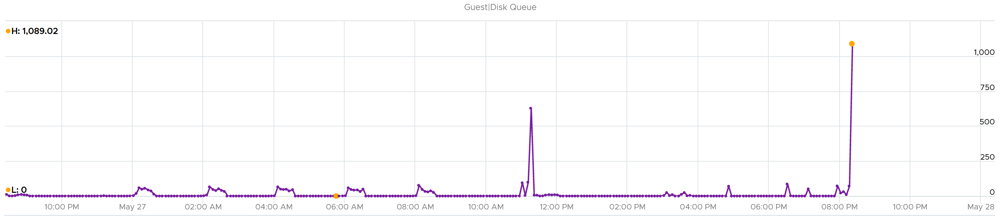
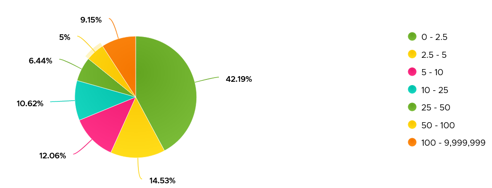
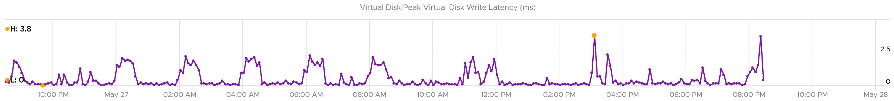

# Guest OS Disk Queue

## Layer
- Guest OS layer: Windows or Linux, running on the VM. The VM is a virtual motherboard; it cannot see inside the Guest OS.
- VMware Tools collects this counter inside the Guest OS and vCenter and VCF Operations store it on the VirtualMachine object. That is a data path, not ownership: the counter belongs to the Guest OS.

## Meaning
- Windows: Avg. Disk Queue Length and Current Disk Queue Length count the requests active below the partition manager. A request can wait in a Storport queue or in a queue of the adapter driver (LSI Logic, PVSCSI), be in service at the virtual or physical device, or be completed and on its way back up the stack. The counter does not separate waiting from service. See [`guest-os/storage/windows-storage-io-path`](windows-storage-io-path.md).
- Linux: aqu-sz in iostat counts the requests in progress at the block layer, from the moment a request enters the request queue until it finishes, whether it waits or is served. See [`guest-os/storage/linux-storage-io-path`](linux-storage-io-path.md).
- Both are Little's Law values: the queue equals the I/O rate times the time per I/O.
- The part of the queue that waits in the Guest OS for a free slot of the virtual adapter has not reached the virtual disk. The vCenter virtual disk latency starts at the virtual disk, so it does not include that wait.

| VMware Tools counter | Windows source (WMI) |
|---|---|
| guest.disk.queue | Win32_PerfFormattedData_PerfDisk_PhysicalDisk _Total CurrentDiskQueueLength (point in time at the end of the collection period) |
| guest.disk.queueAvg | Win32_PerfFormattedData_PerfDisk_PhysicalDisk _Total AvgDiskQueueLength (average over the period) |

## Interpretation
- Windows documentation: the queue length per physical disk should average below 2. The guideline counts spindles; a virtual disk has none.
- High guest queue with low I/O rate: the time per I/O is long (queue = I/O rate x time per I/O). Read the response time.
- Requests at the virtual disk equal the I/O rate times the vCenter virtual disk latency. Compare with VM outstanding IO.
- The guest queue minus the requests at the virtual disk is the average number of requests that wait inside the Guest OS. A remainder near zero means the queue is concurrency the device serves; it is not a wait in the guest.
- A remainder that is large, with the requests at the virtual disk at the queue depth of the adapter (Paravirtual SCSI default: 64 per device, 254 per adapter), means requests wait in the guest for a free slot.
- VM disk latency stays good while requests wait in the guest, because it starts at the virtual disk. The application still feels the delay.
- No universal threshold; varies by application.

## Observed values
- 3,000 VMs, 3 months: about 70% below 10; about 10% above 100.
- Some values are extreme (spikes above 1,000). Guest queues are rarer than latency spikes.
- A spike far above the adapter queue depth is mostly requests waiting in the guest: at a queue of 1,000 and the default device queue depth of 64, at most 64 requests are at the virtual disk.

- 20-second peak about 200-250 while the 5-minute average stays above 125: volatile, not sustained.



## Guest OS storage questions
| Area | Required data |
|---|---|
| Configuration | Per partition: name, filesystem (NTFS, ext4), network or local, block size. Ideally the partition-to-virtual-disk mapping. |
| Capacity | Per partition: configured and used space; free space in GB and %. Alert before full: the OS crashes. Exclude network drives (shared), except VDI user profiles. |
| Reclamation | From free space. Hard: partitions must shrink. |
| Performance | Queue, read and write latency, IOPS, throughput. |

## Misconceptions
- "VM latency is fine, so the guest sees no storage delay" → the VM latency starts at the virtual disk. Time spent waiting in the guest queues is not in it. Compare the guest queue with the I/O rate x the VM latency.
- "The guest disk queue is IO not yet sent" → the counter also counts requests in service at the device and requests on their way back. Only the excess over the I/O rate x the VM latency waits in the guest.
- "A high guest disk queue with a low VM latency proves the guest is the bottleneck" → a queue equal to the I/O rate x the VM latency is requests in service. Only the excess waits.

## Metadata
```yaml
id: guest-os/storage/disk-queue
retriever_guide: metric-meaning
scope: guest-os
technology:
- storage
pillar:
- performance
product:
- windows
- linux
- vcf-operations
layer:
- guest-os
metric_class: contention
internal_derive: []
same_name: []
same_meaning: []
related:
- guest-os/storage/windows-storage-io-path
- guest-os/storage/linux-storage-io-path
- vsphere/technology/storage/metrics/virtual-motherboard/outstanding-io
- vsphere/technology/storage/metrics/virtual-motherboard/disk-latency
- vsphere/technology/storage/concepts/guest-os-vs-vm-storage
- guest-os/system/guest-os-performance
images:
  - path: images/guest-os-disk-queue-spikes-timeline.png
    product: [windows]
    object: [VirtualMachine]
    metric: ['Guest OS Disk Queue']
    image_type: timeline
    sample: '1 VM'
  - path: images/guest-os-disk-queue-distribution-across-vms.png
    product: [windows]
    object: [VirtualMachine]
    metric: ['Guest OS Disk Queue']
    image_type: distribution
    sample: '3,000 VMs'
  - path: images/guest-os-disk-queue-spikes-while-vm-disk-latency-good.png
    product: [windows]
    object: [VirtualMachine]
    metric: ['Guest OS Disk Queue', 'VM Disk Latency']
    image_type: timeline
source:
  document: Private Cloud Management by Iwan Rahabok (https://isvara.io/download)
  path: MS Windows > Storage
corrections:
- 'Section ''Meaning'': the book reads the queue as above the SCSI driver, holding IO that has not reached the driver or the VM. Microsoft documentation says the counter counts the requests active below the driver that takes the statistics (the partition manager), including requests in service. The file follows Microsoft.'
review_notes:
- 'To check: Section ''Interpretation'': the subtraction of the requests at the virtual disk from the guest queue is a derivation from Little''s Law, not a vendor procedure. The Observed values in the book are read with it; the 3,000 VMs and the spikes above 1,000 were not re-measured.'
- 'Source URL, Microsoft: https://learn.microsoft.com/previous-versions/dn567651(v=vs.85)'
status: draft
```
