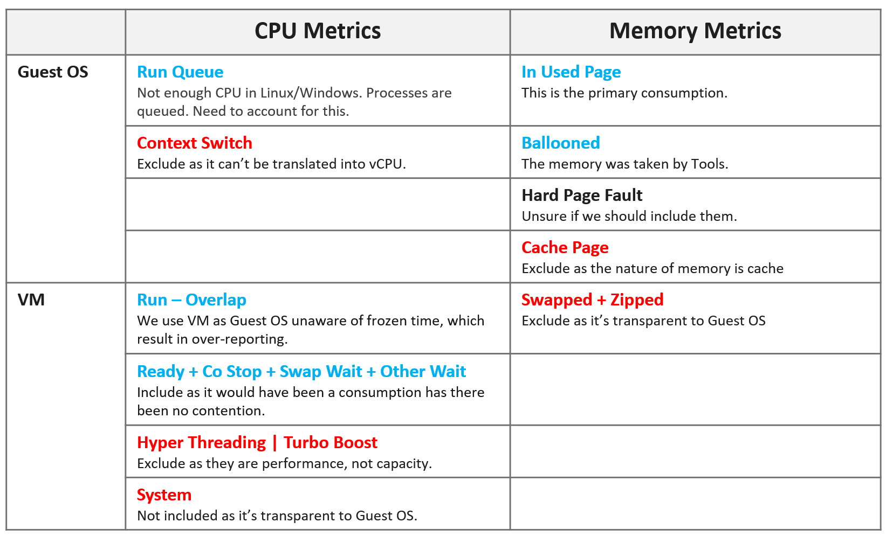
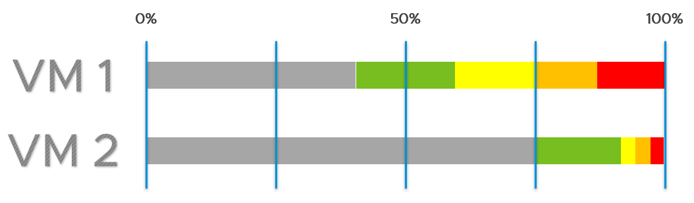

# Guest OS sizing



## VM rightsizing: two jobs
- "VM rightsizing" mixes two different sizing jobs with two different formulas. Asking "what size should this VM be?" without saying which one leads to the wrong counters.

- **Guest OS sizing (internal)**
  - Question: CPU and RAM that Windows or Linux and its applications demand; disk = size of the guest partitions, expressed as virtual disks
  - Counters: Windows / Linux counters
  - Includes: Guest OS queue (Run Queue, Disk Queue)
  - Excludes: VM overhead, Hyper-Threading, frequency
- **VM footprint (external)**
  - Question: What the VM costs the ESXi host and the infrastructure underneath
  - Counters: vSphere counters
  - Includes: VM overhead
  - Excludes: Guest OS queue

- Use cases:
  - The application team asks for more vCPUs → Guest OS sizing. Hypervisor overhead is irrelevant: an NSX Edge does not get extra vCPUs for the packet-processing overhead.
  - Migrating to an ESXi host with CPUs twice as fast (2 GHz to 4 GHz) → VM footprint: all else equal, 16 vCPUs become 8, and the hypervisor counter is the accurate one. Then check the Guest OS after the change: the application may expect 16 slow threads, not 8 fast ones, and queue inside the guest.
  - Migrating from classic VMFS to vSAN → VM footprint: the hypervisor metric adjusts for the vSAN FTT policy.
  - Converting virtual disks from thin to thick → VM footprint: guest consumption is irrelevant, the disk inflates to its configured size.
- After the demand is known, project it from past data and adjust the new size to fit NUMA.
- CPU, RAM and storage each use a different approach. VM footprint: see [`sp5-framework/capacity/vm-footprint-sizing`](../../../sp5-framework/capacity/vm-footprint-sizing.md).

## Layer
- Guest OS layer: Windows or Linux, running on the VM. The VM is a virtual motherboard; it cannot see inside the Guest OS.
- Guest OS sizing reads Guest OS counters and corrects VM counters for what the guest never sees (Hyper-Threading, frequency, hypervisor overhead). VCF Operations shows the result on the VirtualMachine object: a data path, not ownership.

## CPU: exclude
| Item | Reason |
|---|---|
| Hyper-Threading | The guest is unaware. On a shared core it runs at 62.5%: a 3 GHz core feels like 1.875 GHz. |
| CPU frequency | Same. VM CPU Demand and Usage include frequency and HT, so they do not suit guest sizing. Exception: initial sizing, for example a request for 32 vCPU at 3 GHz on a 2 GHz host. |
| CPU idle time | Idle while waiting for IO is a separate scope: a faster IO subsystem raises CPU use. |
| CPU context switch | No translation to vCPU count; not controllable; caused by too many vCPUs or IO. |
| Hypervisor overhead | MKS, VMX, System are not guest demand. So VM Used, Demand and Usage (which include System at VM level) do not suit. |

## CPU: include
| Item | Reason |
|---|---|
| Co-stop, Ready | Runtime the guest demanded. Guest numbers miss it: its time was frozen. Limits are already accounted. Adding or removing vCPUs does not change these waits: the bottleneck is elsewhere. |
| Other Wait, Swap Wait | Same as Ready: the CPU waited for RAM or IO. |
| Overlap | Runtime the guest demanded. Already inside Run, so not added separately when using Run. |
| Guest OS CPU run queue | The primary counter that Windows or Linux cannot keep up. |

## CPU formula
```text
Guest OS CPU Needed (vCPU) = configured vCPU - Idle + run queue factor
```
- Unit: vCPU, not % or GHz.
- Configured - Idle includes Ready, Co-stop, Swap Wait and Other Wait.
- Run queue factor example: 8 vCPU, run queue 28 (the total in the guest; VCF Operations shows 3.5, the total divided by the vCPU count: multiply before using this formula). At 3 per vCPU, 8 vCPU absorb 24. Shortage 4. Each added vCPU takes 1 process + 3 queued: add 1 vCPU.
- Without the run queue factor, Guest OS Needed is usually within 10% of CPU Usage. Usage is higher with System time and Turbo; lower with HT and down-clocking.

## CPU recommendation
```text
Guest OS Recommended Size (vCPU) = round up for NUMA (projection (Guest OS Needed))
```
- Size first, then adjust for NUMA. NUMA depends on the hosts, so it can differ per cluster.
- Use 1 socket with many cores until the socket boundary is exceeded (2 cores × 1 socket, not 2 sockets × 1 core).
- 1 vCPU is valid: since 64-bit Windows there is no separate uniprocessor HAL.
- Mixed hosts: use the smallest NUMA node in the cluster. Example: a 12-vCPU VM as 2 sockets × 6 cores fits both 2 × 10-core and 2 × 12-core hosts. Assumes memory is not the limit.
- Usually an even number once the VM crosses a socket.
- Applications that manage their own memory or fixed thread counts (databases, JVM) may require setting changes after resizing.
- CPU Hot Add affects NUMA.

## Memory
- Memory is cache. Unused memory is waste: aim high, with a narrow green band.
- Option 2 is recommended, of two range schemes: wide grey (waste) zone, then a narrow green band near the top.
- Guest OS memory utilization ranges (option 2):

- Colour bands: `catalog/thresholds-capacity`, rows with this file as `kb`. They are shown with this file; this file holds the reasons.

- Below 75% is grey: waste.

- Grey is a fifth range, below green, and exists only in capacity management: unused capacity is waste. Performance has no grey range: there is no wasted performance.
- Green is 10 points wide. Windows and Linux cache memory, so a high value is normal.
- Option 1 (not recommended): waste below 50%, risk above 75%.
- Applications touch only part of their working set; the rest becomes cache. Active + cache above 95% is fine.
- ESXi waits until about 99% before ballooning. Windows and Linux also cache.


| Rule | Reason |
|---|---|
| Include cache | Sizing on in-use only leaves no cache or free memory: the guest pages out. Name the result Needed Memory, not Demand. How much: the cache Windows ranks high stays in; Free, Reserve and Normal Priority cache are left out, except a buffer of 5% of the memory ([`guest-os/memory/windows-memory`](../../memory/windows-memory.md), section Needed Memory). The image's Cache Page (Exclude) is that reclaimable cache. |
| Exclude page file | Too conservative: In Use already contains cache. Proactive page-in (memory-mapped files) makes unmet demand impossible to isolate. |
| Include balloon | No deduction: a cut must not shrink a VM the balloon already squeezes. |
| No fallback to VM metrics | Inaccurate for the guest. |
| Exclude latency | Memory contention measures speed; sizing measures space. |

- Windows and Linux differ more for memory than for CPU.

## Ballooned memory in sizing
- This section is the one home of the sizing rule for ballooned memory. The balloon mechanism: [`vsphere/technology/memory/concepts/ballooning`](../../../vsphere/technology/memory/concepts/ballooning.md).
- Rule: size on Guest OS Needed Memory as VMware Tools reports it, with no deduction for VM Memory Ballooned.
- The balloon driver allocates its pages inside the Guest OS and pins them (vSphere API 9.1, `mem.vmmemctl`). The Guest OS counts them as in use, neither free nor cache, so Needed Memory, which subtracts Free and the Reserve and Normal Priority cache, already holds them ([`guest-os/memory/windows-memory`](../../memory/windows-memory.md), section Needed Memory).
- A page the balloon took from Free is not demand: Needed Memory then reads higher than the application needs, by up to the balloon size.
- A page the balloon took from In Use is demand: the Guest OS paged the data out to make room, and the data still needs memory. A deduction would then read lower than the application needs, by up to the balloon size.
- The Guest OS counters give the balloon size, not the share of it taken from Free. So the error of inclusion and the error of deduction have the same bound; inclusion errs toward too much memory, deduction toward too little on a VM that is already squeezed.
- Too much memory costs DIMM; too little costs guest paging and slower work. Sizing takes the cheaper error.
- One VM can be read by hand: when guest Free fell by about the balloon size while the balloon inflated and guest page-out did not rise, the balloon took free pages, and deducting it is safe for that VM.
- A balloon is a provider event: host pressure or a limit. The fix for the balloon is on the provider side (the host or the limit), not a smaller Guest OS ([`vsphere/technology/memory/concepts/ballooning`](../../../vsphere/technology/memory/concepts/ballooning.md), section Trigger and requirement).

## Memory downsizing: which VMs give memory back
- Contention is excluded from the size, not from the choice of VM. A VM with memory contention above 0 already waits (a limit, or host reclamation); a VM whose guest pages out is already short. Neither gives memory back.
- No guest data (VMware Tools not running): no Needed Memory, so no sizing. VM Active and Consumed do not stand in for it; restore the data first.
- Low VM Active with Needed Memory near the configured size: the guest uses its memory as cache (database buffer pool, Java heap). Not a donor.
- New size = peak Needed Memory plus headroom, so that the result lands in the green band, not at 100%.
- Cut in steps, not all at once. After each step check guest page-out and VM memory contention over a business cycle before the next.

## Applications that manage their own memory
- SQL Server claims memory for its buffer pool up to `max server memory (MB)` and keeps it, so Windows counts that memory as In Use and the sqlservr.exe working set stays near the limit, whatever the query load.
- The default of `max server memory (MB)` is 2,147,483,647 MB, which is no limit. SQL Server then takes nearly all the memory of the VM and leaves Windows little, so Windows Available is low. Microsoft recommends an upper limit in every version.
- `max server memory (MB)` limits only the buffer pool. Thread stacks, backup buffers, extended stored procedure DLLs and linked server provider allocations sit outside it, so the limit has to leave room for them, for Windows and for the other processes of the VM.
- Microsoft's starting value for one instance: total memory of the OS, minus the thread stack memory (stack size times the calculated max worker threads), minus an allowance for the allocations outside the limit. Microsoft calls the allowance a generic approximation.
- Windows In Use, the sqlservr.exe working set and VM Active do not show the memory SQL Server needs. In Use and the working set show what the buffer pool grew into. VM Active is a sample of recently touched pages and does not see how SQL Server uses its cache.
- A cut of the VM memory to the VM Active value removes the cache SQL Server works from: more reads from disk and slower queries. The first change is `max server memory (MB)`, set from the total memory minus what Windows and the other processes need.
- Finding the size: lower `max server memory (MB)` in steps, each held over a full business cycle while the SQL Server memory counters and the query times are read, and resize the VM after the last step that held. Method, counters and step rule: section SQL Server max server memory in steps.
- In a VM, `min server memory (MB)` keeps memory pressure from the host (ballooning) from taking buffer pool memory below what the workload needs. Once SQL Server has used that much, it does not release memory below the value.
- With the Windows user right Lock pages in memory granted, Microsoft strongly recommends a set `max server memory (MB)`: without it, SQL Server can starve the rest of the system.
- SQL Server on Linux sets its memory limit with mssql-conf, setting `memory.memorylimitmb` (Microsoft, Monitor memory usage).

## SQL Server max server memory in steps
- Why steps: the memory SQL Server holds shows what the limit allows, not what the workload needs. Only a lower limit, held over the workload's own cycle, shows whether the cached data was needed.
- `max server memory (MB)` takes effect at RECONFIGURE, with no restart of SQL Server (Microsoft, Server memory configuration options). A step and its undo are both immediate.
- Baseline: before the first step, record the counters below over one full business cycle at the current value. Compare each later period with the same period of the baseline (month-end with month-end), because the counters move with the load.
- Buffer Manager: Page reads/sec: physical database page reads across all databases. A rise after a step means pages that stayed in cache before now come from disk; this is the first counter to read.
- Buffer Manager: Lazy writes/sec: buffers the lazy writer flushes to make them free. A rise means the smaller buffer pool frees buffers to take in new pages.
- Buffer Manager: Free list stalls/sec: requests that waited for a free page. A rise means the pool runs out of free buffers.
- Memory Manager: Memory Grants Pending: processes waiting for workspace memory (sort, hash, index build). A rise means queries wait for memory before they run.
- Buffer Manager: Page life expectancy: seconds a page stays in the buffer pool without references. It falls with every step, because a smaller pool keeps each page for less time, so a lower level alone is expected. Sudden dips that the baseline did not have show churn: the workload no longer benefits from data already in memory (Microsoft, Monitor memory usage). On a VM with more than one vNUMA node, read Buffer Node: Page life expectancy per node.
- Query times of the application: the final test. The counters explain a change; the query times decide it.
- Buffer cache hit ratio is not a step signal: Microsoft states that after a long period of time the ratio moves very little, so a step that raises Page reads/sec can leave it nearly unchanged.
- Windows Memory: Available Bytes rises by about the size of each step: that memory is what the VM can give back.
- Step rule: a step holds when, over the full business cycle, Page reads/sec, Lazy writes/sec, Free list stalls/sec and Memory Grants Pending stay at their baseline in the same period, Page life expectancy shows no sudden dips the baseline did not have, and the query times do not lengthen.
- Step rule: a step that fails any of these is undone at once, without waiting for the end of the cycle. The size is the last value that held; a value between that one and the undone one can be tried in a further cycle.
- Step size: a choice of method, not a threshold; no Microsoft document gives one. Larger steps take fewer cycles and overshoot further; smaller steps land closer and take more cycles.
- First step: it can remove at least the low point of Memory Manager: Free Memory (KB) over the baseline cycle. That memory is committed to SQL Server and was unused at every sample of the cycle.
- Keep `min server memory (MB)` well below the value under test: Microsoft does not recommend setting min and max to the same or nearly the same value.
- Resizing the VM after the last step: the new `max server memory (MB)`, plus SQL Server memory outside it (thread stacks and the other allocations), plus Windows and the other processes. Then the memory rules of this file apply: Needed Memory, read with SQL Server at its new limit, in the green band.

## Sizing rules
| Rule | Reason |
|---|---|
| Not only utilization | Add unmet demand: CPU runtime demanded but not given (run queue); Guest OS page faults for memory |
| Not only current demand | Size for performing well. Memory: the Guest OS runs poorly without cache, so In Use alone is too small |
| Include the peak | The busy period is when the VM works hardest |
| Long-term pattern | One 5-minute burst does not size the next 3 months |
| Exclude IT load | Guest OS reboot, updates, antivirus full scan, agent-based full backup, unless the VM must also serve work in those hours |

- Memory reason: only the CPU is faster than memory. Cache as much as possible so the CPU does not wait for data; which data the program reads next cannot be predicted.
- Excluding IT load requires knowing its footprint: process names.
- Upsizing and downsizing use the same rules with different boundaries:
  - downsizing: the Guest OS requires a minimum amount of RAM;
  - upsizing: the NUMA boundary; and never more vCPUs than the host's logical processors (the VM does not power on), in practice fewer, to leave room for VMkernel overhead.
- Two parts: the value at each point in time (wrong input, wrong result), then thousands of values projected forward. The projection leans conservative for the peak cycle and covers the business cycle: annual sales require annual data.
- These rules size the Guest OS only. Containers and business applications have their own sizing.

## Misconceptions
- "Windows shows 95% in use, so the VM needs more memory" → SQL Server grew into the memory its `max server memory (MB)` allows, and the default allows nearly all. The setting decides the value, not the need.
- "VM Active is below 12 GB, so cut the VM to 16 GB" → VM Active does not see how SQL Server uses its cache. The cut removes the cache. Set `max server memory (MB)` first and lower it in steps.
- "Size the guest with VM CPU Usage" → includes HT, frequency and System.
- "Free memory is safe headroom" → for memory, unused is waste.
- "Memory contention is excluded from sizing, so ignore it when choosing VMs to downsize" → it is excluded from the size; a VM with contention above 0 already waits and gives nothing back.
- "Size memory on In Use: that is the demand" → without cache the Guest OS pages and runs slower; size for performance, not only demand.
- "Size on the average day" → include the peak period and the business cycle; exclude IT load such as backups and scans.
- "Ballooned memory is a request from ESXi, not from the application, so deduct it before sizing the Guest OS" → the balloon also takes in-use pages, which the guest pages out and still needs. Size on Needed Memory with the balloon in it, so the cut does not shrink a VM the balloon already squeezes.

## Metadata
```yaml
id: guest-os/system/concepts/guest-os-sizing
retriever_guide: how-it-works
scope: guest-os
technology:
- cpu
- memory
- system
pillar:
- capacity
- performance
- value
product:
- windows
- linux
- vcf-operations
layer:
- guest-os
internal_derive:
- vsphere/technology/cpu/concepts/guest-os-vs-vm-cpu
- vsphere/technology/memory/concepts/guest-os-vs-vm-memory
related:
- sp5-framework/capacity/rightsizing
- sp5-framework/capacity/vm-footprint-sizing
- vsphere/technology/memory/metrics/virtual-motherboard/utilization
- vsphere/technology/memory/concepts/ballooning
images:
  - path: ../images/guest-os-sizing-what-to-include-and-exclude.png
    product: [vcf-operations]
    object: [VirtualMachine]
    topic: 'Guest OS sizing'
    image_type: table
  - path: ../images/memory-utilization-range-two-schemes.png
    product: [vcf-operations]
    object: [VirtualMachine]
    topic: 'Guest OS sizing'
    image_type: table
source:
  document: 'Knowledge base; Microsoft Learn, SQL Server documentation (fetched 2026-11-15): Server memory configuration options, Monitor memory usage, SQL Server Buffer Manager object, SQL Server Memory Manager object; vSphere Web Services API 9.1, Memory Counters'
  path: 'Consumer Objects > Capacity: Guest OS > Guest OS Sizing'
corrections: []
review_notes:
- 'Source URL for section ''Applications that manage their own memory'': Microsoft Learn, Server memory configuration options, https://learn.microsoft.com/en-us/sql/database-engine/configure-windows/server-memory-server-configuration-options. The percentage allowance of the starting value and the recommended share of memory are on that page; no number is repeated here (one place per number: knowledge/catalog).'
- 'Source URLs for section ''SQL Server max server memory in steps'': RECONFIGURE with no restart and min and max not at near values, the page above; counters, https://learn.microsoft.com/en-us/sql/relational-databases/performance-monitor/monitor-memory-usage, https://learn.microsoft.com/en-us/sql/relational-databases/performance-monitor/sql-server-buffer-manager-object and https://learn.microsoft.com/en-us/sql/relational-databases/performance-monitor/sql-server-memory-manager-object. The steps, the step rule and the first step are the method of this file, not on those pages.'
- 'Source URL for section ''Ballooned memory in sizing'': `mem.vmmemctl`, guest memory allocated and pinned by the balloon driver, vSphere Web Services API 9.1, https://developer.broadcom.com/xapis/vsphere-web-services-api/9.1/memory_counters.html.'
- 'To check: Section ''VM rightsizing: two jobs'': from another source, section VM Footprint | Guest OS Sizing (screenshot of 2026-11-03 only); check against the full document when it is provided.'
- 'To check: References not read: https://blogs.vmware.com/management/2020/01/rightsizing-vms-with-vrealize-operations.html and https://blogs.vmware.com/management/2019/09/26212.html'
status: draft
```
