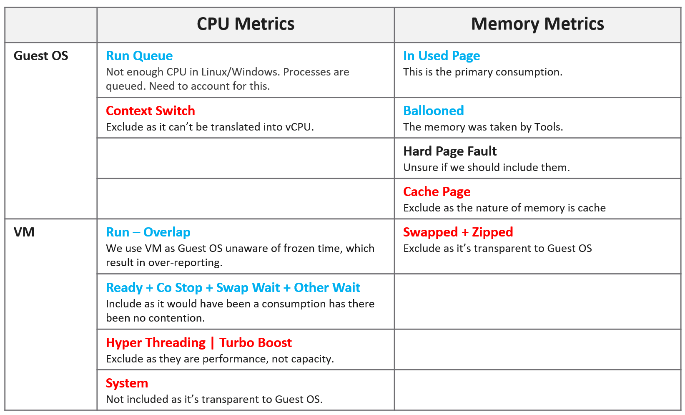
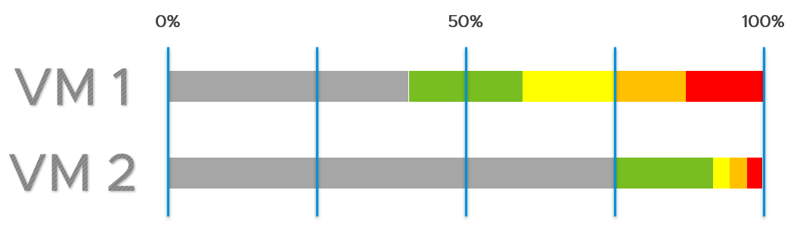

# Guest OS sizing



## No such thing as VM rightsizing
- "VM rightsizing" mixes two different sizing jobs with two different formulas. Asking "what size should this VM be?" without saying which one leads to the wrong counters.

- **Guest OS sizing (internal)**
  - Question: CPU and RAM that Windows or Linux and its applications demand; disk = size of the guest partitions, expressed as virtual disks
  - Counters: Windows / Linux counters
  - Includes: Guest OS queue (Run Queue, Disk Queue)
  - Excludes: VM overhead, Hyper-Threading, frequency
- **VM footprint (external)**
  - Question: What the VM costs the ESXi host and the infrastructure underneath
  - Counters: vSphere counters
  - Includes: VM overhead
  - Excludes: Guest OS queue

- Use cases:
  - The application team asks for more vCPUs → Guest OS sizing. Hypervisor overhead is irrelevant: an NSX Edge does not get extra vCPUs for the packet-processing overhead.
  - Migrating to an ESXi host with CPUs twice as fast (2 GHz to 4 GHz) → VM footprint: all else equal, 16 vCPUs become 8, and the hypervisor counter is the accurate one. Then check the Guest OS after the change: the application may expect 16 slow threads, not 8 fast ones, and queue inside the guest.
  - Migrating from classic VMFS to vSAN → VM footprint: the hypervisor metric adjusts for the vSAN FTT policy.
  - Converting virtual disks from thin to thick → VM footprint: guest consumption is irrelevant, the disk inflates to its configured size.
- After the demand is known, project it from past data and adjust the new size to fit NUMA.
- CPU, RAM and storage each use a different approach. VM footprint: see `operations-management/capacity/vm-footprint-sizing`.

## Layer
- Guest OS layer: Windows or Linux, running on the VM. The VM is a virtual motherboard; it cannot see inside the Guest OS.
- Guest OS sizing reads Guest OS counters and corrects VM counters for what the guest never sees (Hyper-Threading, frequency, hypervisor overhead). VCF Operations shows the result on the VirtualMachine object: a data path, not ownership.

## CPU: exclude
| Item | Reason |
|---|---|
| Hyper-Threading | The guest is unaware. On a shared core it runs at 62.5%: a 3 GHz core feels like 1.875 GHz. |
| CPU frequency | Same. VM CPU Demand and Usage include frequency and HT, so they do not suit guest sizing. Exception: initial sizing, for example a request for 32 vCPU at 3 GHz on a 2 GHz host. |
| CPU idle time | Idle while waiting for IO is a separate scope: a faster IO subsystem raises CPU use. |
| CPU context switch | No translation to vCPU count; not controllable; caused by too many vCPUs or IO. |
| Hypervisor overhead | MKS, VMX, System are not guest demand. So VM Used, Demand and Usage (which include System at VM level) do not suit. |

## CPU: include
| Item | Reason |
|---|---|
| Co-stop, Ready | Runtime the guest demanded. Guest numbers miss it: its time was frozen. Limits are already accounted. Adding or removing vCPUs does not change these waits: the bottleneck is elsewhere. |
| Other Wait, Swap Wait | Same as Ready: the CPU waited for RAM or IO. |
| Overlap | Runtime the guest demanded. Already inside Run, so not added separately when using Run. |
| Guest OS CPU run queue | The primary counter that Windows or Linux cannot keep up. |

## CPU formula
```text
Guest OS CPU Needed (vCPU) = configured vCPU - Idle + run queue factor
```
- Unit: vCPU, not % or GHz.
- Configured - Idle includes Ready, Co-stop, Swap Wait and Other Wait.
- Run queue factor example: 8 vCPU, run queue 28. At 3 per vCPU, 8 vCPU absorb 24. Shortage 4. Each added vCPU takes 1 process + 3 queued: add 1 vCPU.
- Without the run queue factor, Guest OS Needed is usually within 10% of CPU Usage. Usage is higher with System time and Turbo; lower with HT and down-clocking.

## CPU recommendation
```text
Guest OS Recommended Size (vCPU) = round up for NUMA (projection (Guest OS Needed))
```
- Size first, then adjust for NUMA. NUMA depends on the hosts, so it can differ per cluster.
- Use 1 socket with many cores until the socket boundary is exceeded (2 cores × 1 socket, not 2 sockets × 1 core).
- 1 vCPU is valid: since 64-bit Windows there is no separate uniprocessor HAL.
- Mixed hosts: use the smallest NUMA node in the cluster. Example: a 12-vCPU VM as 2 sockets × 6 cores fits both 2 × 10-core and 2 × 12-core hosts. Assumes memory is not the limit.
- Usually an even number once the VM crosses a socket.
- Applications that manage their own memory or fixed thread counts (databases, JVM) may require setting changes after resizing.
- CPU Hot Add affects NUMA.

## Memory
- Memory is cache. Unused memory is waste: aim high, with a narrow green band.
- The book recommends option 2 of two range schemes: wide grey (waste) zone, then a narrow green band near the top.
- Guest OS memory utilization ranges (option 2, author):

| Metric | Green | Yellow | Orange | Red |
|---|---|---|---|---|
| Guest OS memory utilization, for sizing (%) | 75-85 | 85-90 | 90-95 | 95-100 |

- Below 75% is grey: waste.

- Grey is a fifth range, below green, and exists only in capacity management: unused capacity is waste. Performance has no grey range: there is no wasted performance.
- Green is 10 points wide. Windows and Linux cache memory, so a high value is normal.
- Option 1 (not recommended): waste below 50%, risk above 75%.
- Applications touch only part of their working set; the rest becomes cache. Active + cache above 95% is fine.
- ESXi waits until about 99% before ballooning. Windows and Linux also cache.


| Rule | Reason |
|---|---|
| Include cache | Sizing on in-use only leaves no cache or free memory: the guest pages out. Name the result Needed Memory, not Demand. How much cache to include is open. |
| Exclude page file | Too conservative: In Use already contains cache. Proactive page-in (memory-mapped files) makes unmet demand impossible to isolate. |
| Include balloon | Conservative. A ballooned page taken from a free guest page is not demand; one taken from a used page is. The two cannot be told apart, so include it. |
| No fallback to VM metrics | Inaccurate for the guest. |
| Exclude latency | Memory contention measures speed; sizing measures space. |

- Windows and Linux differ more for memory than for CPU.

## Traps
- "Size the guest with VM CPU Usage" → includes HT, frequency and System.
- "Free memory is safe headroom" → for memory, unused is waste.

## Metadata
```yaml
id: guest-os/system/concepts/guest-os-sizing
retriever_guide: how-it-works
scope: guest-os
technology:
- cpu
- memory
- system
pillar:
- capacity
- performance
- value
product:
- windows
- linux
- vcf-operations
layer:
- guest-os
internal_derive:
- vsphere/technology/cpu/concepts/guest-os-vs-vm-cpu
- vsphere/technology/memory/concepts/guest-os-vs-vm-memory
related:
- operations-management/capacity/rightsizing
- operations-management/capacity/vm-footprint-sizing
- vcf-operations/metrics/vm/memory-utilization
images:
  - path: ../images/guest-os-sizing-what-to-include-and-exclude.png
    product: [vcf-operations]
    object: [VirtualMachine]
    topic: 'Guest OS sizing'
    image_type: table
  - path: ../images/memory-utilization-range-two-schemes.png
    product: [vcf-operations]
    object: [VirtualMachine]
    topic: 'Guest OS sizing'
    image_type: table
source:
  document: PART 3 - Counters.docx
  path: 'Consumer Objects > Capacity: Guest OS > Guest OS Sizing'
corrections:
- 'Section ''Memory'': balloon is included, to be conservative (author answer Q028, 2026-11-05); the book text says exclude.'
- 'Section ''Memory'': option 2 ranges 0-75-85-90-95-100% (author answers Q029 and Q055, 2026-11-05); the book gives no numbers for option 2.'
review_notes:
- "Section 'No such thing as VM rightsizing': from the author's other book, section VM Footprint | Guest OS Sizing (screenshot provided 2026-11-03). Author: VM rightsizing is a common misconception; the full book will be provided later."
- 'Section ''Memory'': ranges and the grey range rule from the author answer Q055 (2026-11-05).'
- 'References from the book: https://blogs.vmware.com/management/2020/01/rightsizing-vms-with-vrealize-operations.html and https://blogs.vmware.com/management/2019/09/26212.html (not read).'
status: draft
```
