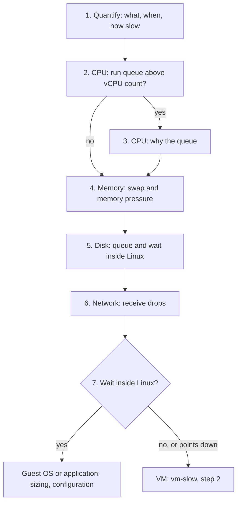

# Linux is slow

## Symptom
- The application team says an application on Linux is slow. They see Linux tools (top, vmstat, iostat, sar), not vSphere or Kubernetes metrics, and they usually do not tell the Guest OS from the VM.
- First quantify the slowness in counters they can see. The Guest OS is a separate realm: it cannot see the VM's waits, and the VM cannot see Linux's queues.
- Written for Linux 5.0 and later.
- Started from [`sp5-framework/performance/troubleshooting/vm-slow`](../../../sp5-framework/performance/troubleshooting/vm-slow.md), step 1. It ends with one of two verdicts: the wait is inside Linux, or it points below Linux to the VM.

## Flow


## Checks, in order
1. Quantify (Guest OS). Ask which transaction is slow, how slow (response time against normal), and when (a time, a schedule, all the time). The window found here is the window of every later step, in Linux and in vSphere. Read the counters at their highest resolution in that window (sar history, or vmstat and iostat at 1-5 seconds while it happens). → step 2.
2. CPU queue (Guest OS). Run queue: `r` in vmstat ([`guest-os/cpu/metrics/run-queue`](../../cpu/metrics/run-queue.md)). Linux includes running threads, so compare it with the vCPU count: above it, threads wait for a vCPU. Load average counts runnable tasks plus tasks in uninterruptible sleep (state D, usually waiting for IO): a high load with idle vCPUs points to IO, not CPU. Pressure stall information: `/proc/pressure/cpu` gives the share of time at least one task waited for a CPU. Queue above vCPU count → step 3. Otherwise → step 4.
3. Why the queue (Guest OS). Per vCPU user and system time (mpstat), the context switch rate (`cs` in vmstat; [`guest-os/cpu/metrics/context-switch`](../../cpu/metrics/context-switch.md)).
   - Queue high, vCPUs not all busy, or one vCPU busy and the rest idle → locks, threads that cannot run in parallel, kernel work: the application or the configuration, not the vCPU count.
   - Queue high, every vCPU busy → the workload demands more runtime than Linux gets. Before adding vCPUs, check VM CPU contention in [`sp5-framework/performance/troubleshooting/vm-slow`](../../../sp5-framework/performance/troubleshooting/vm-slow.md), step 4: a vCPU waiting for a physical thread is invisible to Linux ([`vsphere/technology/cpu/concepts/guest-os-vs-vm-cpu`](../../../vsphere/technology/cpu/concepts/guest-os-vs-vm-cpu.md)).
   - → step 4.
4. Memory (Guest OS).
   - Swap-in and swap-out (`si`, `so` in vmstat) together with a high disk queue → likely a memory performance problem.
   - Pressure stall information: `/proc/pressure/memory` gives the share of time tasks stalled on memory (reclaim, swap-in, refault). Unlike Windows, Linux with pressure stall information measures this wait; VMware Tools does not collect it, so VCF Operations does not show it.
   - Low free memory alone is normal: Linux uses free memory as page cache. Read MemAvailable, not MemFree.
   - → step 5.
5. Disk (Guest OS). Queue size (`aqu-sz`) and wait per request (`r_await`, `w_await`) in iostat; `/proc/pressure/io` ([`guest-os/storage/metrics/disk-queue`](../../storage/metrics/disk-queue.md)).
   - Wait high in Linux, VM disk latency low → the IO waits inside Linux (queue, IO scheduler, filesystem): it never reached the VM.
   - Wait high in Linux and VM disk latency high → the wait is below Linux: the VM and its storage.
   - → step 6.
6. Network (Guest OS). Receive drops on the vmxnet3 interface (`ip -s link`): the guest's receive ring is full, caused and fixed inside Linux ([`vsphere/technology/network/troubleshooting/vnic-rx-drops`](../../../vsphere/technology/network/troubleshooting/vnic-rx-drops.md)). → step 7.
7. Verdict.
   - A wait found inside Linux (queue, memory stall, disk wait with low VM latency, ring full) → the cause is in the Guest OS or the application: Guest OS sizing ([`guest-os/system/concepts/guest-os-sizing`](../concepts/guest-os-sizing.md)) and configuration ([`guest-os/system/concepts/guest-os-configuration-review`](../concepts/guest-os-configuration-review.md)). Still confirm the VM has no contention in the window: a VM wait makes Linux queues worse.
   - No wait inside Linux, or the signs point down (every vCPU busy, disk wait with high VM latency) → the VM: [`sp5-framework/performance/troubleshooting/vm-slow`](../../../sp5-framework/performance/troubleshooting/vm-slow.md), step 2, with the window from step 1.

## Why this order
- Quantify first: the application team describes the symptom in Linux terms; the time window and the slow transaction steer every later check.
- CPU, memory, disk, network: the order of the Guest OS Performance (%) inputs.
- The why after the what: a queue is the fact; locks, kernel time and imbalance explain it.
- Verdict last: only after every Linux queue is read can the wait be placed inside or below Linux.

## How to read the result
- Load average high, vCPUs idle → tasks wait for IO (state D): step 5, not more vCPUs.
- Disk wait high in Linux, VM disk latency good → the delay is real for the application, but invisible to vSphere.
- Nothing high in Linux, users still slow → the VM, or a dependency outside the VM: continue in vm-slow.

## Misconceptions
- "Load average is above the vCPU count, so add vCPUs" → load average includes tasks waiting for IO; read the run queue and per-vCPU time.
- "Free memory is near 0, so Linux is short of memory" → Linux fills free memory with page cache; read MemAvailable, swap activity and memory pressure.
- "The VM's disk latency is fine, so Linux sees no storage delay" → IO waiting in the Linux queue never reaches the VM.
- "The Linux run queue means the same as the Windows queue" → Linux counts running threads too; compare with the vCPU count.
- "Linux is slow, so the VM is slow" → Linux and the VM are separate realms; a wait inside Linux is not a vSphere problem.

## Metadata
```yaml
id: guest-os/system/troubleshooting/linux-os-slow
retriever_guide: troubleshooting
scope: guest-os
technology:
- cpu
- memory
- storage
- network
- system
pillar:
- performance
product:
- linux
- vsphere
layer:
- guest-os
internal_derive:
- vsphere/technology/cpu/concepts/guest-os-vs-vm-cpu
- guest-os/cpu/metrics/run-queue
- guest-os/cpu/metrics/context-switch
- sp5-framework/performance/troubleshooting/vm-slow
- guest-os/storage/metrics/disk-queue
- vsphere/technology/network/troubleshooting/vnic-rx-drops
- guest-os/system/concepts/guest-os-sizing
- guest-os/system/concepts/guest-os-configuration-review
related:
- guest-os/system/troubleshooting/ms-windows-slow
- vsphere/architecture/vm-vs-guest-os
- guest-os/system/metrics/guest-os-performance
source:
  document: Knowledge base synthesis of the files in internal_derive; Linux kernel documentation (pressure stall information, load average)
  path: n/a
corrections: []
review_notes:
- 'To check: the whole order of checks, from field practice (Q060, 2026-11-11: the application team first quantifies the slowness in Guest OS counters).'
- 'To check: Steps 2, 4, 5: the Linux counters (vmstat, iostat, mpstat, load average, MemAvailable) are not in the book; pressure stall information against https://docs.kernel.org/accounting/psi.html (Q172).'
status: draft
```
