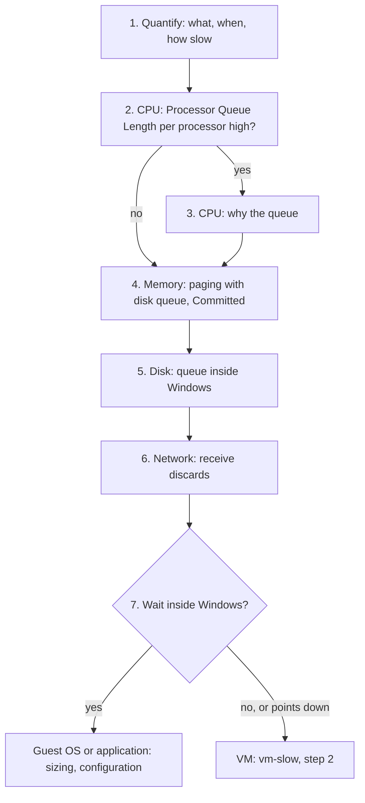

# Windows is slow

## Symptom
- The application team says an application on Windows is slow. They see Windows counters (Task Manager, PerfMon), not vSphere or Kubernetes metrics, and they usually do not tell the Guest OS from the VM.
- First quantify the slowness in counters they can see. The Guest OS is a separate realm: it cannot see the VM's waits, and the VM cannot see Windows' queues.
- Started from [`sp5-framework/performance/troubleshooting/vm-slow`](../../../sp5-framework/performance/troubleshooting/vm-slow.md), step 1. It ends with one of two verdicts: the wait is inside Windows, or it points below Windows to the VM.

## Flow


## Checks, in order
1. Quantify (Guest OS). Ask which transaction is slow, how slow (response time against normal), and when (a time, a schedule, all the time). The window found here is the window of every later step, in Windows and in vSphere. Read PerfMon counters at their highest resolution in that window, not a daily average. → step 2.
2. CPU queue (Guest OS). Processor Queue Length per processor ([`guest-os/cpu/metrics/run-queue`](../../cpu/metrics/run-queue.md); bands with that file). Windows excludes running threads, so any sustained queue means threads wait for a vCPU. High → step 3. Low → step 4.
3. Why the queue (Guest OS). Read % Processor Time per vCPU, % Privileged Time, % DPC Time, % Interrupt Time ([`guest-os/cpu/metrics/processor-time`](../../cpu/metrics/processor-time.md)) and the context switch rate ([`guest-os/cpu/metrics/context-switch`](../../cpu/metrics/context-switch.md)).
   - Queue high, vCPUs not all busy, or one vCPU busy and the rest idle → locks, threads that cannot run in parallel, kernel or driver work: the application or the configuration, not the vCPU count.
   - Queue high, every vCPU busy → the workload demands more runtime than Windows gets. Before adding vCPUs, check VM CPU contention in [`sp5-framework/performance/troubleshooting/vm-slow`](../../../sp5-framework/performance/troubleshooting/vm-slow.md), step 4: a vCPU waiting for a physical thread is invisible to Windows ([`vsphere/technology/cpu/concepts/guest-os-vs-vm-cpu`](../../../vsphere/technology/cpu/concepts/guest-os-vs-vm-cpu.md)).
   - → step 4.
4. Memory (Guest OS) ([`guest-os/memory/concepts/windows-memory`](../../memory/concepts/windows-memory.md)).
   - Page-in and page-out high together with a high disk queue → likely a memory performance problem.
   - % Committed: performance drops near 90%. A growing Commit Limit means Windows grows the page file under pressure.
   - Paging alone is not a shortage: binaries, memory-mapped files and prefetch cause page-in. Low Free with high Standby is normal.
   - → step 5.
5. Disk (Guest OS). Current and average disk queue length ([`guest-os/storage/metrics/disk-queue`](../../storage/metrics/disk-queue.md)).
   - High queue with low VM IOPS → IO is stuck inside Windows (filter driver, antivirus, application): it never reached the VM.
   - High queue with high VM disk latency → the wait is below Windows: the VM and its storage.
   - → step 6.
6. Network (Guest OS). Receive discards on the VMXNET3 adapter: the guest's receive ring is full, caused and fixed inside Windows ([`vsphere/technology/network/troubleshooting/vnic-rx-drops`](../../../vsphere/technology/network/troubleshooting/vnic-rx-drops.md)). → step 7.
7. Verdict.
   - A wait found inside Windows (queue, paging, disk queue with low VM IOPS, ring full) → the cause is in the Guest OS or the application: Guest OS sizing ([`guest-os/system/concepts/guest-os-sizing`](../concepts/guest-os-sizing.md)) and configuration ([`guest-os/system/concepts/guest-os-configuration-review`](../concepts/guest-os-configuration-review.md)). Still confirm the VM has no contention in the window: a VM wait makes Windows queues worse.
   - No wait inside Windows, or the signs point down (every vCPU busy, disk queue with high VM latency) → the VM: [`sp5-framework/performance/troubleshooting/vm-slow`](../../../sp5-framework/performance/troubleshooting/vm-slow.md), step 2, with the window from step 1.

## Why this order
- Quantify first: the application team describes the symptom in Windows terms; the time window and the slow transaction steer every later check.
- CPU, memory, disk, network: the order of the Guest OS Performance (%) inputs; the run queue is the primary Guest OS CPU counter.
- The why after the what: a queue is the fact; locks, kernel time and imbalance explain it.
- Verdict last: only after every Windows queue is read can the wait be placed inside or below Windows.

## How to read the result
- Queue high with idle vCPUs → adding vCPUs makes it worse (more context switching).
- Disk queue high, VM disk latency good → the delay is real for the application, but invisible to vSphere.
- Nothing high in Windows, users still slow → the VM, or a dependency outside the VM: continue in vm-slow.

## Misconceptions
- "Task Manager shows CPU at 100%, so the VM needs more vCPUs" → read the queue and VM CPU contention first; a busy vCPU can be waiting for a physical thread.
- "Queue 53 on 8 vCPUs, so add vCPUs" → check locks, vCPU imbalance and kernel time first.
- "The VM's disk latency is fine, so Windows sees no storage delay" → IO stuck in the Windows queue never reaches the VM.
- "Page-in is high, so Windows is short of memory" → binaries, mapped files and prefetch cause page-in; look for page-in and page-out with a high disk queue.
- "Windows is slow, so the VM is slow" → Windows and the VM are separate realms; a wait inside Windows is not a vSphere problem.

## Metadata
```yaml
id: guest-os/system/troubleshooting/ms-windows-slow
retriever_guide: troubleshooting
scope: guest-os
technology:
- cpu
- memory
- storage
- network
- system
pillar:
- performance
product:
- windows
- vsphere
layer:
- guest-os
internal_derive:
- vsphere/technology/cpu/concepts/guest-os-vs-vm-cpu
- guest-os/cpu/metrics/run-queue
- guest-os/cpu/metrics/context-switch
- sp5-framework/performance/troubleshooting/vm-slow
- guest-os/cpu/metrics/processor-time
- guest-os/memory/concepts/windows-memory
- guest-os/storage/metrics/disk-queue
- vsphere/technology/network/troubleshooting/vnic-rx-drops
- guest-os/system/concepts/guest-os-sizing
- guest-os/system/concepts/guest-os-configuration-review
related:
- guest-os/system/troubleshooting/linux-os-slow
- vsphere/architecture/vm-vs-guest-os
- guest-os/system/metrics/guest-os-performance
source:
  document: Knowledge base synthesis of the files in internal_derive
  path: n/a
corrections: []
review_notes:
- 'To check: the whole order of checks, from field practice (Q060, 2026-11-11: the application team first quantifies the slowness in Guest OS counters).'
status: draft
```
