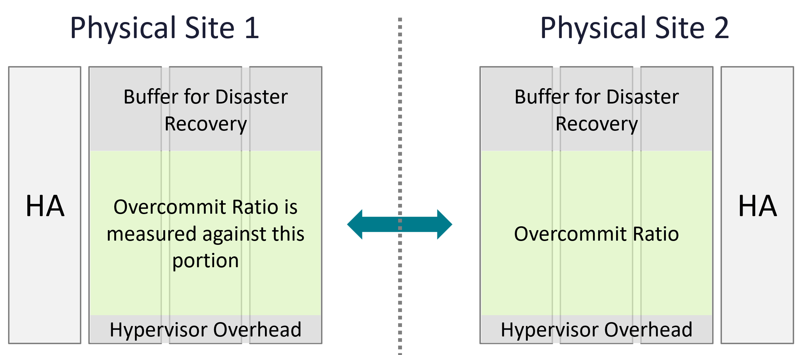
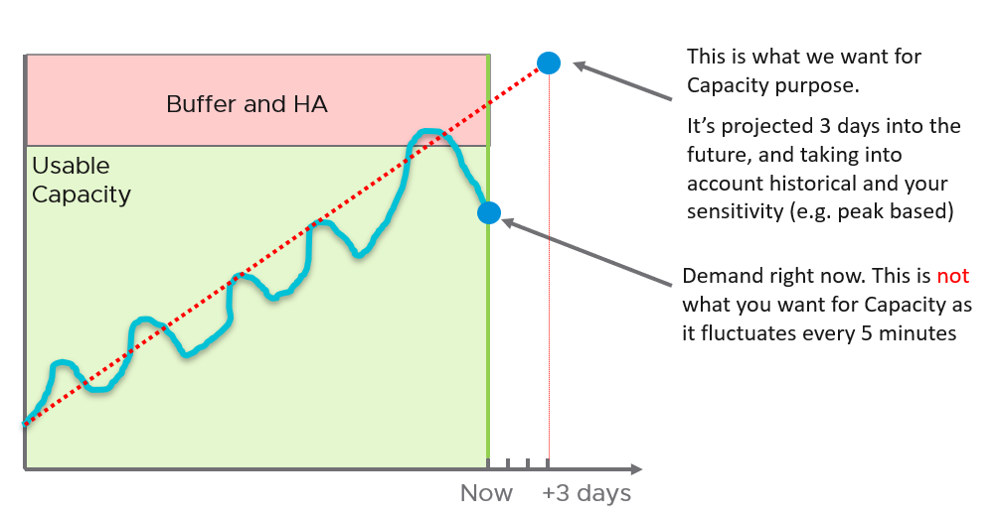
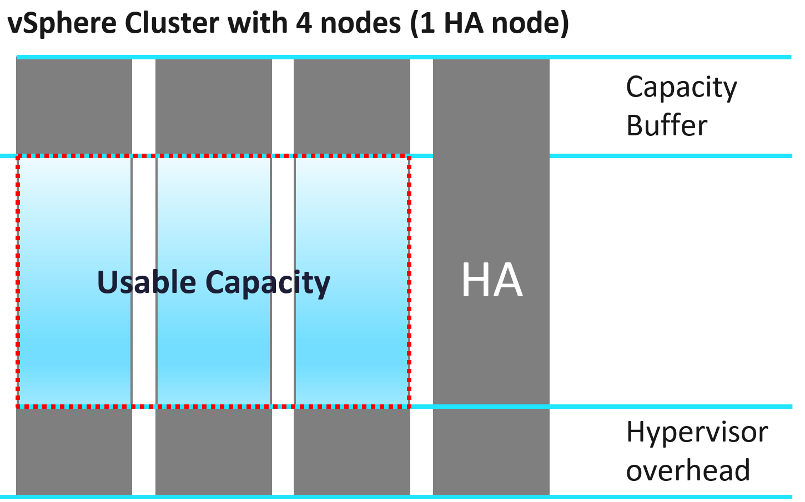

# Capacity model: total, usable, buffer, projection

## Supply and demand
- Supply: total capacity and usable capacity.
- Demand: utilization, reservation, allocation, unmet demand.
- The hypervisor affects both supply and demand: avoid double counting.
- CPU, memory, storage and network differ in nature.
- Total and usable capacity should be constants: a stable 100% anchors capacity management and cost accounting.

## Total capacity
- Fixed unless changed on purpose.
- Scale up: one object grows (for example a LUN resized on demand).
- Scale out: identical nodes are added (Kubernetes clusters, Horizon pools, VMware Cloud on AWS clusters). More common: cheaper. Does not work when data cannot be partitioned.
- Dynamic only when intentional: horizontal auto-scaling, vSphere DPM.

## Usable capacity
```text
Usable Capacity = Total Capacity - Availability protection - Overhead - Buffer
ESXi Usable Capacity = Total Capacity - Hypervisor
Hypervisor = VMkernel + vSAN + NSX + vSphere Replication
```
- A stable, chosen number. Actual use can exceed it.
- Availability protection: HA and DR. RAID, hot spares, paired switches. In a vSphere cluster, at least 1 spare host for maintenance; it runs workload but is excluded. Kubernetes nodes are transient; HA may not apply.
- Overhead: unavoidable architecture cost (VMkernel, Kubernetes supervisor, node OS).
- A separate hypervisor value helps migrations between clusters with different stacks (for example to vSAN + NSX).
- Overhead and availability overlap: the HA host contains overhead too.

| Model | HA host | Hypervisor | Buffer |
|---|---|---|---|
| Allocation | Included | Included | Included |
| Utilization | Included | Not included: too volatile | Included |
| Reservation | Included | - | Included |

## Buffer
- A business decision. Optional.
- Applied to capacity after HA, not total capacity: (Total - HA) × buffer.
- VCF Operations properties: cpu|demand|bufferSetting (%), mem|demand|bufferSetting (%). Default 0%.
- Purpose: performance avoidance. Example: imbalance appears at 95% utilization; a 10% buffer sets usable at 90%, leaving 5% watched by contention counters.
- DR use: paired clusters, production plus DR cluster running test workloads, stretched clusters.
- Example: two 10-host clusters (9 + 1 each) protecting each other, each capped at 50% of 9 hosts (45% of 10 hosts with no imbalance): 50% buffer after HA. With 60% of workload switchable off in DR, utilization can reach 160% of usable.
- Typical: 10% CPU and 0% memory; stretched cluster 50% for both; DR depends on the DR workload.

## Overcommit (allocation model)

- The overcommit ratio excludes buffer. Allocation ignores utilization and the provider part.
- CPU: include Hyper-Threading; a vCPU maps to a thread. Say 4:1 per thread instead of 8:1 per core.
- CPU: a thread on a shared 1 GHz core gets 625 MHz; 1.6 GHz restores 1 GHz per thread. Tenants buying 4 GHz expect 4 GHz; with HT, state 2.5 GHz.
- Disk: count only virtual disks; exclude snapshots and swap. On vSAN, exclude FTT protection and lower the ratio to match (FTT doubling space: halve the ratio).
- Network: exclude inter-switch links; count only ESXi ports used by VMs.

## Projection
- With a clear trend, projection beats a percentile.
- Accuracy depends on data volume and cycle length. Quarter-end peaks require at least 6 months. VCF Operations uses 6+ months when available.
- Recent data weighs more (exponential decay). Projections can look visually odd for that reason.
- Momentary one-off peaks barely affect the projection. Sustained non-periodic peaks fade over time. Periodic peaks (hourly, daily, weekly, month-end, overlapping) are detected; 5-minute granularity is required as input.
- Without 3 months of data: use the 97th percentile for overall sizing. 2 standard deviations ≈ 95%, 3 ≈ 99.7%; the 97th sits between.


## Capacity Remaining (%) and Time Remaining (days)
- Capacity Remaining is projected 3 days ahead (hardcoded). It ignores committed future demand.
- Confidence band: aggressive (upper band) or conservative (trajectory).
- Set to 0 in a cycle where demand breaches usable capacity. Fluctuates when load regularly touches the threshold.
- CPU and Memory Capacity Remaining (%) appear in policies but are internal and unusable.
- Time Remaining: days until the upper confidence interval of the long-term forecast crosses usable capacity. Up to 1 year. Based on utilization, not on Capacity Remaining.
- Read both together: ideal is low capacity remaining with high time remaining.

## Cluster capacity
| Factor | Effect |
|---|---|
| Total capacity | Can be dynamic: maintenance mode, DPM, on-demand hosts in hybrid cloud. Avoid removing hosts from clusters with fewer than 5 hosts: availability overhead rises. |
| HA | 9 + 1: cluster average 100% means each host averages 90%. |
| Stretched cluster | Each site has its own capacity; they affect each other. |
| Host-VM affinity | Host groups act as sub-clusters. |
| Resource pool | Each pool has its own capacity. |
| DR | Use buffer to reserve for rare DR workload. |

## Total vs usable after host loss (10 hosts, N+1, 0% buffer)


| Event | Intentional | Desired | Impacts |
|---|---|---|---|
| DPM | Yes | Yes | Total capacity |
| Maintenance mode | Yes | No | Usable capacity |
| HA event | No | No | Usable capacity |

| One host out | DPM | Maintenance mode |
|---|---|---|
| Total capacity | 9 | 10 |
| Usable capacity | 8 | 9 |
| Actual availability | 9/9 = 100% | 9/10 = 90% |
| Operational availability | 9/8 → 100% (capped) | 9/9 = 100% |

| Two hosts out | DPM | Maintenance mode |
|---|---|---|
| Total capacity | 8 | 10 |
| Usable capacity | 7 | 8 |
| Actual availability | 8/8 = 100% | 8/10 = 80% |
| Operational availability | 8/7 → 100% | 8/9 = 89% |

- Total Capacity counts only hosts connected to vCenter. A disconnected host's value goes blank.

## Traps
- "Buffer = HA" → buffer applies after HA.
- "Capacity Remaining is current free capacity" → it is a 3-day projection.

## Metadata
```yaml
id: operations-management/capacity/capacity-model
retriever_guide: how-it-works
scope: operations-management
technology:
- cpu
- memory
- storage
- network
- system
pillar:
- capacity
- availability
- value
product:
- vsphere
- vcf-operations
object:
- ClusterComputeResource
- HostSystem
internal_derive: []
related:
- vsphere/foundations/overhead
- vsphere/technology/cpu/concepts/cpu-measurement-levels
- vsphere/technology/memory/concepts/memory-capacity
images:
  - path: images/cluster-overcommit-ratio-excludes-buffer.png
    product: [vcf-operations]
    object: [ClusterComputeResource]
    topic: 'Capacity model'
    image_type: diagram
  - path: images/capacity-projection-vs-percentile.png
    product: [vcf-operations]
    object: [ClusterComputeResource]
    topic: 'Capacity model'
    image_type: diagram
  - path: images/cluster-total-vs-usable-capacity.png
    product: [vcf-operations]
    object: [ClusterComputeResource]
    topic: 'Capacity model'
    image_type: diagram
source:
  document: PART 3 - Counters.docx
  path: Provider Objects > Capacity > Key Metrics; Projected Metrics; Cluster Capacity
corrections: []
review_notes:
- 'Section ''Total capacity'': the book says scale out is more popular than scale out; read as more popular than scale up.'
status: draft
```
