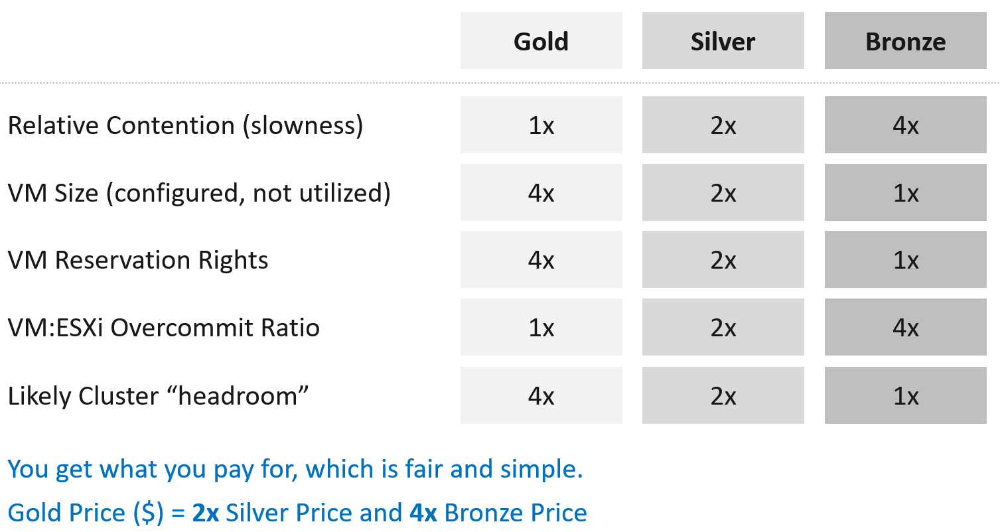

# Class of service in capacity planning

## Why a fixed gap
- Gold, Silver and Bronze require a relative value that tenants understand.
- Recommendation: a 2x gap. Gold is 2x better than Silver; Silver is 2x better than Bronze.
- A 2x gap is easier to explain to senior leadership and application teams than 1.5x or 3x, and easier to run at scale.
- Price follows the same gap: Gold price = 2x Silver = 4x Bronze.
- Price, SLA numbers per class, size limits and soft products: `operations-management/performance/class-of-service`. This file holds the capacity settings.

## Promise vs technique


- What is sold: a Gold VM is 2x better than Silver; its chance of contention is half of Silver's.
- Contention cannot be guaranteed directly. So the provider proves the promise with three techniques, each with the 2x gap:
  - 2x the reservation;
  - half the overcommit ratio;
  - 2x the headroom.

| Relative value | Gold | Silver | Bronze |
|---|---|---|---|
| Contention (slowness) | 1x | 2x | 4x |
| VM size (configured) | 4x | 2x | 1x |
| VM reservation rights | 4x | 2x | 1x |
| VM to ESXi overcommit ratio | 1x | 2x | 4x |
| Likely cluster headroom | 4x | 2x | 1x |

## Example implementation
![Reservation (relative to VM configured size, set at resource pool): Gold 50% CPU 100% RAM, Silver 25% CPU 50% RAM, Bronze 12.5% CPU 25% RAM. Allocation (thread, usable capacity; memory tiering beyond 1:1): Gold CPU 1:1 RAM 1:1, Silver CPU 2:1 RAM 1.5:1, Bronze CPU 4:1 RAM 2:1. Contention minimum Performance (%) KPI: 99.5%, 99%, 98%. Expected utilization against ESXi threads and usable capacity: Gold CPU about 50% RAM about 80%, Silver CPU below 70% RAM below 90%, Bronze CPU below 90% RAM below 95%](images/class-of-service-reservation-allocation-contention-utilization-table.png)

- **Reservation**
  - Gold: 50% CPU, 100% RAM
  - Silver: 25% CPU, 50% RAM
  - Bronze: 12.5% CPU, 25% RAM
  - Relative to the VM's configured size. Set at the resource pool, not the VM.
- **Allocation (overcommit, virtual : physical)**
  - Gold: CPU 1:1, RAM 1:1
  - Silver: CPU 2:1, RAM 1.5:1
  - Bronze: CPU 4:1, RAM 2:1
  - CPU per thread, not per core. Against usable capacity, not total capacity. Memory tiering serves memory beyond 1:1.
- **Contention: minimum VM Performance (%)**
  - Gold: ≥ 99.5%
  - Silver: ≥ 99%
  - Bronze: ≥ 98%
  - A KPI threshold, not an SLA (`operations-management/performance/kpi-vs-sla`).
- **Utilization (expected, not a ceiling)**
  - Gold: CPU about 50%, RAM about 80%
  - Silver: CPU below 70%, RAM below 90%
  - Bronze: CPU below 90%, RAM below 95%
  - Against ESXi physical threads, not cores. Against usable capacity, not total.

- Reservation, allocation and contention are the settings and promises. Utilization is the result they produce.
- A cluster of mostly Gold VMs is likely to stay well below 60% CPU utilization: the 1:1 allocation and the reservations fill the cluster first.
- Bronze is overcommitted, so utilization becomes its upper limit: above it, contention risk rises.
- The minimum Performance (%) keeps the 2x gap in unmet demand: 0.5%, 1%, 2%.

## Planning tool
- The author's capacity planning spreadsheet implements this model (isvara.io). First input: the ESXi host size. Its defaults balance cost and host size.

## Traps
- "Gold gets 2x the performance of Silver" → Gold gets half the chance of contention; speed is not doubled.
- "Set the Gold reservation on each VM" → set it on the resource pool; VM-level reservation changes HA admission control and restart.
- "Bronze at 90% CPU is overloaded" → for Bronze, 90% is the expected upper limit; for Gold, about 50% is expected.
- "Overcommit ratio per core" → the plan counts threads, not cores; 4:1 per thread is 8:1 per core with Hyper-Threading.
- "Gold memory at 1:1 means no memory tiering" → tiering serves memory beyond 1:1; Gold stays at 1:1 against DRAM.

## Metadata
```yaml
id: operations-management/capacity/class-of-service-planning
retriever_guide: how-it-works
scope: operations-management
technology:
- cpu
- memory
- system
pillar:
- capacity
- performance
- value
product:
- vsphere
- vcf-operations
object:
- ClusterComputeResource
- ResourcePool
internal_derive:
- operations-management/capacity/capacity-dimensions
related:
- operations-management/performance/class-of-service
- vsphere/foundations/noisy-neighbour
- operations-management/performance/class-of-service
- operations-management/capacity/host-spec-from-class-of-service
- operations-management/performance/kpi-vs-sla
- vcf-operations/models/cluster-risk
- vcf-operations/kpis/vm-performance
images:
  - path: images/class-of-service-2x-gap-gold-silver-bronze-table.png
    product: [vsphere]
    object: [ClusterComputeResource]
    topic: 'Class of service 2x gap'
    image_type: table
  - path: images/class-of-service-reservation-allocation-contention-utilization-table.png
    product: [vsphere]
    object: [ClusterComputeResource, ResourcePool]
    topic: 'Class of service planning values'
    image_type: table
source:
  document: PART 1 - Concepts of Operations Management.docx
  path: 'Capacity Management > Capacity Model > Planning Phase; Planning Template. Pages 107-109.'
corrections: []
review_notes:
- 'Section ''Example implementation'': the book says "Notice the consistent 2x gap"; memory allocation (1:1, 1.5:1, 2:1) and utilization do not follow 2x (Q119).'
- 'Section ''Example implementation'': Silver 2:1 and Bronze 4:1 per thread are 4 and 8 vCPUs per core with Hyper-Threading; Cluster Risk (%) marks 3-4 vCPUs per core as red, and memory 1.8-2.2 as red. A Bronze cluster built to this plan scores red on both rows (Q120).'
- 'Section ''Example implementation'': Gold at 50% CPU reservation and 1:1 CPU per thread from the book image. Text written from the image; the image is kept as the author''s table.'
- 'Section ''Example implementation'': the 2x gap in unmet demand (0.5%, 1%, 2%) is Claude''s arithmetic on the book values.'
status: draft
```
