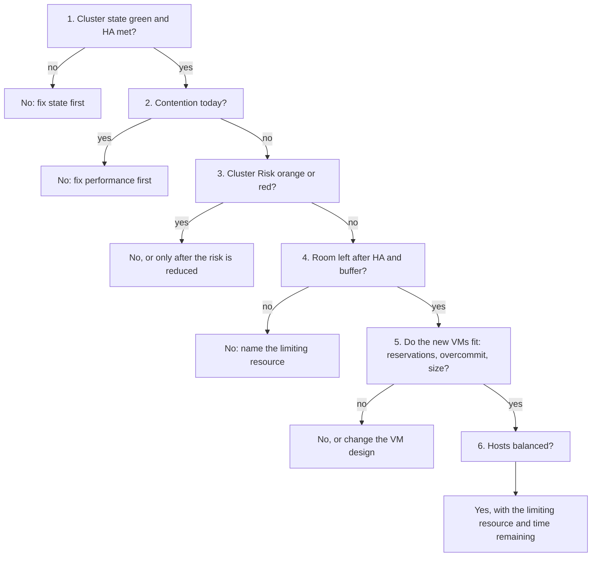

# Can this cluster take more VMs?

## Symptom
- A request to place N new VMs, or a project, on an existing vSphere cluster.
- The answer is yes or no, with the resource that limits it and the reason.

## Flow


## Checks, in order
1. Cluster state and HA (ClusterComputeResource). Yellow or red, or HA no longer meets its failover capacity → no; fix the state first. Admission control counts reservations, not usage. See `vsphere/object-types/cluster/concepts/admission-control-and-cluster-state`. Green → step 2.
2. Performance today (ClusterComputeResource). Cluster Performance (%) shows contention now, in depth (worst VM) or breadth (90th percentile) → no; more VMs add to it. See `vcf-operations/kpis/cluster-performance`. No contention → step 3.
3. Risk (ClusterComputeResource). Cluster Risk (%) orange (50-75) or red (75-100) → no, or only after the sub-metric driving it is reduced. Read the sub-metrics, not only the score: a worse sub-metric can lower the score. See `vcf-operations/kpis/cluster-risk`. Green or yellow → step 4.
4. Room left (ClusterComputeResource). Usable capacity = total − HA − overhead − buffer (`operations-management/capacity/capacity-model`). Read Cluster Consumption (%) and its saturation rows (`vcf-operations/kpis/cluster-consumption`). Memory: ballooning starts only near 99% host use, so set the normal ceiling from the HA case; with 12 hosts sized for 11, 99% × 11 / 12 = 90.75% (`vsphere/technology/memory/concepts/host-memory-states`). No room on a resource → no, and name it. Room → step 5.
5. Fit of the new VMs (ClusterComputeResource, VirtualMachine).
   - Reservations: they must fit unreserved capacity; leave at least 10% unreserved (`vsphere/object-types/cluster/concepts/admission-control-and-cluster-state`).
   - Overcommit: the CPU and memory overcommit rows of Cluster Risk after the new VMs (`vcf-operations/kpis/cluster-risk`).
   - Size: a monster VM (more than 50% of a host's physical cores, or more than 40% of its DRAM or 256 GB, whichever is smaller) raises contention risk even at low utilization (`vcf-operations/kpis/cluster-risk`, section Monster VM).
   - Any no → no, or change the VM design. All fit → step 6.
6. Balance (ClusterComputeResource). Inter-host imbalance red or pink → rebalance first: a hot host suffers while the cluster has room (`vcf-operations/metrics/cluster/cpu-inter-host-imbalance`). Then answer yes, with the resource that fills first and the time remaining from the projection (`operations-management/capacity/capacity-model`, section Capacity Remaining and Time Remaining).

## Why this order
- State first: in yellow or red, reservations are not met; any capacity number is built on a broken base.
- Performance before capacity: a cluster with contention today is already full for its current VMs.
- Risk before consumption: risk shows how close contention is; consumption alone can look fine while one host is at its limit.
- Room before fit: no design of the new VMs helps if the cluster has no usable capacity.
- Fit before balance: balance is fixed by DRS or by moving VMs; a VM that cannot fit is a design question.

## How to read the result
- No at step 1 or 2 → the answer is about the current state, not about the new VMs.
- No at step 4 → name the resource (CPU, memory, storage) and the gap.
- Yes → give the limiting resource and how long the room lasts.

## Traps
- "Cluster CPU at 40%, so there is room" → check contention, risk and HA headroom; one hot host can be full.
- "Memory consumed at 85% means the cluster is full" → consumed is utilization; check saturation rows and contention, and the HA ceiling.
- "Cluster Risk fell after the last VMs, so the risk is lower" → read the sub-metrics; a worse sub-metric can lower the score.
- "The VMs have no reservation, so admission control passes them" → their overhead memory is still checked.

## Metadata
```yaml
id: operations-management/capacity/diagnosis/can-cluster-take-more-vms
retriever_guide: what-to-check
scope: operations-management
technology:
- cpu
- memory
- storage
- system
pillar:
- capacity
- performance
product:
- vsphere
- vcf-operations
object:
- ClusterComputeResource
internal_derive:
- vsphere/object-types/cluster/concepts/admission-control-and-cluster-state
- vcf-operations/kpis/cluster-performance
- vcf-operations/kpis/cluster-risk
- operations-management/capacity/capacity-model
- vcf-operations/kpis/cluster-consumption
- vsphere/technology/memory/concepts/host-memory-states
- vcf-operations/metrics/cluster/cpu-inter-host-imbalance
related:
- vsphere/object-types/cluster/overview-what-to-monitor
source:
  document: Knowledge base synthesis of the files in internal_derive
  path: n/a
corrections: []
review_notes:
- 'Drafted by Claude 2026-11-06 from the files in internal_derive and vsphere/object-types/cluster/overview-what-to-monitor (architecture review 2026-11-06, section 3.3). The order of checks is to be confirmed by the author from field practice (Q061).'
status: draft
```
