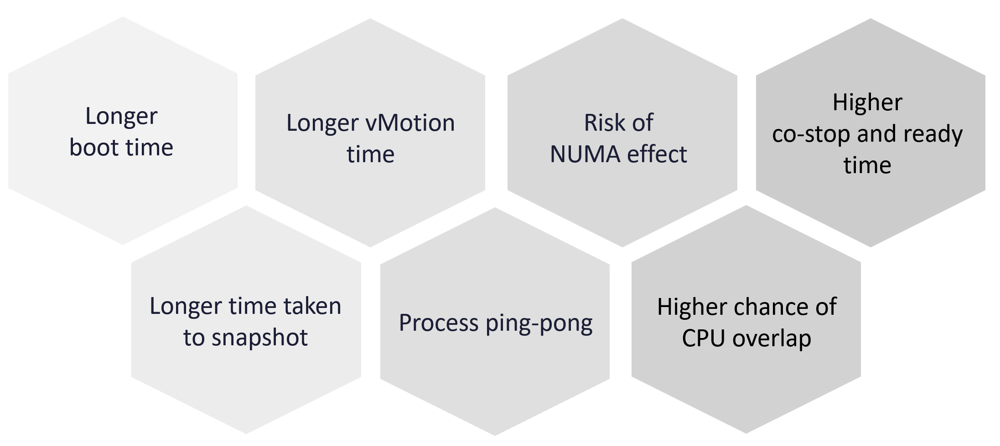
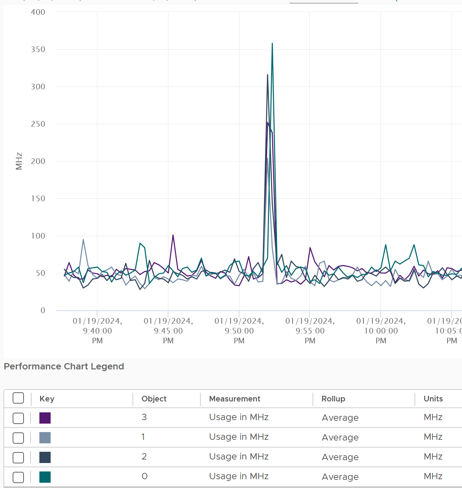

# Rightsizing VMs: why, how to win the argument, and how to prove it

## What is rightsized
- VMs and Kubernetes. Not ESXi hosts, datastores or vSAN: their size rarely changes once bought.
- There is no single "VM rightsizing". Guest OS sizing (internal, Guest OS counters, includes guest queue, excludes VM overhead) and VM footprint (external, vSphere counters, includes VM overhead, excludes guest queue) answer different questions. See `guest-os/system/concepts/guest-os-sizing` and `operations-management/capacity/vm-footprint-sizing`.
- This file covers why oversizing happens, what it costs, and how to get a downsize accepted and proven.

## Why VMs are oversized
| Cause | Mechanism |
|---|---|
| Legacy | P2V copied the physical server's configuration |
| Cost | The VM is free or far cheaper than public cloud |
| Cost | No progressive pricing: 10 vCPU costs exactly 10x 1 vCPU |
| Education | Bigger is believed to be faster |
| Vendor | Commercial software sizing; no support if changed |
| Micro burst | CPU bursts of a few seconds vanish in 20-second averages |

- Public cloud providers have no oversizing problem to fight: oversized instances earn them a higher margin.

## Oversized is relative
- A 64-vCPU VM running 7 vCPUs is oversized; an 8-vCPU VM running 7 is not. Idle, in contrast, is absolute (`operations-management/capacity/reclamation`, section Idle VM).
- VCF Operations definitions:
  - undersized: for CPU or memory, the recommended size is above the total (configured) size; the smallest increase is 1 vCPU or 1 GB;
  - oversized: CPU or memory can be reclaimed, from total capacity against the recommended size.
- VCF Operations bases both on the projection, not on 5-minute or daily data. A powered-off oversized VM stays oversized until it no longer meets the definition.

## Cost of an oversized VM


- More CPU, memory and disk do not make a VM faster; they add overhead.
- Higher frequency with fewer vCPUs: fewer active threads let ESXi boost the active cores. Check CPU Usage (MHz) per vCPU.
- Lower Co-stop and Ready: all vCPUs are scheduled, used or not.
- Higher chance of CPU Overlap: more vCPUs, more interrupts and IO serviced on their time.
- Process ping-pong: the guest scheduler moves threads across vCPUs; each move costs a context switch and cache warm-up (`vcf-operations/metrics/vm/cpu-usage-disparity`).
- Faster snapshots, especially with memory.
- Faster vMotion: Windows and Linux use memory as cache; more memory, more to copy.
- Faster boot: without a reservation, vSphere creates a swap file the size of configured RAM; slow storage delays boot.
- Risk of NUMA effect: see the example below.


## NUMA example
- Host: 2 sockets × 16 cores. VM: 16 vCPU at 90%, fits one socket.
- Linux run queue below 2 per vCPU 95% of the time: busy but serving all processes.
- Sizing on CPU Usage, which runs 25% higher due to Turbo: 16 × 90% × 125% = 18 vCPU.
- 18 vCPU spans 2 NUMA nodes (9 + 9 or 10 + 8). Rounding up to 20 for buffer spreads vCPUs and memory over 2 sockets: NUMA effect.
- With CCDs inside a socket, a smaller NUMA effect exists within a socket too.

## What to optimize in the consumer layer
| Resource | Rule |
|---|---|
| CPU | CPU Run Queue is the primary counter; high vCPU utilization is the aim: fewer vCPUs, less ping-pong and NUMA |
| CPU | Check CPU Usage Disparity: some applications stay on the first 8 vCPUs |
| Memory | Utilization near 100% is normal: most pages are cache. Check page faults for excess |
| Disk | Rightsize the file system: a Windows or Linux partition change |
| Disk | Use fewer RDMs; with array thin provisioning, check unmap for wastage |

## Micro burst
- Some applications burst to above 80% CPU for 1-3 seconds. Per-second data shows it; a 20-second average of the same period reads about 50%. Sizing on the 20-second value leaves the burst short of vCPUs: CPU run queue rises.
- Memory rarely bursts like this.
- Two ways to find these applications:
  - default no: the application team must declare short, sharp bursts;
  - default yes: the infrastructure team scans the estate. No agent allowed, so esxtop, the 2-second real-time metrics of VCF Operations 9.1 (`vcf-operations/concepts/real-time-metrics`), or a custom management pack (vCommunity). Limit collection to about 1,000 data points: 2-second data is heavy on the monitored system.
- Business transaction monitoring of the VM owner shows bursts that infrastructure metrics miss: work with the owner.

## Getting the downsize accepted
- Taking resources away is harder politically than technically.
- Mass downsizing backfires: a small share of VMs suffer, and the whole program loses trust.
- Saving money is a weak argument: owners already paid. Show that a right-sized VM performs better.

| Concern | Response |
|---|---|
| Fear: it will be slow | A formal, open process: owners see performance and usage before and after, over 1 month (month-end peak) |
| Fear: slowness from another cause | Agree the metrics up front; show contention and Guest OS metrics |
| Paid for: the original size looks like a mistake | Present the owner as the one who saves the company; infrastructure only helps |

### Practices
| Practice | Action |
|---|---|
| Hardware | Map the VM to the CPU and memory architecture; NUMA-aware vSocket × vCore |
| Performance | Rightsizing serves performance at peak, not capacity. Include contention; sample at 20 seconds, not 5 minutes; add Guest OS and business transaction metrics for time-sensitive work |
| Collaboration | Agree metrics, method and change date up front; joint execution; a rollback plan; no other change (data, application) in the window |
| Proof | A dashboard of before vs after per right-sized VM |
| Big picture | Company-wide excess, reported regularly to all stakeholders |
| Encourage small | Small VMs by self-service at once; large VMs require justification, approval and regular review |
| Pricing | Progressive pricing: large VMs at a premium pay for the small-VM discount |
| Application-aware | Exclude Java VMs, databases and Kubernetes nodes from the standard formula: they manage their own memory or run containers. Work with the DBA or Kubernetes SRE |
| Open | A public dashboard any owner can use: transparency builds trust |

- Hardware sizes from the book: a VM above 8 vCPU risks the Hyper-Threading effect; above 16 vCPU risks the NUMA effect. Both depend on the host CPU (see review notes).

## Big picture: Max and Average of large VMs
- To show management that large VMs do not use their CPU: a dynamic group of all large VMs (example: more than 16 vCPU), one for CPU and one for memory, plotted every 5 minutes for 3 months so short peaks stay in.
- Two super metrics on the group:

| Super metric | Right-sized fleet | Reading |
|---|---|---|
| Maximum CPU workload among the VMs | About 80% | Constantly flat at 100%: a runaway process; low: severe wastage |
| Average CPU workload among the VMs | About 40% | Below 20% all month: all large VMs oversized |

- With hundreds of VMs, at any 5 minutes one VM is busy, so Max spikes; some are idle, others busy, so Average sits at 40-50%.
- Minimum is not useful: some VM is always idle.
- Find the runaway VM: list the VMs by 95th percentile over the period; it is at the top at 100%.
- Limit: the counter does not tell real demand from infrastructure load (Guest OS reboot, antivirus full scan, runaway process). A multi-threaded runaway process can reach 100% CPU Demand.

## Prevent oversizing
- Progressive pricing (Part 1, Cost and Price Management): the price per vCPU rises with VM size.
- Without chargeback: approval chain grows with VM size; a longer form for monster VMs.
- Every VM has a life span, renewed by an annual confirmation (`operations-management/capacity/unused-vm`, section Annual stocktake).
- Start small (minimal size for every VM, upsize later) has costs:
  - it breaks the service provider model: IT joins every sizing discussion; price is the better lever;
  - upsizing is harder than downsizing: NUMA, and the maximum size depends on the host;
  - it can be gamed with synthetic load: monitor continuously and long term;
  - upsizing must be fast: the same day, or within an hour when performance is hit. Downsizing can wait weeks.
  - CPU Hot Add and memory Hot Add become required, and CPU Hot Add turns off vNUMA (`vsphere/technology/cpu/concepts/idle-and-unused-vcpus`, section CPU Hot Add).

## Before vs after
- CPU:
  - total CPU use should stay the same;
  - if CPU cycles (GHz) drop after the change, raise the VM's shares instead of adding vCPUs back;
  - load spread across all vCPUs → each remaining vCPU shows higher utilization;
  - uneven load, vCPUs taking turns → each remaining vCPU shows about the same utilization;
  - Guest OS CPU run queue should stay the same; if it rises, check the thread states;
  - context switches rise when the application runs many threads; the rise should be small.
- Memory:
  - less free memory and more paging in the Guest OS;
  - a large VM that crossed NUMA nodes shows more local NUMA access, faster for memory-heavy applications;
  - Windows Available (MB) drops: fine, that memory was not used.
- Other: disk and network demand change CPU and memory use. Plot disk IOPS and throughput, network throughput and packets per second to compare like with like.

## Traps
- "Size on CPU Usage" → Turbo inflates it 25% in this example, pushing the VM across NUMA nodes.
- "20-second data shows the CPU peak" → bursts of 1-3 seconds average out; a 20-second reading of 50% can hide 80%+ bursts.
- "Downsize everything that looks oversized in one program" → a few VMs that suffer discredit the program; go VM by VM, with proof.
- "Saving money convinces the owner" → owners paid already; show performance.
- "Average CPU of large VMs is 40%, so they are oversized" → 40% average with a Max near 80% is a right-sized fleet; below 20% all month is oversized.
- "CPU cycles dropped after the downsize, so add the vCPUs back" → raise the shares; the vCPU count was not the constraint.
- "Free memory dropped after the downsize: a problem" → expected; the removed memory was unused.
- "Start every VM small" → upsizing is harder, slower and NUMA-sensitive; price is the better lever.

## Metadata
```yaml
id: operations-management/capacity/rightsizing
retriever_guide: how-it-works
scope: operations-management
technology:
- cpu
- memory
- storage
- system
pillar:
- capacity
- performance
- value
product:
- vsphere
- vcf-operations
- kubernetes
object:
- VirtualMachine
internal_derive: []
related:
- guest-os/system/concepts/guest-os-sizing
- operations-management/capacity/vm-footprint-sizing
- vsphere/technology/cpu/concepts/cpu-topology
- vsphere/technology/cpu/concepts/numa
- vsphere/technology/cpu/diagnosis/oversized-vm-downsizing
- vcf-operations/metrics/vm/cpu-usage-disparity
- operations-management/capacity/reclamation
- vcf-operations/concepts/real-time-metrics
images:
  - path: images/vm-cpu-usage-mhz-per-vcpu.png
    product: [vsphere]
    object: [VirtualMachine]
    metric: ['VM CPU Usage (MHz)']
    topic: 'Rightsizing'
    image_type: timeline
  - path: images/vm-oversized-cost-diagram.png
    product: [vsphere]
    object: [VirtualMachine]
    topic: 'Cost of an oversized VM'
    image_type: diagram
source:
  document: PART 3 - Counters.docx; PART 1 - Concepts of Operations Management.docx
  path: 'Part 3: Consumer Objects > Capacity: Guest OS > Benefits. Part 1: Capacity Management > Rightsizing (Challenges; Micro Burst; Oversized Guest OS; Cost of Oversized; Optimization; Best Practices; The Big Picture; Progressive Pricing; Start Small?; Before vs After), pages 121-127.'
corrections: []
review_notes:
- 'Section ''Idle VM: power it off'' (author, Q042, 2026-11-06) moved to operations-management/capacity/reclamation, section Idle VM, 2026-11-07: one place for idle VM reclamation.'
- 'Section ''Practices'': the book says AMD EPYC and Intel Xeon use an 8-core block, a VM above 8 vCPU risks the Hyper-Threading effect and above 16 vCPU the NUMA effect. EPYC CCDs are 8 cores (16 on Zen 4c and Zen 5c); Intel Xeon has no 8-core block. Kept as the book''s rule of thumb, attributed (Q097).'
- 'Section ''What to optimize'': the book says CPU utilization should be 100%; the Big Picture section expects about 40% average and 80% max across large VMs. Read as per-VM aim vs fleet average (Q098).'
- 'Section ''Micro burst'': 2-second metrics checked against the VCF Operations 9.1 documentation (2026-11-07).'
- 'Section ''Cost of an oversized VM'': the Overlap reason ("more interrupts and IO serviced on their time") is Claude''s explanation of the book image.'
- 'Section ''Prevent oversizing'': the CPU Hot Add and vNUMA link is from Performance Best Practices (idle-and-unused-vcpus), not this chapter.'
- 'Part 1, VM Footprint | Guest OS Sizing repeats the Part 3 text already in guest-os/system/concepts/guest-os-sizing; nothing added.'
status: draft
```
