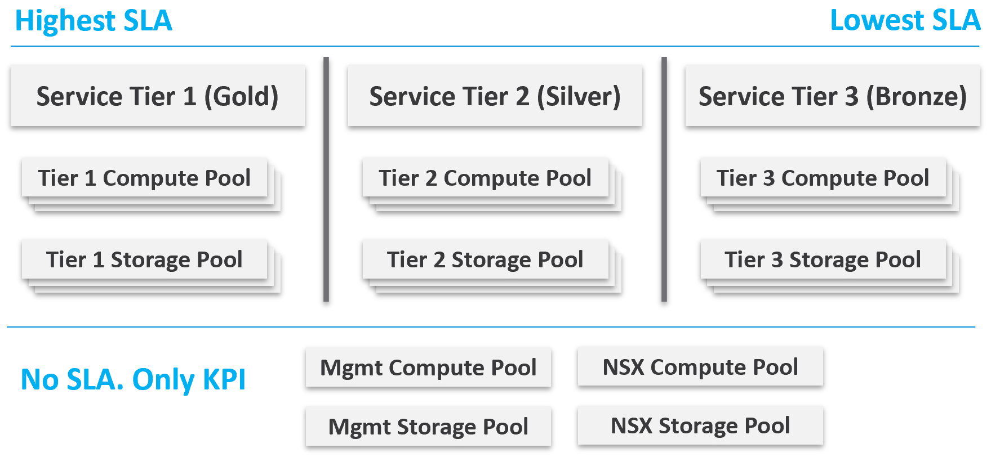

# Class of service: price, overcommit, SLA numbers, size limit and cluster design

## Why several classes
- With one class and a promise of good service, every customer expects first-class service.
- A comparison sets value: a Gold offer that few buy makes Silver look like a good deal (pricing psychology), and customers who see only Silver and Bronze ask where Gold is.
- If a class is not offered, give customers and management the reason.

## Price/performance
- Cheap, good, fast: pick two. In IaaS:
  - Availability: measurable. Half the downtime window, twice the price.
  - Performance: utilization does not exist before the VM runs, so the overcommit ratio stands in. Twice the vCPUs on a cluster, each pays half: the cost is shared by all.
  - Compliance: the same for every class. A weak class is a jump box into the rest.
- The class sets four things: price (overcommit ratio and quality of service), capacity (overcommit ratio), and the Availability, Performance and Compliance SLAs.
- Overcommit ratios here are vCPU : physical CPU and VM memory : physical memory (N:1). The basis for CPU (core or thread) changes the number by 2x with Hyper-Threading: `operations-management/capacity/host-spec-from-class-of-service`.

## Generic guideline
| Tier | Price | CPU overcommit | Performance penalty |
|---|---|---|---|
| 1 Gold | 1.00x | 1:1 | none |
| 2 Silver | 0.50x | 2:1 | 5% |
| 3 Bronze | 0.25x | 4:1 | 10% |
| 4 Free | 0 | maximum | no SLA |

- Gold: performance guarantee for latency-sensitive, mission-critical applications. The guarantee is not literal for CPU: VM CPU Ready never reads 0.00%, even with no contention.
- Silver: most production workloads. Bronze: test and development. Free: temporary projects.
- Each step halves the price and doubles the penalty: consistent and fair.
- The penalty column positions the business value; it is not the SLA. Bronze is not CPU Ready at or below 10% at all times:
  - a VM at 9.9% Ready all month would pass, which is unacceptable;
  - at all times means a 100% SLA, which is cost-prohibitive;
  - a plain average is far too loose.
- So one threshold (CPU Ready 2.5%, a 5-minute average) serves every class, and the class sets the nines. An SLA is never 95%: that is 1 failure in 20.

## Free tier
- Shows the value of the SLA by its absence.
- Funded by the paid tiers, so it carries no SLA: unpredictable downtime and slow time are acceptable. Public clouds make their free tier slower and less reliable on purpose, so customers upgrade.
- Cap the number of free VMs per customer as well as their size.

## Recommended SLA per class
| Tier | Availability | Performance | Compliance |
|---|---|---|---|
| 1 Gold | 99.975% | 99.9% | 99.95% |
| 2 Silver | 99.950% | 99.8% | 99.95% |
| 3 Bronze | 99.900% | 99.6% | 99.95% |

- Different numbers per pillar because they measure different things.
- Availability is the highest: scheduled and customer-caused downtime are excluded. Not higher than 99.975%: Windows or Linux may run a filesystem check after a crash, and IT or security services may have to start before the application. The windows are 1x, 2x, 4x from Gold to Bronze.
- Performance is lower: the threshold is strict enough for mission-critical VMs, so Bronze meets it less often. The failure windows are 1x, 2x, 4x: half the price, twice the window.
- Gold performance is not 100% even with no CPU overcommit: the provider's compute is only part of the path; storage and network are outside its control.
- Compliance is the same for all classes. Not 99.99%: that allows no failed interval in a month. A compliance value is the last value collected, which can be one second old. If changes are manual, adjust the number for the time a change takes.
- Performance numbers are also in `knowledge/catalog/thresholds-performance.yaml` (performance-sla-gold, -silver, -bronze).

## Sample offering: Gold at 2x Silver
| Item | Gold | Silver | Why |
|---|---|---|---|
| Price | 2x | 1x | Gold is priced 2x Silver |
| Overcommit | CPU 2:1, RAM 1:1 | CPU 4:1, RAM 2:1 | Twice as many consumers in Silver |
| Availability SLA | 99.975% | 99.950% | Gold: half the downtime |
| Performance SLA | 99.9% | 99.8% | Gold: half the slow time |
| Compliance SLA | 100% | 100% | Perfect compliance for every class |

- The SLA is the hard product, what is paid for, like the seat in an airline. Support, reports and backup are soft products.
- Customers do not care about SSD type or memory brand; they buy the SLA.
- Classes mixed in one cluster leave only reservations and shares to separate them, for example Gold with 2x the shares of Silver. That is hard to run and does not prove the SLA.

## Planning example: hardware follows price
- Decide the overcommit and the price first; the hardware specification follows. Use vendor discounts and licensing to complement the plan, not to dictate it.
- Price as a share of Gold, with a 50/50 split between CPU and memory:

```text
price vs Gold = 0.5 × (1 / CPU overcommit) + 0.5 × (1 / memory overcommit)
```
- Silver at CPU 3:1 and no memory overcommit: 0.5 × 1/3 + 0.5 × 1 = 67% of Gold, a 33% discount.
- Bronze at CPU 6:1 and memory 2:1: 0.5 × 1/6 + 0.5 × 1/2 = 33% of Gold.
- Gold: CPU 1:1, memory 1:1, all flash. Free: no overcommit stated, magnetic storage; may be left out entirely (business decision).
- Average VM profile for Silver and Bronze: 1 vCPU to 4 GB RAM, a common ratio. Measure the real ratio in VCF Operations.
- Host for Silver: `operations-management/capacity/host-spec-from-class-of-service`.
- Open question for the business: what performance penalty is fair for a 33% discount?
- Progressive pricing: a 64-vCPU VM must cost more than 64x a 1-vCPU VM. A straight-line price gives no reason to size small, and rightsizing then happens in production, which is slow and costly.

## Size limit per class
- Overcommit risks contention. A cap on VM size stops monster VMs from dominating overcommitted hosts.
- If one VM may be the size of the host, overcommit with good performance is not possible.

| Tier | Limit | Example cap |
|---|---|---|
| 1 | ≤ 1 socket | 32 vCPU, 512 GB |
| 2 | ≤ 50% of a socket | 16 vCPU, 128 GB |
| 3 | ≤ 25% of a socket | 8 vCPU, 32 GB |
| 4 Free | n/a | 1 vCPU, 4 GB, 100 GB disk |

- Public cloud free tiers are smaller: 1-2 vCPU and 1 GB RAM.
- Size limit by overcommit ratio and logical CPUs: `vsphere/foundations/noisy-neighbour`.

## Soft products
- Support (Gold vs Silver):
  - response time 2 vs 4 hours; support hours 24 x 7 vs 12 x 7;
  - Gold bypasses the first-level help desk;
  - root cause analysis included vs charged. The RCA includes the alert that detects the same incident next time;
  - daily proactive health check (KPI and alerts) vs none;
  - Gold VMs on the NOC live screen; Silver VMs not, to keep the NOC on Gold;
  - reports weekly vs monthly; monthly business review vs none;
  - critical patches to Gold first; proactive performance and capacity optimization (rightsizing) for Gold only.
- Availability (Gold vs Silver):
  - snapshot kept 1 week with a reminder vs 1 day then auto-deleted; size unlimited vs 100 GB; 2 snapshots vs 1;
  - backup: Gold first; full backup weekly vs fortnightly; application-level vs OS-level agent, installed and managed; backup report vs none;
  - disaster recovery: an add-on service for both.

## Compute and storage design
- A VM runs on a cluster and is stored on a datastore. Both must carry the class.
- The smallest building block for a class of service is a vSphere cluster with vSAN.
- Resource pools and VM-host affinity rules subdivide a cluster but cannot deliver a differentiated class:
  - a resource pool can give Gold 2x the shares, but whether 2x shares means half the CPU Ready cannot be known in advance;
  - they add operations complexity.
- Storage has the same limit. A VMFS datastore cannot deliver differentiated service levels by latency, which is what customers buy. vSAN storage policies do not either.
  - Example: Gold promised 10 ms worst case, Silver 20 ms (half the price). Controls that are not based on latency can give 9 ms for Gold and 21 ms for Silver, where 10 ms and 20 ms were possible.
  - Storage I/O Control is deprecated in VCF 9: `vsphere/foundations/noisy-neighbour`.
- Layout: one compute pool and one storage pool per tier. Management and NSX Edge clusters, with their own storage, carry no SLA, only a KPI.

- Name clusters and datastores after their class.

## Mixing compute and storage classes
- Example: three compute tiers and three storage tiers, with Tier 1 never paired with Tier 3: 7 combinations instead of 9.
- With two clusters and two datastores per tier, the same rule gives 28 cluster-datastore pairs. With ten per tier it is far worse. Flexibility becomes complexity; a small environment can afford more of it.
- Further costs:
  - two tags, one for compute and one for storage; a VM with Gold compute and Silver storage has no class name;
  - tagging doubles: clusters and datastores;
  - virtual disks can inherit the class from the datastore, but RDMs do not sit on one;
  - a class per virtual disk means tagging and reporting each disk of each VM;
  - troubleshooting: a VM with Bronze compute and Gold storage can show disk latency caused by CPU contention.

## Traps
- "Gold has no overcommit, so its Performance SLA can be 100%" → the provider controls compute only; storage and network sit in the path. 99.9% is the recommended number.
- "Bronze tolerates 10% CPU Ready" → the 10% is a price-position penalty, not a threshold. Every class uses CPU Ready 2.5%; Bronze gets fewer nines.
- "Give Silver its own looser threshold" → one threshold, different nines. Separate thresholds cannot be justified by price and let Silver outscore Gold.
- "Use resource pools with 2x shares to sell Gold and Silver in one cluster" → shares do not translate into a predictable Ready. The cluster is the smallest unit for a class.
- "Storage policies give Gold 10 ms and Silver 20 ms" → the controls are not based on latency; the result is not predictable.
- "Let customers mix any compute class with any storage class" → combinations multiply with every cluster, tagging doubles, and disk latency caused by CPU contention gets misread.
- "Price per vCPU in a straight line" → no reason to size small; rightsizing then happens in production. Price progressively.
- "Allow a VM as large as the host in an overcommitted class" → one VM can then take the whole host; cap size per class.
- "Choose the hardware, then price the classes" → price and overcommit first; the host specification follows.
- "Compliance can be lower for Bronze" → one weak class exposes all classes. Same compliance for all.
- "Management and NSX Edge clusters carry an SLA too" → they serve the provider; they carry a KPI only.

## Metadata
```yaml
id: operations-management/performance/class-of-service
retriever_guide: how-it-works
scope: operations-management
technology:
- cpu
- memory
- storage
- system
pillar:
- performance
- availability
- capacity
- value
product:
- vsphere
- vsan
- nsx
- vcf-operations
object:
- ClusterComputeResource
- Datastore
- ResourcePool
- VirtualMachine
internal_derive:
- operations-management/performance/sla-metrics
- vsphere/foundations/noisy-neighbour
- operations-management/capacity/host-spec-from-class-of-service
related:
- operations-management/performance/iaas-business
- vcf-operations/kpis/cluster-sla-sli
- operations-management/capacity/rightsizing
- vsphere/foundations/resource-controls
images:
  - path: images/class-of-service-tier-compute-and-storage-pools-diagram.png
    product: [vsphere, vsan, nsx]
    object: [ClusterComputeResource, Datastore]
    topic: 'Compute and storage pools per service tier; management and NSX pools with KPI only'
    image_type: diagram
source:
  document: PART 1 - Concepts of Operations Management.docx
  path: 'Your Private Cloud > Service Level Agreement (Class of Service, Price/Performance, Free Tier, Recommended SLA, Penalty Quantification, Sample Offering, Price & SLA, Size Limit, Service, Availability, Compute & Storage, Mix and Match) (pp. 32-42)'
corrections: []
review_notes:
- 'Overcommit notation: the book writes 1:2 and 2:1 for the same idea; written here as N:1 (consumer : physical) throughout. Basis (core or thread): Q079, Q087 a, Q099.'
- 'Section ''Planning example'': the book''s table gives Silver CPU 1:2 and RAM 1:1.5; its text gives Silver 3:1 CPU, no RAM overcommit, 67% of Gold. Only the text matches 67% (the table gives 58%). Written from the text; Bronze table values (6:1, 2:1) match 33%. Q099.'
- 'Section ''Planning example'', price formula: written by Claude from the book''s 67% and 33% figures.'
- 'Section ''Recommended SLA per class'', Compliance 99.95% vs 100% in the sample offering: Q098.'
- 'Section ''Size limit per class'': socket-based limits; vsphere/foundations/noisy-neighbour gives a logical-CPU basis (Gold 1:1 up to all logical CPUs). Q100.'
- 'Section ''Mixing compute and storage classes'', 28 pairs: Claude''s count of the book''s 6-cluster diagram (each Tier 1 or Tier 3 cluster to 4 datastores, each Tier 2 cluster to 6).'
- 'Section ''Compute and storage design'': the book says Gold is charged 200% more for 2x; written as twice the price (Q107). Storage I/O Control: deprecated in VCF 9 (Q080).'
- 'Section ''Soft products'': the book''s Service SLA text says Gold tickets go to Level 3; its service table says Level 2, bypassing Level 1. Written as bypassing the first level. Q107.'
- 'Not copied: class of service input diagram (text in Price/performance), mix-and-match diagrams (text), size limit image (table), generic tables (text).'
status: draft
```
