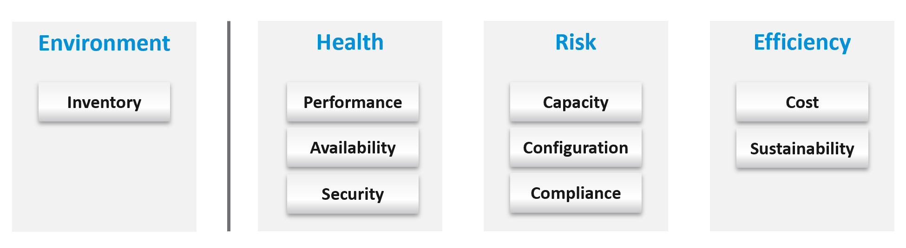

# Health: present health, risk and efficiency, not one score

## Why one health score fails
- Health depends on context and object. A score that tries to cover everything ends low while everything runs well.
- So health is mapped to the pillars of operations, and split three ways: present health, future health (risk), efficiency. Three sides, three metrics.
- Inventory sits apart: it describes the environment, not its health.


## Present health
- Real problems that happened or are still going on. Only reality, not possibility: a security risk is not a breach.
- Three problem types, checked in this order:
  - Availability (is it up?): workloads (VMs, Kubernetes) and infrastructure (VCF appliances, ESXi). Crashes and unscheduled downtime. The data comes mostly from logs, not metrics.
  - Performance (is it fast?): actual slowness (contention) and its main cause (very high consumption), as a trend over time. Read both the KPI and the SLA.
  - Security, present part (is it safe?): actual incidents. Example: the environment runs well, but unauthorized access and suspicious commands appear on ESXi consoles. Data from logs, events and metrics.
- Availability and performance are related, not the same: an environment can be 100% up and slow.

## Future health: risk
- No problem now, but the risk of one grows if nothing is done. The applications and the business are not affected yet.
- Four problem types:
  - Security, future part.
  - Compliance.
  - Configuration: four kinds of setting issue: incorrect, outdated, complex, suboptimal. Work on the most urgent first. Technical debt: keep versions current to stay supported.
  - Capacity: rightsizing, reclamation, capacity planning (what-if, commitment), as a trend. Questions: what is the overall capacity; should workloads be rebalanced?
- Example: a vSphere cluster without HA. With all hosts running, availability is 100% and performance is unaffected; the availability risk is real.

## Efficiency
- No present problem and no risk. Efficiency is optimization: lower cost, less complexity, a smaller capacity footprint, better application performance.
- Effectiveness is doing the right things; efficiency is doing things right. A wrong architecture can be operated correctly.
- Ways to raise it, which differ by object:
  - hardware refresh: more performance and capacity at the same price;
  - removing waste: oversized VMs, idle VMs, unused instances, unmapped disk space, orphaned files;
  - cost: compare with other cloud providers; IaaS is a commodity.
- Green operations belong here: sustainable operations are lean operations.

## Inventory over time
- Not a health dimension, but read with health: movement over time, not only the present count. Do the environment's dynamics match expectation?

## Traps
- "The health score is low, so something is broken" → a broad score drops on risk and inefficiency too. Read present health, risk and efficiency separately.
- "Security findings mean we are under attack" → a finding of exposure is risk (future health). Present health counts only actual incidents.
- "Everything is up and fast, so the environment is healthy" → present health is fine; risk (no HA, outdated versions, capacity trend) can still be high.
- "No HA, but nothing failed, so availability is fine" → availability today is 100%; the availability risk is in future health.
- "Availability is 100%, so performance is fine" → up is not fast.
- "Availability is monitored from metrics" → crashes and unscheduled downtime show mostly in logs.
- "Efficiency work can wait until there is a problem" → efficiency is the work done when there is no problem and no risk.

## Metadata
```yaml
id: operations-management/performance/health-risk-efficiency
retriever_guide: how-it-works
scope: operations-management
technology:
- system
pillar:
- availability
- performance
- security
- capacity
- value
product:
- vsphere
- vcf-operations
- kubernetes
object:
- ClusterComputeResource
- VirtualMachine
- HostSystem
internal_derive:
- operations-management/performance/pillars-of-operations
related:
- operations-management/performance/alerts-and-insights
- operations-management/performance/monitoring-vs-troubleshooting
- operations-management/performance/proactive-operations
- operations-management/capacity/rightsizing
images:
  - path: images/health-risk-efficiency-pillar-grouping-diagram.png
    product: [vsphere, vcf-operations]
    object: [ClusterComputeResource]
    topic: 'Pillars grouped as environment, health, risk and efficiency'
    image_type: diagram
source:
  document: PART 1 - Concepts of Operations Management.docx
  path: 'Your Private Cloud > SP5 Framework > Health (pp. 50-52)'
corrections: []
review_notes:
- 'Grouping differs inside the section: the grouping image puts compliance under risk and inventory under environment; the present/future health image puts compliance in present health (with security) and inventory in future health. Written from the text table and the grouping image. Q102.'
- 'Section ''Present health'' and ''Future health'': details (logs, data sources, four kinds of setting issue, capacity questions) from the present/future health image (not copied).'
- 'The personal and country analogies of the book are left out.'
status: draft
```
