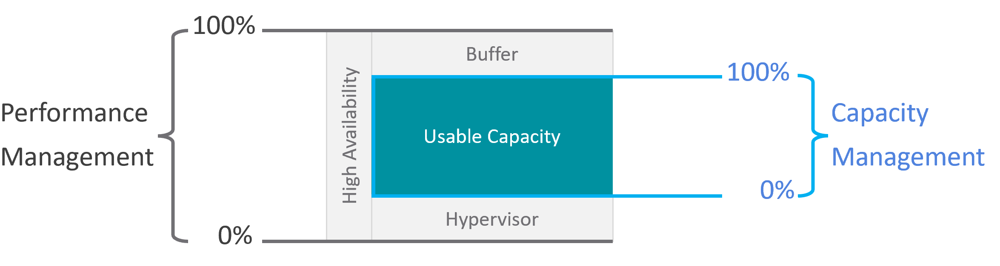
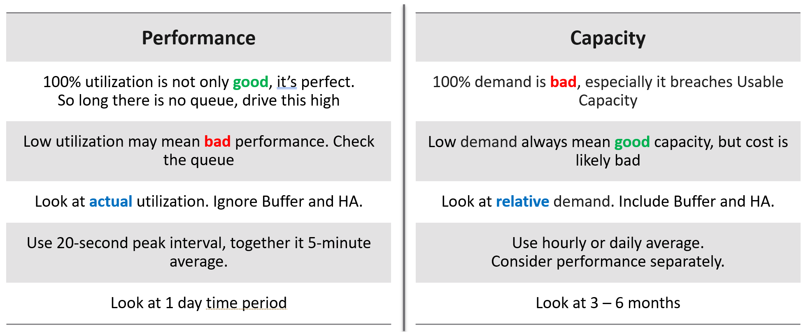
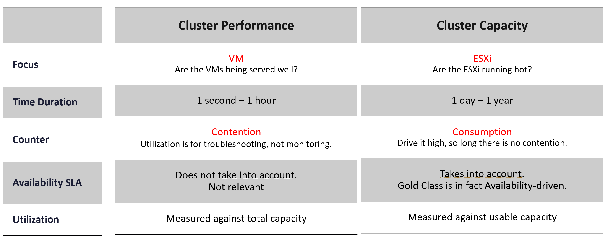
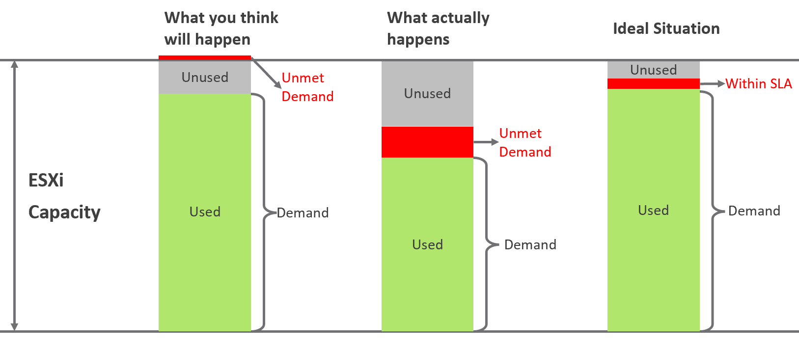
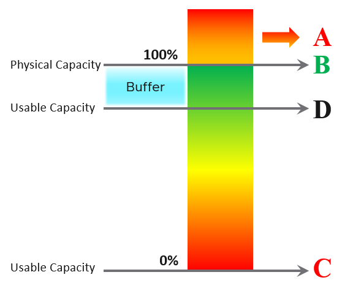
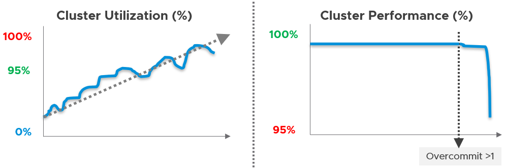

# Performance vs capacity: two readings of the same utilization

## Goal of performance management
- Find the problem before the customer complains. A process that waits for an alert or a complaint is troubleshooting, not performance management.
- Proactive takes a regular cadence and an internal threshold stricter than the SLA agreed with the customer.
- Performance first, capacity second: performance is more time sensitive. Restaurant analogy: the dining area before the kitchen.

## Two pillars, two questions
- Performance: quality, speed. Are the consumers served well now?
- Capacity: quantity, space. Is there enough supply for the demand to come?
- They are intertwined:
  - rightsizing is a capacity task, but performance is its first input; for mission-critical VMs read 1-20 second data, not the 5-minute average;
  - infrastructure capacity aims for the highest utilization, and performance overrides it.
- In large organizations two teams own them. Capacity looks at long-term supply, latent workload and future demand. Operations looks at what runs on the floor this hour.

## Usable capacity exists only in capacity
- Capacity subtracts HA, buffer, hypervisor overhead and reservation from total capacity. What remains is usable capacity, and capacity is measured against it.
- Performance ignores all four. It measures what happens, against total capacity. These factors can cause a performance problem, but they are not inputs to a performance metric.
- No other pillar has a usable part: no usable performance, usable availability or usable compliance.


## Absolute vs relative
- Performance is read against total capacity, but its meaning is relative: compare a cluster with other clusters, and with itself over time. Like a stock index: the number itself means little; the movement does.
- By class of service, a Gold cluster should score higher Performance (%), lower consumption (%) and lower Risk (%) than a Bronze cluster.
- Capacity is relative to usable capacity, not total capacity. The real utilization is lower; divided by the smaller usable capacity, the capacity score reads higher.
- Utilization is not managed for its own sake. Alone it means nothing: 0% can be bad, 100% can be good. It is an input to both pillars, read differently by each.
- Capacity reads demand, not utilization: demand is the higher of utilization and reservation. Model: `operations-management/capacity/capacity-model`.

| Reading | Performance | Capacity |
|---|---|---|
| 100% | Good: most work done, if there is no queue | Bad: demand breaches usable capacity |
| Low | May be bad: check the queue | Good for capacity, bad for cost |
| Baseline | Actual utilization; ignore buffer and HA | Relative demand; include buffer and HA |
| Interval | 20-second peak with the 5-minute average | Hourly or daily average |
| Period | 1 day | 3-6 months |



## Cluster: performance vs capacity
| Aspect | Cluster performance | Cluster capacity |
|---|---|---|
| Focus | VM: are the VMs served well? | ESXi: are the hosts running hot? |
| Time | 1 second to 1 hour | 1 day to 1 year |
| Counter | Contention; utilization only for troubleshooting | Consumption; drive it high while there is no contention |
| Availability SLA | Not taken into account | Taken into account; Gold class is availability-driven |
| Utilization against | Total capacity | Usable capacity |



- Provider objects (vSphere cluster, vSAN cluster): performance is bottom up, from the VMs inside, aggregated. Capacity is top down: the cluster first, then the hosts.
- Consumer objects (VM, Kubernetes pod) relate the two pillars differently from provider objects.
- 16-host cluster, utilization:
  - risk: the average of 16 hosts reacts too late; a problem on one host is already a problem. Take the highest host. If it shows no issue, the other 15 hosts are lower. This reading belongs to Cluster Risk (%), a leading indicator (`vcf-operations/kpis/cluster-risk`), not to cluster performance, which reads VM contention.
  - capacity: the average is right, because capacity is planned per cluster. Add workload until usable capacity runs out or contention appears.

## Contention vs consumption
- Three cases of unmet demand on an ESXi host:
  - expected: contention only at high utilization, with unused capacity as a cushion. Unlikely, because of imbalance;
  - common: unmet demand at low utilization, from imbalance or wrong cluster configuration;
  - optimized: high utilization with unmet demand kept within the SLA.


- High utilization is not a performance problem while there is no queue or contention.
- ESXi ballooning, compression or swapping does not mean a VM has a memory performance problem. Read the VM's own contention.

### Four points on the utilization scale
- A, demand above physical capacity: utilization measures what happens and cannot pass 100%; demand can, since it includes unmet demand. Rarely reached, because the HA buffer keeps utilization below 100%. Not where most performance problems happen.
- B, 100% of physical capacity: the most work done. Best overall performance.
- C, 0% while there is demand: nothing gets done. Worst performance.
- D, the usable capacity threshold: a capacity limit only. Performance above it is better, not worse.


## Pattern difference
- Performance cannot be forecast from capacity: the two metrics move differently.
- Cluster utilization rises with demand, roughly in a line. Aim: as high as possible, since the hardware is paid for.
- Cluster performance stays flat near 100% while allocation is at or below 1:1. Once the allocation ratio passes 1, contention becomes possible and performance starts to fall.
- It falls first on the hottest host, before the cluster average reaches 100%: each host is its own pool, and DRS balances the hosts only approximately.
- Only allocation can be overcommitted. Demand, usage and utilization are results, not settings.
- So a utilization trend line says nothing about when performance will drop.
- The performance target depends on the class of service: Gold must perform better than the free tier. Two metrics carry it: SLA and KPI (`operations-management/performance/kpi-vs-sla`).


## Traps
- "Host CPU at 95%, so the VMs are slow" → utilization is consumption. Read VM contention (Ready, Co-stop, memory and disk latency). 100% with no queue is the most work done.
- "Utilization is low, so performance is fine" → unmet demand at low utilization is common: imbalance, limits, wrong cluster configuration. Check contention.
- "The host is ballooning and swapping, so its VMs have a memory problem" → host reclamation is not VM contention. Read each VM's memory contention.
- "Cluster utilization trends up slowly, so performance will degrade slowly" → performance is flat, then drops steeply. Forecast capacity from utilization; watch performance through contention.
- "Average host utilization of a 16-host cluster is 60%, so no host is hot" → the average is the capacity reading; the highest host is the risk reading (Cluster Risk %).
- "Performance is measured against usable capacity" → usable capacity is a capacity concept. Performance is measured against total capacity and ignores HA, buffer and reservation.

## Metadata
```yaml
id: operations-management/performance/performance-vs-capacity
retriever_guide: how-it-works
scope: operations-management
technology:
- cpu
- memory
- storage
- network
- system
pillar:
- performance
- capacity
product:
- vsphere
- vcf-operations
object:
- VirtualMachine
- HostSystem
- ClusterComputeResource
internal_derive:
- operations-management/capacity/capacity-model
related:
- operations-management/performance/kpi-vs-sla
- operations-management/performance/realms-and-layers
- vcf-operations/kpis/cluster-performance
- vsphere/foundations/provider-consumer
images:
  - path: images/performance-vs-capacity-total-vs-usable-range-diagram.png
    product: [vsphere]
    object: [ClusterComputeResource]
    topic: 'Performance vs capacity: total vs usable capacity'
    image_type: diagram
  - path: images/performance-vs-capacity-utilization-reading-table.png
    product: [vsphere]
    object: [ClusterComputeResource]
    topic: 'Performance vs capacity: reading utilization'
    image_type: table
  - path: images/cluster-performance-vs-cluster-capacity-table.png
    product: [vsphere]
    object: [ClusterComputeResource]
    topic: 'Cluster performance vs cluster capacity'
    image_type: table
  - path: images/esxi-unmet-demand-three-scenarios-diagram.png
    product: [vsphere]
    object: [HostSystem]
    topic: 'Contention vs consumption: unmet demand'
    image_type: diagram
  - path: images/utilization-scale-points-a-b-c-d-diagram.png
    product: [vsphere]
    object: [HostSystem]
    topic: 'Utilization scale: physical vs usable capacity'
    image_type: diagram
  - path: images/cluster-utilization-vs-cluster-performance-pattern-timeline.png
    product: [vsphere]
    object: [ClusterComputeResource]
    metric: ['Cluster Utilization', 'Cluster Performance']
    image_type: timeline
source:
  document: PART 1 - Concepts of Operations Management.docx
  path: 'Performance Management (intro); Performance | Capacity > Utilization vs Demand; Contention vs Consumption; Pattern Difference (pp. 67-70)'
corrections:
- 'Section ''Absolute vs relative'': utilization alone means nothing; 0% can be bad, 100% can be good (author, Q066, 2026-11-06).'
- 'Section ''Cluster: performance vs capacity'': highest-host utilization belongs to Cluster Risk (%), not cluster performance (author, Q068, 2026-11-06).'
- 'Section ''Pattern difference'': the drop starts where the allocation ratio passes 1, on the hottest host first; only allocation can be overcommitted (author, Q069, 2026-11-06).'
- 'Section ''Absolute vs relative'': performance is relative to other clusters and to itself over time; Gold vs Bronze; capacity reads higher against usable capacity (author, Q065, 2026-11-06). Corrects the book (performance is absolute).'
- 'Section ''Four points on the utilization scale'', point A: utilization cannot pass physical capacity; demand can (author, Q067, 2026-11-06).'
review_notes:
- 'Section ''Usable capacity exists only in capacity'': reservation is subtracted from supply here, while Part 1 Capacity Model puts it on the demand side (Demand = Max (Utilization, Reservation)); see operations-management/capacity/capacity-dimensions and Q099.'
status: draft
```
