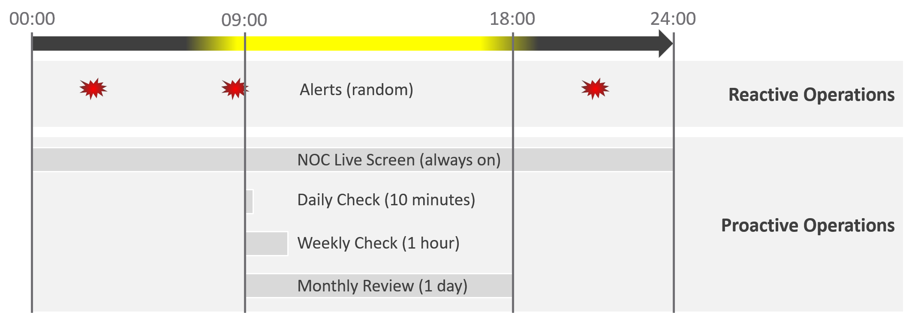

# Proactive operations: dual track, daily cadence, NOC screens and the VM life cycle

## Who does which day
- Day 0 (plan) and Day 1 (design and build) belong to the architecture team; Day 2 (operate) to the operations team.
- In a large estate Day 1 never stops. 6,000 ESXi hosts on a 5-year depreciation means about 100 hosts replaced a month, 25 a week.
- Pillars per phase:

| Phase | Yes | Partial | Not applicable |
|---|---|---|---|
| Day 0: planning | All five | - | - |
| Day 1: design and build | Availability, performance, compliance, capacity | Cost | - |
| Day 2: monitoring | All five | - | - |
| Day 2: troubleshooting | Availability, performance | - | Compliance, capacity, cost |
| Day 2: optimizing | Performance, capacity, cost | Availability | Compliance |

- A major technology upgrade needs planning and redesign: the cycle starts again.

## Dual track: proactive first, reactive as fallback
- Reactive track: a complaint or an alert starts a manual process by the operations team: configuration issue? availability issue? known bug? consumption issue? Then remediation.
- Proactive track, four techniques feeding a human expert, who decides the remediation:
  - automated process: a morning health check of configuration and state, with remediation by rules IT sets;
  - insight: important but not urgent symptoms, reviewed top down by someone who knows the environment;
  - modelling: quantification that makes observability work at scale;
  - monthly performance baselining: overall performance analysis covering Guest OS and VM.
- Remediation examples: vMotion a VM, reboot Windows, restart a pod.

- Troubleshooting cannot be eliminated; regular health checks with automatic remediation reduce it.
- The checks must cover every manual check done today: automate the whole checklist.
- The rules are finite and known: the logic experts use to troubleshoot performance can be automated. Most remediation is moving VMs out of a cluster, which needs no AI and can be automated too.
- Daily check plus remediation, verified by a human, leaves the team free for corner cases.
- The check is short, so it runs twice a day: start and end of the day.

## Day-to-day order
1. Availability: a system that is down has no performance problem.
2. Performance: a system so slow it is as good as down.
3. Security: third, not first, in day-to-day operations.
- Assess all three on both sides of VCF, platform and product (`operations-management/performance/purpose-driven-architecture`).

## A 24-hour day
- Alerts arrive at random times, day and night: reactive.
- Proactive work:
  - NOC live screen: always on;
  - daily check: about 10 minutes at 09:00;
  - weekly check: about 1 hour;
  - monthly review: about 1 day.

- Morning sequence:
  - 08:00-09:00: an automatic health optimization script runs and flags VCF components it cannot remediate.
  - 09:00-09:30: a human expert reviews the script outcome and the daily dashboard, including the alert trend.
  - 09:30-10:00: the team prepares the environment for the day's expected load, for example by approving rebalancing between clusters.
- Cadence by item: critical business applications twice daily (minimum), tracked by both the application and infrastructure teams; daily check twice daily; NOC screens now; log analysis daily; alerts as they come.
- Week-to-year: deep analysis and long-term planning by the Level 2 team, covering capacity, performance and configuration.

## NOC live screen and daily check
- Live screen: real-time data on the NOC wall, always on, auto-refreshing. With clear SOPs it gives Level 1 fewer, better escalations. It covers the hours after the morning check.
- Daily check: insight, not alerts. Insight and alerts complement each other: open both pages side by side.
- Both complement alerts. An alert is bottom up and shows only the tip of the iceberg.
- Real-time screen per pillar (minutes, so capacity rarely matters):
  - availability: undesirable events that do not match what is happening. Many VMs deleted while no deletion is planned means something is wrong;
  - performance: overall performance; check that fluctuation stays within expectation;
  - security: suspicious activity such as firewall rules loosened or administrator accounts used.
- The aim is early warning before any alert fires, to buy time.

## Alerts as guard rails
- An alert is a guard rail: it catches what humans forget and failures that give no warning.
- Operations does not start from alerts. Well-run operations have few alerts.
- Too many alerts overwhelm; too few give no early warning. Insight leads; alerts play a secondary role.
- Proactive operations reduce alerts in count and intensity. Most alerts are yellow (lower threshold); insight from the daily health check replaces them.
- Weekly, review the alerts that slipped through the daily check and NOC screens, and improve the dashboards. Repeated over months, fewer alerts slip through.
- Colours and urgency: `operations-management/performance/alerts-and-insights`.

## Deeper analysis
- Daily check and NOC screens cover at most one day. A quarterly workload pattern is invisible to them.
- Major improvements need monthly or longer analysis with interactive dashboards, such as performance baseline profiling. It has time to run and suits larger, complex and political problems.

## Daily SOP per pillar
- The daily SOP looks ahead, using history and business context.
- Availability:
  - soft errors, which usually need each vendor's logs (vSphere Proactive HA reads hardware health);
  - backups done. Example: snapshots taken on 1,549 VMs and removed on 1,518 means 31 backups likely failed to consolidate their snapshot.
- Performance: insight analysis over the environment; mission-critical VM performance for the next day, from the pattern of the last week and the expected load agreed with the business owner.
- Compliance: non-compliance remediated.
- Security: signs of attack, such as firewall rules loosened or administrator accounts used.
- Configuration: misconfigurations that can cause issues; urgent patches after validation.
- Capacity:
  - VM provisioning, ideally automated through the day; check that the aggregate load does not overwhelm the shared environment;
  - snapshot deletion by policy, for example older than 3 days, with agreed exclusions honoured;
  - powered-off VMs deleted once past the powered-off definition, without waiting another week (backups exist);
  - idle VMs shut down gracefully once past the idle definition.

## Optimization
- Monitoring that finds nothing to fix can still find something to improve.
- Lower cost: reclaim orphaned, powered-off, idle and oversized VMs and snapshots; a smaller data-centre footprint saves software, hardware, rack space, cooling and UPS; move burst capacity from owned to on-demand.
- Better performance: profiling with real baselines; Performance SLAs beside Availability SLAs; NOC dashboards (insight, then alerts); self-service with approval workflows.
- Lower complexity: standard architecture; simpler business and security policy; SOPs; automation against human error; replace ageing hardware and outdated software.
- Customer satisfaction: reputation with application teams (internal IT); repeat business (service provider); price/performance that justifies the price.
- Compliance: internal and industry benchmarks such as VMware hardening guides, CIS, ISO, FISMA, DISA, PCI DSS, HIPAA.

## VM life cycle
- Back each stage with an approval system: every change request and action recorded, which ends finger-pointing and supports audit (who changed which object, when).
- Request: if the VM is free, business justification and IT policy decide; the policy sets the criteria per class. The application team requests the size, approved by its management; IT reviews above a size or count threshold.
- Creation: deployment in vCenter, ideally automated. It sets the VM name, creates folders and places the VM in the right one. Once VCF Operations registers the VM, add it to custom groups and set custom properties.
- Changes: size changes need approval, because they affect capacity and performance. Update shares and reservations to match.
- Retire: delete the VM and remove it from inventory.

## Traps
- "Proactive operations means proactive alerts" → reacting to an alert is reactive. Proactive is the scheduled health check, insight, modelling and baselining.
- "Troubleshooting automation needs AI" → the rules are finite and the usual remediation is moving VMs out of a cluster; rules and automation do it.
- "The morning check covers the whole day" → the NOC live screen covers the rest of the day; the weekly review catches what both missed.
- "The daily check shows every problem" → it covers at most a day; quarterly patterns need monthly baselining.
- "Security comes first in daily operations" → availability, then performance, then security.
- "A snapshot count that differs from the VM count is cosmetic" → snapshots taken but not removed point to failed backup consolidation.
- "Wait a week before deleting powered-off VMs" → once past the definition, delete; backups exist.
- "Day 1 is a project phase that ends" → at thousands of hosts, hardware replacement runs every week.
- "Capacity belongs on the NOC live screen" → live screens span minutes; capacity is a daily and long-term view.

## Metadata
```yaml
id: operations-management/performance/proactive-operations
retriever_guide: how-it-works
scope: operations-management
technology:
- system
pillar:
- availability
- performance
- security
- capacity
- value
product:
- vsphere
- vcf-operations
- kubernetes
- windows
object:
- VirtualMachine
- ClusterComputeResource
- HostSystem
internal_derive:
- operations-management/performance/alerts-and-insights
- operations-management/performance/monitoring-vs-troubleshooting
- operations-management/performance/purpose-driven-architecture
related:
- operations-management/performance/pillars-of-operations
- operations-management/performance/health-risk-efficiency
- operations-management/capacity/rightsizing
- vsphere/technology/storage/concepts/snapshot-impact
images:
  - path: images/reactive-vs-proactive-operations-dual-track-diagram.png
    product: [vsphere, vcf-operations, kubernetes]
    object: [VirtualMachine]
    topic: 'Reactive manual track vs proactive automated, insight, modelling and baselining track'
    image_type: diagram
  - path: images/operations-24-hour-reactive-vs-proactive-timeline.png
    product: [vcf-operations]
    object: [ClusterComputeResource]
    topic: 'Alerts, NOC live screen, daily, weekly and monthly checks over 24 hours'
    image_type: timeline
source:
  document: PART 1 - Concepts of Operations Management.docx
  path: 'Your Private Cloud > SP5 Framework: Process (Proactive Operations, Day-to-day Operations, Real Time, Daily, Optimize, VM Life Cycle) (pp. 58-65); SP5 Framework: Pillars (pillar per phase table)'
corrections: []
review_notes:
- 'Section ''Dual track'': the book says 3 techniques and lists 4 (daily optimization, insight review, performance quantification, monthly baselining); the diagram names them automated process, insight, modelling, monthly performance baselining. Written from the diagram. Q105, Q107.'
- 'Daily check length: about 1 minute (text), 10 minutes (timeline), 5 minutes (monitoring table). Written as 10 minutes from the timeline, short so it can run twice a day. Q105.'
- 'Section ''Who does which day'', table: the troubleshooting row marks compliance not applicable, while the Troubleshoot text says availability, performance and security are troubleshot. Q101.'
- 'Section ''NOC live screen and daily check'': the book says insight and alerts were covered in Part 1; this is Part 1 (Q107).'
- 'Section ''Daily SOP per pillar'', 31 backups: Claude''s subtraction (1,549 - 1,518).'
- 'Section ''Daily SOP per pillar'', Proactive HA reading hardware health: Claude''s knowledge (vSphere Proactive HA uses hardware vendor health providers).'
- 'Not copied: day-to-day operations cadence image (text in A 24-hour day), day-to-day order image (text in Day-to-day order).'
status: draft
```
